# 1. Accès, portail public et espace usager

Ce chapitre présente tout ce que voient les usagers de CityRésa (habitants, associations, entreprises) : la connexion et l'inscription, le catalogue public des espaces, puis leur espace personnel, où ils déposent et suivent leurs demandes de réservation, signent leurs conventions, échangent avec la Ville et, pour les associations, déposent leurs vœux de créneaux et leurs demandes de subvention.

Les agents municipaux y trouveront aussi de quoi accompagner un usager au téléphone : chaque écran est décrit tel que l'usager le voit.

## 1.1 Se connecter

**À quoi ça sert** — Ouvrir sa session sur CityRésa avec son adresse de courriel et son mot de passe. La même page sert aux usagers et aux agents.

**Qui** — Tous : usagers du portail et agents de la Ville.

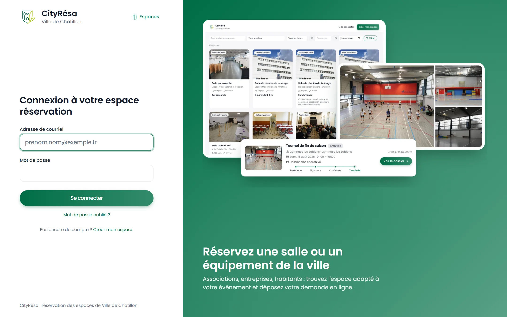
*Figure — la page de connexion : formulaire à gauche, présentation du portail à droite.*

**Ce que l'on voit**
- En haut à gauche, le nom de l'application et de la Ville ; en haut à droite, le lien **Espaces** qui mène au catalogue public sans se connecter.
- Le formulaire « Connexion à votre espace réservation » : **Adresse de courriel**, **Mot de passe** et le bouton **Se connecter**.
- Sous le bouton, les liens **Mot de passe oublié ?** et **Créer mon espace**.
- À droite, un aperçu du portail et le message « Réservez une salle ou un équipement de la ville ».

**Comment faire**
1. Saisissez votre adresse de courriel et votre mot de passe.
2. Cliquez sur **Se connecter**.
3. Un usager arrive sur le portail ; un agent arrive sur son tableau de bord. Si un second facteur est activé sur un compte d'agent, un code à six chiffres de l'application d'authentification est demandé à l'écran suivant.

**Règles à connaître**
- Après plusieurs mots de passe erronés (5 par défaut), le compte est bloqué quelques minutes (15 par défaut) : le message « Trop de tentatives. Réessayez dans … minute(s). » s'affiche.
- Il n'existe pas de mot de passe par défaut : en cas d'oubli, utilisez **Mot de passe oublié ?** (section 1.3).

## 1.2 Créer son espace (inscription)

**À quoi ça sert** — Permettre à un habitant, une association ou une entreprise d'ouvrir lui-même son compte pour réserver en ligne.

**Qui** — Les futurs usagers. Les agents peuvent aussi créer les comptes eux-mêmes depuis le back-office. L'inscription en ligne peut être désactivée par la Ville.

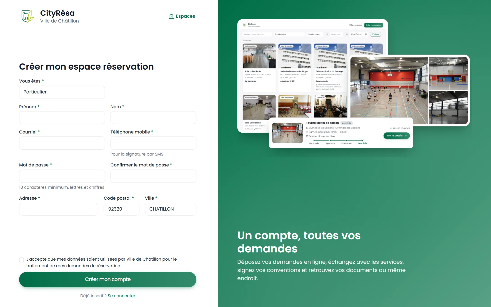
*Figure — le formulaire « Créer mon espace réservation », ici pour un particulier, avec le code postal et la ville pré-remplis.*

**Ce que l'on voit**
- Le choix **Vous êtes** : Particulier, Association, Entreprise ou Autre.
- L'identité : **Prénom**, **Nom**, **Courriel**, **Téléphone mobile** (« Pour la signature par SMS »).
- Le **Mot de passe** et sa confirmation (« 10 caractères minimum, lettres et chiffres »).
- L'**Adresse**, le **Code postal** et la **Ville**, pré-remplis avec ceux de la commune (92320, CHATILLON) et modifiables.
- La case d'acceptation de l'utilisation des données, le bouton **Créer mon compte** et le lien **Se connecter** pour ceux qui ont déjà un compte.

**Comment faire**
1. Choisissez votre situation dans **Vous êtes**.
2. Renseignez votre identité, votre téléphone mobile et votre mot de passe (deux fois).
3. Vérifiez l'adresse : corrigez le code postal et la ville si vous n'habitez pas Châtillon.
4. Pour une association, une entreprise ou « Autre », le formulaire passe en deux étapes : la seconde (« Votre association », « Votre entreprise »…) demande le nom de la structure, l'adresse du siège, le SIRET, le N° RNA pour une association, et le représentant légal (président ou dirigeant ; date de l'assemblée générale qui a nommé le président pour une association).
5. Cochez la case d'acceptation et cliquez sur **Créer mon compte**. Vous êtes connecté directement : « Bienvenue ! Votre espace est prêt. »

**Règles à connaître**
- Les champs marqués d'un astérisque sont ceux exigés avant toute demande de réservation : les remplir dès l'inscription évite d'être bloqué plus tard.
- Le **profil tarifaire** (particulier ou association de la commune, extérieur, entreprise…) est déduit du type et du code postal. La Ville peut le corriger ensuite.
- Les services de la Ville et les autres collectivités ne s'inscrivent pas eux-mêmes : leurs comptes sont créés par les agents.

## 1.3 Mot de passe oublié

**À quoi ça sert** — Recevoir par courriel un lien pour choisir un nouveau mot de passe.

**Qui** — Usagers et agents.

*Figure — la page « Mot de passe oublié » : un seul champ, l'adresse de courriel.*

**Ce que l'on voit**
- Le texte « Indiquez votre adresse : si un compte lui correspond, vous recevez un lien pour choisir un nouveau mot de passe. »
- Le champ **Adresse de courriel**, le bouton **Envoyer le lien** et le lien **Retour à la connexion**.

**Comment faire**
1. Depuis la page de connexion, cliquez sur **Mot de passe oublié ?**.
2. Saisissez votre adresse et cliquez sur **Envoyer le lien**.
3. Ouvrez le courriel reçu et suivez le lien : la page « Choisir un nouveau mot de passe » s'ouvre.
4. Saisissez deux fois le nouveau mot de passe et validez. Si le lien n'est plus valable, cliquez sur **Demander un nouveau lien**.

**Règles à connaître**
- Par discrétion, le message est le même que l'adresse existe ou non.

## 1.4 Le catalogue des espaces

**À quoi ça sert** — Présenter au public tous les espaces réservables de la Ville et permettre de trouver le bon lieu.

**Qui** — Tout le monde, sans être connecté.

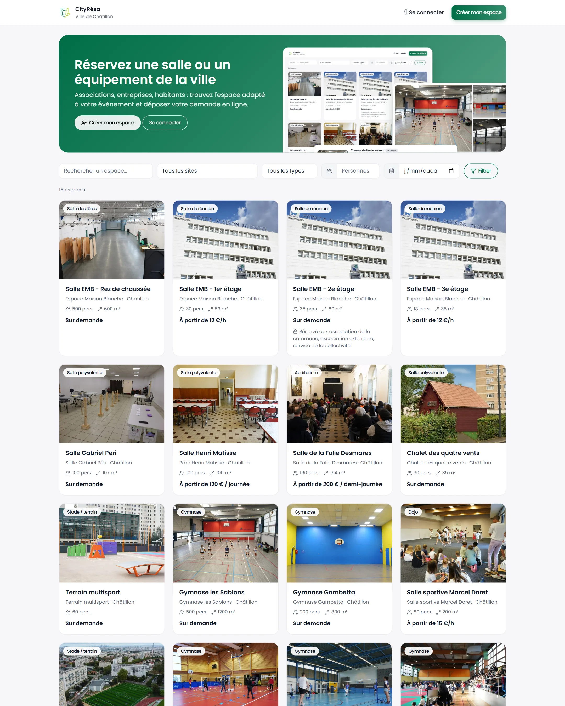
*Figure — l'accueil du portail : bandeau de bienvenue, barre de filtres et cartes des 16 espaces.*

**Ce que l'on voit**
- En haut, les boutons **Se connecter** et **Créer mon espace**, repris dans le bandeau vert.
- La barre de recherche : **Rechercher un espace…**, **Tous les sites**, **Tous les types**, nombre de **Personnes**, date souhaitée, puis le bouton **Filtrer**.
- Le nombre d'espaces trouvés, puis une carte par espace : photo, type (Salle des fêtes, Gymnase, Dojo…), nom, site, capacité, surface et prix (« À partir de 12 €/h », « Sur demande »).
- Certaines cartes signalent un accès limité, par exemple « Réservé aux association de la commune, association extérieure, service de la collectivité ».

**Comment faire**
1. Tapez un mot dans la recherche ou choisissez un site, un type d'espace, un nombre de personnes et une date.
2. Cliquez sur **Filtrer**. Avec une date, seuls les espaces disponibles ce jour-là sont listés. Le bouton **Effacer** remet tous les espaces.
3. Cliquez sur une carte pour ouvrir la fiche de l'espace.

## 1.5 La fiche d'un espace et le simulateur de tarif

**À quoi ça sert** — Tout savoir sur un espace avant de demander une réservation : photos, équipements, tarifs, horaires, règles, adresse et disponibilités. Le simulateur donne une estimation du prix.

**Qui** — Tout le monde ; le bouton de demande mène à la connexion pour un visiteur.

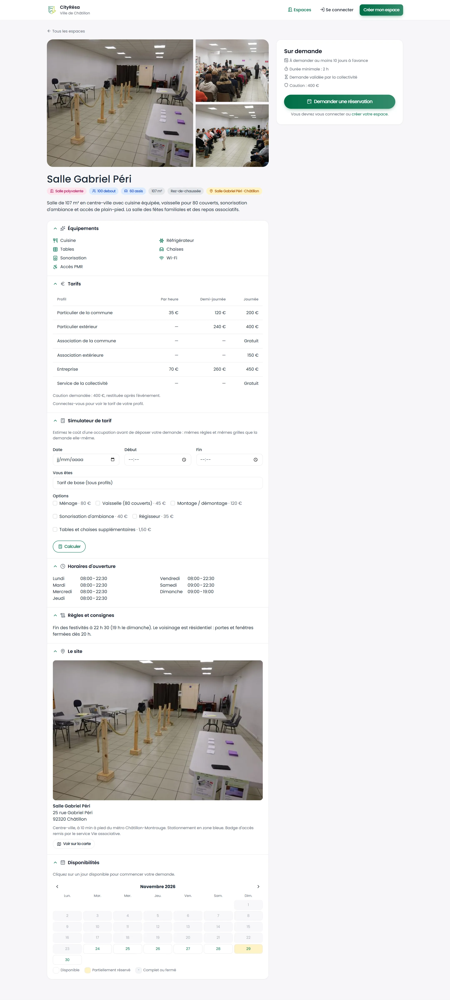
*Figure — la fiche de la Salle Gabriel Péri : photos, conditions de réservation à droite, tarifs, simulateur, horaires et calendrier des disponibilités.*

**Ce que l'on voit**
- Les photos, le nom, des pastilles (type, capacité debout et assise, surface, étage, site) et un descriptif.
- À droite, l'encadré des conditions : « À demander au moins 10 jours à l'avance », « Durée minimale : 2 h », « Demande validée par la collectivité », « Caution : 400 € », et le bouton **Demander une réservation**.
- Des rubriques que l'on peut replier :
  - **Équipements** (cuisine, sonorisation, accès PMR…) ;
  - **Tarifs** par profil, à l'heure, à la demi-journée et à la journée, avec la caution demandée ;
  - **Simulateur de tarif** ;
  - **Horaires d'ouverture** jour par jour ;
  - **Règles et consignes** ;
  - **Le site**, avec l'adresse, l'accès et le lien **Voir sur la carte** ;
  - **Disponibilités** : un calendrier du mois.
- La légende du calendrier : Disponible, Partiellement réservé (jours en jaune), Complet ou fermé.

**Comment faire**
- Estimer un prix :
  1. Dans **Simulateur de tarif**, indiquez la **Date**, le **Début** et la **Fin**.
  2. Choisissez votre profil dans **Vous êtes** (sinon le « Tarif de base » s'applique) et cochez les options souhaitées.
  3. Cliquez sur **Calculer**. Le détail s'affiche avec le total, l'acompte et la caution, et un bouton **Déposer une demande pour ce créneau**.
- Démarrer une demande : cliquez sur **Demander une réservation**, ou sur un jour libre du calendrier (« Cliquez sur un jour disponible pour commencer votre demande. »).

**Règles à connaître**
- Le simulateur applique les mêmes règles que la demande, mais le résultat reste indicatif : le devis définitif est établi avec la demande.
- Connecté, l'usager voit le tarif de son propre profil (« Connectez-vous pour voir le tarif de votre profil »).
- Selon les espaces, un lien **Ajouter au calendrier** permet d'afficher les occupations de l'espace dans un agenda.

## 1.6 Déclaration d'accessibilité et pages réglementaires

**À quoi ça sert** — Informer le public du niveau d'accessibilité du service et des recours possibles, comme l'exige la loi.

**Qui** — Tout le monde.

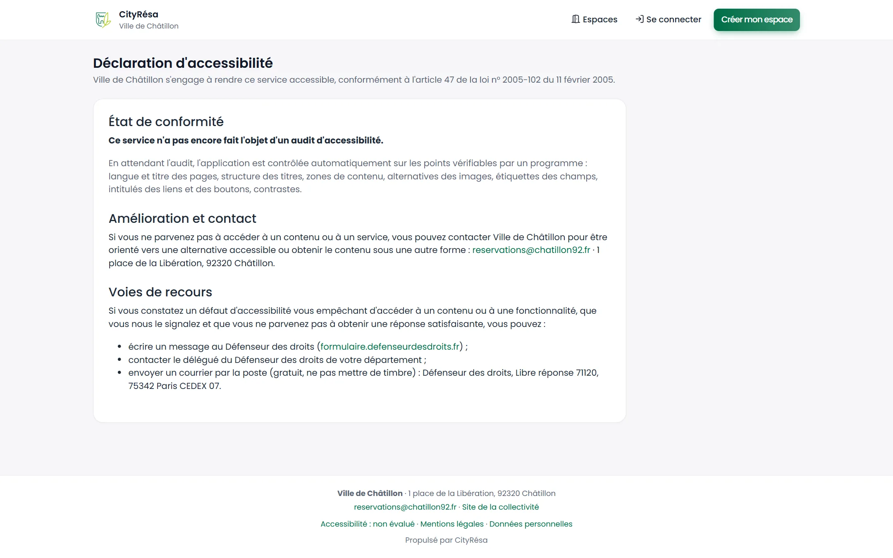
*Figure — la déclaration d'accessibilité : état de conformité, contact et voies de recours.*

**Ce que l'on voit**
- **État de conformité** : ici « Ce service n'a pas encore fait l'objet d'un audit d'accessibilité », avec la liste des points contrôlés automatiquement.
- **Amélioration et contact** : l'adresse de courriel et l'adresse postale de la Ville.
- **Voies de recours** : le Défenseur des droits.
- En pied de page, présent sur tout le portail : coordonnées de la Ville et liens **Accessibilité : non évalué**, **Mentions légales**, **Données personnelles**.

**Comment faire**
1. Cliquez sur **Accessibilité : non évalué** en bas de n'importe quelle page du portail.
2. Les liens **Mentions légales** et **Données personnelles**, à côté, ouvrent les deux autres pages réglementaires.

## 1.7 Mes réservations

**À quoi ça sert** — Suivre toutes ses demandes au même endroit et voir en un coup d'œil ce qu'il reste à faire.

**Qui** — Usagers connectés. Les membres d'une même organisation voient les dossiers de celle-ci.

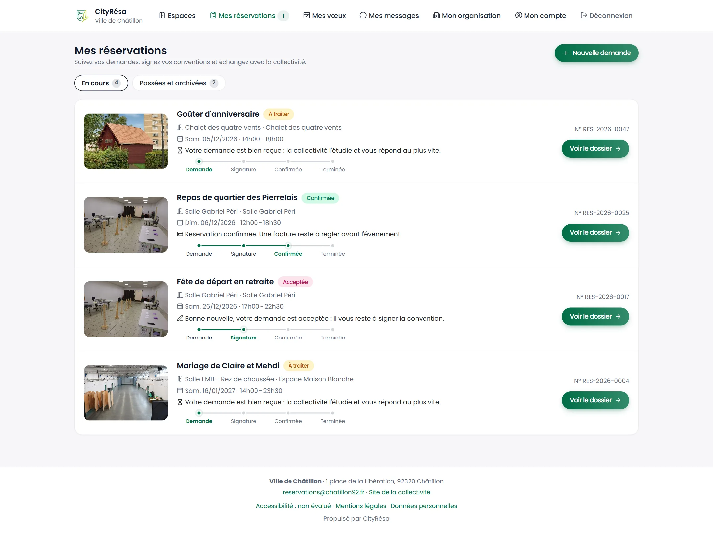
*Figure — « Mes réservations » de Martine Dupont : trois dossiers en cours, chacun à une étape différente.*

**Ce que l'on voit**
- Le menu de l'espace usager : **Espaces**, **Mes réservations**, **Mes vœux**, **Mes messages**, **Mon organisation**, **Mon compte**, **Déconnexion**. Le chiffre à côté de **Mes réservations** compte les conventions à signer ; celui de **Mes messages**, les messages non lus.
- Le bouton **Nouvelle demande** et les onglets **En cours** et **Passées et archivées**, avec leur nombre de dossiers.
- Une ligne par dossier : photo, objet, statut (Confirmée, Acceptée, À traiter…), espace, date et horaires, numéro (N° RES-2026-0025) et bouton **Voir le dossier**.
- Sous chaque dossier, la phrase « prochaine étape » et une frise en quatre étapes : Demande, Signature, Confirmée, Terminée.

**Comment faire**
1. Lisez la phrase de chaque dossier : elle dit ce que vous devez faire, par exemple « il vous reste à signer la convention ».
2. Cliquez sur **Voir le dossier** pour agir (section 1.9).
3. Pour une nouvelle réservation, cliquez sur **Nouvelle demande** : le catalogue s'ouvre et vous choisissez l'espace.

**Règles à connaître**
- Les phrases possibles : « Votre demande est bien reçue… » (à traiter), « La collectivité vous a demandé des précisions… » (en traitement), « il vous reste à signer la convention » (acceptée), « votre réservation sera confirmée à réception de l'acompte » (signée), « Une facture reste à régler avant l'événement » ou « Tout est en ordre » (confirmée).
- Un onglet **Brouillons** apparaît quand vous avez gardé une demande sans l'envoyer : **Reprendre** la rouvre, **Supprimer** l'efface.
- Un bloc **Liste d'attente** apparaît si vous attendez qu'un créneau se libère : vous serez prévenu par courriel. **Retirer** annule l'inscription.

## 1.8 Demander une réservation

**À quoi ça sert** — Déposer une demande : créneau, événement, options et matériel, avec un devis calculé en direct.

**Qui** — Usagers connectés dont le dossier est complet.

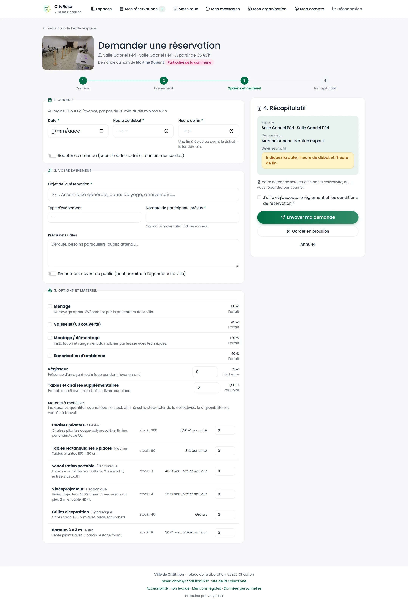
*Figure — le formulaire « Demander une réservation » pour la Salle Gabriel Péri, avec le récapitulatif et le devis à droite.*

**Ce que l'on voit**
- En tête : l'espace, le prix « à partir de » et le demandeur avec son profil (« Demande au nom de Martine Dupont », « Particulier de la commune »).
- Une frise en quatre étapes : Créneau, Événement, Options et matériel, Récapitulatif.
- **1. Quand ?** : rappel des règles de l'espace (« Au moins 10 jours à l'avance, par pas de 30 min, durée minimale 2 h »), **Date**, **Heure de début**, **Heure de fin**, et l'interrupteur **Répéter ce créneau (cours hebdomadaire, réunion mensuelle…)**.
- **2. Votre événement** : **Objet de la réservation**, **Type d'événement**, **Nombre de participants prévus** (avec la capacité maximale), **Précisions utiles**, interrupteur **Événement ouvert au public**.
- **3. Options et matériel** : options payantes (ménage, vaisselle, montage…), avec leur prix et leur mode de calcul (forfait, par heure, par unité), puis le **Matériel à mobiliser** avec le stock et le prix de chaque article.
- **4. Récapitulatif** : espace, demandeur, **Devis estimatif**, case d'acceptation du règlement et boutons **Envoyer ma demande**, **Garder en brouillon** et **Annuler**.

**Comment faire**
1. Choisissez la date et les heures. Une fin à 00:00, ou avant le début, signifie le lendemain.
2. Pour une activité régulière, activez **Répéter ce créneau** : choisissez la fréquence (chaque jour, chaque semaine, chaque mois), l'intervalle (2 = une fois sur deux), la date de fin, les jours de la semaine, et si besoin « hors vacances scolaires », « hors jours fériés » ou des dates à exclure.
3. Renseignez l'objet et le nombre de participants (obligatoires), puis les précisions.
4. Cochez les options et saisissez les quantités de matériel souhaitées. Le devis se met à jour à droite.
5. Cochez **J'ai lu et j'accepte le règlement et les conditions de réservation**, puis cliquez sur **Envoyer ma demande**. Un accusé de réception vous est envoyé par courriel.
6. Pour finir plus tard, cliquez sur **Garder en brouillon** : la saisie est rangée dans l'onglet Brouillons de « Mes réservations ».

**Règles à connaître**
- Les règles de l'espace (délai minimal, horizon maximal, durée, horaires d'ouverture, pas de saisie) sont vérifiées avant l'envoi.
- Le stock de matériel affiché est le stock total. La disponibilité réelle est vérifiée à l'envoi.
- « Votre demande sera étudiée par la collectivité » : l'espace demande une validation. Pour un espace sans validation, la réservation est confirmée dès l'envoi si le créneau est libre.
- **Créneau occupé** : le portail propose **Me prévenir si le créneau se libère** (liste d'attente) et, quand il en trouve, des **Créneaux équivalents libres**.
- Le formulaire est remplacé par un message bloquant dans quatre cas :
  - le compte attend la validation de la Ville, si celle-ci l'exige ;
  - le dossier est incomplet : boutons **Compléter mon organisation** et **Compléter mon compte** ;
  - les pièces justificatives ne sont pas à jour, si la Ville l'exige : bouton **Déposer mes pièces** ;
  - l'espace n'est pas ouvert à votre profil.

## 1.9 Suivre un dossier et signer la convention

**À quoi ça sert** — Consulter le détail d'une demande acceptée et signer électroniquement la convention de mise à disposition.

**Qui** — Le demandeur, ou un membre de son organisation.

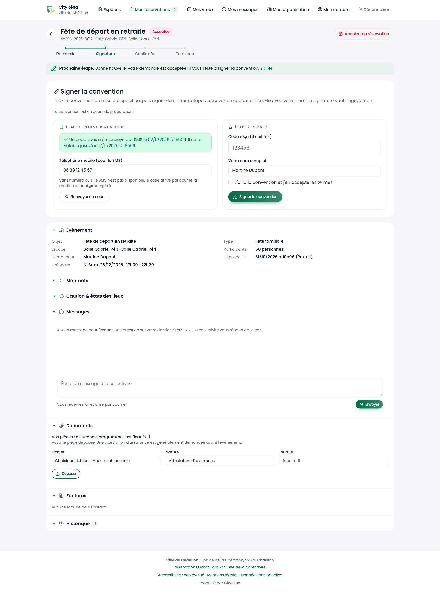
*Figure — un dossier « Acceptée » : la carte « Signer la convention » en deux étapes, puis les rubriques du dossier.*

**Ce que l'on voit**
- En tête : objet, statut, numéro, espace, la frise des étapes et le bouton **Annuler ma réservation**.
- Le bandeau **Prochaine étape** avec le lien **Y aller**.
- La carte **Signer la convention** :
  - **Étape 1 · Recevoir mon code** : la confirmation de l'envoi par SMS et sa date limite, le **Téléphone mobile**, le bouton **Renvoyer un code** ;
  - **Étape 2 · Signer** : **Code reçu (6 chiffres)**, **Votre nom complet**, case **J'ai lu la convention et j'en accepte les termes**, bouton **Signer la convention**.
- Les rubriques du dossier : **Événement**, **Montants** (repliée ici), **Messages**, **Documents**, **Factures**, **Historique**.

**Comment faire**
1. Lisez la convention : quand elle est prête, un lien **Lire la convention (PDF)** apparaît dans la carte. Sur la capture, elle est encore « en cours de préparation ».
2. Demandez le code : il arrive par SMS sur le mobile indiqué, ou par courriel à défaut. **Renvoyer un code** en envoie un nouveau.
3. Saisissez le code à 6 chiffres et votre nom complet, cochez la case, puis cliquez sur **Signer la convention**.
4. Pour poser une question, écrivez dans **Messages** puis cliquez sur **Envoyer**. La réponse arrive aussi par courriel.
5. Pour joindre une pièce (assurance, programme…), utilisez **Documents** : choisissez le fichier, sa **Nature** et un **Intitulé** facultatif, puis cliquez sur **Déposer**.

**Règles à connaître**
- Le code est valable pour une durée limitée, indiquée à l'écran, et cinq essais au plus sont permis. Au-delà, demandez un nouveau code.
- Nom, date, heure et adresse de connexion du signataire sont conservés dans le dossier.
- Des relances automatiques sont envoyées tant que la convention n'est pas signée.
- Si le dossier est une option avec une date limite, il faut signer avant cette date, sinon le créneau est libéré.
- Après la signature, le dossier est confirmé tout de suite s'il n'y a pas d'acompte. Sinon, il passe en « Signée » jusqu'au paiement de l'acompte (section 1.11).
- Si les créneaux changent après la signature, un **avenant** à signer apparaît de la même façon.

## 1.10 Dossier confirmé : montants, factures et annulation

**À quoi ça sert** — Retrouver le détail du prix, les factures à régler et, si besoin, annuler soi-même.

**Qui** — Le demandeur, ou un membre de son organisation.

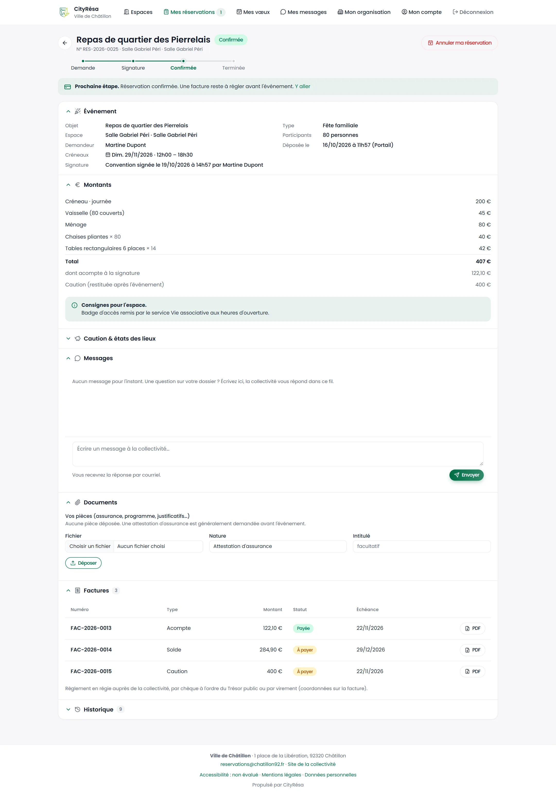
*Figure — un dossier « Confirmée » : signature consignée, détail des montants et trois factures.*

**Ce que l'on voit**
- **Événement** : la ligne **Signature** indique « Convention signée le 10/10/2026 à 15h26 par Martine Dupont ».
- **Montants** : le créneau (« journée »), les options et le matériel ligne par ligne, le **Total**, la part d'acompte à la signature et la **Caution** restituée après l'événement.
- L'encadré **Consignes pour l'espace** (remise du badge d'accès, par exemple).
- La rubrique **Caution & états des lieux**, repliée.
- **Factures** : numéro, type (Acompte, Solde, Caution), montant, statut (**Payée**, **À payer**), échéance, et un bouton **PDF** par facture. En dessous, les modes de règlement acceptés.

**Comment faire**
1. Ouvrez **Factures** et cliquez sur **PDF** pour télécharger une facture.
2. Réglez selon les indications (en régie, par chèque à l'ordre du Trésor public ou par virement). La Ville enregistre le paiement et le statut passe à « Payée ».
3. Pour annuler, cliquez sur **Annuler ma réservation**, indiquez un motif facultatif, puis **Confirmer l'annulation**.

**Règles à connaître**
- L'annulation en ligne n'est possible que jusqu'à un certain délai avant l'événement (7 jours par défaut). Passé ce délai, le bouton disparaît : il faut écrire à la Ville dans le fil de discussion.
- Si la Ville a fixé un barème, la fenêtre d'annulation annonce les frais prévus (montant et pourcentage), qui seront facturés.
- L'annulation est définitive. La Ville en est informée.
- Après l'événement, la rubrique **Caution & états des lieux** indique où en est la caution (restituée ou retenue, avec le motif) et présente les états des lieux, avec leurs photos.
- Des rappels sont envoyés avant l'événement (7 jours et la veille), avec les consignes d'accès.

## 1.11 Convention signée, en attente de l'acompte

**À quoi ça sert** — Montrer l'étape intermédiaire entre la signature et la confirmation, quand un acompte est demandé.

**Qui** — Les usagers dont la réservation est payante (ici, une entreprise).

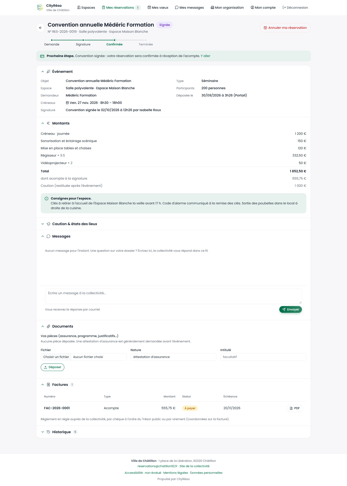
*Figure — un dossier « Signée » de Médéric Formation : convention signée, acompte à payer.*

**Ce que l'on voit**
- Le statut **Signée** et la phrase « Convention signée : votre réservation sera confirmée à réception de l'acompte. »
- **Montants** : location, options, régisseur à l'heure et matériel, total de 1 852,50 €, dont 555,75 € d'acompte à la signature, et caution de 1 000 €.
- **Factures** : une seule facture d'acompte, « À payer », avec son échéance et son **PDF**.

**Comment faire**
1. Cliquez sur **Y aller** dans le bandeau : la page descend aux factures.
2. Téléchargez la facture d'acompte avec **PDF** et réglez-la avant l'échéance.
3. Dès que la Ville enregistre le paiement, le dossier passe en « Confirmée ».

**Règles à connaître**
- L'acompte est un pourcentage du total fixé par la Ville. Le solde est facturé ensuite (total moins acomptes). La caution est facturée à part.

## 1.12 Les réservations d'une association

**À quoi ça sert** — Montrer « Mes réservations » vu par une association, avec un dossier en attente de précisions et une activité régulière.

**Qui** — Les membres d'une association.

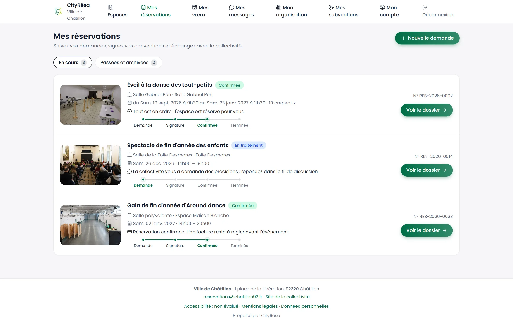
*Figure — « Mes réservations » de l'association Around dance : une activité sur dix créneaux, une demande en traitement et un gala confirmé.*

**Ce que l'on voit**
- Le menu comporte en plus **Mes subventions**.
- « Éveil à la danse des tout-petits » couvre une période (« du Sam. 19 sept. 2026 … au Sam. 23 janv. 2027 · 10 créneaux ») : c'est une réservation récurrente.
- « Spectacle de fin d'année des enfants » est **En traitement** : « La collectivité vous a demandé des précisions : répondez dans le fil de discussion. »

**Comment faire**
1. Pour un dossier « En traitement », ouvrez **Voir le dossier** et répondez dans **Messages**.
2. Une fois la réponse donnée, la Ville reprend l'instruction.

## 1.13 Le dossier d'une réservation récurrente

**À quoi ça sert** — Consulter tous les créneaux d'une activité régulière et leurs montants.

**Qui** — Les usagers ayant une réservation répétée (le plus souvent les associations).

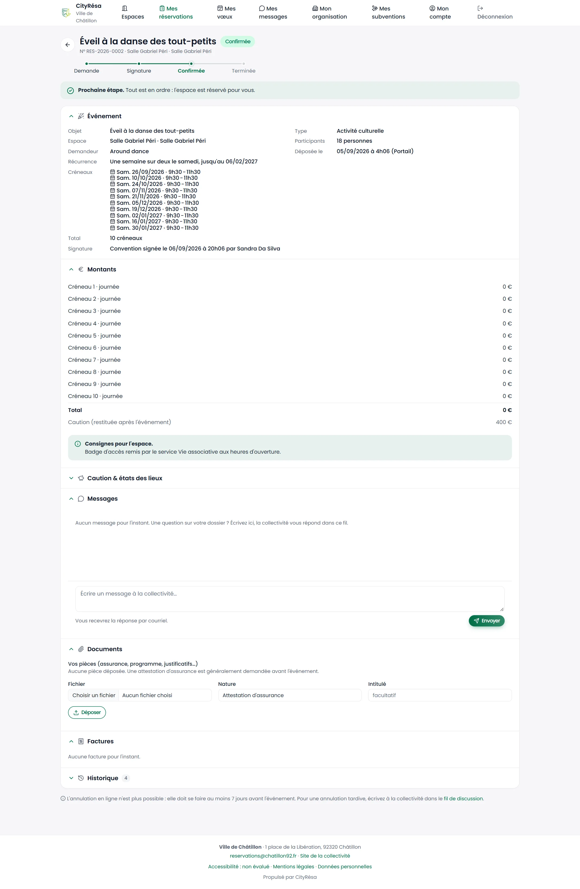
*Figure — le dossier « Éveil à la danse des tout-petits » : règle de récurrence, liste des 10 créneaux et montants à 0 €.*

**Ce que l'on voit**
- **Récurrence** : « Une semaine sur deux le samedi, jusqu'au 27/01/2027 ».
- **Créneaux** : la liste des dates et horaires, puis **Total : 10 créneaux**.
- **Montants** : une ligne par créneau, ici à 0 € (salle gratuite pour une association de la commune), et la caution.
- En bas de page : « L'annulation en ligne n'est plus possible : elle doit se faire au moins 7 jours avant l'événement… » avec un lien vers le fil de discussion.

**Comment faire**
1. Vérifiez la liste des créneaux. Un créneau annulé par la Ville apparaît barré.
2. Pour toute modification (une date à supprimer, un horaire à changer), écrivez à la Ville dans **Messages**.

**Règles à connaître**
- Le délai d'annulation se compte à partir du premier créneau : une fois la série commencée, l'annulation ne se fait plus en ligne.
- Une récurrence compte au plus 200 occurrences.

## 1.14 Mes messages

**À quoi ça sert** — Retrouver tous ses échanges avec la Ville, dossier par dossier.

**Qui** — Usagers connectés.

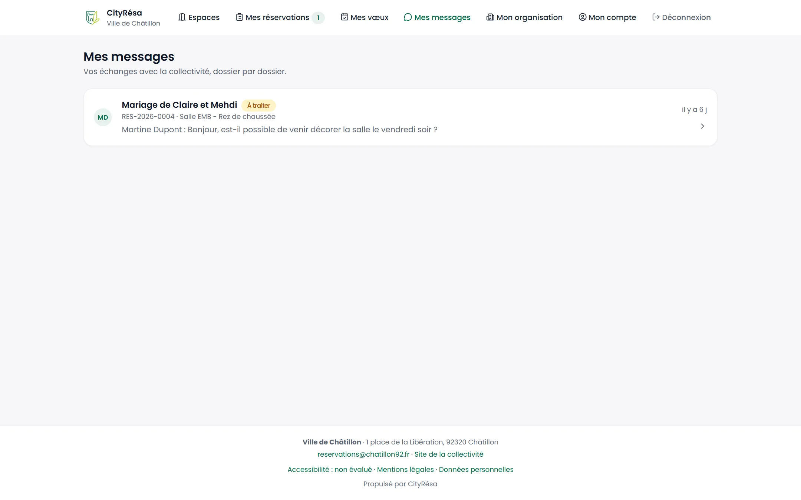
*Figure — « Mes messages » : une conversation sur le dossier « Mariage de Claire et Mehdi ».*

**Ce que l'on voit**
- Une ligne par dossier ayant des messages : initiales de l'auteur, objet, statut, numéro, espace, dernier message et ancienneté (« il y a 2 j »).

**Comment faire**
1. Cliquez sur une ligne : le dossier s'ouvre directement sur sa rubrique **Messages**.
2. Écrivez votre réponse et cliquez sur **Envoyer**.

**Règles à connaître**
- L'usager ne voit jamais les notes internes des agents.
- Le chiffre à côté de **Mes messages** dans le menu compte les messages de la Ville non encore lus.

## 1.15 Mon organisation

**À quoi ça sert** — Tenir à jour la fiche de l'organisation, inviter des membres et déposer les pièces justificatives.

**Qui** — Les membres d'une association, d'une entreprise ou d'une autre structure. Pour un particulier, la page contient seulement ses coordonnées de demandeur.

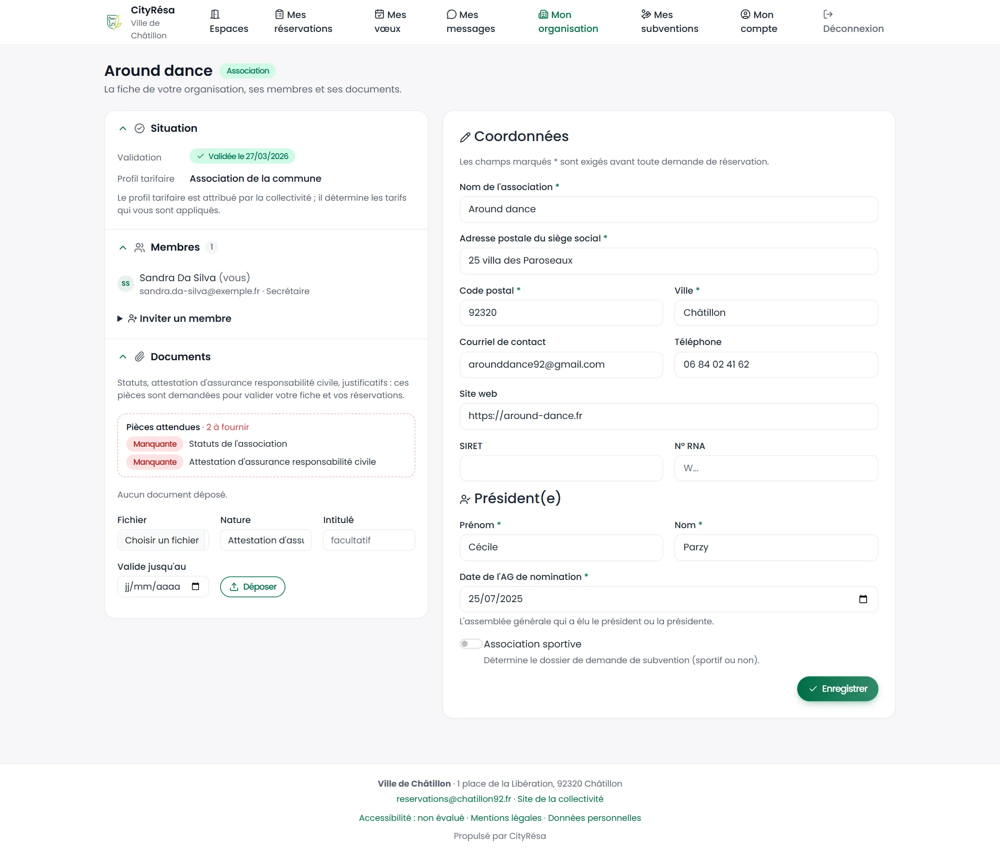
*Figure — la fiche de l'association Around dance : situation validée, un membre, deux pièces manquantes, coordonnées et président(e).*

**Ce que l'on voit**
- **Situation** : la validation (« Validée le 23/03/2026 ») et le **Profil tarifaire** (« Association de la commune »), attribué par la Ville.
- **Membres** : les comptes rattachés, avec leur fonction, et le lien **Inviter un membre**.
- **Documents** :
  - l'encadré **Pièces attendues** (ici « 2 à fournir » : statuts et attestation d'assurance, marqués **Manquante**) ;
  - le formulaire de dépôt : **Fichier**, **Nature**, **Intitulé**, **Valide jusqu'au**, bouton **Déposer**.
- **Coordonnées** : nom, adresse du siège, code postal, ville, courriel, téléphone, site web, SIRET, N° RNA.
- **Président(e)** : prénom, nom, **Date de l'AG de nomination**, et le bouton **Enregistrer**.

**Comment faire**
1. Complétez les champs marqués d'un astérisque, puis cliquez sur **Enregistrer**.
2. Déposer une pièce :
   1. Choisissez le fichier et sa **Nature** (Attestation d'assurance, Statuts, Pièce justificative, Autre).
   2. Indiquez la date de fin de validité dans **Valide jusqu'au**.
   3. Cliquez sur **Déposer**.
3. Inviter un collègue :
   1. Ouvrez **Inviter un membre**.
   2. Saisissez son prénom, son nom et son courriel.
   3. Cliquez sur **Envoyer l'invitation**. La personne reçoit un courriel pour choisir son mot de passe et peut ensuite suivre et déposer les demandes de l'organisation.

**Règles à connaître**
- Données exigées avant toute demande :
  - **association** : nom, adresse du siège, code postal, ville, président (prénom et nom), date de l'AG de nomination, ainsi que prénom, nom, téléphone et courriel du contact ;
  - **entreprise** : raison sociale, SIRET et dirigeant, en plus des mêmes coordonnées ;
  - **particulier** : ses coordonnées seulement.
- Tant qu'il manque une donnée, un bandeau « Votre dossier est incomplet pour déposer une demande » la nomme.
- Une pièce dont la date de validité approche ou est dépassée est signalée, et l'usager est relancé. Selon le réglage de la Ville, une pièce manquante ou expirée peut aussi bloquer le dépôt d'une demande.
- Les attestations annuelles de valorisation des aides en nature déposées par la Ville apparaissent dans ces documents.

## 1.16 Une organisation en attente de validation

**À quoi ça sert** — Montrer ce que voit une organisation nouvellement inscrite tant que la Ville n'a pas vérifié sa fiche.

**Qui** — Les organisations dont la fiche n'est pas encore validée.

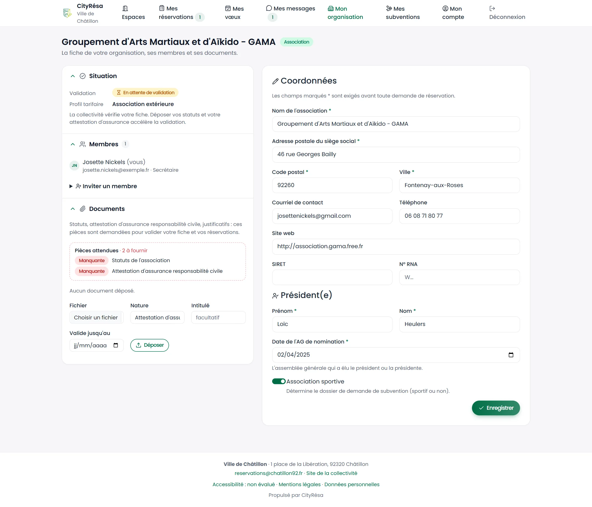
*Figure — la fiche de l'association GAMA, « En attente de validation », avec le profil « Association extérieure ».*

**Ce que l'on voit**
- **Validation** : « En attente de validation ».
- **Profil tarifaire** : « Association extérieure », déduit du code postal du siège (92260, Fontenay-aux-Roses).
- Le message « La collectivité vérifie votre fiche. Déposer vos statuts et votre attestation d'assurance accélère la validation. »

**Comment faire**
1. Déposez les pièces demandées dans **Documents**.
2. Vérifiez et complétez les coordonnées, puis cliquez sur **Enregistrer**.
3. Attendez le courriel de la Ville annonçant la validation.

**Règles à connaître**
- Une organisation non validée peut déposer des demandes, sauf si la Ville a choisi d'exiger la validation d'abord.
- La validation donne accès aux tarifs du profil et aux espaces réservés à certains profils.

## 1.17 Mes vœux de créneaux

**À quoi ça sert** — Déposer, pendant la campagne annuelle, ses souhaits de créneaux hebdomadaires pour toute la saison.

**Qui** — Les organisations (associations surtout), quand la Ville a ouvert une campagne.

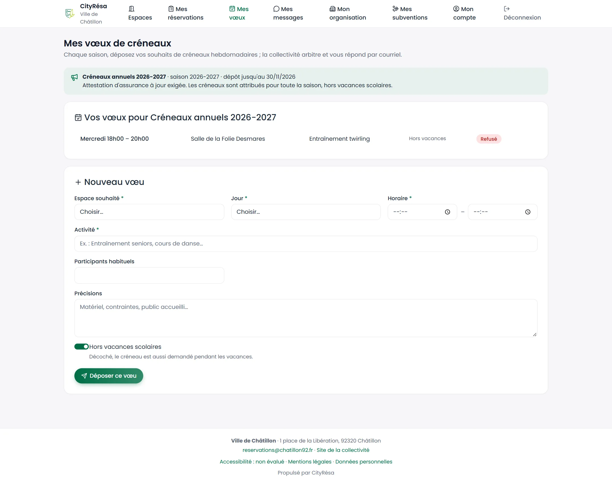
*Figure — « Mes vœux de créneaux » pendant la campagne « Créneaux annuels 2026-2027 » : un vœu déjà refusé et le formulaire « Nouveau vœu ».*

**Ce que l'on voit**
- Le bandeau de la campagne ouverte : nom, saison, date limite (« dépôt jusqu'au 30/11/2026 ») et consignes de la Ville (« Attestation d'assurance à jour exigée… »).
- **Vos vœux pour Créneaux annuels 2026-2027** : jour et horaire, espace, activité, « Hors vacances » ou « Vacances comprises », et statut (ici **Refusé**).
- **Nouveau vœu** : **Espace souhaité**, **Jour**, **Horaire** (début et fin), **Activité**, **Participants habituels**, **Précisions**, interrupteur **Hors vacances scolaires** et bouton **Déposer ce vœu**.

**Comment faire**
1. Choisissez l'espace, le jour de la semaine et l'horaire.
2. Décrivez l'activité (par exemple « Entraînement seniors ») et le nombre de participants habituels.
3. Laissez **Hors vacances scolaires** activé si le créneau n'est pas utile pendant les vacances ; décoché, le créneau est aussi demandé pendant les vacances.
4. Cliquez sur **Déposer ce vœu**. Répétez l'opération pour chaque créneau souhaité.
5. Tant qu'un vœu est « En attente », le bouton **Retirer** permet de l'annuler.

**Règles à connaître**
- Un vœu passe par trois statuts : **En attente**, **Attribué** ou **Refusé**. La décision est envoyée par courriel.
- En cas de conflit entre vœux, la Ville arbitre selon un ordre de priorité :
  1. services de la Ville ;
  2. autres collectivités et établissements scolaires ;
  3. associations conventionnées ;
  4. autres associations ;
  5. entreprises, particuliers et autres.
- Un vœu attribué devient une réservation pour toute la saison, visible dans « Mes réservations » : à signer, ou déjà confirmée si aucune signature n'est attendue.
- Hors campagne, la page affiche « Aucune campagne n'est ouverte au dépôt pour l'instant ».

## 1.18 Mes subventions

**À quoi ça sert** — Suivre les demandes de subvention déposées par l'association.

**Qui** — Les membres d'une association, si la Ville a activé le module des subventions.

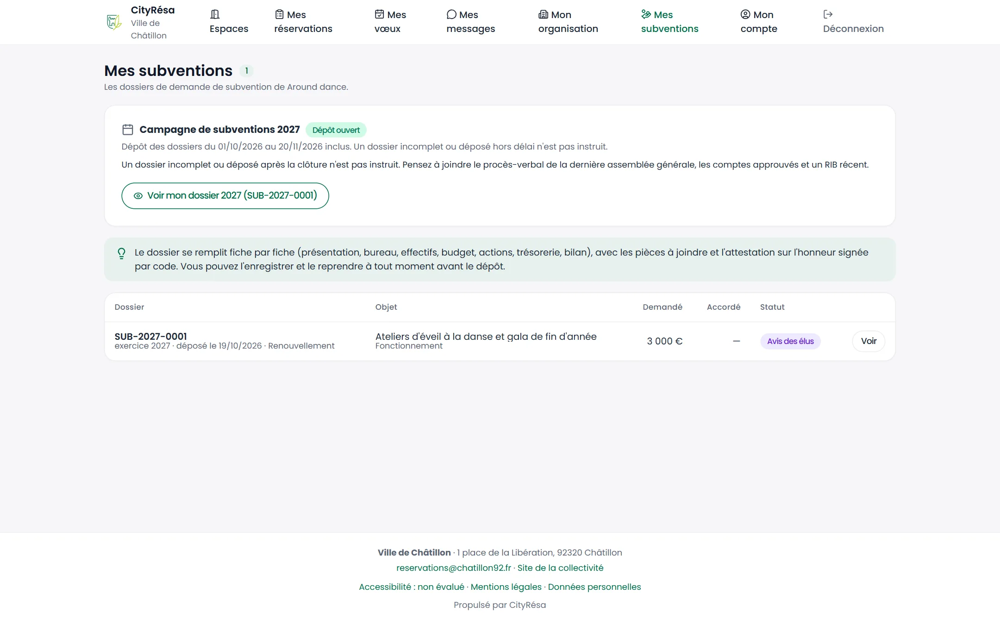
*Figure — « Mes subventions » d'Around dance : une demande de 3 000 € au stade « Avis des élus ».*

**Ce que l'on voit**
- Le bouton **Nouvelle demande**.
- Un tableau des demandes : **Numéro** (SUB-2026-0003), **Exercice**, **Type**, **Objet**, montant **Demandé**, montant **Accordé**, **Statut** et bouton **Voir**.

**Comment faire**
1. Cliquez sur **Voir** pour ouvrir une demande (section 1.20).
2. Cliquez sur **Nouvelle demande** pour en déposer une autre (section 1.19).

**Règles à connaître**
- Les statuts d'une demande : Déposée, En instruction, Avis des élus, Votée, Refusée, Versée.
- Le montant accordé s'affiche une fois la subvention votée.

## 1.19 Déposer une demande de subvention

**À quoi ça sert** — Demander une aide financière pour le fonctionnement de l'association ou pour un projet.

**Qui** — Les membres d'une association.

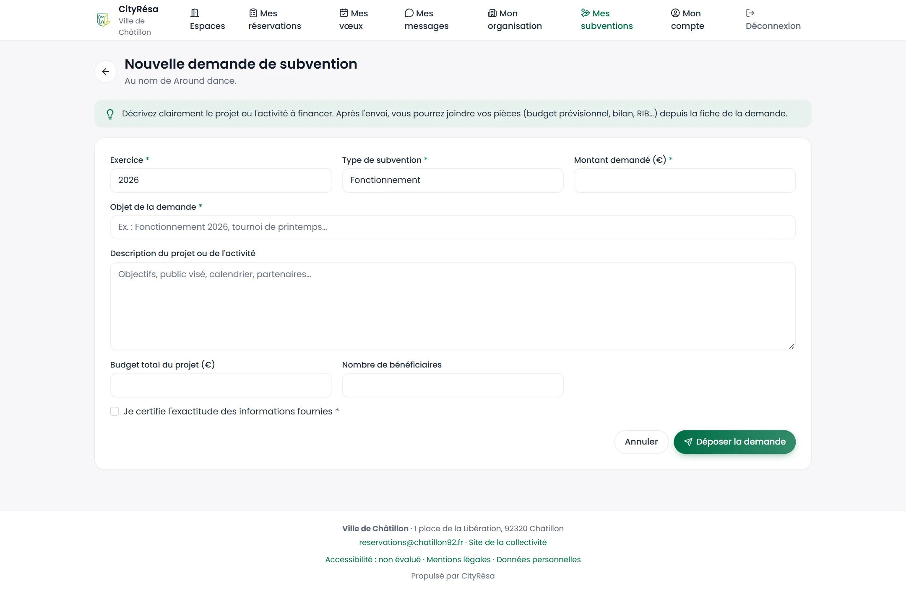
*Figure — le formulaire « Nouvelle demande de subvention » au nom d'Around dance.*

**Ce que l'on voit**
- L'astuce : « Décrivez clairement le projet ou l'activité à financer. Après l'envoi, vous pourrez joindre vos pièces… »
- Les champs **Exercice**, **Type de subvention**, **Montant demandé (€)**, **Objet de la demande**, **Description du projet ou de l'activité**, **Budget total du projet (€)** et **Nombre de bénéficiaires**.
- La case **Je certifie l'exactitude des informations fournies** et les boutons **Annuler** et **Déposer la demande**.

**Comment faire**
1. Choisissez l'exercice et le type (fonctionnement, projet, exceptionnelle, investissement).
2. Indiquez le montant demandé et l'objet, puis décrivez le projet : objectifs, public, calendrier, partenaires.
3. Renseignez le budget total et le nombre de bénéficiaires.
4. Cochez la certification et cliquez sur **Déposer la demande**. Un courriel de réception est envoyé.
5. Ouvrez ensuite la demande pour joindre vos pièces (section 1.20).

## 1.20 Suivre une demande de subvention

**À quoi ça sert** — Voir où en est une demande et y joindre les pièces justificatives.

**Qui** — Les membres de l'association.

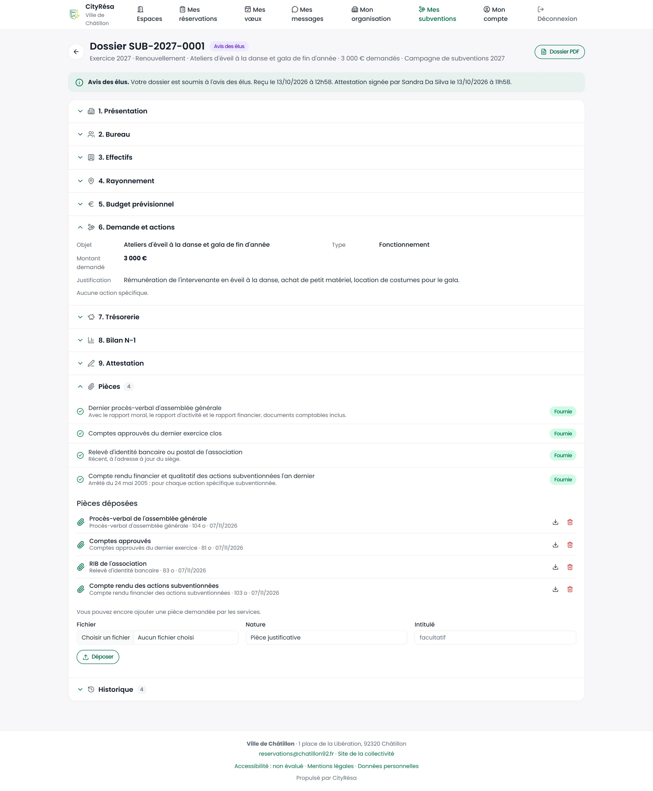
*Figure — la demande SUB-2026-0003 au statut « Avis des élus », sans pièce jointe pour l'instant.*

**Ce que l'on voit**
- En tête : objet, statut, numéro, exercice et type.
- Un bandeau qui explique l'étape : « Votre demande est soumise à l'avis des élus. »
- **Demande** : objet, type, exercice, montant demandé, budget total, bénéficiaires, date de dépôt et auteur, description.
- **Pièces justificatives** : la liste des pièces (« Aucune pièce jointe. ») et le formulaire **Fichier**, **Nature**, **Intitulé**, bouton **Déposer**.

**Comment faire**
1. Dans **Pièces justificatives**, choisissez le fichier (budget prévisionnel, bilan et compte de résultat, rapport d'activité, RIB…).
2. Indiquez sa nature et, si besoin, un intitulé, puis cliquez sur **Déposer**.

**Règles à connaître**
- Les phrases d'étape selon le statut :
  - « Votre demande est enregistrée ; elle sera instruite par les services » ;
  - « en cours d'instruction » ;
  - « soumise à l'avis des élus » ;
  - « La subvention a été votée » ;
  - « La collectivité n'a pas retenu cette demande » ;
  - « La subvention a été versée ».
- La décision est envoyée par courriel.

## 1.21 Mon compte

**À quoi ça sert** — Gérer ses informations personnelles, son mot de passe, l'abonnement de son agenda et ses données personnelles.

**Qui** — Tout usager connecté.

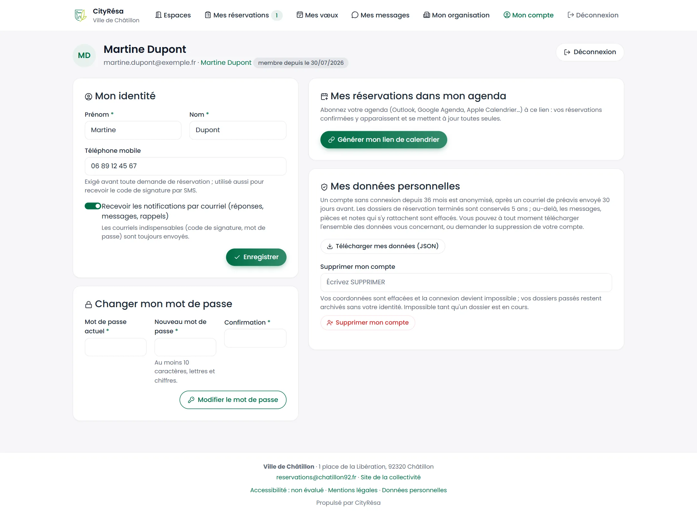
*Figure — la page « Mon compte » de Martine Dupont : identité, mot de passe, lien d'agenda et données personnelles.*

**Ce que l'on voit**
- **Mon identité** :
  - **Prénom**, **Nom** et **Téléphone mobile** (« Exigé avant toute demande de réservation ; utilisé aussi pour recevoir le code de signature par SMS ») ;
  - l'interrupteur **Recevoir les notifications par courriel** ;
  - le bouton **Enregistrer**.
- **Changer mon mot de passe** : mot de passe actuel, nouveau mot de passe et confirmation, puis le bouton **Modifier le mot de passe**.
- **Mes réservations dans mon agenda** : le bouton **Générer mon lien de calendrier**.
- **Mes données personnelles** :
  - les durées de conservation ;
  - le bouton **Télécharger mes données (JSON)** ;
  - le champ **Supprimer mon compte** et son bouton.

**Comment faire**
1. Modifiez vos informations et cliquez sur **Enregistrer**.
2. Changez votre mot de passe en saisissant l'actuel puis deux fois le nouveau, et cliquez sur **Modifier le mot de passe**.
3. Pour voir vos réservations dans Outlook, Google Agenda ou Apple Calendrier :
   1. Cliquez sur **Générer mon lien de calendrier**.
   2. Copiez le lien affiché et abonnez-y votre agenda.
   3. Plus tard, **Nouveau lien** remplace le lien et **Révoquer** le désactive.
4. Pour récupérer vos données, cliquez sur **Télécharger mes données (JSON)**.
5. Pour supprimer votre compte, écrivez SUPPRIMER dans le champ puis cliquez sur **Supprimer mon compte**.

**Règles à connaître**
- Les courriels indispensables (code de signature, mot de passe) sont toujours envoyés, même si les notifications sont désactivées.
- Le lien de calendrier est personnel : ne le partagez pas. Seules les réservations confirmées y apparaissent, et elles se mettent à jour d'elles-mêmes.
- Nouveau mot de passe : au moins 10 caractères, avec des lettres et des chiffres.
- Un compte sans connexion depuis 36 mois est anonymisé, après un courriel de préavis 30 jours avant.
- Les dossiers terminés sont conservés 5 ans. Ensuite, les messages, pièces et notes qui s'y rattachent sont effacés.
- La suppression du compte efface vos coordonnées et rend la connexion impossible. Vos dossiers passés restent archivés sans votre identité. Elle est impossible tant qu'un dossier est en cours.
