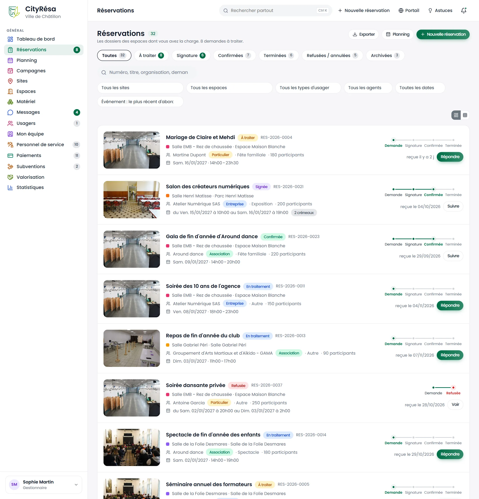
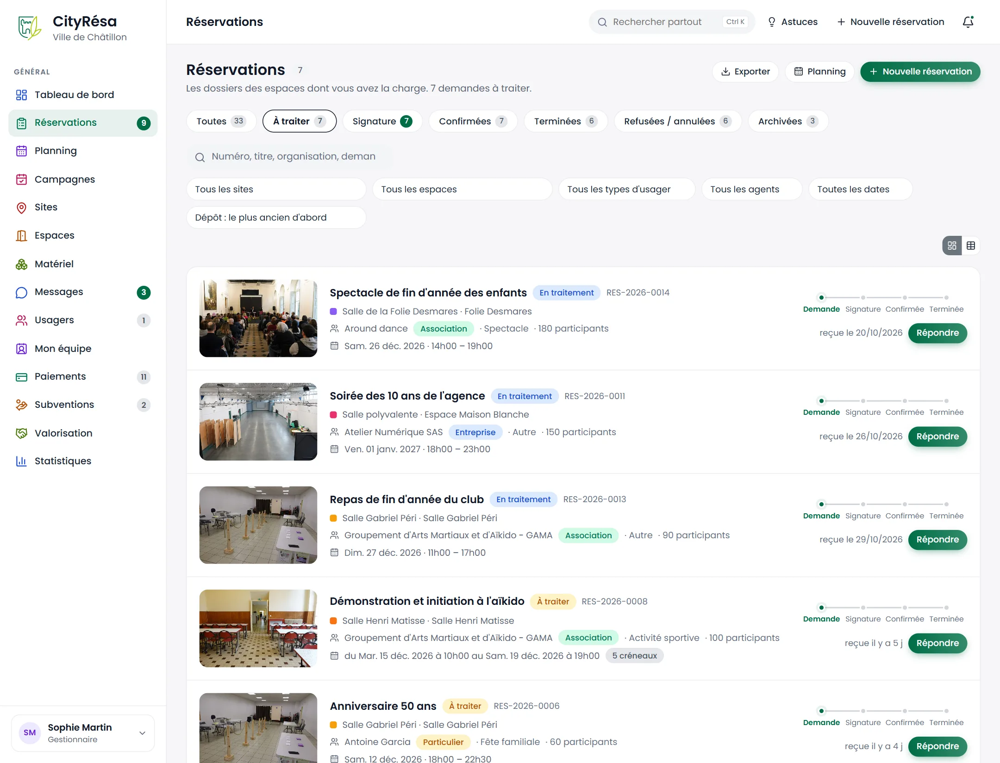
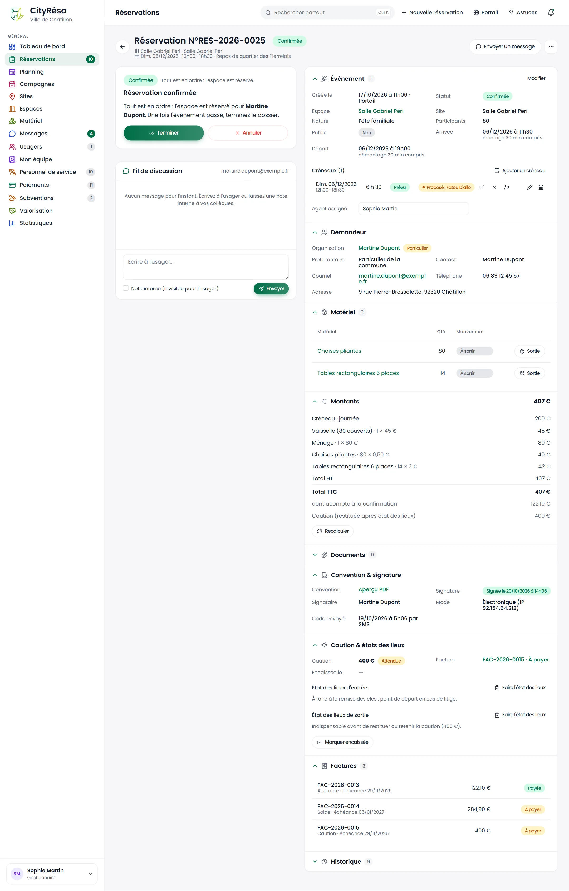
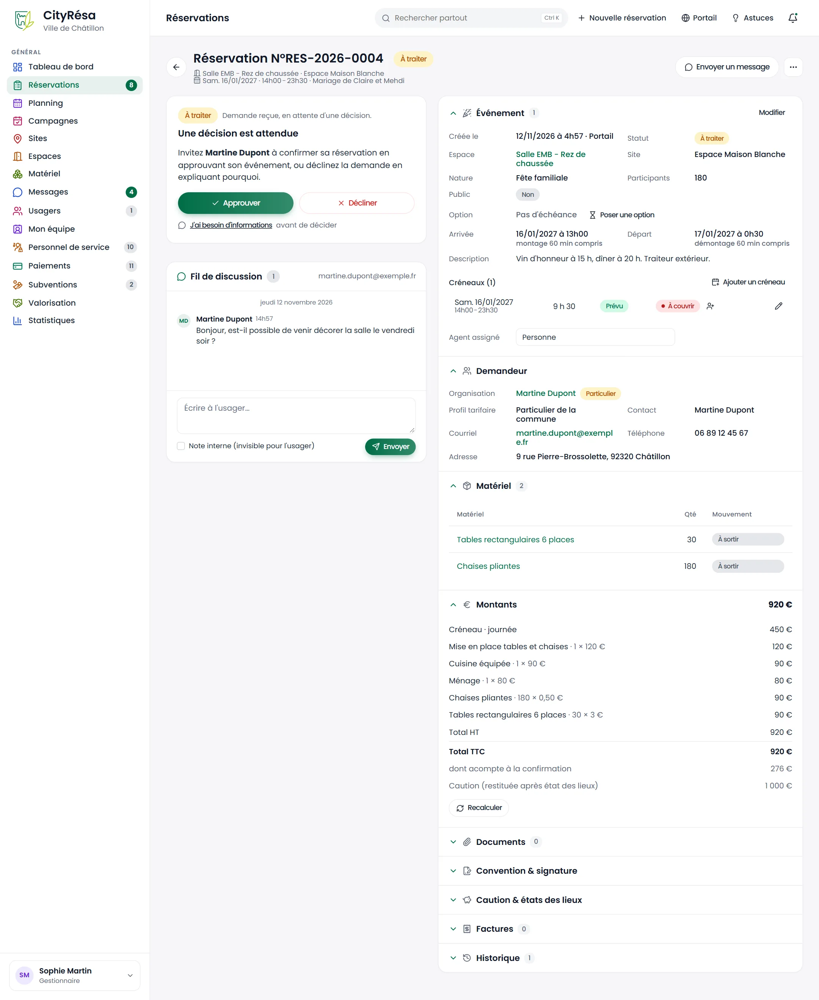
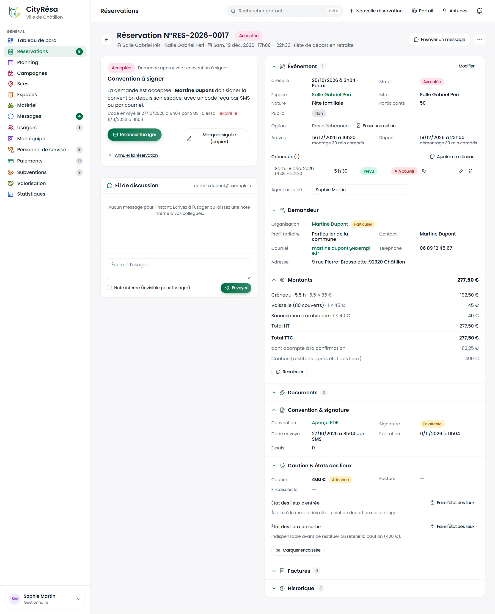
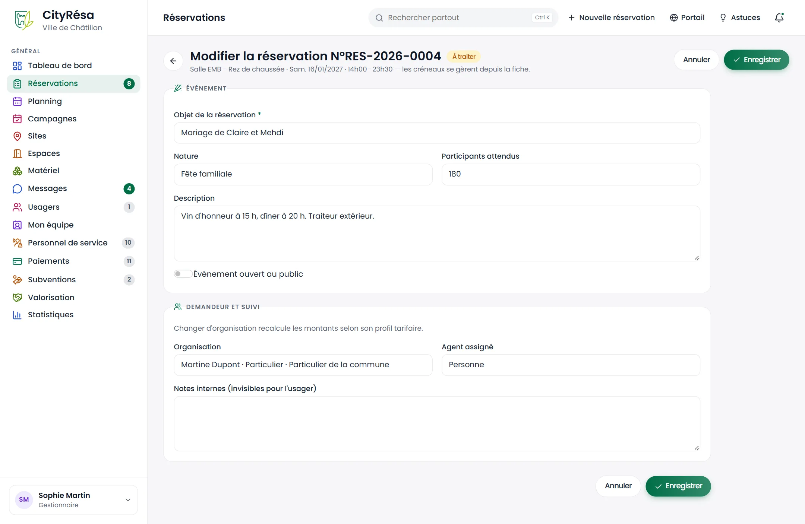
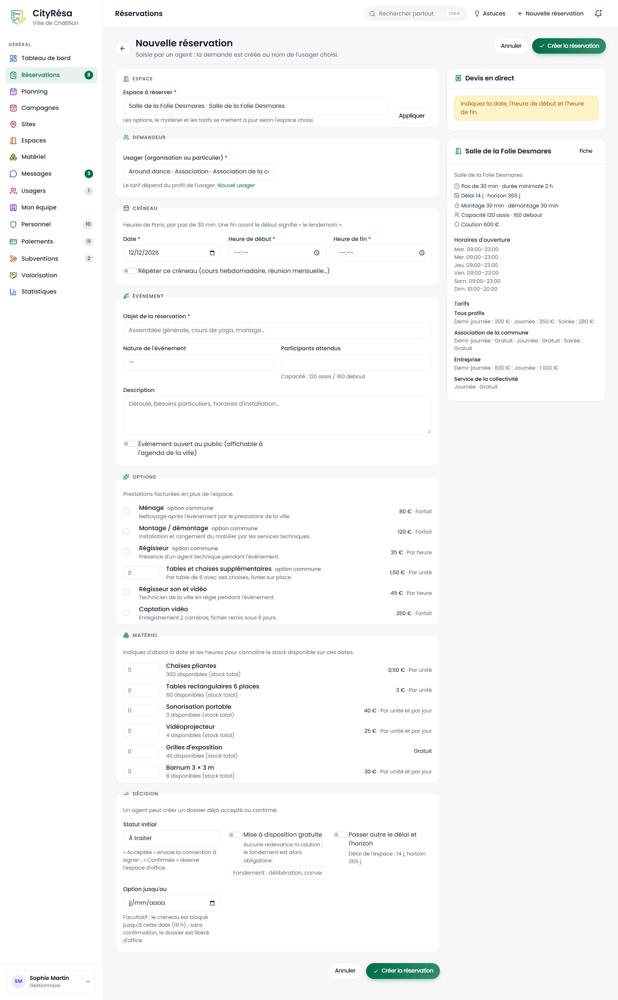
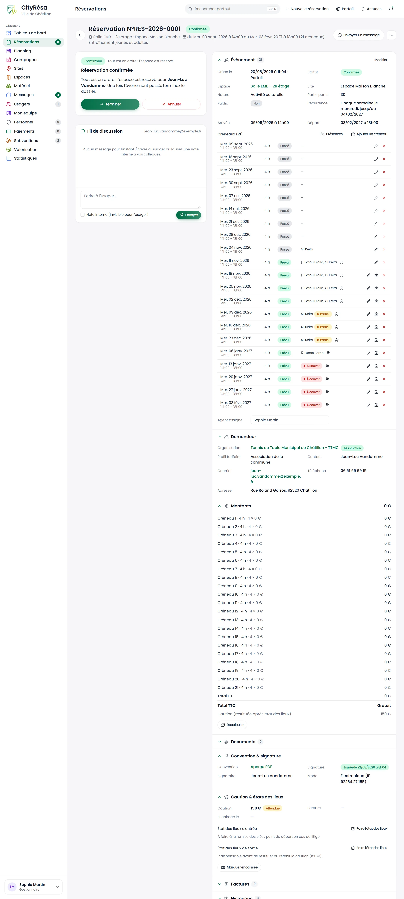
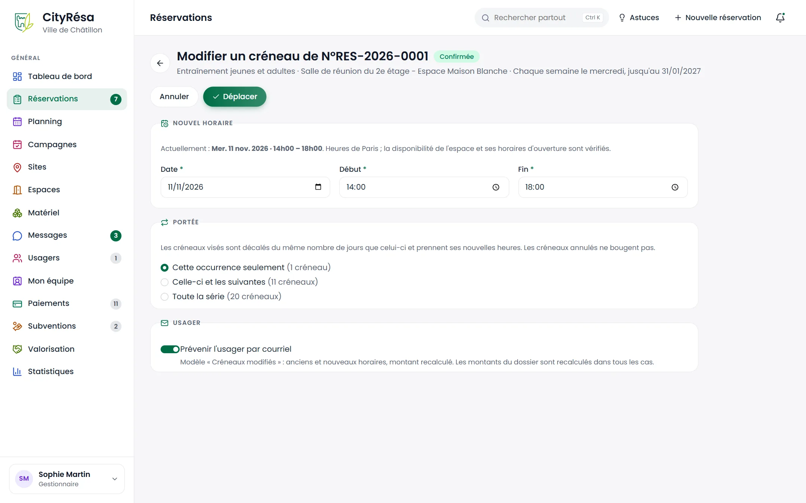
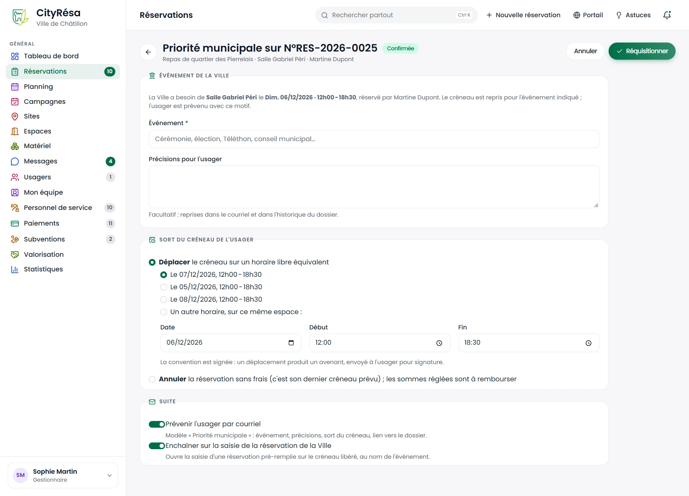

# 2. Les réservations (back-office)

Ce chapitre décrit le traitement des dossiers de réservation par les agents : de la demande reçue sur le portail jusqu'à la clôture du dossier, en passant par la convention, la caution, les factures et les modifications de créneaux.

## 2.1 La liste des réservations

**À quoi ça sert** — Retrouver tous les dossiers de réservation, les trier par statut et ouvrir celui que vous devez traiter.

**Qui** — Tout agent qui a au moins le droit de lecture sur les réservations. Un agent rattaché à certains espaces ne voit que les dossiers de ces espaces ; un agent sans rattachement les voit tous.

*Figure — la liste des réservations, onglet « Toutes », affichée en cartes.*

**Ce que l'on voit**

- En haut à droite : **Exporter** (la liste filtrée en fichier tableur), **Planning** et **Nouvelle réservation**.
- Une rangée d'onglets avec leur compteur : **Toutes**, **À traiter**, **Signature**, **Confirmées**, **Terminées**, **Refusées / annulées**, **Archivées**. L'onglet « Toutes » ne montre pas les dossiers archivés.
- Une zone de recherche (numéro, titre, organisation, demandeur) et des filtres : site, espace, type d'usager, agent assigné, période (ce mois-ci, ce trimestre, cette année, 30 ou 90 derniers jours, 12 derniers mois) et l'ordre de tri.
- Deux petits boutons à droite pour passer de l'affichage en **cartes** à l'affichage en **tableau**.
- Chaque carte présente la photo de l'espace, le titre de l'événement, la pastille de statut, le numéro (RES-AAAA-0001), l'espace et son site, le demandeur avec son type (Particulier, Association, Entreprise…), la nature de l'événement, le nombre de participants, la date et les horaires (et le nombre de créneaux quand il y en a plusieurs).
- À droite de chaque carte, une frise d'avancement en quatre étapes (Demande, Signature, Confirmée, Terminée), la date de réception et un bouton : **Répondre** pour une demande à traiter, **Suivre** pour un dossier accepté, signé ou confirmé, **Voir** pour les autres.

**Comment faire**

1. Cliquez sur **Réservations** dans le menu de gauche.
2. Choisissez un onglet, par exemple **Signature** pour voir les conventions en attente.
3. Affinez avec la recherche ou les filtres ; le lien **Réinitialiser** apparaît dès qu'un filtre est actif.
4. Cliquez sur le titre du dossier ou sur son bouton pour ouvrir la fiche.

**Règles à connaître**

- L'onglet « Signature » regroupe les dossiers acceptés (convention à signer) et signés (en attente d'acompte ou de confirmation).
- L'onglet « Refusées / annulées » regroupe les deux statuts.
- Le nombre de lignes par page est mémorisé pour chaque agent.

## 2.2 Les demandes à traiter

**À quoi ça sert** — Voir d'un coup d'œil les demandes qui attendent une décision, en commençant par les plus anciennes.

**Qui** — Les agents chargés d'instruire les demandes (droit d'écriture sur les réservations).

*Figure — l'onglet « À traiter » : sept demandes, triées du dépôt le plus ancien au plus récent.*

**Ce que l'on voit**

- Les dossiers « À traiter » (demande reçue, aucune décision) et « En traitement » (des précisions ont été demandées à l'usager).
- Le tri par défaut « Dépôt : le plus ancien d'abord ».
- Pour chaque demande, l'ancienneté de réception (« reçue il y a 5 j ») et le bouton **Répondre**.

**Comment faire**

1. Cliquez sur l'onglet **À traiter**. Le compteur vert du menu **Réservations** indique aussi le nombre de demandes en attente.
2. Traitez les demandes de haut en bas : la plus ancienne est en tête.
3. Cliquez sur **Répondre** pour ouvrir le dossier et décider (voir 2.5).

> **Astuce** — Une demande sans réponse depuis plus de sept jours apparaît dans les alertes du tableau de bord.

## 2.3 La fiche d'un dossier

**À quoi ça sert** — Tout savoir d'une réservation sur une seule page et agir sur elle.

**Qui** — Tous les agents qui voient le dossier. Seuls les agents qui ont la main sur l'espace (droit d'écriture sur les réservations et espace dans leur périmètre) voient les boutons de décision ; les autres lisent la mention « Vous n'avez pas la main sur cet espace ».

*Figure — la fiche d'un dossier confirmé : carte de décision et fil de discussion à gauche, sections détaillées à droite.*

**Ce que l'on voit**

- **En-tête** : numéro du dossier, statut, espace, date et titre de l'événement ; bouton **Envoyer un message** et menu « ... » (**Modifier le dossier**, **Convention (PDF)**, **Planning de l'espace**, **Fiche de l'usager**, et pour un administrateur **Supprimer le dossier**).
- **Colonne de gauche** : la carte de décision (son contenu change selon le statut, voir 2.4) puis le fil de discussion (voir 2.7).
- **Colonne de droite**, en sections que l'on replie ou déplie d'un clic sur leur titre :
  - **Événement** : date de création et origine (Portail ou Back-office), statut, espace, site, nature, participants, événement public ou non, récurrence, option, heures d'arrivée et de départ (temps de montage et de démontage compris), description, liste des créneaux, agent assigné, notes internes. Le lien **Modifier** ouvre le formulaire du dossier.
  - **Demandeur** : organisation et son type, profil tarifaire, contact, courriel, téléphone, adresse. Un compte pas encore validé par la Ville porte la mention « Compte non validé ».
  - **Matériel** : le matériel prêté, sa quantité et son mouvement (voir 2.16). La section n'apparaît que si du matériel est demandé.
  - **Montants** : le détail ligne par ligne (créneau, options, matériel), le total HT, la TVA éventuelle, le total TTC, l'acompte et la caution, et le bouton **Recalculer** (voir 2.9).
  - **Documents** : les pièces du dossier et celles de l'organisation ; un formulaire pour déposer une pièce justificative, une attestation d'assurance ou un autre document ; le bouton **Régénérer la convention** une fois le dossier accepté.
  - **Convention & signature**, **Caution & états des lieux**, **Factures** : voir 2.6.
  - **Historique** : chaque étape du dossier, horodatée, avec son auteur.

**Règles à connaître**

- La suppression d'un dossier est réservée à un administrateur, et seulement pour un dossier brouillon, annulé ou refusé. Elle efface définitivement créneaux, messages et pièces.
- Les montants affichés sont recalculés avec les tarifs du moment. Si l'écart avec le montant enregistré est réel, un bandeau jaune vous invite à **Recalculer**.

## 2.4 Le cycle des statuts

**À quoi ça sert** — Comprendre où en est un dossier et ce qu'il est possible de faire ensuite.

**Qui** — Tous les agents.

**Ce que l'on voit** — La pastille de statut figure dans la liste, en tête de fiche et dans la carte de décision, avec une phrase d'explication.

| Statut | Signification | Peut devenir |
| --- | --- | --- |
| Brouillon | Demande non envoyée | À traiter, Annulée |
| À traiter | Demande reçue, en attente d'une décision | En traitement, Acceptée, Confirmée, Refusée, Annulée |
| En traitement | Des informations ont été demandées à l'usager | À traiter, Acceptée, Confirmée, Refusée, Annulée |
| Acceptée | Demande approuvée : convention à signer | Signée, Confirmée, Annulée, En traitement |
| Signée | Convention signée : paiement ou confirmation en attente | Confirmée, Annulée |
| Confirmée | Tout est en ordre : l'espace est réservé | Terminée, Annulée |
| Terminée | L'événement a eu lieu | Archivée |
| Refusée | Demande déclinée (avec motif) | Archivée, À traiter (réouverture) |
| Annulée | Par l'usager ou la collectivité (avec motif) | Archivée |
| Archivée | Dossier clos | — |

La carte de décision propose, selon le statut :

- **À traiter / En traitement** : **Approuver**, **Décliner**, et le lien **J'ai besoin d'informations**.
- **Acceptée** : **Relancer l'usager**, **Marquer signée (papier)** et le lien **Annuler la réservation**.
- **Signée** : **Confirmer** (sans attendre le paiement) et **Annuler** ; **Facturer l'acompte** si aucune facture d'acompte n'a encore été émise.
- **Confirmée** : **Terminer** et **Annuler**.
- **Terminée** : **Archiver**.
- **Refusée** : **Archiver** et **Rouvrir** ; **Annulée** : **Archiver**.

**Règles à connaître**

- Les dossiers à traiter, en traitement, acceptés, signés et confirmés occupent l'espace : le créneau n'est plus disponible pour quelqu'un d'autre.
- Accepter ou confirmer revérifie la disponibilité : si un autre dossier a pris le créneau entre-temps, l'acceptation est refusée avec le nom du dossier en conflit.
- Si la signature électronique est désactivée, une demande acceptée passe directement « Confirmée ».
- Une convention signée sans acompte attendu confirme le dossier d'office ; avec un acompte, le dossier reste « Signée » jusqu'au règlement de l'acompte, qui le confirme automatiquement.
- Un refus ou une annulation libère tous les créneaux du dossier ; le motif est repris dans le courriel envoyé à l'usager.
- Selon le réglage choisi par la Ville, une pièce attendue manquante ou expirée (statuts, assurance) peut bloquer l'acceptation.

## 2.5 Approuver, décliner ou demander des informations

**À quoi ça sert** — Rendre une décision sur une demande reçue.

**Qui** — Les agents qui ont la main sur l'espace concerné.

*Figure — une demande « À traiter » : la carte « Une décision est attendue » avec ses boutons, le message de l'usager et le détail du dossier.*

**Ce que l'on voit**

- La carte **Une décision est attendue** avec les boutons **Approuver** et **Décliner**, et le lien **J'ai besoin d'informations** avant de décider.
- Le fil de discussion, où figure ici une question de l'usager.
- À droite, les sections Événement (avec la ligne **Option**), Demandeur, Matériel (« À sortir »), Montants avec acompte et caution, puis les sections repliées.

**Comment faire — approuver**

1. Cliquez sur **Approuver**. Un panneau s'ouvre sur la droite.
2. Vérifiez le récapitulatif (espace, dates, demandeur et profil).
3. Ajustez si besoin les **Options** et le **Matériel** (le stock disponible est vérifié).
4. Dans **Tarification**, activez **Mise à disposition gratuite** si la gratuité est accordée et indiquez son fondement (voir 2.9). Le montant se recalcule en direct.
5. Ajoutez un **Message à l'usager** facultatif (consignes d'accès, personne à contacter…).
6. Cliquez sur **Approuver**. L'usager reçoit l'acceptation, la convention à signer et votre message.

**Comment faire — décliner**

1. Cliquez sur **Décliner**.
2. Saisissez le **Motif du refus** (obligatoire) : il est transmis à l'usager par courriel.
3. Validez avec **Décliner**.

**Comment faire — demander des informations**

1. Cliquez sur **J'ai besoin d'informations**.
2. Rédigez le **Message à l'usager** (obligatoire), par exemple pour réclamer une attestation d'assurance.
3. Cliquez sur **Envoyer**. Le message part dans le fil de discussion et par courriel ; la demande passe « En traitement ».
4. Quand l'usager a répondu, revenez sur le dossier et décidez avec **Approuver** ou **Décliner**.

**Règles à connaître**

- L'approbation passe outre le délai minimal et l'horizon de réservation de l'espace : c'est l'agent qui décide.
- Un dossier refusé peut être rouvert avec **Rouvrir** : il repasse « À traiter ».

## 2.6 Convention, signature, caution et factures

**À quoi ça sert** — Suivre la signature de la convention, la caution avec les états des lieux, et les factures du dossier.

**Qui** — Les agents qui ont la main sur l'espace ; l'émission de factures demande en plus le droit d'écriture sur les paiements. La validation d'une retenue de caution importante revient à un administrateur.

*Figure — un dossier « Acceptée » : convention à signer, code envoyé par SMS, sections Convention & signature et Caution & états des lieux dépliées.*

**Ce que l'on voit**

- La carte **Convention à signer** : la date d'envoi du code (SMS ou courriel), le nombre d'essais et l'expiration ; les boutons **Relancer l'usager** et **Marquer signée (papier)** ; le lien **Annuler la réservation**.
- La section **Convention & signature** : lien **Aperçu PDF**, état de la signature (En attente, puis « Signée le… »), signataire, mode (électronique avec adresse IP, ou papier enregistré par un agent), code envoyé, expiration, essais. Les avenants éventuels y sont listés (voir 2.13).
- La section **Caution & états des lieux** : montant et état de la caution, facture de caution, date d'encaissement, puis les blocs **État des lieux d'entrée** et **État des lieux de sortie** avec le bouton **Faire l'état des lieux**, et le bouton **Marquer encaissée**.
- La section **Factures** (repliée ici, car vide) : numéro, type (acompte, solde, caution, frais d'annulation), échéance, montant et statut.

**Comment faire — la convention**

1. L'usager signe depuis son espace avec un code reçu par SMS ou par courriel. Vous n'avez rien à faire, sinon le relancer avec **Relancer l'usager** si besoin.
2. Si l'usager a signé sur papier, cliquez sur **Marquer signée (papier)**, saisissez le **Nom du signataire** puis **Marquer signée**. La convention signée est régénérée et le dossier avance.

**Comment faire — la caution**

1. Quand la caution est reçue, cliquez sur **Marquer encaissée** (ou enregistrez le paiement de la facture de caution).
2. À la remise des clés, cliquez sur **Faire l'état des lieux** dans le bloc d'entrée : observations, case des dégâts, nom de l'usager présent, photos. Validez avec **Enregistrer**.
3. Après l'événement, faites de même pour l'état des lieux de sortie.
4. Cliquez sur **Restituer** pour rendre la caution en totalité, ou sur **Retenir tout ou partie** en indiquant le montant et le motif.

**Comment faire — les factures**

1. Dans la section **Factures**, utilisez **Facturer l'acompte**, **Facturer le solde** ou **Facturer la caution** selon le besoin.
2. Cliquez sur le numéro d'une facture pour l'ouvrir dans le module Paiements.

**Règles à connaître**

- La caution entre dans son cycle dès que le dossier est accepté : attendue, puis encaissée, puis restituée ou retenue.
- La restitution n'est possible qu'après l'état des lieux de sortie. Une retenue doit être motivée.
- Au-delà du seuil fixé dans les paramètres, une retenue attend la validation d'un administrateur (bouton **Valider la retenue**) avant que l'usager soit prévenu.
- Les photos des états des lieux sont visibles par l'usager depuis son dossier.
- Les factures ne s'émettent que pour un dossier signé, confirmé ou terminé, et jamais pour une mise à disposition gratuite.
- À la confirmation, la facture d'acompte (ou de solde s'il n'y a pas d'acompte) est émise automatiquement quand le module Paiements est actif.

> **Attention** — Sur cette capture, la caution de 400 € porte encore la mention « Sans caution » : c'est une particularité des données de démonstration. Sur un dossier réel accepté, elle indique « Attendue ».

## 2.7 Fil de discussion et notes internes

**À quoi ça sert** — Échanger avec l'usager au sujet de son dossier et laisser des notes à vos collègues.

**Qui** — Les agents qui ont le droit d'écriture sur les réservations.

**Ce que l'on voit** — Dans la colonne de gauche de la fiche, le **Fil de discussion** : l'adresse de l'usager en en-tête, les messages regroupés par jour, avec leur auteur et leur heure. Une note interne porte la pastille « Note interne » ; un message de l'usager non lu porte la pastille « Nouveau ».

**Comment faire**

1. Écrivez votre texte dans la zone **Écrire à l'usager…** (ou cliquez sur **Envoyer un message** en haut de la fiche pour y accéder directement).
2. Pour une note réservée aux agents, cochez **Note interne (invisible pour l'usager)**.
3. Cliquez sur **Envoyer**.

**Règles à connaître**

- Un message à l'usager lui est envoyé par courriel et apparaît dans ses notifications.
- Un message de l'usager prévient les agents de l'espace (cloche et courriel) et apparaît dans la boîte **Messages**.
- Une note interne ne quitte pas le back-office. Le champ **Notes internes** du formulaire du dossier (voir 2.10) sert aux remarques durables.

## 2.8 Option avec échéance et liste d'attente

**À quoi ça sert** — Bloquer un créneau pour un usager jusqu'à une date limite, puis le libérer automatiquement s'il ne s'est pas engagé. Prévenir les personnes qui attendent qu'un créneau se libère.

**Qui** — Les agents qui ont la main sur l'espace.

**Ce que l'on voit** — Dans la section **Événement**, la ligne **Option** indique « Pas d'échéance » ou la pastille « Option jusqu'au… (dans N jours) », avec les boutons **Poser une option**, **Modifier** et **Lever**.

**Comment faire**

1. Sur un dossier à traiter, en traitement ou accepté, cliquez sur **Poser une option**.
2. Indiquez la **Date limite** et l'**Heure** (18 h par défaut).
3. Cliquez sur **Poser l'option**.
4. Pour supprimer l'échéance, cliquez sur **Lever**.

Vous pouvez aussi poser l'option dès la saisie d'une réservation, avec le champ **Option jusqu'au** (voir 2.11).

**Règles à connaître**

- Pendant l'option, le créneau reste bloqué. L'usager voit l'échéance sur son dossier.
- L'usager est relancé quelques jours avant l'échéance (nombre de jours réglé dans les paramètres).
- À l'échéance, si rien n'a été signé ni confirmé, le dossier est annulé d'office sans frais, avec un motif explicite, et les agents sont prévenus.
- L'option tombe d'elle-même dès que le dossier est signé ou confirmé.
- Le tableau de bord signale les options qui arrivent à échéance.
- **Liste d'attente** : sur le portail, un usager dont la demande bute sur un créneau occupé peut s'inscrire pour être prévenu. Dès qu'un créneau de l'espace se libère (annulation, refus, option expirée, créneau annulé ou déplacé), les inscrits concernés reçoivent un courriel avec la demande pré-remplie, une seule fois. Le premier qui redépose sa demande obtient le créneau. La fiche de l'espace liste les inscrits ; un agent ne peut pas inscrire un usager lui-même.

## 2.9 Gratuité et recalcul des montants

**À quoi ça sert** — Accorder une mise à disposition gratuite et remettre les montants d'un dossier à jour.

**Qui** — Les agents qui ont la main sur l'espace.

**Ce que l'on voit** — Quand la gratuité est accordée, l'en-tête de la section **Montants** porte la pastille « Gratuité » et son fondement ; les lignes du devis restent affichées pour mémoire, à zéro.

**Comment faire — accorder la gratuité**

1. À l'approbation (panneau **Approuver**) ou à la saisie d'une réservation (section **Décision**), activez **Mise à disposition gratuite**.
2. Saisissez le fondement : délibération, convention, intérêt général…
3. Terminez l'approbation ou la saisie.

**Comment faire — recalculer**

1. Dans la section **Montants**, cliquez sur **Recalculer**.
2. Les montants du dossier sont mis à jour avec les tarifs en vigueur, les options, le matériel et le profil actuel du demandeur.

**Règles à connaître**

- Le fondement de la gratuité est obligatoire ; il figure sur la convention et sur l'attestation de valorisation de l'association.
- La gratuité met à zéro la redevance et la caution ; aucune facture n'est émise.
- Une modification de la grille tarifaire ne change jamais un dossier existant : seul un clic sur **Recalculer** (ou une modification du dossier) le met à jour. Chaque créneau est tarifé selon la grille en vigueur à sa date.
- Changer l'organisation d'un dossier, ajouter, annuler ou déplacer un créneau recalcule aussi les montants.

## 2.10 Modifier un dossier et le réaffecter

**À quoi ça sert** — Corriger les informations d'un dossier et désigner l'agent qui le suit.

**Qui** — Les agents qui ont le droit d'écriture sur les réservations.

*Figure — le formulaire « Modifier la réservation » : événement, demandeur, agent assigné et notes internes.*

**Ce que l'on voit**

- La section **Événement** : objet de la réservation (obligatoire), nature, participants attendus, description, interrupteur **Événement ouvert au public**.
- La section **Demandeur et suivi** : organisation, agent assigné, notes internes (invisibles pour l'usager).
- Le rappel en tête : les créneaux se gèrent depuis la fiche, pas depuis ce formulaire.

**Comment faire — modifier**

1. Sur la fiche, cliquez sur **Modifier** (section Événement) ou sur **Modifier le dossier** dans le menu « ... ».
2. Corrigez les champs voulus.
3. Cliquez sur **Enregistrer**.

**Comment faire — réaffecter**

1. Sur la fiche, dans la section **Événement**, choisissez un collègue dans la liste **Agent assigné** : l'enregistrement est immédiat.
2. Choisissez **Personne** pour retirer l'assignation.

**Règles à connaître**

- Changer d'organisation recalcule les montants selon son profil tarifaire.
- L'agent désigné reçoit une notification « Dossier assigné ».
- Le filtre **Tous les agents** de la liste permet de retrouver les dossiers d'un agent, ou ceux qui ne sont assignés à personne.

## 2.11 Créer une réservation au nom d'un usager

**À quoi ça sert** — Saisir une demande reçue par téléphone, courriel ou au guichet, ou réserver pour un service de la Ville.

**Qui** — Les agents qui ont le droit d'écriture sur les réservations.

*Figure — la saisie d'une réservation pour l'association Around dance à la Salle de la Folie Desmares : formulaire complet à gauche, devis en direct et résumé de l'espace à droite.*

**Ce que l'on voit**

- **Espace** : le champ **Espace à réserver** et le bouton **Appliquer**. Les options, le matériel et les tarifs suivent l'espace choisi.
- **Demandeur** : la liste **Usager (organisation ou particulier)**, qui affiche le type et le profil tarifaire, et le lien **Nouvel usager**.
- **Créneau** : **Date**, **Heure de début**, **Heure de fin** (par pas de 30 minutes pour cet espace) et l'interrupteur **Répéter ce créneau**.
- **Événement** : objet, nature, participants attendus (avec le rappel de la capacité de la salle), description, interrupteur **Événement ouvert au public**.
- **Options** : chaque prestation avec sa description et son prix (forfait, à l'heure ou à l'unité).
- **Matériel** : chaque article avec son stock et son tarif. Tant que la date et les heures ne sont pas saisies, c'est le stock total qui s'affiche.
- **Décision** : **Statut initial**, **Mise à disposition gratuite** et son fondement, **Passer outre le délai et l'horizon** (avec le rappel du délai de l'espace) et **Option jusqu'au**.
- À droite : le **Devis en direct**, qui demande d'abord la date et les heures, puis le résumé de l'espace. On y trouve le pas de réservation, la durée minimale, le délai, l'horizon, le montage, le démontage, la capacité et la caution, puis les horaires d'ouverture et les tarifs par profil, avec un lien **Fiche**.

**Comment faire**

1. Cliquez sur **Nouvelle réservation** (en haut de chaque page, dans la liste ou dans le planning). Un clic sur une case vide du planning ouvre aussi cette page avec l'espace et la date déjà remplis.
2. Choisissez l'**Espace à réserver** puis cliquez sur **Appliquer**.
3. Dans **Demandeur**, choisissez l'usager (organisation ou particulier). S'il n'existe pas encore, utilisez le lien **Nouvel usager**.
4. Dans **Créneau**, saisissez la date, l'heure de début et l'heure de fin. Une fin avant le début signifie « le lendemain ».
5. Pour une activité régulière, activez **Répéter ce créneau** (voir ci-dessous).
6. Dans **Événement**, saisissez l'objet, la nature, les participants, la description et précisez si l'événement est ouvert au public.
7. Cochez les **Options** et le **Matériel** souhaités. Le stock disponible s'affiche une fois la date et les heures saisies.
8. Dans **Décision**, choisissez le **Statut initial** : « À traiter », « Acceptée » (la convention part à la signature) ou « Confirmée » (l'espace est réservé d'office). Accordez si besoin la gratuité, la dérogation au délai ou une option.
9. Vérifiez le **Devis en direct** puis cliquez sur **Créer la réservation**.

**Les récurrences** — Avec **Répéter ce créneau** :

- **Fréquence** : chaque jour, chaque semaine ou chaque mois ;
- **Toutes les…** : 1 = chaque fois, 2 = une fois sur deux ;
- **Jusqu'au** : date de fin, pré-remplie avec la fin de la saison active ;
- **Jours** : les jours de la semaine pour une récurrence hebdomadaire ;
- **Hors vacances scolaires** et **Hors jours fériés** : les séances qui tombent pendant les vacances (zone C) ou un jour férié ne sont pas créées ;
- **Autres dates exclues** : des dates à retirer à la main.

**Les alternatives en cas de conflit** — Si le créneau demandé est déjà occupé, la page se réaffiche avec un encadré **Créneaux équivalents libres** : jusqu'à trois propositions (même espace à une autre heure le même jour, même espace aux mêmes heures un autre jour, ou autre espace de même nature et de capacité suffisante). Cliquez sur l'une d'elles pour reprendre la saisie pré-remplie.

**Règles à connaître**

- **Passer outre le délai et l'horizon** : un agent peut réserver moins de jours à l'avance que le délai minimal de l'espace, ou plus loin que son horizon. Les horaires d'ouverture, la durée et la disponibilité restent vérifiés.
- Une récurrence compte au plus 200 séances ; chaque séance devient un créneau distinct, que l'on peut modifier ou annuler seul.
- Les heures se saisissent en heure de Paris : « tous les mercredis 18 h-20 h » reste à 18 h après le changement d'heure.
- Les temps de montage et de démontage de l'espace sont ajoutés autour du créneau pour vérifier les conflits.
- Réserver une salle bloque aussi ses sous-espaces et la salle qui la contient.
- Une réservation pour la Ville se saisit au nom du service organisateur.

## 2.12 Les créneaux d'un dossier récurrent

**À quoi ça sert** — Suivre et ajuster, séance par séance, un dossier qui compte plusieurs créneaux.

**Qui** — Les agents qui ont la main sur l'espace.

*Figure — un dossier hebdomadaire confirmé de 20 créneaux : séances passées, absence constatée, séances à venir et leurs boutons.*

**Ce que l'on voit**

- Dans **Événement**, la ligne **Récurrence** (« Chaque semaine le mercredi, jusqu'au 31/01/2027 »).
- La liste **Créneaux (20)** : pour chaque séance, la date, les horaires, la durée et une pastille : « Passé », « Présent » avec les heures constatées, « Absent sans prévenir », « Prévu » ou « Annulé » (barré).
- Pour chaque créneau prévu, de petits boutons : le crayon (**Modifier ce créneau**), le bâtiment public (**Réquisitionner ce créneau pour la Ville**, sur les séances à venir d'un dossier accepté, signé ou confirmé) et la croix (**Annuler ce créneau**).
- Les boutons **Présences** (constat des séances passées) et **Ajouter un créneau**.
- Dans **Montants**, une ligne par créneau. Ici le tarif du profil « Association de la commune » est nul : le total affiche « Gratuit ».

**Comment faire**

- **Ajouter une séance** : cliquez sur **Ajouter un créneau**, saisissez la date, le début et la fin, puis **Ajouter**.
- **Annuler une seule séance** : cliquez sur la croix de la ligne et confirmez. La séance est retirée du montant.
- **Déplacer une ou plusieurs séances** : cliquez sur le crayon (voir 2.13).
- **Constater les présences** : cliquez sur **Présences** (voir le chapitre 3).

**Règles à connaître**

- On ne peut pas annuler le dernier créneau d'un dossier : il faut alors annuler la réservation.
- Ajouter un créneau vérifie les horaires de l'espace et sa disponibilité (sans contrôle du délai) ; les montants sont recalculés.
- Une séance annulée libère le créneau : les inscrits de la liste d'attente sont prévenus.

## 2.13 Modifier un créneau ou une série

**À quoi ça sert** — Changer la date ou les horaires d'une séance, des séances suivantes ou de toute la série.

**Qui** — Les agents qui ont la main sur l'espace.

*Figure — la page « Modifier un créneau » d'une série hebdomadaire : nouvel horaire, portée de la modification et courriel à l'usager.*

**Ce que l'on voit**

- **Nouvel horaire** : le rappel de l'horaire actuel, puis **Date**, **Début** et **Fin**.
- **Portée** : **Cette occurrence seulement**, **Celle-ci et les suivantes** ou **Toute la série**, avec le nombre de créneaux concernés.
- **Usager** : l'interrupteur **Prévenir l'usager par courriel** (modèle « Créneaux modifiés »).
- Les boutons **Annuler** et **Déplacer**.

**Comment faire**

1. Sur la fiche, cliquez sur le crayon du créneau à modifier.
2. Saisissez la nouvelle date et les nouvelles heures.
3. Choisissez la portée.
4. Laissez **Prévenir l'usager par courriel** activé, sauf raison particulière.
5. Cliquez sur **Déplacer**.

**Règles à connaître**

- Les créneaux visés sont décalés du même nombre de jours que la séance modifiée et prennent ses nouvelles heures. Les créneaux annulés ne bougent pas.
- Les horaires d'ouverture de l'espace, les chevauchements entre séances et la disponibilité sont vérifiés avant tout changement ; rien n'est modifié en cas de problème.
- Les montants sont recalculés dans tous les cas. L'opération est inscrite à l'historique.
- Si la convention n'est pas encore signée, elle est régénérée. Si elle est déjà signée, un **avenant** numéroté est édité et envoyé à l'usager pour signature, avec le même circuit à code que la convention ; il peut aussi être signé sur papier (bouton **Signature sur papier** dans la section Convention & signature).
- La série reste un seul dossier : elle n'est jamais scindée en deux numéros.
- Le planning permet aussi de déplacer une séance par glisser-déposer (voir le chapitre 3).

## 2.14 Réquisitionner un créneau pour la Ville

**À quoi ça sert** — Reprendre un créneau déjà attribué à un usager quand la Ville a besoin de l'espace (cérémonie, élection, conseil municipal…).

**Qui** — Les agents qui ont la main sur l'espace.

*Figure — la page « Priorité municipale » : événement de la Ville, sort du créneau de l'usager avec trois créneaux libres proposés, et suite à donner.*

**Ce que l'on voit**

- **Événement de la Ville** : un rappel de la situation, le champ **Événement** (obligatoire) et les **Précisions pour l'usager** (facultatives).
- **Sort du créneau de l'usager** :
  - **Déplacer** le créneau sur l'un des créneaux libres équivalents proposés, ou sur **Un autre horaire, sur ce même espace** (date, début, fin) ;
  - **Annuler** sans frais : la réservation entière s'il s'agit de son dernier créneau prévu, sinon ce créneau seul.
- Une mention rappelle que, la convention étant signée, un déplacement produit un avenant.
- **Suite** : **Prévenir l'usager par courriel** (modèle « Priorité municipale ») et **Enchaîner sur la saisie de la réservation de la Ville**.

**Comment faire**

1. Sur la fiche du dossier, cliquez sur l'icône de bâtiment public du créneau concerné.
2. Saisissez l'**Événement** et, si besoin, des précisions pour l'usager.
3. Choisissez de déplacer (créneau proposé ou horaire saisi) ou d'annuler.
4. Laissez les deux interrupteurs de la suite activés pour prévenir l'usager et saisir ensuite la réservation de la Ville.
5. Cliquez sur **Réquisitionner**. Si vous avez choisi d'enchaîner, la page de saisie s'ouvre pré-remplie sur le créneau libéré.

**Règles à connaître**

- Seul un créneau à venir d'un dossier accepté, signé ou confirmé se réquisitionne. Les autres dossiers se refusent ou s'annulent normalement.
- La réquisition porte sur un créneau à la fois.
- Le déplacement suit les mêmes règles que la modification d'un créneau (vérifications, montants, convention régénérée ou avenant).
- L'annulation se fait sans frais d'annulation ; les sommes déjà réglées sont à rembourser.
- L'historique garde la trace « Réquisition municipale » avec son motif.
- La réservation de la Ville n'est pas créée automatiquement : vous la saisissez dans la foulée, au nom du service organisateur.

## 2.15 Annuler une réservation et frais d'annulation

**À quoi ça sert** — Annuler un dossier, à la demande de l'usager ou de la Ville, en appliquant le cas échéant le barème de frais.

**Qui** — Les agents qui ont la main sur l'espace. L'usager peut aussi annuler lui-même depuis le portail tant que le délai d'annulation est respecté.

**Ce que l'on voit** — La fenêtre **Annuler la réservation** : le champ **Motif** (obligatoire) et, si des frais s'appliquent, un encadré jaune qui indique le nombre de jours avant l'événement, le pourcentage et le montant des frais, avec la case **Annuler sans frais**.

**Comment faire**

1. Sur la fiche, cliquez sur **Annuler** (ou sur le lien **Annuler la réservation** pour un dossier accepté).
2. Saisissez le motif : il est repris dans le courriel à l'usager.
3. Si l'annulation est du fait de la Ville ou relève d'un geste commercial, cochez **Annuler sans frais**.
4. Cliquez sur **Annuler la réservation**.

**Règles à connaître**

- Le barème se règle dans **Paramètres › Réservations**, par tranches « à moins de N jours du début : pourcentage du montant TTC ». Par exemple, 20 % à moins de 30 jours, 50 % à moins de 7 jours, 100 % à moins de 2 jours. Au-delà de la tranche la plus large, l'annulation est gratuite.
- Les frais ne concernent que les dossiers acceptés, signés ou confirmés, non gratuits et d'un montant positif.
- À l'annulation, les factures encore dues sont annulées et une facture « Frais d'annulation » est émise ; l'usager est prévenu du montant.
- Un acompte déjà réglé n'est pas déduit automatiquement des frais : faites un avoir à la main si nécessaire.
- Tous les créneaux sont libérés et les inscrits de la liste d'attente sont prévenus.

## 2.16 Les mouvements de matériel du dossier

**À quoi ça sert** — Tracer la remise du matériel prêté à l'usager et son retour, et signaler les unités manquantes.

**Qui** — Les agents qui ont la main sur l'espace.

**Ce que l'on voit** — Dans la section **Matériel** de la fiche, pour chaque article : sa quantité et une pastille de mouvement : « À sortir », « Sorti » avec la date de sortie, « Rendu » avec la date de retour, ou « Rendu avec manquants » et le nombre d'unités manquantes. Les boutons **Sortie** et **Retour** apparaissent une fois le dossier accepté.

**Comment faire**

1. Au moment de remettre le matériel, cliquez sur **Sortie** sur la ligne de l'article.
2. Au retour, cliquez sur **Retour**.
3. Indiquez les **Unités rendues** et, si besoin, une **Remarque** (état, casse…).
4. Cliquez sur **Constater le retour**.

**Règles à connaître**

- Les unités manquantes sont retirées du stock utilisable et signalées sur la fiche du matériel, dans son journal des mouvements.
- Les manquants ne sont pas facturés automatiquement : retenez-les sur la caution ou facturez-les à la main.
- Chaque geste est inscrit à l'historique du dossier.
