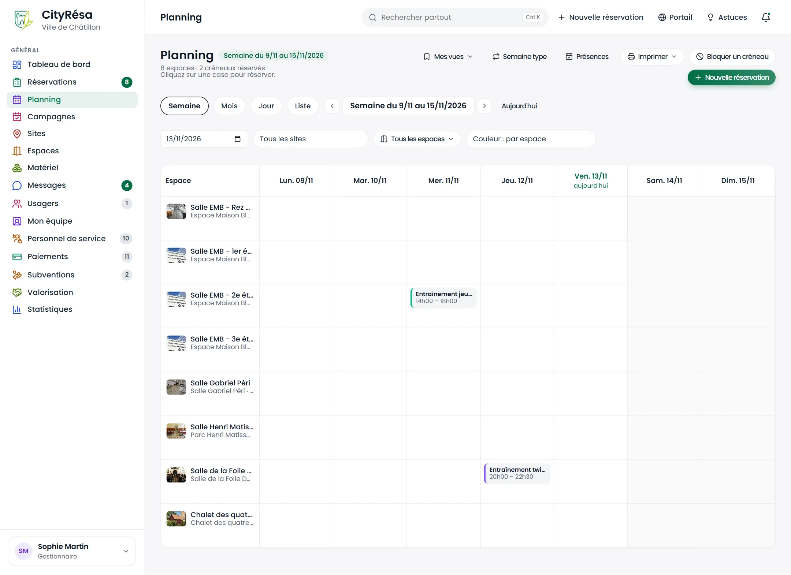
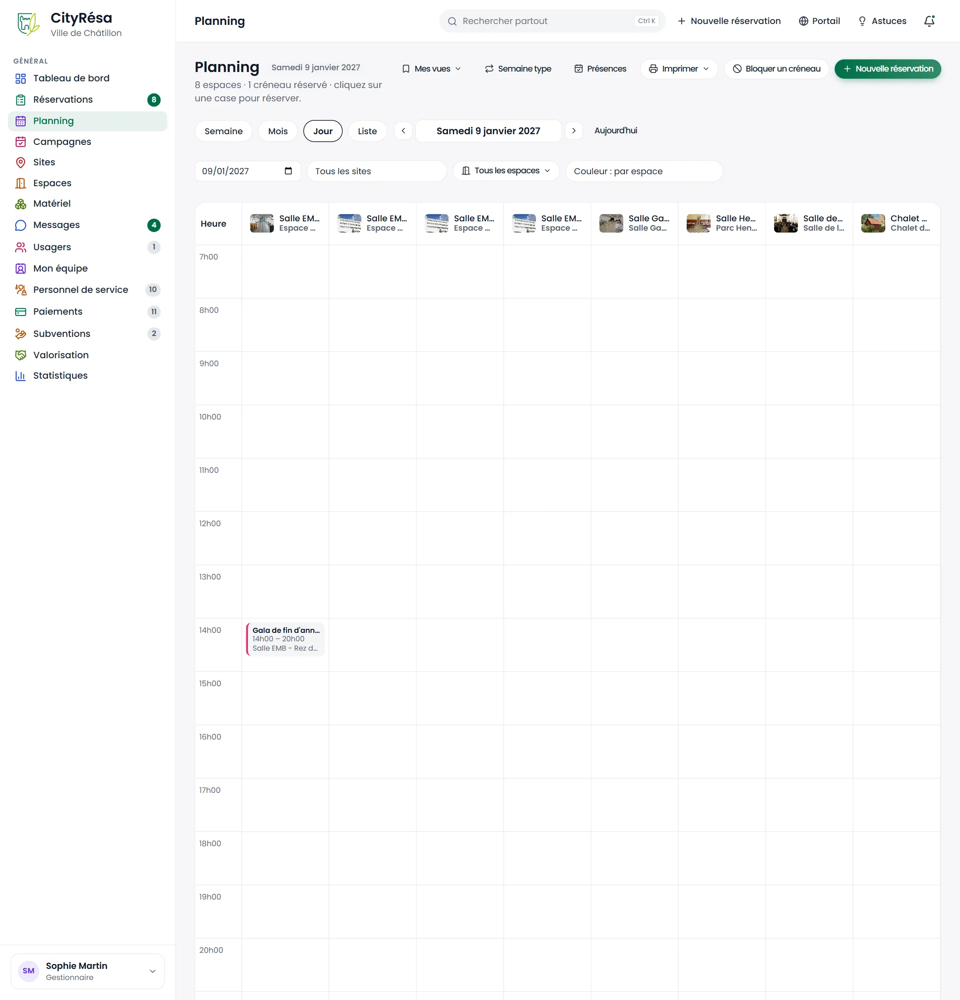
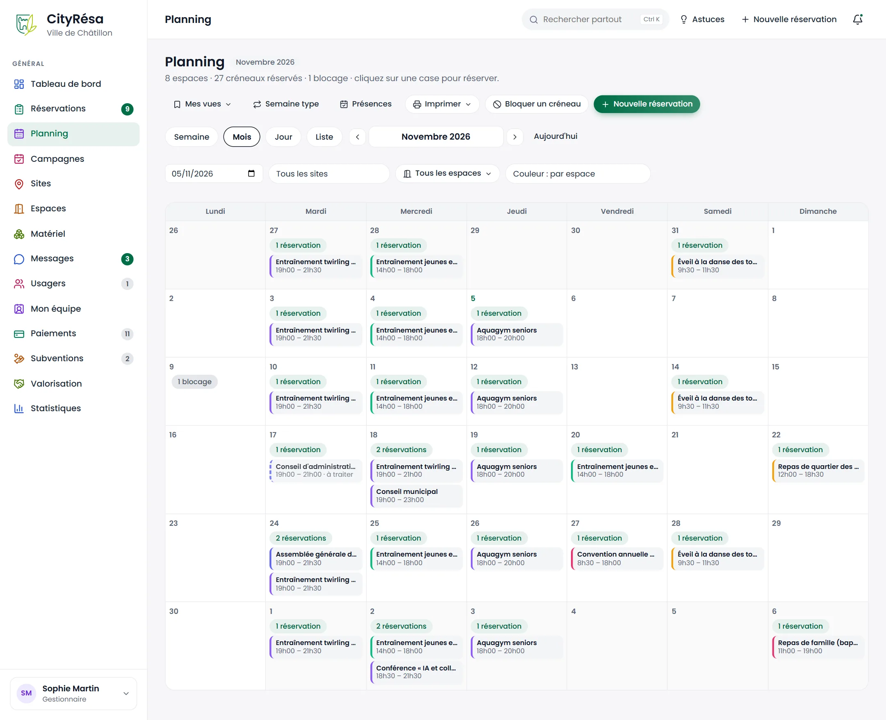
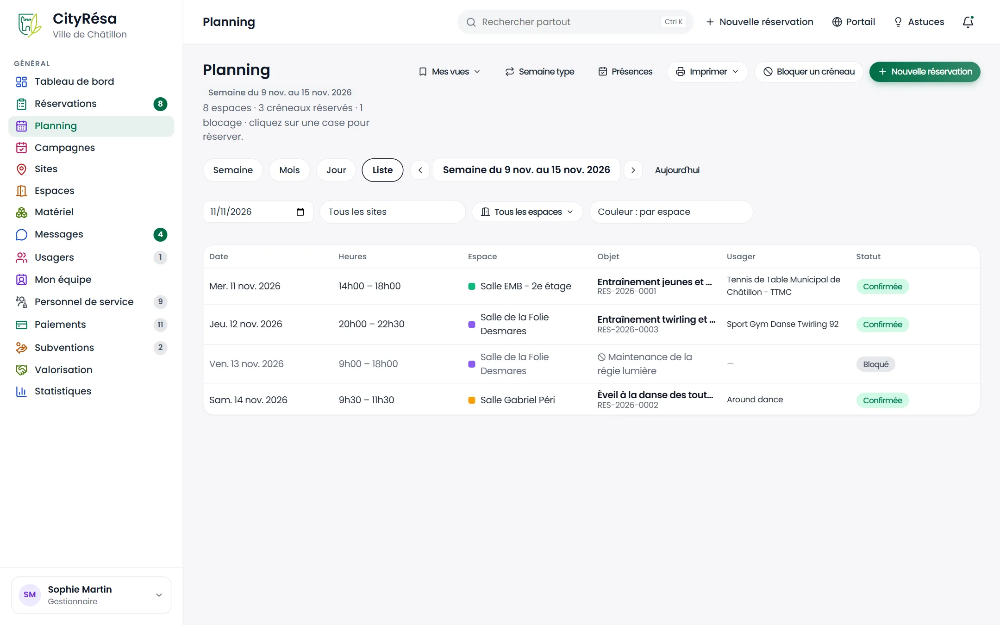
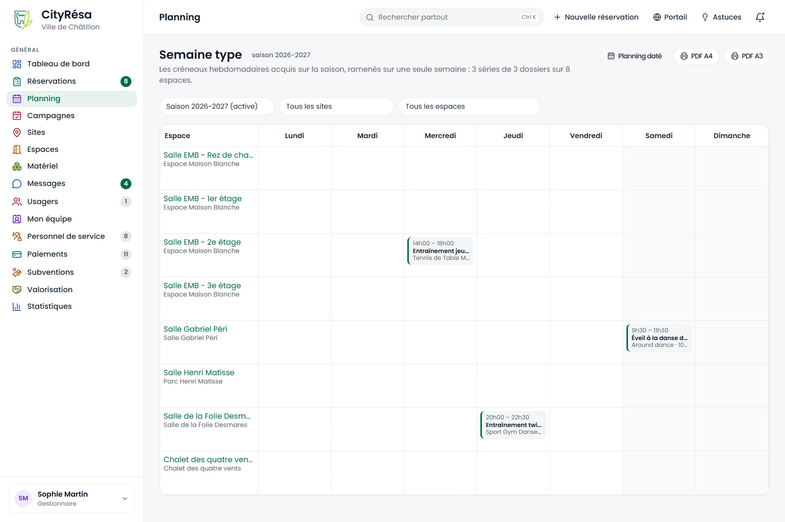
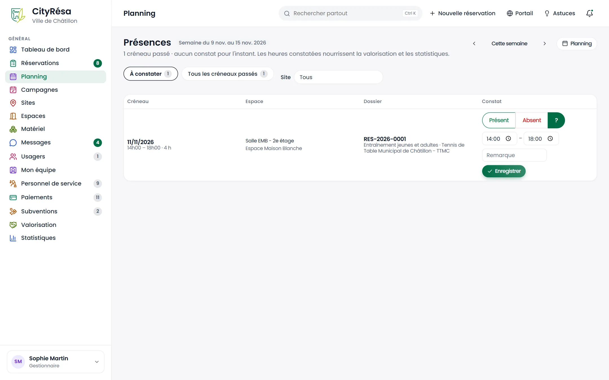
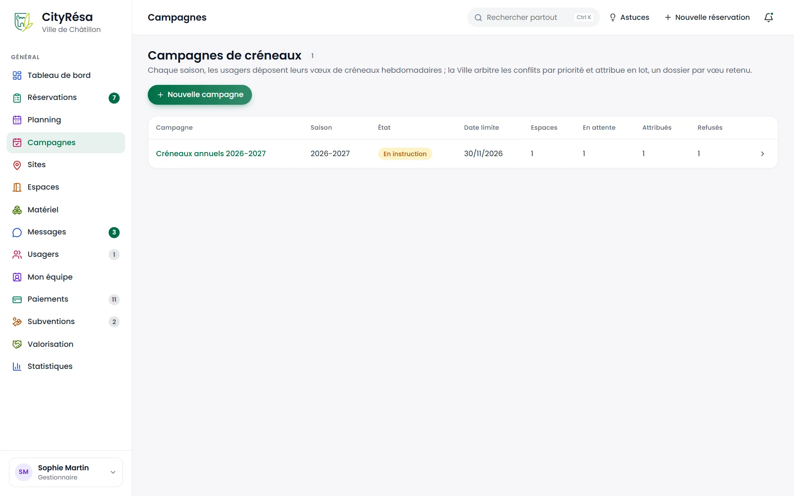
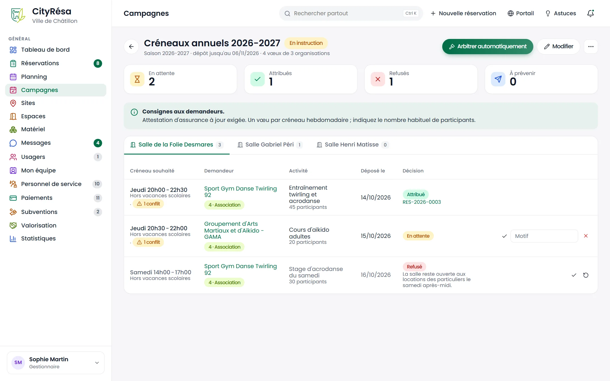

# 3. Planning et campagnes annuelles

Ce chapitre présente le planning des espaces (ses quatre vues, ses impressions, les blocages et les présences) puis les campagnes annuelles, qui permettent d'attribuer en une fois les créneaux hebdomadaires de la saison.

## 3.1 Le planning en vue semaine

**À quoi ça sert** — Voir l'occupation de tous vos espaces sur une semaine et réserver une case libre d'un clic.

**Qui** — Tout agent qui a accès au planning. Les boutons qui modifient quelque chose (blocage, nouvelle réservation, présences, glisser-déposer) demandent le droit d'écriture sur les réservations.

*Figure — le planning de la semaine du 2 au 8 novembre 2026 : une ligne par espace, une colonne par jour, la journée en cours mise en évidence.*

**Ce que l'on voit**

- Sous le titre : la période affichée, le nombre d'espaces et de créneaux réservés, et le rappel « cliquez sur une case pour réserver ».
- La barre d'outils : **Mes vues**, **Semaine type**, **Présences**, **Imprimer**, **Bloquer un créneau** et **Nouvelle réservation**.
- Les onglets **Semaine**, **Mois**, **Jour** et **Liste**, les flèches pour passer à la période précédente ou suivante, la période en cours et le lien **Aujourd'hui**.
- Les filtres : un sélecteur de date, **Tous les sites**, **Tous les espaces** (choix de plusieurs espaces par cases à cocher) et **Couleur**.
- La grille : chaque espace avec sa photo et son site, puis les sept jours. Chaque réservation est une étiquette avec son titre et ses horaires, bordée à gauche de la couleur de l'espace. Le samedi et le dimanche sont grisés.

**Comment faire**

1. Cliquez sur **Planning** dans le menu de gauche : la semaine en cours s'affiche.
2. Changez de semaine avec les flèches, ou choisissez une date dans le sélecteur.
3. Limitez l'affichage avec les filtres de sites et d'espaces.
4. Cliquez sur une étiquette pour ouvrir le dossier de réservation.
5. Cliquez sur une case vide pour saisir une réservation : la page « Nouvelle réservation » s'ouvre avec l'espace et la date déjà remplis.

**Règles à connaître**

- Une demande encore à traiter ou en traitement apparaît avec la mention « à traiter » et une bordure en pointillés : le créneau est déjà bloqué, mais la décision reste à prendre.
- Les blocages (travaux, fermetures) apparaissent en grisé avec leur motif.
- Un agent rattaché à certains espaces ne voit que ceux-ci.

## 3.2 La vue jour

**À quoi ça sert** — Voir une journée heure par heure, tous espaces côte à côte.

**Qui** — Les mêmes agents que pour la vue semaine.

*Figure — la vue « Jour » du samedi 9 janvier 2027 : trois créneaux, dont une demande encore à traiter en pointillés.*

**Ce que l'on voit**

- Une colonne par espace (photo, nom, site) et une ligne par heure, de 7 h à 23 h.
- Chaque réservation est placée sur la ligne de son heure de début, avec son titre, ses heures et son espace. Ici, à la Salle Gabriel Péri un éveil à la danse de 9 h 30 à 11 h 30, à la Salle Henri Matisse un salon de 10 h à 19 h.
- Une demande pas encore décidée porte la mention « à traiter » et une bordure en pointillés. C'est le cas du mariage à la salle polyvalente, de 14 h à 23 h 30.

**Comment faire**

1. Cliquez sur l'onglet **Jour**, ou sur un numéro de jour dans la vue mois.
2. Passez d'un jour à l'autre avec les flèches.
3. Cliquez sur une case horaire vide pour réserver cet espace à cette heure-là.

## 3.3 La vue mois

**À quoi ça sert** — Avoir une vue d'ensemble d'un mois, avec le nombre de réservations et de blocages par jour.

**Qui** — Les mêmes agents que pour la vue semaine.

*Figure — la vue « Mois » de novembre 2026 : pour chaque jour, le nombre de réservations, les étiquettes des créneaux et, le 9, un blocage.*

**Ce que l'on voit**

- Un calendrier du lundi au dimanche, qui déborde sur les jours des mois voisins.
- Dans chaque case : une pastille « 1 réservation », « 2 réservations » ou « 1 blocage », puis les étiquettes des créneaux avec leurs horaires.
- La couleur à gauche de chaque étiquette suit le mode de couleur choisi (ici, par espace).

**Comment faire**

1. Cliquez sur l'onglet **Mois**.
2. Cliquez sur le numéro d'un jour ou sur sa pastille pour ouvrir la vue jour correspondante.
3. Cliquez sur une étiquette pour ouvrir le dossier.

## 3.4 La vue liste

**À quoi ça sert** — Lire la période sous forme de tableau chronologique, plus facile à parcourir au clavier ou avec un lecteur d'écran.

**Qui** — Les mêmes agents que pour la vue semaine.

*Figure — la vue « Liste » de la semaine : trois créneaux avec leur date, leurs heures, leur espace, leur objet, l'usager et le statut du dossier.*

**Ce que l'on voit** — Un tableau avec les colonnes **Date**, **Heures**, **Espace** (précédé de sa couleur), **Objet** (titre et numéro du dossier), **Usager** et **Statut**. Les blocages y figurent aussi.

**Comment faire**

1. Cliquez sur l'onglet **Liste**.
2. Changez de période avec les flèches, comme dans les autres vues.
3. Cliquez sur l'objet pour ouvrir le dossier.

## 3.5 Couleurs et vues enregistrées

**À quoi ça sert** — Adapter l'affichage du planning à votre besoin et retrouver d'un clic les réglages que vous utilisez souvent.

**Qui** — Chaque agent, pour lui-même.

**Ce que l'on voit**

- Le filtre **Couleur** propose trois modes : **par espace** (par défaut), **par statut du dossier** ou **par type d'usager**. Une légende s'affiche sous les filtres quand le mode n'est pas « par espace ».
- Le menu **Mes vues** liste vos vues enregistrées, chacune avec une croix pour la supprimer, et un champ **Nom de la vue actuelle** avec le bouton **Enregistrer**.

**Comment faire**

1. Réglez le planning comme vous le souhaitez : vue, sites, espaces, couleur.
2. Ouvrez **Mes vues**, saisissez un nom (par exemple « Gymnases, par statut ») et cliquez sur **Enregistrer**.
3. Pour retrouver cet affichage, ouvrez **Mes vues** et cliquez sur son nom.
4. Pour supprimer une vue, cliquez sur la croix à côté de son nom.

**Règles à connaître**

- Une vue mémorise la vue, les sites, les espaces et la couleur ; la date reste celle du jour.
- Douze vues au plus par agent. Les vues sont personnelles et ne se partagent pas.

## 3.6 Déplacer un créneau par glisser-déposer

**À quoi ça sert** — Décaler rapidement une séance directement depuis le planning.

**Qui** — Les agents qui ont le droit d'écriture sur les réservations.

**Ce que l'on voit** — Au survol, une étiquette déplaçable indique « glisser pour déplacer ». Pendant le déplacement, les cases où le dépôt est possible sont mises en évidence.

**Comment faire**

1. En vue **Semaine**, faites glisser l'étiquette vers un autre jour sur la ligne du même espace : les heures sont conservées.
2. En vue **Jour**, faites-la glisser vers une autre heure dans la colonne du même espace : la durée est conservée.
3. Une fenêtre de confirmation rappelle la nouvelle date et les nouvelles heures. Cliquez sur **OK**.
4. La page se recharge avec un message de réussite ou la raison du refus.

**Règles à connaître**

- Seules les réservations à traiter, en traitement, acceptées, signées ou confirmées se déplacent.
- Le glisser-déposer déplace une seule séance à la fois, sans changer d'espace ; il ne permet pas de modifier la durée. Pour une série ou un changement d'horaire plus complet, utilisez le crayon du créneau sur la fiche du dossier.
- Les mêmes contrôles que sur la fiche s'appliquent : horaires d'ouverture, disponibilité, régénération de la convention ou avenant si elle est signée.
- L'usager est prévenu par le courriel « Créneaux modifiés ».

## 3.7 Bloquer un créneau et fermeture exceptionnelle

**À quoi ça sert** — Rendre un espace indisponible (travaux, usage interne, fermeture annuelle) et, si des réservations sont déjà en place, les traiter en une seule fois.

**Qui** — Les agents qui ont le droit d'écriture sur les réservations, pour les espaces de leur périmètre.

**Ce que l'on voit**

- La fenêtre **Bloquer un créneau** : **Espace**, **Date**, **Début**, **Fin** (une fin avant le début désigne le lendemain) et **Motif**.
- Si des réservations sont touchées, la page **Fermeture exceptionnelle** :
  - **Période** : les dates, le motif et le nombre de dossiers et de créneaux concernés ;
  - **Réservations concernées** : pour chaque dossier, son numéro, le demandeur, le statut, les créneaux touchés et, quand il y en a, jusqu'à trois créneaux de remplacement possibles ;
  - **Suite à donner** : **Annuler les créneaux touchés** et **Prévenir les usagers par courriel** ;
  - le bouton **Fermer l'espace**.

**Comment faire**

1. Dans le planning, cliquez sur **Bloquer un créneau** (vous pouvez aussi poser un blocage depuis la fiche d'un espace).
2. Choisissez l'espace, la date, les heures et saisissez le motif.
3. Cliquez sur **Bloquer**.
4. Si aucune réservation n'est touchée, le blocage est posé tout de suite.
5. Sinon, la page **Fermeture exceptionnelle** s'ouvre : relisez la liste, choisissez la suite à donner et cliquez sur **Fermer l'espace**.
6. Pour lever un blocage, cliquez sur la petite croix de son étiquette dans le planning et confirmez.

**Règles à connaître**

- Le blocage s'étend à la famille de l'espace : la salle elle-même, la salle qui la contient et ses sous-espaces.
- Les créneaux annulés sont retirés des dossiers et du montant dû.
- Un dossier dont tous les créneaux tombent pendant la fermeture n'est pas vidé : il est signalé « Tous ses créneaux : à annuler ou reporter depuis la fiche ».
- Chaque usager reçoit un courriel « Fermeture exceptionnelle » par dossier, avec ses créneaux concernés, les remplacements possibles et un lien pour convenir d'un report.
- Chaque dossier touché garde la trace de la fermeture dans son historique.

## 3.8 Imprimer le planning et la feuille de salle

**À quoi ça sert** — Disposer d'un planning papier pour l'affichage, le gardiennage ou la porte d'une salle.

**Qui** — Tout agent qui a accès au planning.

**Ce que l'on voit** — Le menu **Imprimer** propose :

- **Cette page** : l'impression du planning tel qu'il est affiché ;
- **Semaine en PDF (A4, une page par espace)** ;
- **Semaine en PDF (A3)**.

Quand un seul espace est affiché, un bouton **Feuille de salle** apparaît à côté.

**Comment faire**

1. Réglez les filtres de sites et d'espaces : le PDF reprend la sélection en cours.
2. Ouvrez **Imprimer** et choisissez le format. Le PDF s'ouvre dans un nouvel onglet.
3. Pour la feuille de salle, filtrez sur un seul espace puis cliquez sur **Feuille de salle**. Elle est aussi disponible depuis la fiche de l'espace (**Feuille de salle (PDF, QR code)**).

**Règles à connaître**

- Le planning PDF est en paysage, en noir et blanc, daté de son édition, avec une page par espace, le week-end grisé, les fermetures hachurées et les chevauchements côte à côte.
- La feuille de salle (A4) présente le programme de la semaine, les consignes, le règlement et un QR code vers la page publique de l'espace.
- Il n'existe pas de planning mensuel imprimable ni de version en couleur.

## 3.9 La semaine type

**À quoi ça sert** — Voir sur une seule semaine toutes les activités régulières d'une saison : qui occupe quel espace, quel jour, à quelle heure.

**Qui** — Tout agent qui a accès au planning.

*Figure — la semaine type de la saison 2026-2027 : les séries hebdomadaires de chaque espace ramenées du lundi au dimanche.*

**Ce que l'on voit**

- En tête : le nombre de séries, de dossiers et d'espaces.
- Les boutons **Planning daté** (retour au planning), **PDF A4** et **PDF A3**.
- Les filtres : la saison (la saison active est indiquée), **Tous les sites**, **Tous les espaces**.
- La grille : un espace par ligne, un jour par colonne. Chaque étiquette indique les horaires, le titre de l'activité, l'usager et le nombre de séances.

**Comment faire**

1. Dans le planning, cliquez sur **Semaine type**.
2. Choisissez la saison et, si besoin, le site ou l'espace.
3. Cliquez sur une étiquette pour ouvrir le dossier correspondant.
4. Cliquez sur **PDF A4** ou **PDF A3** pour l'imprimer.

**Règles à connaître**

- Seuls les dossiers acquis à récurrence hebdomadaire de la saison y figurent.
- Un dossier qui se répète plusieurs jours par semaine apparaît dans chacun de ces jours (ici, l'entraînement de twirling du mardi et du mercredi à la Salle de la Folie Desmares).
- Sans saison déclarée, la page invite à en créer une dans Administration › Calendrier des saisons.

## 3.10 Les présences

**À quoi ça sert** — Constater après coup si l'usager est venu, et combien de temps, pour chaque créneau passé.

**Qui** — Les agents qui ont le droit d'écriture sur les réservations, pour les espaces de leur périmètre.

*Figure — l'écran « Présences » de la semaine : un créneau reste à constater, avec les boutons Présent, Absent et « ? ».*

**Ce que l'on voit**

- En tête : le bilan de la semaine (créneaux passés, présents, absents sans prévenir, heures constatées sur heures prévues).
- La navigation de semaine en semaine et le bouton **Planning**.
- Les onglets **À constater** et **Tous les créneaux passés**, et le filtre **Site**.
- Le tableau : **Créneau**, **Espace**, **Dossier**, **Constat**. Dans la colonne Constat : les boutons **Présent**, **Absent** et **?** (non constaté), les heures d'arrivée et de départ, une **Remarque** et le bouton **Enregistrer**.

**Comment faire**

1. Dans le planning, cliquez sur **Présences** (ou, depuis la fiche d'un dossier, sur **Présences** au-dessus de la liste des créneaux).
2. Pour chaque créneau, cliquez sur **Présent** ou **Absent**.
3. Si l'usager est arrivé ou parti à d'autres heures que prévu, corrigez les heures.
4. Ajoutez une remarque si besoin, puis cliquez sur **Enregistrer**.
5. Pour corriger ou effacer un constat, ouvrez l'onglet **Tous les créneaux passés** ; le bouton **?** efface le constat.

**Règles à connaître**

- Sur la fiche du dossier, la pastille du créneau devient « Présent » avec les heures constatées, ou « Absent sans prévenir ».
- Les heures effectives (constatées si présent, zéro si absent, prévues sans constat) servent à la valorisation des avantages en nature et aux statistiques de présence.
- La fiche de l'usager compte ses absences non signalées.
- Il n'y a pas de relance automatique des constats manquants.

## 3.11 L'envoi hebdomadaire du planning

**À quoi ça sert** — Recevoir chaque semaine par courriel le planning des espaces dont vous avez la charge.

**Qui** — Les agents gestionnaires ou notifiés d'au moins un espace, qui acceptent les courriels. Le réglage est fait par un administrateur.

**Ce que l'on voit** — Un courriel « Planning hebdomadaire » avec, en pièce jointe, le planning PDF de la semaine (une page par espace, comme le menu **Imprimer**) et, dans le corps du message, le résumé des créneaux par espace : jour, heures, objet, usager et fermetures.

**Comment faire** (administrateur)

1. Ouvrez **Paramètres › Réservations**.
2. Activez **Planning hebdomadaire par courriel aux gestionnaires**.
3. Choisissez le **Jour d'envoi du planning hebdomadaire** (lundi par défaut).
4. Enregistrez.

**Règles à connaître**

- L'envoi est désactivé par défaut.
- Du lundi au jeudi, c'est la semaine en cours qui est envoyée ; du vendredi au dimanche, la semaine suivante.
- Un agent reçoit un seul envoi par jour, au format A4.
- Les adresses supplémentaires à notifier saisies dans les paramètres ne reçoivent pas ce planning.

## 3.12 Les campagnes de créneaux

**À quoi ça sert** — Organiser chaque saison l'attribution des créneaux hebdomadaires : les associations déposent leurs vœux sur le portail, la Ville arbitre les conflits par priorité et attribue en lot.

**Qui** — Les agents qui ont le droit d'écriture sur les réservations ; la suppression d'une campagne demande le droit de suppression. Le module Campagnes doit être activé.

*Figure — la liste des campagnes : une campagne « Créneaux annuels 2026-2027 » en instruction.*

**Ce que l'on voit**

- Le bouton **Nouvelle campagne**.
- Le tableau : **Campagne**, **Saison**, **État**, **Date limite**, **Espaces**, **En attente**, **Attribués**, **Refusés**, et une flèche pour ouvrir la campagne.

**Comment faire — créer une campagne**

1. Cliquez sur **Campagnes** dans le menu de gauche, puis sur **Nouvelle campagne**.
2. Renseignez le **Nom de la campagne**, la **Saison**, la **Date limite de dépôt** et les **Consignes aux demandeurs** (pièces à fournir, critères, calendrier).
3. Cochez les **Espaces ouverts aux vœux** ; si vous n'en cochez aucun, tous les espaces publics sont ouverts.
4. Cliquez sur **Créer la campagne**. Elle reste en brouillon.
5. Sur sa fiche, ouvrez le menu « ... » et choisissez **Ouvrir le dépôt des vœux**.

**Règles à connaître** — Une campagne passe par quatre états :

| État | Signification | Action du menu « ... » |
| --- | --- | --- |
| Brouillon | Invisible des usagers | **Ouvrir le dépôt des vœux** |
| Dépôt ouvert | Les usagers déposent et retirent leurs vœux dans « Mes vœux » | **Clore le dépôt et instruire** ou **Repasser en brouillon** |
| En instruction | Dépôt clos : la Ville arbitre et attribue | **Clôturer la campagne** ou **Ouvrir le dépôt des vœux** (réouverture) |
| Clôturée | Décisions rendues et communiquées | **Clore le dépôt et instruire** (retour en instruction) |

- La date limite est indicative : c'est vous qui closez le dépôt depuis la fiche.
- Les vœux sont contrôlés par les règles de l'espace au moment du dépôt.

## 3.13 Instruire une campagne

**À quoi ça sert** — Décider, vœu par vœu ou automatiquement, quels créneaux sont attribués, puis prévenir les demandeurs.

**Qui** — Les agents qui ont le droit d'écriture sur les réservations.

*Figure — une campagne en instruction : compteurs, consignes, et pour la Salle de la Folie Desmares un vœu attribué (avec son dossier), un vœu en attente qui le chevauche (« 1 conflit ») et un vœu refusé avec son motif.*

**Ce que l'on voit**

- En tête : le nom, l'état, la saison, la date limite et le nombre de vœux et d'organisations ; les boutons **Arbitrer automatiquement**, **Prévenir les demandeurs** (quand des décisions restent à annoncer), **Modifier** et le menu « ... ».
- Quatre compteurs : **En attente**, **Attribués**, **Refusés**, **À prévenir**.
- Les consignes aux demandeurs.
- Un onglet par espace, avec le nombre de vœux. Pour chaque vœu : le **Créneau souhaité** (jour, heures, « Hors vacances scolaires » ou « Vacances comprises »), le **Demandeur** avec sa pastille de priorité, l'**Activité**, la date de dépôt et la **Décision** (En attente, Attribué avec le numéro du dossier créé, Refusé avec le motif). Une pastille signale les vœux en conflit avec un autre.
- Les boutons de chaque ligne : la coche (**Attribuer**), le champ **Motif** et la croix (**Refuser**), la flèche circulaire (**Remettre en attente**).

**Comment faire**

1. Une fois le dépôt clos, ouvrez la campagne.
2. Pour laisser l'application trancher, cliquez sur **Arbitrer automatiquement** et confirmez.
3. Pour décider vous-même, sur la ligne d'un vœu : cliquez sur la coche pour l'attribuer, ou saisissez un motif et cliquez sur la croix pour le refuser.
4. Vérifiez les vœux restés « En attente » : le motif indique le créneau déjà occupé. Décidez au cas par cas.
5. Cliquez sur **Prévenir les demandeurs** : chaque organisation reçoit un seul courriel récapitulant ses créneaux attribués (avec le numéro de dossier) et ses vœux refusés (avec le motif).
6. Ouvrez le menu « ... » et choisissez **Clôturer la campagne**.

**Règles à connaître**

- L'ordre de priorité est le suivant : 1. Ville, 2. Collectivité ou scolaire, 3. Association conventionnée, 4. Association, 5. Entreprise, particulier ou autre. Le caractère « conventionnée » se coche sur la fiche de l'usager.
- L'arbitrage automatique retient les vœux par priorité, puis par ancienneté de dépôt ; un vœu en conflit avec un vœu retenu est refusé avec le motif « Créneau attribué en priorité à… ».
- Chaque vœu attribué crée un dossier sur toute la saison, chaque semaine le jour demandé, hors jours fériés et, si demandé, hors vacances scolaires. Le dossier est « Acceptée » (convention à signer) quand la signature électronique est active, sinon « Confirmée ».
- Si le créneau est déjà pris par une réservation (un conseil municipal, par exemple), le vœu reste en attente avec le motif.
- Les vœux ne sont pas classés par ordre de préférence et aucun courriel n'annonce l'ouverture du dépôt : les usagers découvrent la campagne dans « Mes vœux ».

> **Astuce** — Avant d'arbitrer, vérifiez sur la fiche des usagers que les associations conventionnées sont bien signalées : c'est ce qui les fait passer avant les autres associations.
