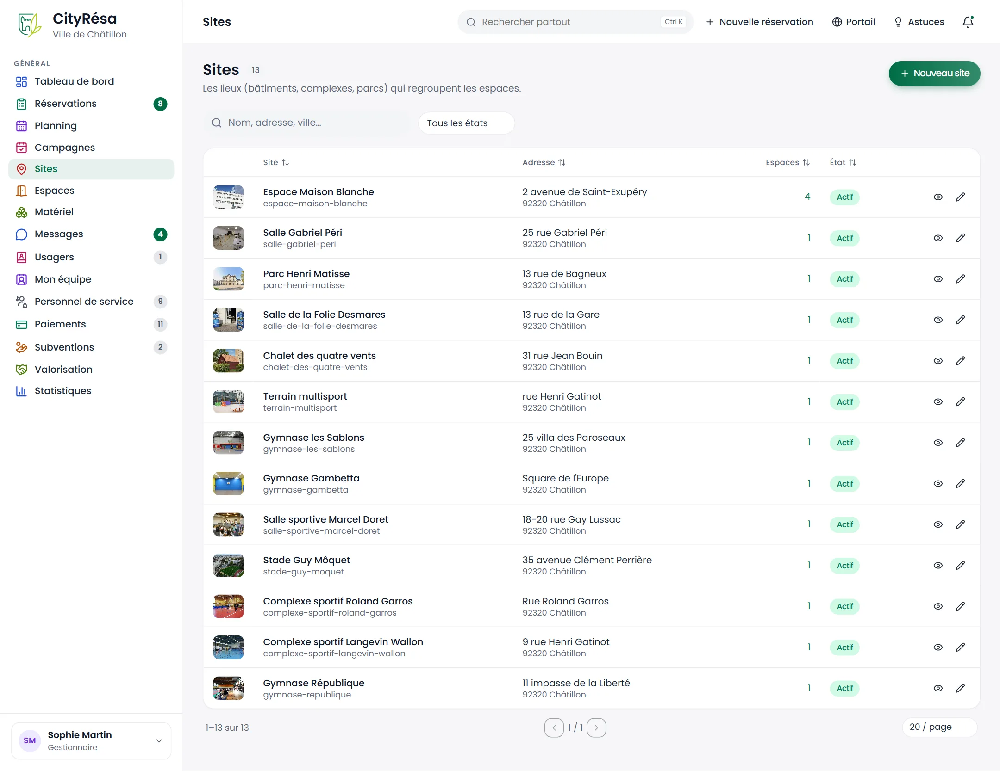
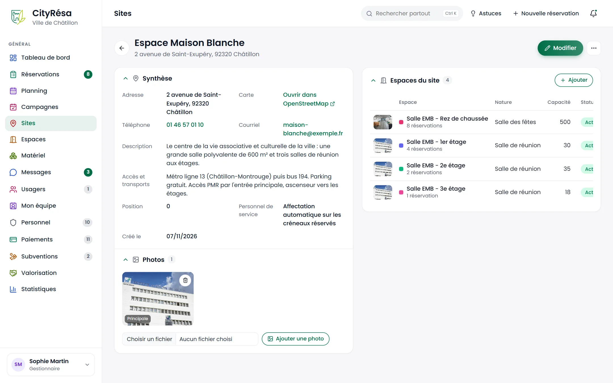
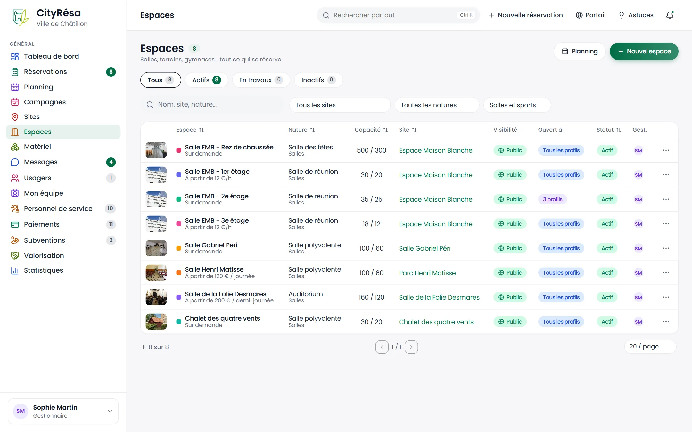
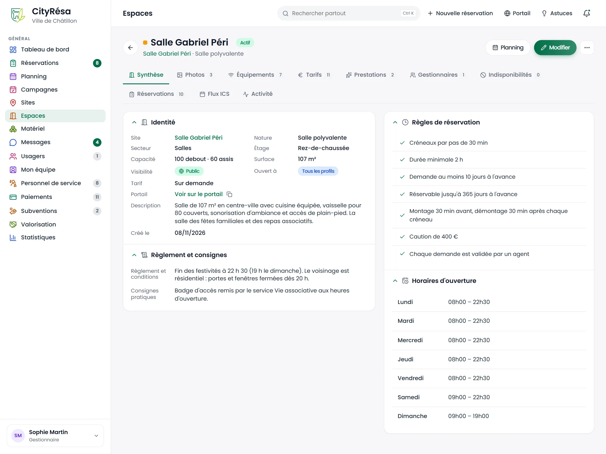
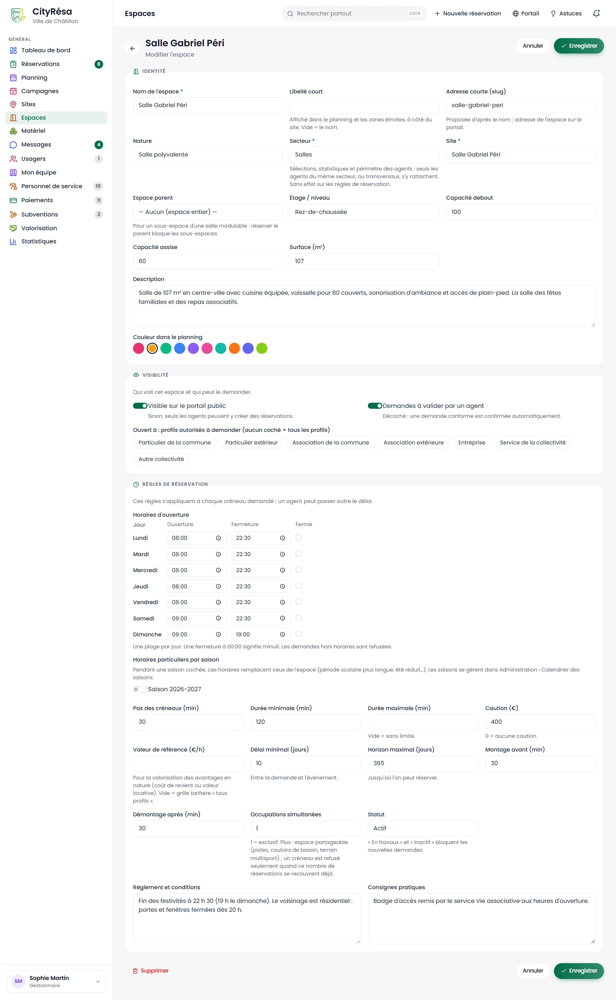
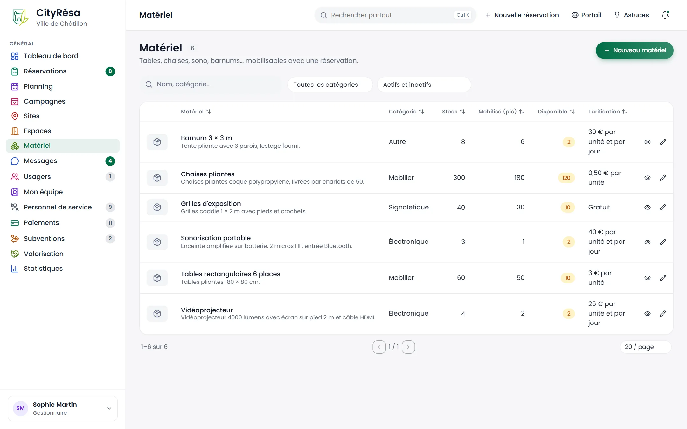
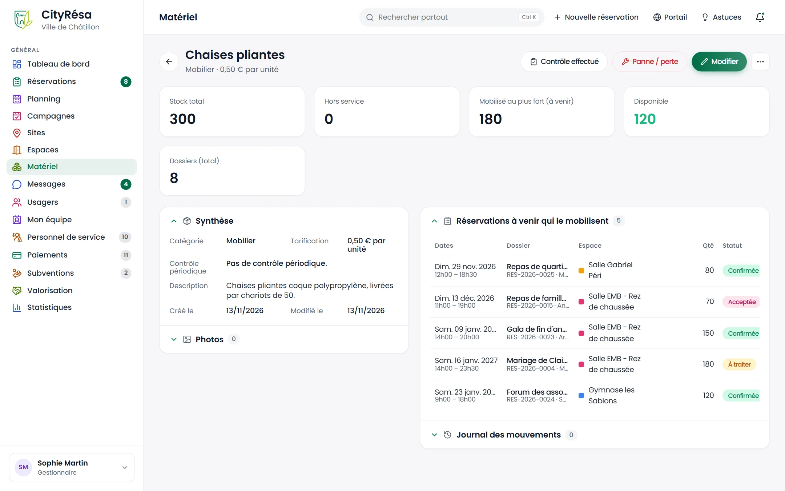

# 4. Sites, espaces et matériel

Ce chapitre explique comment décrire les lieux de la Ville (sites), ce qui s'y réserve (espaces) et le matériel prêté avec les réservations : c'est le catalogue sur lequel reposent toutes les demandes.

## 4.1 La liste des sites

**À quoi ça sert** — Un site est un lieu physique (bâtiment, complexe sportif, parc) qui regroupe un ou plusieurs espaces réservables. La liste donne une vue d'ensemble des lieux de la Ville.

**Qui** — Tous les agents peuvent la consulter. La création et la modification demandent le droit d'écriture sur « Sites et espaces » (gestionnaires et agents par défaut) ; la suppression est réservée aux gestionnaires et administrateurs.

*Figure — la liste des 13 sites de la Ville, avec leur vignette, leur adresse, le nombre d'espaces rattachés et leur état.*

**Ce que l'on voit**

- En haut, le nombre de sites (13) et le bouton **Nouveau site**.
- Une zone de recherche (nom, adresse, ville) et un filtre **Tous les états** (actifs ou inactifs).
- Pour chaque site : sa photo principale, son nom et son adresse courte (utilisée dans les liens du portail), l'adresse postale, le nombre d'espaces (l'Espace Maison Blanche en compte 4), l'état **Actif**, puis deux icônes : l'œil pour ouvrir la fiche, le crayon pour la modifier.
- Les colonnes marquées de flèches se trient d'un clic sur leur titre.

**Comment faire — créer un site**

1. Cliquez sur **Nouveau site**.
2. Renseignez le **Nom du site**. L'**Adresse courte (slug)** se propose toute seule d'après le nom ; elle sert à construire l'adresse des pages du portail.
3. Complétez l'adresse, le code postal et la ville. Si vous connaissez la **Latitude** et la **Longitude**, saisissez-les : la fiche proposera alors un lien vers la carte.
4. Ajoutez le téléphone, le courriel et les informations **Accès, transports, stationnement** (elles sont reprises sur le portail).
5. Laissez **Site actif** coché et réglez la **Position** (ordre d'affichage, le plus petit en premier). Si le module Personnel de service est actif, l'interrupteur **Affectation automatique du personnel de service** décide, pour ce site, si la personne disponible est affectée d'office aux créneaux réservés ou seulement proposée au gestionnaire (chapitre 11).
6. Enregistrez.

**Règles à connaître**

- Un site inactif n'apparaît plus sur le portail ni dans les listes de choix.
- Un site qui porte encore des espaces ne peut pas être supprimé : il est seulement désactivé.
- Deux sites ne peuvent pas avoir la même adresse courte.

## 4.2 La fiche d'un site

**À quoi ça sert** — Consulter toutes les informations d'un lieu, ses photos et la liste de ses espaces, et ajouter un espace sur ce site.

**Qui** — Tous les agents en lecture ; les gestionnaires et agents en écriture pour modifier et ajouter des photos.

*Figure — la fiche de l'Espace Maison Blanche : synthèse, photo principale et les quatre salles du site.*

**Ce que l'on voit**

- En haut : le nom et l'adresse du site, le bouton **Modifier** et le menu « … » (trois points) qui propose **Ajouter un espace**, **Voir sur la carte** et, pour les gestionnaires, **Désactiver le site** ou **Supprimer le site**.
- Le bloc **Synthèse** : adresse, lien **Ouvrir dans OpenStreetMap**, téléphone, courriel, description, accès et transports, position et date de création.
- Le bloc **Photos** : chaque photo avec une corbeille pour la retirer ; la première porte la mention **Principale** (c'est la vignette du site). Sous les photos, **Choisir un fichier** puis **Ajouter une photo**.
- Le bloc **Espaces du site** à droite : chaque espace avec sa couleur, son nombre de réservations, sa nature, sa capacité et son statut. Le bouton **Ajouter** crée un nouvel espace directement rattaché à ce site.

**Comment faire — ajouter une photo**

1. Dans le bloc **Photos**, cliquez sur **Choisir un fichier** et sélectionnez l'image sur votre poste.
2. Cliquez sur **Ajouter une photo**.
3. Pour retirer une photo, cliquez sur la corbeille en haut à droite de la vignette et confirmez.

> **Astuce** — Les noms affichés dans le bloc « Espaces du site » sont parfois plus courts que dans la liste des espaces (« Salle du 1er étage - EMB ») : c'est le **libellé court** de l'espace, prévu pour les zones étroites comme le planning.

## 4.3 La liste des espaces

**À quoi ça sert** — Un espace est ce qui se réserve réellement : salle, gymnase, dojo, terrain. La liste permet de retrouver un espace, de voir d'un coup d'œil qui peut le demander et qui le gère.

**Qui** — Tous les agents en lecture ; création et modification avec le droit d'écriture sur « Sites et espaces ».

*Figure — les 16 espaces de la Ville avec leur nature, leur capacité, leur site, leur visibilité, leur statut et leur gestionnaire.*

**Ce que l'on voit**

- Les onglets **Tous**, **Actifs**, **En travaux** et **Inactifs**, chacun avec son compteur.
- Une recherche (nom, site, nature) et deux filtres : **Tous les sites** et **Toutes les natures**.
- En haut à droite, **Planning** (ouvre le planning de tous les espaces) et **Nouvel espace**.
- Pour chaque espace :
  - la pastille de couleur (celle du planning), le nom et, dessous, le tarif « à partir de » (par exemple « À partir de 12 €/h ») ou **Sur demande** si aucun tarif n'est saisi ;
  - la **Capacité** sous la forme « debout / assis » (500 / 300) ; un tiret indique une capacité non renseignée ;
  - la **Visibilité** : **Public** si l'espace est visible sur le portail, **Interne** s'il n'existe que pour les agents ;
  - **Ouvert à** : qui peut déposer une demande, **Tous les profils** ou le nombre de profils autorisés (« 3 profils » pour la salle du 2e étage, ouverte aux seules associations de la commune, associations extérieures et services de la collectivité ; survolez la pastille pour lire la liste, ou ouvrez la fiche) ;
  - le **Statut** et, dans la colonne **Gest.** (gestionnaires), les initiales des agents qui gèrent l'espace (SM pour Sophie Martin, KB pour Karim Benali).
- Le menu de chaque ligne propose **Voir la fiche**, **Voir au planning**, **Modifier**, **Nouvelle réservation** et **Supprimer**.

**Règles à connaître**

- Un espace qui a déjà des réservations n'est jamais supprimé : il est seulement désactivé, pour garder l'historique des dossiers.

## 4.4 La fiche d'un espace

**À quoi ça sert** — Rassembler tout ce qui concerne un espace : identité, règles de réservation, horaires, photos, équipements, tarifs, prestations, agents responsables, blocages, prochaines réservations, flux d'agenda et taux d'occupation.

**Qui** — Tous les agents en lecture ; les onglets se modifient avec le droit d'écriture sur « Sites et espaces ».

*Figure — la fiche de la salle Gabriel Péri, onglet Synthèse : identité, règlement, règles de réservation et horaires d'ouverture.*

**Ce que l'on voit**

- En haut : la pastille de couleur, le nom, le statut (**Actif**), le site et la nature. À droite, **Planning** (planning filtré sur cet espace), **Modifier** et le menu « … ».
- Les onglets : **Synthèse**, **Photos**, **Équipements**, **Tarifs**, **Prestations**, **Gestionnaires**, **Indisponibilités**, **Réservations**, **Flux ICS** et **Activité**. Le chiffre à côté de chaque onglet indique le nombre d'éléments (3 photos, 11 lignes de tarif…).
- Dans **Synthèse** :
  - le bloc **Identité** : site, nature, étage, capacité, surface, visibilité (Public ou Interne), **Ouvert à** (les profils autorisés à demander), tarif, lien **Voir sur le portail** (avec une icône pour copier le lien), description ; s'il existe des sous-espaces, ils sont listés ici ;
  - le bloc **Règlement et consignes**, repris dans la convention envoyée à l'usager ;
  - le bloc **Règles de réservation**, qui résume en clair les réglages : pas des créneaux, durée minimale, délai, horizon, montage et démontage, caution, mode de validation ;
  - le bloc **Horaires d'ouverture**, jour par jour. Si des horaires particuliers existent pour une saison, ils s'affichent dans un second tableau.

**Comment faire — les gestes courants depuis le menu « … »**

1. **Feuille de salle (PDF, QR code)** : produit une feuille à afficher à l'entrée de la salle (voir 4.13).
2. **Nouvelle réservation** : ouvre la saisie d'une réservation déjà positionnée sur cet espace.
3. **Voir sur le portail** : ouvre la page publique de l'espace.
4. **Ajouter un espace sur ce site**.
5. **Supprimer l'espace** ou **Désactiver l'espace** (gestionnaires).

## 4.5 Modifier un espace : identité, visibilité et règles

**À quoi ça sert** — Régler tout ce qui conditionne l'acceptation d'une demande : horaires, pas de saisie, durées, délais, montage et démontage, caution, partage, validation, profils autorisés.

**Qui** — Agents et gestionnaires avec le droit d'écriture sur « Sites et espaces ».

*Figure — le formulaire de la salle Gabriel Péri : identité, couleur, visibilité, profils autorisés, horaires et règles de réservation.*

**Ce que l'on voit**

Le formulaire compte trois parties.

- **Identité** : **Nom de l'espace** (obligatoire), **Libellé court** (affiché dans le planning ; vide = le nom), **Adresse courte (slug)**, **Nature**, **Site** (obligatoire), **Espace parent**, **Étage / niveau**, **Capacité debout**, **Capacité assise**, **Surface (m²)**, **Description** et **Couleur dans le planning** (une pastille à choisir parmi dix).
- **Visibilité** : l'interrupteur **Visible sur le portail public**, l'interrupteur **Demandes à valider par un agent** et la rangée **Ouvert à : profils autorisés à demander** (Particulier de la commune, Particulier extérieur, Association de la commune, Association extérieure, Entreprise, Service de la collectivité, Autre collectivité).
- **Règles de réservation** : le tableau des **Horaires d'ouverture** (ouverture, fermeture et case **Fermé** pour chaque jour), les **Horaires particuliers par saison**, puis les champs **Pas des créneaux (min)**, **Durée minimale (min)**, **Durée maximale (min)**, **Caution (€)**, **Valeur de référence (€/h)**, **Délai minimal (jours)**, **Horizon maximal (jours)**, **Montage avant (min)**, **Démontage après (min)**, **Occupations simultanées**, **Statut**, **Règlement et conditions** et **Consignes pratiques**.

**Comment faire**

1. Depuis la fiche de l'espace, cliquez sur **Modifier**.
2. Modifiez les champs voulus (voir les règles ci-dessous).
3. Pour des horaires différents selon la saison (période scolaire, été réduit), cochez la saison concernée sous **Horaires particuliers par saison** et saisissez sa grille.
4. Cliquez sur **Enregistrer** (en haut ou en bas de page). **Annuler** abandonne les changements.

**Règles à connaître**

- **Horaires** : une plage par jour. Une fermeture à 00:00 signifie minuit. Les demandes hors horaires sont refusées. Pendant une saison cochée, ses horaires remplacent ceux de l'espace ; les saisons elles-mêmes se gèrent dans Administration › Calendrier des saisons.
- **Pas des créneaux** : les heures de début et de fin doivent tomber sur ce pas (par exemple toutes les 30 minutes).
- **Durées** : une demande plus courte que la durée minimale ou plus longue que la durée maximale est refusée ; une durée maximale vide signifie « sans limite ».
- **Délai minimal** : nombre de jours exigés entre la demande et l'événement. **Horizon maximal** : jusqu'à combien de jours à l'avance on peut réserver. Un agent peut passer outre ces deux règles lorsqu'il saisit lui-même une réservation.
- **Montage et démontage** : ces minutes s'ajoutent avant et après chaque créneau pour vérifier les conflits. Avec 30 minutes de chaque côté, un créneau 14 h-18 h occupe en réalité la salle de 13 h 30 à 18 h 30.
- **Sous-espaces** : choisir un **Espace parent** fait de l'espace une partie d'une salle modulable. Réserver le parent bloque tous ses sous-espaces ; réserver un sous-espace bloque le parent ; deux sous-espaces voisins restent indépendants.
- **Occupations simultanées** : 1 = l'espace est exclusif. Au-delà (pistes, couloirs de bassin, terrain multisport), un créneau n'est refusé que lorsque ce nombre de réservations se chevauchent déjà au même moment. Une indisponibilité bloque toujours l'espace, quel que soit ce nombre.
- **Ouvert à** (profils autorisés) : aucune case cochée = tous les profils peuvent demander l'espace ; la fiche et la liste des espaces affichent alors **Tous les profils**, sinon le nombre de profils cochés. Une organisation dont la fiche n'est pas encore validée ne bénéficie pas des espaces réservés à son profil (voir chapitre 5).
- **Demandes à valider par un agent** : décoché, une demande conforme aux règles est confirmée automatiquement, sans intervention d'un agent.
- **Visible sur le portail public** : décoché, seuls les agents peuvent voir l'espace et y créer des réservations.
- **Caution (€)** : 0 = aucune caution. La caution est facturée à part, hors devis, puis restituée ou retenue (voir chapitre 6).
- **Valeur de référence (€/h)** : sert uniquement à la valorisation des avantages en nature (coût de revient ou valeur locative). Vide, c'est la grille tarifaire « tous profils » de l'espace qui sert de référence (voir chapitre 7).
- **Statut** : « En travaux » et « Inactif » bloquent les nouvelles demandes.

> **Attention** — Le bouton **Supprimer** en bas à gauche du formulaire désactive l'espace s'il a déjà des réservations ; il ne le supprime réellement que s'il n'en a jamais eu.

## 4.6 Photos et équipements

**À quoi ça sert** — Illustrer l'espace sur le portail et indiquer ce qu'il contient (sonorisation, vidéoprojecteur, cuisine…).

**Qui** — Agents et gestionnaires en écriture sur « Sites et espaces ».

**Comment faire**

1. Onglet **Photos** : ajoutez des images comme pour un site (voir 4.2). La première photo est la vignette de l'espace.
2. Onglet **Équipements** : cochez les équipements présents, puis cliquez sur **Enregistrer les équipements**. Ils sont affichés sur le portail et dans la convention.
3. Si la liste est vide, c'est que le référentiel des équipements n'a pas encore été rempli : un administrateur l'alimente depuis Administration › Référentiels.

> **Astuce** — Le règlement de l'espace ne se dépose pas comme un fichier : il se saisit dans le champ **Règlement et conditions** du formulaire, et il est repris automatiquement dans chaque convention.

## 4.7 La grille tarifaire datée

**À quoi ça sert** — Fixer le prix de l'espace selon le profil de l'usager et l'unité de location, et préparer à l'avance les tarifs votés pour l'année suivante.

**Qui** — Agents et gestionnaires en écriture sur « Sites et espaces ».

**Ce que l'on voit** — L'onglet **Tarifs** affiche la grille avec, pour chaque ligne : le **Profil** (ou **Tous profils**), l'**Unité**, le **Montant**, le **Libellé**, la colonne **En vigueur** (« dès le … » ou « depuis toujours », avec une pastille **En vigueur**, **À venir** ou **Remplacé**) et la **Délibération**. Les lignes remplacées ou à venir sont grisées.

**Comment faire**

1. Ouvrez l'onglet **Tarifs** et cliquez sur **Ajouter un tarif**.
2. Choisissez le **Profil** (laissez « Tous profils » pour une ligne générale) et l'**Unité** : Par heure, Demi-journée, Journée, Soirée, Week-end ou Forfait.
3. Saisissez le **Montant (€)** (0 = gratuit pour ce profil) et, si besoin, un **Libellé**.
4. Indiquez la **Date d'effet** pour un tarif qui ne s'applique qu'à partir d'un jour donné, et la référence de la **Délibération** (par exemple « DEL-2026-042 du 15/06/2026 »).
5. Cliquez sur **Ajouter**. Pour retirer une ligne, utilisez la corbeille en bout de ligne.

**Règles à connaître**

- Pour un profil, ses lignes propres s'appliquent ; à défaut, ce sont les lignes « Tous profils ».
- À chaque créneau, CityRésa retient l'unité **la moins chère pour l'usager**. L'heure est facturée à la demi-heure supérieure ; la demi-journée vaut jusqu'à 5 heures ; la soirée vaut à partir de 18 h ; le week-end vaut le samedi et le dimanche ; la journée se compte par tranche de 24 heures. Un forfait couvre toute la réservation et remplace les lignes horaires s'il est moins cher.
- Le tarif appliqué est celui **en vigueur à la date du créneau**, pas à la date de la demande : une ligne à date future n'est utilisée que pour les créneaux qui tombent après cette date. Un dossier qui enjambe un changement de grille tarife chaque créneau à sa propre grille.
- Modifier une grille ne recalcule jamais les dossiers existants ; le recalcul se fait volontairement depuis le dossier.
- On ne peut pas avoir deux lignes pour le même profil, la même unité et la même date d'effet : supprimez l'ancienne ou donnez une date d'effet à la nouvelle.
- Sans aucun tarif, l'espace est affiché **Sur demande**.

## 4.8 Les prestations (options)

**À quoi ça sert** — Proposer, ou imposer, des services payants avec la location : ménage, montage, sonorisation, régisseur…

**Qui** — Agents et gestionnaires en écriture sur « Sites et espaces ».

**Comment faire**

1. Ouvrez l'onglet **Prestations** et cliquez sur **Ajouter une prestation**.
2. Saisissez le **Libellé**, une **Description** courte, le **Montant (€)** et l'**Unité** : Forfait, Par heure ou Par unité.
3. Cochez **Obligatoire** si la prestation doit être imposée à toute réservation de l'espace ; laissez **Active** cochée pour qu'elle soit proposée.
4. Cliquez sur **Ajouter**. Le crayon d'une ligne permet de la modifier, la corbeille de la supprimer.

**Règles à connaître**

- Un forfait est compté une fois ; une prestation « par heure » est comptée sur la durée totale réservée ; une prestation « par unité » est multipliée par la quantité demandée.
- Une prestation déjà utilisée par des dossiers n'est pas supprimée : elle est seulement désactivée.

## 4.9 Les agents responsables d'un espace

**À quoi ça sert** — Désigner qui traite les demandes de l'espace et qui en est averti.

**Qui** — Agents et gestionnaires en écriture sur « Sites et espaces ». Le même rattachement se fait aussi depuis Mon équipe (voir chapitre 5).

**Comment faire**

1. Ouvrez l'onglet **Gestionnaires** et cliquez sur **Ajouter un agent**.
2. Choisissez l'**Agent** et son **Rôle sur l'espace** :
   - **Gestionnaire** : décide sur les demandes de cet espace ;
   - **Lecteur** : consulte les demandes sans décider ;
   - **Notifié** : reçoit les alertes de cet espace.
3. Cliquez sur **Ajouter**. Pour retirer un agent, cliquez sur la croix de sa ligne.

**Règles à connaître**

- Sans aucun gestionnaire rattaché, tous les agents habilités traitent les demandes de l'espace.
- Les notifications d'une nouvelle demande vont aux agents rattachés à l'espace ; s'il n'y en a aucun, à tous les agents.

## 4.10 Les indisponibilités et fermetures exceptionnelles

**À quoi ça sert** — Bloquer un espace sur une période (travaux, usage municipal, fermeture) pour qu'aucune demande ne puisse y être acceptée.

**Qui** — Agents et gestionnaires en écriture sur « Sites et espaces ».

**Comment faire**

1. Ouvrez l'onglet **Indisponibilités** et cliquez sur **Bloquer une période**.
2. Saisissez **Début · date**, **Début · heure**, **Fin · date**, **Fin · heure** (heure de Paris) et un **Motif** (travaux, usage interne…).
3. Cliquez sur **Bloquer**.
4. Si des réservations tombent déjà sur cette période, un aperçu les liste avant de bloquer : pour chaque dossier touché, il indique les créneaux concernés et propose jusqu'à trois créneaux de remplacement libres. Choisissez d'annuler les créneaux touchés et de prévenir les usagers, puis confirmez.
5. Pour lever un blocage, cliquez sur la corbeille de sa ligne.

**Règles à connaître**

- Une période bloquée refuse toute demande sur l'espace, sur son parent et sur ses sous-espaces.
- Les créneaux annulés par une fermeture sont retirés du montant dû. L'usager reçoit un courriel « Fermeture exceptionnelle » avec un lien pour convenir d'un report.
- Un dossier dont tous les créneaux sont couverts par la fermeture n'est pas vidé : il reste à annuler ou à reporter depuis sa fiche.

## 4.11 Prochaines réservations, liste d'attente et activité

**À quoi ça sert** — Voir rapidement ce qui est prévu dans l'espace, qui attend un créneau et à quel point l'espace est utilisé.

**Qui** — Tous les agents.

**Ce que l'on voit**

- L'onglet **Réservations** liste **Les 10 prochains créneaux** (créneau, dossier, demandeur, statut) avec un lien **Toutes les réservations**. Dessous, la **Liste d'attente** : les usagers qui se sont inscrits depuis le portail parce que le créneau voulu était occupé, avec la date d'inscription et la date à laquelle ils ont été prévenus d'une libération.
- L'onglet **Activité** affiche l'occupation des 30 derniers jours : taux d'occupation (heures réservées rapportées aux heures d'ouverture), heures réservées, nombre de créneaux fermes et nombre total de réservations.

**Règles à connaître**

- Dès qu'un créneau de l'espace se libère, les inscrits concernés reçoivent un courriel avec la demande pré-remplie, une seule fois. La libération ne leur réserve pas le créneau : le premier qui redépose sa demande l'obtient.

## 4.12 Le flux ICS (abonnement d'agenda)

**À quoi ça sert** — Afficher les réservations d'un espace dans un agenda extérieur (Outlook, Google Agenda, Thunderbird), par exemple pour un gardien.

**Qui** — Tous les agents peuvent copier l'adresse ; la génération et la révocation demandent le droit d'écriture.

**Comment faire**

1. Ouvrez l'onglet **Flux ICS**.
2. Si aucun flux n'existe, cliquez sur **Générer le flux**.
3. Cliquez sur **Copier**, puis collez l'adresse dans votre agenda comme « abonnement à un calendrier par adresse internet ». **Ouvrir** télécharge le fichier.
4. Pour couper l'accès, cliquez sur **Révoquer le flux** : les agendas abonnés cessent de se mettre à jour. Générez-en un nouveau si besoin.

**Règles à connaître**

- Le flux publie les créneaux fermes de l'espace, 30 jours en arrière et à venir.

> **Attention** — L'adresse contient un code secret : toute personne qui la connaît peut lire l'agenda de l'espace. Ne la diffusez qu'aux personnes concernées et révoquez-la en cas de doute.

## 4.13 La feuille de salle

**À quoi ça sert** — Imprimer une affiche à placer à l'entrée de l'espace, avec le programme de la semaine.

**Qui** — Tous les agents.

**Comment faire**

1. Sur la fiche de l'espace, ouvrez le menu « … » en haut à droite.
2. Cliquez sur **Feuille de salle (PDF, QR code)**. Le document s'ouvre dans un nouvel onglet ; imprimez-le.

**Ce que contient la feuille** — Un PDF au format A4, en noir et blanc : le programme de la semaine de l'espace, les consignes, le règlement et un QR code qui renvoie vers la page publique de l'espace. La même feuille est accessible depuis le planning de l'espace.

## 4.14 La liste du matériel

**À quoi ça sert** — Tenir le catalogue du matériel prêté avec les réservations (tables, chaises, sonorisation, barnums…) et suivre son stock.

**Qui** — Tous les agents en lecture ; création et modification avec le droit d'écriture sur « Matériel ». Le module Matériel doit être activé dans les paramètres.

*Figure — les 6 articles du catalogue avec leur catégorie, leur stock, la quantité mobilisée au plus fort, le disponible et la tarification.*

**Ce que l'on voit**

- La recherche (nom, catégorie), le filtre **Toutes les catégories** et le filtre d'état (**Actifs et inactifs** par défaut, ou Actifs, Inactifs, Avec unités hors service, Contrôle en retard).
- Pour chaque article : nom et description, **Catégorie**, **Stock** (avec la mention « 2 hors service » en rouge pour les tables), **Mobilisé (pic)**, **Disponible** (pastille rouge à 0, jaune si faible) et **Tarification** (« 3 € par unité », « 30 € par unité et par jour », « Gratuit »…).
- L'œil ouvre la fiche, le crayon la modification ; le bouton **Nouveau matériel** crée un article.

**Comment faire — créer un article**

1. Cliquez sur **Nouveau matériel**.
2. Renseignez le **Nom**, la **Catégorie** et une **Description** (dimensions, état, conditions de prêt).
3. Indiquez le **Stock total**.
4. Si l'article doit être vérifié régulièrement, saisissez la périodicité dans **Contrôle périodique (mois)**.
5. Choisissez la **Tarification** : Gratuit, Forfait, Par unité ou Par unité et par jour, puis le **Montant (€)** (ignoré si « Gratuit »).
6. Laissez **Matériel actif** coché et enregistrez.

**Règles à connaître**

- À chaque demande, le stock réellement disponible est calculé sur la période du dossier : stock total, moins les unités hors service, moins les quantités déjà retenues par les dossiers en cours sur les mêmes dates. Une demande qui dépasse le disponible est refusée.
- Un matériel inactif n'est plus proposé dans les demandes.
- Un article déjà utilisé par des dossiers n'est pas supprimé : il est seulement désactivé.

- La colonne **Mobilisé (pic)** indique le plus grand nombre d'unités retenues en même temps par les dossiers à venir : seuls les dossiers dont les dates se recouvrent s'additionnent. **Disponible** est ce qui reste au pire moment ; une date donnée peut en offrir davantage, le contrôle exact se faisant à chaque demande.

## 4.15 La fiche d'un matériel : pannes, remises en service, contrôles et mouvements

**À quoi ça sert** — Suivre l'état d'un article : unités hors service, contrôles périodiques, réservations qui le mobilisent et historique de tous les mouvements.

**Qui** — Agents et gestionnaires en écriture sur « Matériel ».

*Figure — la fiche des chaises pliantes : compteurs de stock, synthèse, réservations à venir et journal des mouvements.*

**Ce que l'on voit**

- En haut : le nom, la catégorie et le tarif, puis les boutons **Contrôle effectué**, **Panne / perte** et **Modifier**. Le bouton **Remettre en service** apparaît lorsque des unités sont hors service.
- Cinq compteurs : **Stock total**, **Hors service**, **Mobilisé au plus fort (à venir)**, **Disponible** et **Dossiers (total)**.
- Le bloc **Synthèse** : catégorie, tarification, **Contrôle périodique** (périodicité, date du dernier contrôle et du prochain), description, dates de création et de modification. Le bloc **Photos** se déplie pour ajouter des images.
- Le bloc **Réservations à venir qui le mobilisent** : dates, dossier, espace, quantité et statut.
- Le **Journal des mouvements** : date, nature du mouvement (Contrôle périodique, Remise en service, Panne ou perte signalée…), quantité, dossier éventuel et auteur.

**Comment faire**

1. **Signaler une panne ou une perte** : cliquez sur **Panne / perte**, indiquez les **Unités concernées** et un **Motif** (cassé, perdu, à réparer), puis **Retirer du stock**. Ces unités sortent du stock utilisable.
2. **Remettre en service** : quand les unités sont réparées ou retrouvées, cliquez sur **Remettre en service**, indiquez le nombre d'**Unités remises en service** et une remarque, puis validez.
3. **Enregistrer un contrôle** : cliquez sur **Contrôle effectué**, notez vos **Observations** (« RAS, points vérifiés… ») et cliquez sur **Enregistrer le contrôle**. La date du contrôle est celle du jour ; le prochain est calculé d'après la périodicité.
4. **Sortie et retour pour un dossier** : sur la fiche d'une réservation acceptée, signée ou confirmée, la section **Matériel** propose **Sortie** au moment de la remise à l'usager, puis **Retour**. Saisissez le nombre d'unités rendues et cliquez sur **Constater le retour**.

**Règles à connaître**

- On ne peut pas déclarer en panne plus d'unités qu'il n'en reste en service, ni remettre en service plus d'unités qu'il n'y en a hors service.
- Au retour, les unités non rendues sont signalées « Rendu avec manquants », retirées du stock utilisable et tracées dans le journal. Leur facturation éventuelle se fait à la main (retenue sur la caution ou facture libre).
- Un contrôle en retard est signalé dans la liste du matériel et dans les alertes du tableau de bord.
- Chaque geste (sortie, retour, panne, remise en service, contrôle) est inscrit au journal avec son auteur, ainsi que dans l'historique du dossier concerné.
