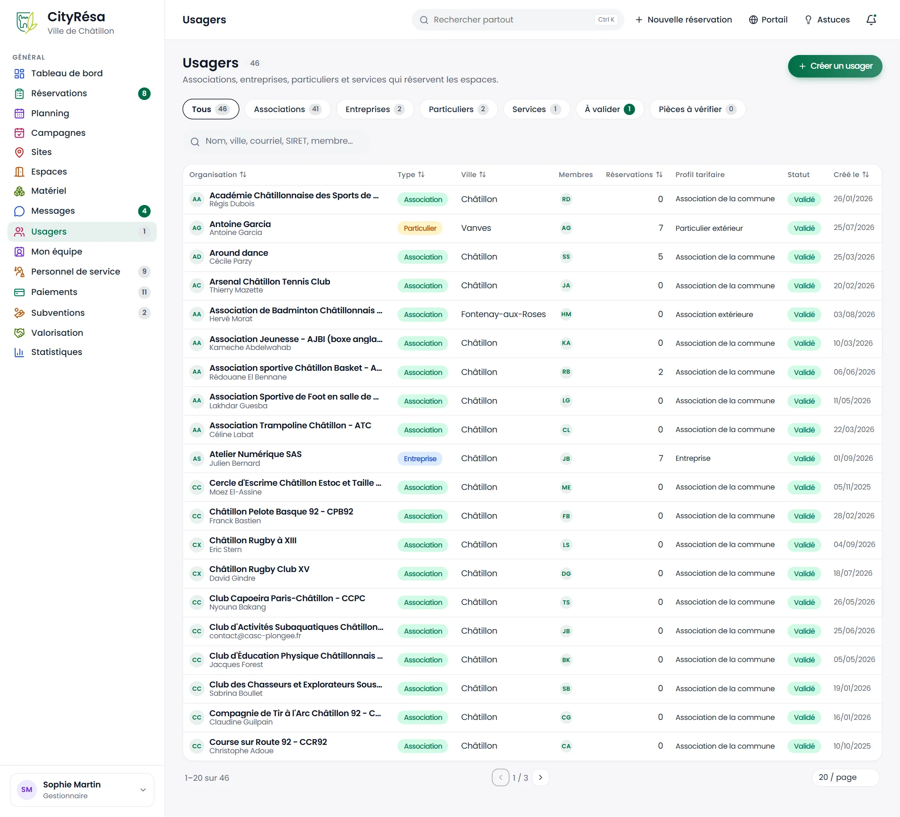
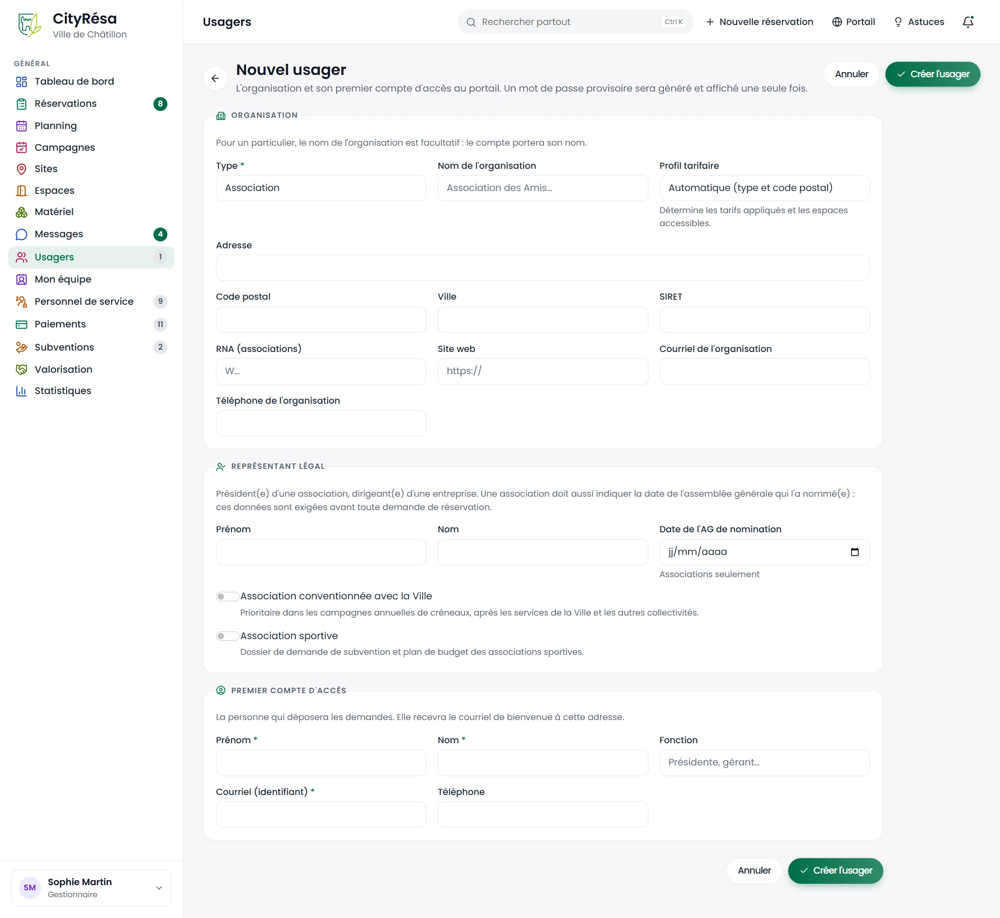
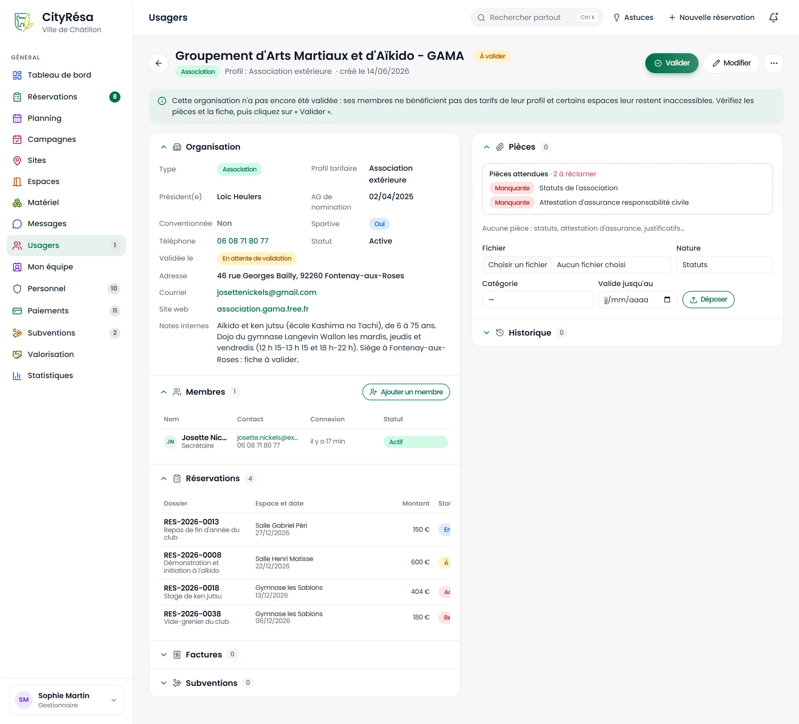
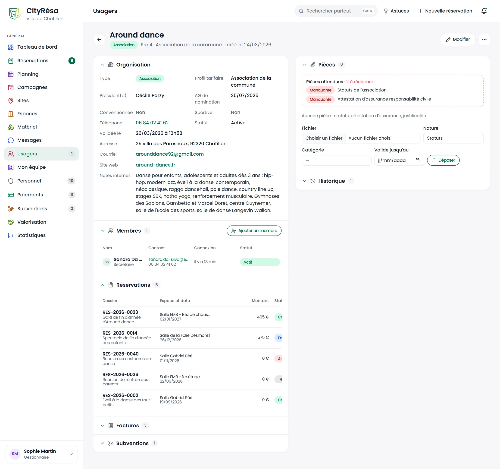
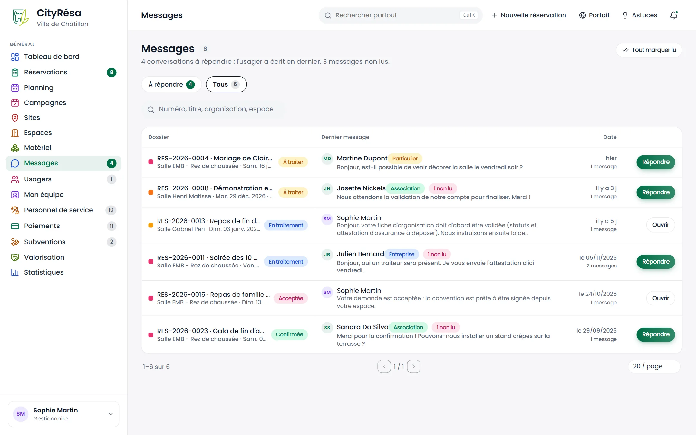
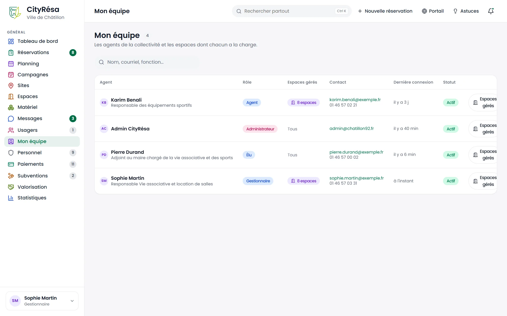

# 5. Usagers, messages et équipe

Ce chapitre présente le fichier des usagers (organisations et leurs comptes), la validation des fiches et des pièces justificatives, la boîte des messages échangés avec les usagers et l'écran Mon équipe qui répartit les espaces entre les agents.

## 5.1 La liste des usagers

**À quoi ça sert** — Retrouver toute organisation qui réserve les espaces : association, entreprise, particulier, service de la Ville ou autre collectivité, et repérer celles qui demandent une action (fiche à valider, pièce à renouveler).

**Qui** — Tous les agents en lecture ; création et modification avec le droit d'écriture sur « Usagers » (gestionnaires et agents par défaut).

*Figure — les 46 usagers, avec leur type, leur ville, leur membre, leur nombre de réservations, leur profil tarifaire et leur statut.*

**Ce que l'on voit**

- Les onglets **Tous**, **Associations**, **Entreprises**, **Particuliers**, **Services**, **À valider** et **Pièces à vérifier**, chacun avec son compteur.
- La recherche (nom, ville, courriel, SIRET, membre) et le bouton **Créer un usager**.
- Pour chaque organisation : son nom et le nom de son contact principal, son **Type** (pastille colorée), sa **Ville**, les initiales de ses **Membres**, son nombre de **Réservations**, son **Profil tarifaire** et son **Statut** : **Validé**, **À valider** ou **Inactif**. Une pastille **Pièce expirée** ou **Pièce à renouveler** s'ajoute au besoin.

**Règles à connaître**

- Un particulier est enregistré comme une organisation à son nom : c'est ce qui permet de lui appliquer un profil tarifaire et de suivre ses factures comme pour les autres.
- L'onglet **À valider** regroupe les organisations actives dont la fiche n'a pas encore été validée par la Ville.
- L'onglet **Pièces à vérifier** regroupe les organisations dont une pièce datée est expirée ou arrive à expiration (dans les 30 jours par défaut, délai réglable dans les paramètres).

## 5.2 Créer un usager et son premier compte

**À quoi ça sert** — Enregistrer une organisation sans attendre son inscription en ligne, avec la personne qui déposera les demandes sur le portail.

**Qui** — Agents et gestionnaires en écriture sur « Usagers ».

*Figure — le formulaire « Nouvel usager » : organisation, représentant légal et premier compte d'accès.*

**Ce que l'on voit** — Trois parties :

- **Organisation** : **Type** (obligatoire), **Nom de l'organisation**, **Profil tarifaire** (« Automatique (type et code postal) » par défaut), **Adresse**, **Code postal**, **Ville**, **SIRET**, **RNA (associations)**, **Site web**, **Courriel de l'organisation**, **Téléphone de l'organisation**.
- **Représentant légal** : **Prénom**, **Nom**, **Date de l'AG de nomination** (associations seulement) et l'interrupteur **Association conventionnée avec la Ville**.
- **Premier compte d'accès** : **Prénom**, **Nom**, **Fonction**, **Courriel (identifiant)** et **Téléphone**.

**Comment faire**

1. Dans la liste des usagers, cliquez sur **Créer un usager**.
2. Choisissez le **Type**. Pour un particulier, le nom de l'organisation est facultatif : le compte portera le nom de la personne.
3. Laissez le **Profil tarifaire** sur « Automatique » sauf cas particulier : il sera déduit du type et du code postal.
4. Remplissez le représentant légal (président d'une association, dirigeant d'une entreprise).
5. Saisissez la personne qui utilisera le portail ; son courriel lui servira d'identifiant.
6. Cliquez sur **Créer l'usager**.
7. Un mot de passe provisoire s'affiche **une seule fois** : notez-le ou transmettez-le à la personne. Elle reçoit aussi un courriel de bienvenue.

**Règles à connaître**

- **Profil tarifaire automatique** : il dépend du type et du code postal, comparé à celui de la Ville. Un particulier ou une association de Châtillon reçoit le profil « de la commune », sinon le profil « extérieur » ; une entreprise, un service de la Ville ou une autre collectivité reçoivent le profil correspondant. Le profil détermine les tarifs appliqués et les espaces accessibles.
- **Données exigées avant toute demande** : une association doit avoir renseigné son nom, les coordonnées du contact, l'adresse de son siège, le président et la date de l'AG qui l'a nommé ; une entreprise sa raison sociale, son SIRET et son dirigeant ; un particulier ses seules coordonnées. Tant qu'il manque une donnée, le portail refuse le dépôt d'une demande et la fiche affiche « Dossier incomplet pour réserver ».
- **Association conventionnée** : elle passe en priorité dans les campagnes annuelles de créneaux, après les services de la Ville et les autres collectivités. Ce drapeau sert aussi au suivi des seuils de valorisation (chapitre 7).

## 5.3 Valider la fiche d'une organisation

**À quoi ça sert** — Contrôler une organisation inscrite en ligne avant de lui accorder les tarifs de son profil et l'accès aux espaces réservés à ce profil.

**Qui** — Agents et gestionnaires en écriture sur « Usagers ».

*Figure — la fiche d'une association pas encore validée : bandeau d'explication, bouton Valider, pièces attendues manquantes.*

**Ce que l'on voit**

- Le titre porte la pastille **À valider** ; sous le titre, le type, le profil et la date de création.
- Un bandeau rappelle que les membres ne bénéficient pas encore des tarifs de leur profil et que certains espaces leur restent inaccessibles.
- Le bloc **Organisation** affiche **Validée le : En attente de validation**.
- Le bloc **Pièces** signale les **Pièces attendues** et le nombre de pièces « à réclamer » (ici les statuts et l'attestation d'assurance, toutes deux **Manquante**).
- Le bloc **Réservations** montre que l'organisation peut déjà déposer des demandes.

**Comment faire**

1. Ouvrez l'onglet **À valider** de la liste des usagers, puis la fiche concernée.
2. Vérifiez les informations de la fiche et les pièces déposées. S'il manque des pièces, demandez-les à l'usager.
3. Cliquez sur **Valider** en haut à droite.
4. Les membres de l'organisation reçoivent un courriel les informant que leur compte est validé.

**Règles à connaître**

- Une organisation non validée peut déposer des demandes, mais sans les tarifs ni les espaces réservés de son profil.
- Une organisation désactivée (menu « … », **Désactiver l'organisation**) ne peut plus se connecter ; **Réactiver l'organisation** la rétablit.

## 5.4 La fiche d'un usager : organisation, membres, réservations

**À quoi ça sert** — Consulter tout l'historique d'une organisation : coordonnées, comptes rattachés, réservations, factures, subventions, pièces et actions passées.

**Qui** — Tous les agents en lecture ; les actions demandent le droit d'écriture sur « Usagers », l'anonymisation le droit de suppression.

*Figure — la fiche de l'association Around dance : organisation, membre, réservations, factures, subventions, pièces et historique.*

**Ce que l'on voit**

- À gauche, le bloc **Organisation** : type, profil tarifaire, président(e), date de l'AG de nomination, **Conventionnée**, téléphone, statut, date de validation, adresse, courriel, site web et **Notes internes** (visibles des seuls agents). Si l'usager a manqué des créneaux sans prévenir, un compteur **Absences non signalées** apparaît.
- Le bloc **Membres** : chaque compte avec son nom, son statut (**Actif**, **Désactivé** ou **Anonymisé**), son courriel, son téléphone, sa fonction et sa dernière connexion, et le bouton **Ajouter un membre**. Un administrateur y voit en plus la pastille **2FA** des comptes protégés par la double authentification, et le nom de chaque membre ouvre la fiche de son compte (chapitre 9).
- Les blocs **Réservations** (numéro, montant et statut, puis date, espace et objet) et **Factures** (numéro, montant et statut, puis libellé et échéance), et le bloc **Subventions**. Factures et Subventions sont repliés : cliquez sur leur titre pour les ouvrir.
- À droite, le bloc **Pièces** et le bloc **Historique** des actions.

**Comment faire**

1. **Modifier la fiche** : cliquez sur **Modifier**. C'est là que vous changez le profil tarifaire, cochez « conventionnée » ou complétez les notes internes.
2. **Ajouter un membre** : cliquez sur **Ajouter un membre**, saisissez prénom, nom, courriel, téléphone et fonction, puis **Créer le compte**. Un mot de passe provisoire s'affiche une seule fois et la personne reçoit le courriel de bienvenue.
3. **Modifier un membre** : cliquez sur le crayon en bout de ligne, corrigez prénom, nom, courriel, téléphone ou fonction, puis **Enregistrer**. Le courriel est l'identifiant de connexion : s'il change, la personne se connecte avec la nouvelle adresse.
4. **Gérer un membre** : en bout de ligne, les autres icônes permettent d'**exporter ses données** (réponse à une demande d'accès à ses données personnelles), d'**envoyer un lien de réinitialisation** du mot de passe, de **désactiver** ou **réactiver** le compte et, pour les gestionnaires, d'**anonymiser** le compte.

> **Attention** — L'anonymisation efface définitivement les coordonnées de la personne et rend la connexion impossible ; ses dossiers restent archivés. Elle ne peut pas être annulée.

## 5.5 Les pièces justificatives datées

**À quoi ça sert** — Conserver les statuts, attestations d'assurance et autres justificatifs d'une organisation, avec leur date de fin de validité, et être alerté avant leur expiration.

**Qui** — Agents et gestionnaires en écriture sur « Usagers ». L'usager peut aussi déposer ses pièces depuis « Mon organisation » sur le portail.

**Ce que l'on voit** — Dans le bloc **Pièces** de la fiche (voir les figures ci-dessus) :

- le cadre **Pièces attendues**, qui liste ce que le type d'usager doit fournir, avec l'état de chaque pièce : **Manquante**, fournie, valide, à renouveler ou expirée ;
- la liste des pièces déposées, avec une pastille « Valide jusqu'au … », « Expire dans … jours » ou « Expirée le … » pour les pièces datées ;
- le formulaire de dépôt : **Fichier**, **Nature**, **Catégorie**, **Valide jusqu'au** et le bouton **Déposer**.

**Comment faire**

1. Cliquez sur **Choisir un fichier** et sélectionnez le document.
2. Choisissez sa **Nature** (Statuts, Attestation d'assurance, Pièce justificative…) et, si besoin, une **Catégorie**.
3. Pour une pièce qui expire (attestation d'assurance annuelle), saisissez la date dans **Valide jusqu'au**.
4. Cliquez sur **Déposer**.
5. Pour suivre les échéances de toutes les organisations, ouvrez l'onglet **Pièces à vérifier** de la liste des usagers.

**Règles à connaître**

- Pièces attendues : statuts et attestation d'assurance responsabilité civile pour une association ; attestation d'assurance pour une entreprise ou un particulier.
- Quand plusieurs pièces de même nature existent, c'est la plus favorable (la validité la plus lointaine) qui compte.
- Avant l'expiration (30 jours par défaut), puis le jour même, l'usager et les gestionnaires reçoivent un courriel et une notification. Les pièces expirées ou bientôt expirées apparaissent aussi dans les alertes du tableau de bord.
- Selon le réglage choisi par la Ville dans les paramètres, une pièce attendue manquante ou expirée est seulement signalée (réglage par défaut), bloque le dépôt d'une demande sur le portail, ou bloque aussi l'acceptation par un agent.

## 5.6 Les messages

**À quoi ça sert** — Répondre aux usagers : chaque dossier de réservation a son fil de discussion, et la page Messages regroupe tous les fils de votre périmètre.

**Qui** — Les agents ayant le droit « Messages ». Chaque agent ne voit que les dossiers des espaces dont il a la charge (ou tous s'il n'est rattaché à aucun espace).

*Figure — la boîte des messages : 4 conversations à répondre sur 6 fils de discussion, dont 2 messages encore non lus.*

**Ce que l'on voit**

- Le résumé « 4 conversations à répondre : l'usager a écrit en dernier. 2 messages non lus. » et le bouton **Tout marquer lu**.
- Les onglets **À répondre** et **Tous**, et une recherche par numéro, titre, organisation ou espace.
- Pour chaque fil : le dossier (numéro, objet, espace, date et statut), le dernier message (auteur, type d'usager, pastille « 1 non lu », début du texte), la date et le nombre de messages.
- Le bouton **Répondre** (vert, ligne en gras) pour une conversation où l'usager a écrit en dernier, **Ouvrir** pour les autres.

**Comment faire — répondre à un usager**

1. Cliquez sur **Répondre** : la fiche du dossier s'ouvre sur le **Fil de discussion**.
2. Les messages de l'usager sont marqués lus à l'ouverture du dossier.
3. Écrivez votre réponse dans la zone « Écrire à l'usager… ».
4. Cliquez sur **Envoyer**. L'usager est prévenu par courriel et par une notification sur le portail.

**Comment faire — laisser une note interne**

1. Dans le fil de discussion du dossier, écrivez votre texte.
2. Cochez **Note interne (invisible pour l'usager)** avant de cliquer sur **Envoyer**.
3. La note apparaît dans le fil avec la pastille **Note interne**. Elle n'est visible que des agents et n'apparaît pas dans la page Messages.

**Règles à connaître**

- Une conversation est **à répondre** tant que le dernier message échangé vient de l'usager. Lire le message ne suffit pas : elle n'en sort que lorsqu'un agent répond à l'usager. Une note interne ne compte pas comme une réponse.
- La pastille « non lu » indique seulement les messages d'usager que personne n'a encore ouverts. **Tout marquer lu** les marque lus, après confirmation, sans changer les conversations à répondre.
- Le même décompte alimente la pastille de **Messages** dans le menu, l'alerte et la ligne « Conversations à répondre » du tableau de bord, et le récapitulatif quotidien.

> **Astuce** — Utilisez les notes internes pour passer le relais à un collègue (« attestation reçue par courrier, à scanner ») : elles restent attachées au dossier.

## 5.7 Mon équipe

**À quoi ça sert** — Voir les agents de son équipe et répartir les espaces entre eux : chacun traite les demandes et reçoit les messages des espaces dont il a la charge. L'équipe d'un agent, ce sont les collègues de son **secteur** (Salles ou Sports) et les agents **transversaux**, qui n'ont pas de secteur (élu, financier…). Un agent transversal voit tous les agents. Les administrateurs n'y figurent pas.

**Qui** — Les gestionnaires par défaut : l'écran demande le droit « Mon équipe », et la répartition des espaces son niveau écriture. Les autres rôles (Agent, Financier, Élu, Lecteur) ne l'ont pas dans leur menu, sauf si un administrateur leur ouvre ce droit dans **Rôles & permissions**. L'administrateur, lui, n'a pas « Mon équipe » : il retrouve la même liste, complète, dans **Administration › Comptes** (chapitre 9), où il crée aussi les comptes.

*Figure — l'équipe vue par Sophie Martin, du secteur Salles : elle-même et un agent transversal, avec leur rôle, leur secteur, les espaces gérés, leur contact et leur dernière connexion.*

**Ce que l'on voit**

- Une recherche par nom, courriel, fonction, rôle ou secteur. Si des comptes sont désactivés, deux onglets **Actifs** et **Inactifs** les séparent.
- Pour chaque agent : son nom et sa fonction, son **Rôle** (Agent, Élu, Gestionnaire…), son **Secteur** (Salles, Sports ou **Transversal**), ses **Espaces gérés** (« 8 espaces » ; survolez la pastille pour voir la liste ; **Tous · Sports** s'il n'est rattaché à aucun espace de son secteur, ou **Tous** pour un agent transversal sans rattachement), son contact et sa **Dernière connexion**. Les colonnes portant deux flèches se trient d'un clic.
- En bout de ligne, l'icône de porte (**Espaces gérés**) pour modifier son rattachement.

**Comment faire — rattacher un agent à des espaces**

1. Cliquez sur l'icône de porte (**Espaces gérés**) au bout de la ligne de l'agent.
2. Choisissez son **Rôle sur ces espaces** :
   - **Gestionnaire** : décide sur les demandes ;
   - **Lecteur** : consulte seulement ;
   - **Notifié** : reçoit les alertes.
3. Cochez les espaces concernés ; ils sont regroupés par site.
4. Cliquez sur **Enregistrer**.

**Règles à connaître**

- Un agent d'un secteur ne peut être rattaché qu'aux espaces de ce secteur : la fenêtre ne propose que ceux-là. Un agent transversal peut être rattaché partout.
- Aucune case cochée = l'agent voit et traite **tous les espaces de son secteur** (tous les espaces s'il est transversal), dans la limite des droits de son rôle.
- Si vous avez vous-même un secteur, vous ne répartissez que les espaces de ce secteur, entre vos collègues ; les rattachements d'un agent transversal dans l'autre secteur ne sont ni affichés ni modifiés.
- Cocher des espaces restreint son périmètre : listes de réservations, planning et messages ne montrent plus que ces espaces.
- Le même rattachement se règle espace par espace dans l'onglet **Gestionnaires** de la fiche d'un espace (chapitre 4).
- Le rôle général d'un agent (Gestionnaire, Agent, Financier, Élu, Lecteur, Administrateur) fixe ses droits par catégorie ; son secteur fixe son équipe et ses espaces. Les deux se modifient dans Administration › Comptes.
