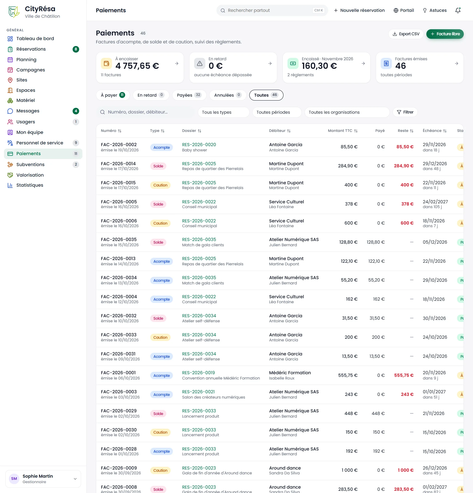
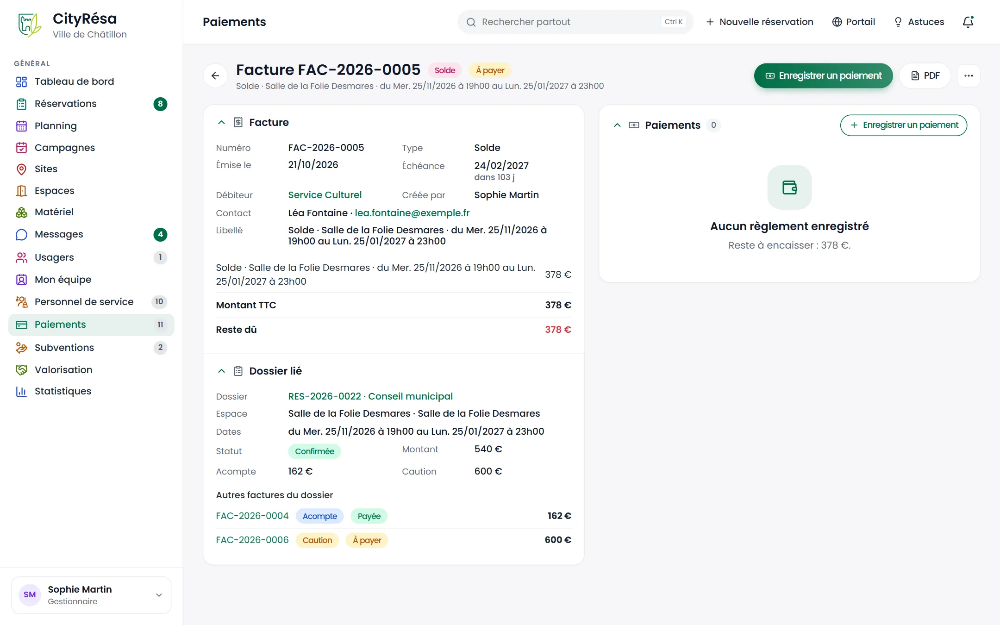
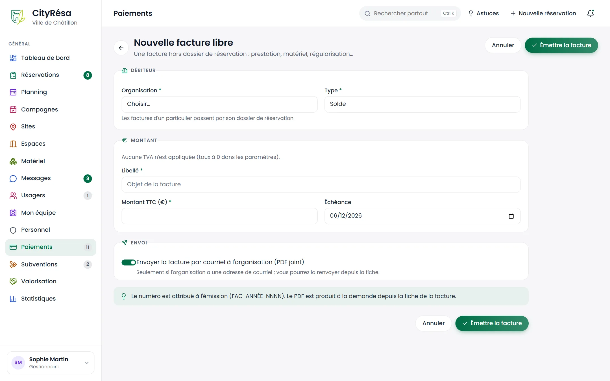

# 6. Paiements

Ce chapitre décrit le suivi des factures émises pour les réservations (acompte, solde, caution, frais d'annulation), les factures libres et les avoirs, l'enregistrement des règlements, les relances et l'export comptable.

## 6.1 La liste des factures

**À quoi ça sert** — Suivre en un seul écran ce qui reste à encaisser, ce qui est en retard et ce qui a été réglé.

**Qui** — Tous les agents en lecture. L'émission de factures et l'enregistrement des règlements demandent le droit d'écriture sur « Paiements » (gestionnaires, agents et financiers par défaut). Le module Paiements doit être activé dans les paramètres.

*Figure — la page Paiements : quatre compteurs, les onglets par statut et la liste des 47 factures.*

**Ce que l'on voit**

- En haut à droite, **Export CSV** et **Facture libre**.
- Quatre cartes cliquables :
  - **À encaisser** : le montant restant dû et le nombre de factures concernées (4 729,15 €, 11 factures) ;
  - **En retard** : le montant des factures dont l'échéance est dépassée ;
  - **Encaissé** sur le mois en cours et le nombre de règlements ;
  - **Factures émises**, toutes périodes.
- Les onglets **À payer**, **En retard**, **Payées**, **Annulées** et **Toutes**.
- La recherche (numéro, dossier, débiteur) et les filtres **Tous les types**, **Toutes périodes**, **Toutes les organisations**, puis **Filtrer**.
- Pour chaque facture : **Numéro** et date d'émission, **Type** (pastille Acompte, Solde, Caution, Frais d'annulation, Avoir), **Dossier** lié, **Débiteur** et son contact, **Montant TTC**, **Payé**, **Reste** (en rouge s'il reste une somme due) et **Échéance** (avec le nombre de jours restants).

**Règles à connaître**

- Chaque facture porte un numéro unique de la forme FAC-ANNÉE-NNNN, attribué à l'émission.
- Les services de la Ville et les mises à disposition gratuites ne génèrent aucune facture.

## 6.2 Les factures d'un dossier : acompte, solde, caution, frais d'annulation

**À quoi ça sert** — Facturer une réservation en une ou plusieurs fois, et la caution à part.

**Qui** — Les agents qui peuvent décider sur le dossier et qui ont le droit d'écriture sur « Paiements ».

**Comment faire**

La plupart des factures partent toutes seules :

1. Quand un dossier est **confirmé**, CityRésa émet la facture d'**acompte** (si un acompte est prévu) ou directement la facture de **solde**.
2. Quand l'usager **signe sa convention** et qu'un acompte est attendu, la facture d'acompte part immédiatement.
3. Les autres factures s'émettent à la main depuis la section **Factures** de la fiche du dossier, avec les boutons **Facturer l'acompte**, **Facturer le solde** et **Facturer la caution**. Ces boutons n'apparaissent que pour un dossier signé, confirmé ou terminé, non gratuit, et seulement si la facture correspondante n'existe pas encore.

Chaque facture est produite en PDF, jointe au dossier et envoyée par courriel à l'usager avec son échéance.

**Règles à connaître**

- **Acompte** : un pourcentage du montant TTC du dossier, réglé dans les paramètres.
- **Solde** : le montant TTC du dossier moins les acomptes déjà facturés.
- **Caution** : le montant de caution de l'espace, facturé à part, sans TVA. Une fois réglée, elle est marquée encaissée sur le dossier ; elle est ensuite restituée (la facture passe alors à « Remboursée ») ou retenue en tout ou partie après l'état des lieux de sortie.
- **Frais d'annulation** : lorsqu'un dossier accepté, signé ou confirmé est annulé, les factures encore dues sont annulées et, si la Ville a défini un barème, une facture « Frais d'annulation » est émise selon le délai restant avant l'événement. L'agent voit le montant prévu avant de confirmer l'annulation et peut annuler sans frais.
- L'échéance est fixée par défaut à 30 jours après l'émission.
- Un acompte entièrement réglé fait passer un dossier « signé » à « confirmé ».

> **Attention** — Un acompte déjà réglé n'est pas déduit automatiquement des frais d'annulation : faites un avoir à la main si nécessaire (voir 6.4).

## 6.3 La fiche d'une facture et l'enregistrement d'un règlement

**À quoi ça sert** — Consulter le détail d'une facture, le dossier lié, et saisir les règlements reçus.

**Qui** — Agents, gestionnaires et financiers en écriture sur « Paiements ».

*Figure — la facture de solde FAC-2026-0005 du Service Culturel, à payer, sans règlement enregistré.*

**Ce que l'on voit**

- En haut : le numéro, le type (**Solde**), le statut (**À payer**) et le libellé ; une pastille rouge **Échéance dépassée** s'ajoute si la facture est en retard. À droite, **Enregistrer un paiement**, **PDF** et le menu « … ».
- Le bloc **Facture** : numéro, type, date d'émission, échéance (avec le nombre de jours restants), débiteur, auteur, contact, libellé, puis le détail des montants : **Montant TTC**, déjà réglé et **Reste dû**.
- Le bloc **Dossier lié** : numéro et objet du dossier, espace, dates, statut, montant, acompte et caution, ainsi que les **Autres factures du dossier** (ici l'acompte payé et la caution à payer).
- Le bloc **Paiements** à droite : la liste des règlements, ou « Aucun règlement enregistré » avec le reste à encaisser.

**Comment faire — enregistrer un règlement**

1. Cliquez sur **Enregistrer un paiement**.
2. Le **Montant (€)** est pré-rempli avec le reste dû ; corrigez-le pour un règlement partiel.
3. Indiquez la **Date du règlement** (elle ne peut pas être dans le futur).
4. Choisissez le **Mode** : Régie (sur place), Virement, Chèque, Carte bancaire, Mandat administratif ou Gratuité.
5. Saisissez la **Référence** (numéro de chèque, de virement, de quittance).
6. Cliquez sur **Enregistrer**.

**Comment faire — autres actions du menu « … »**

- **Renvoyer à l'usager** : renvoie la facture par courriel avec le PDF en pièce jointe.
- **Ouvrir le dossier** et **Fiche de l'organisation** : accès direct au dossier et au débiteur.
- **Annuler la facture** : la facture reste visible, marquée « Annulée ».

**Règles à connaître**

- Une facture peut recevoir plusieurs règlements ; elle passe à **Payée** dès que leur total atteint son montant.
- Chaque règlement est inscrit dans l'historique du dossier, et l'usager reçoit un courriel et une notification « Paiement reçu ».
- Une facture qui porte déjà un règlement ne peut pas être annulée : émettez un avoir.

## 6.4 Les factures libres et les avoirs

**À quoi ça sert** — Facturer une organisation en dehors d'un dossier de réservation (prestation, matériel manquant, régularisation) ou émettre un avoir.

**Qui** — Agents, gestionnaires et financiers en écriture sur « Paiements ».

*Figure — le formulaire « Nouvelle facture libre » : débiteur, montant et envoi par courriel.*

**Ce que l'on voit** — Trois blocs : **Débiteur** (**Organisation** et **Type**), **Montant** (**Libellé**, **Montant TTC (€)**, **Échéance**, pré-remplie à 30 jours) et **Envoi** (interrupteur **Envoyer la facture par courriel à l'organisation (PDF joint)**). Un encadré rappelle que le numéro est attribué à l'émission. Une ligne indique le taux de TVA appliqué (« Aucune TVA n'est appliquée (taux à 0 dans les paramètres) » dans la démonstration).

**Comment faire**

1. Dans la page Paiements, cliquez sur **Facture libre**.
2. Choisissez l'**Organisation** à facturer.
3. Choisissez le **Type** : Acompte, Solde, Caution, Avoir ou Frais d'annulation. Pour un avoir, choisissez « Avoir ».
4. Saisissez le **Libellé** (objet de la facture), le **Montant TTC (€)** et vérifiez l'**Échéance**.
5. Laissez l'envoi par courriel activé si l'organisation doit recevoir le PDF tout de suite.
6. Cliquez sur **Émettre la facture**.

**Règles à connaître**

- Comme le rappelle le formulaire, les factures d'un particulier passent normalement par son dossier de réservation : réservez la facture libre aux cas qui n'ont pas de dossier.
- La TVA éventuelle est calculée à partir du montant TTC ; une caution et un avoir n'en portent pas.
- L'envoi ne part que si l'organisation a une adresse de courriel ; vous pouvez renvoyer la facture plus tard depuis sa fiche.

## 6.5 Les relances

**À quoi ça sert** — Rappeler aux usagers les factures dont l'échéance est passée.

**Qui** — Automatique ; aucun geste n'est nécessaire.

**Comment ça marche**

1. Chaque jour, CityRésa recherche les factures à payer dont l'échéance est dépassée.
2. Pour chacune, l'usager auteur du dossier reçoit une notification « Facture … échue » sur le portail, avec le montant à régler et un lien vers son dossier.
3. Une même facture n'est pas relancée plus d'une fois par semaine.

**Règles à connaître**

- Les factures en retard apparaissent dans la carte et l'onglet **En retard** de la page Paiements, et dans les alertes du tableau de bord.
- Pour une relance plus directe, utilisez **Renvoyer à l'usager** depuis la fiche de la facture.

## 6.6 L'export

**À quoi ça sert** — Transmettre la liste des factures au service financier ou la retravailler dans un tableur.

**Qui** — Tous les agents qui ont accès à la page Paiements.

**Comment faire**

1. Réglez les onglets, la recherche et les filtres pour n'afficher que les factures voulues (par exemple **Payées** sur une période).
2. Cliquez sur **Export CSV**.
3. Ouvrez le fichier obtenu dans votre tableur.

**Règles à connaître**

- L'export reprend la sélection affichée (onglet et filtres), sur toutes les pages de la liste, et pas seulement la page visible.

> **Astuce** — Le paiement en ligne par carte n'est pas proposé : les règlements reçus en régie, par chèque, virement, carte sur place ou mandat administratif se saisissent à la main comme décrit en 6.3.
