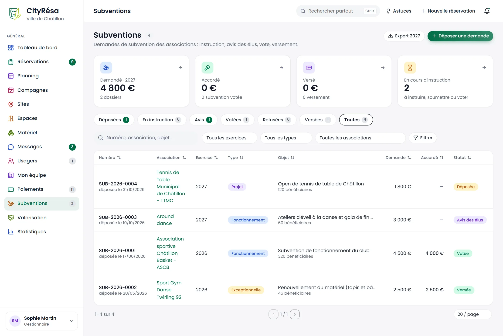
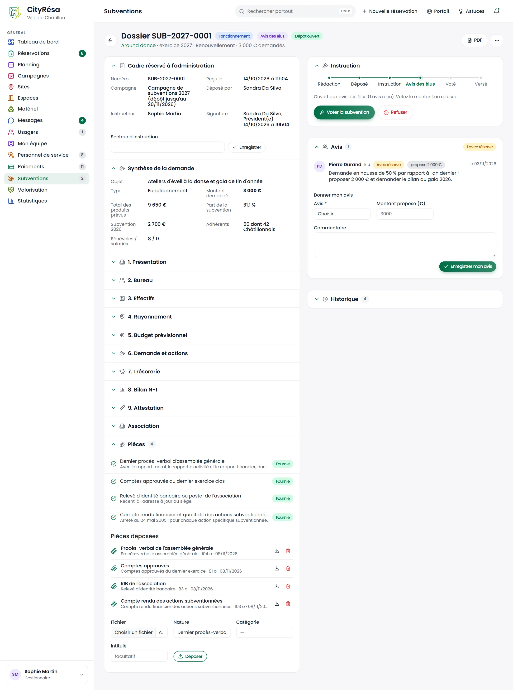
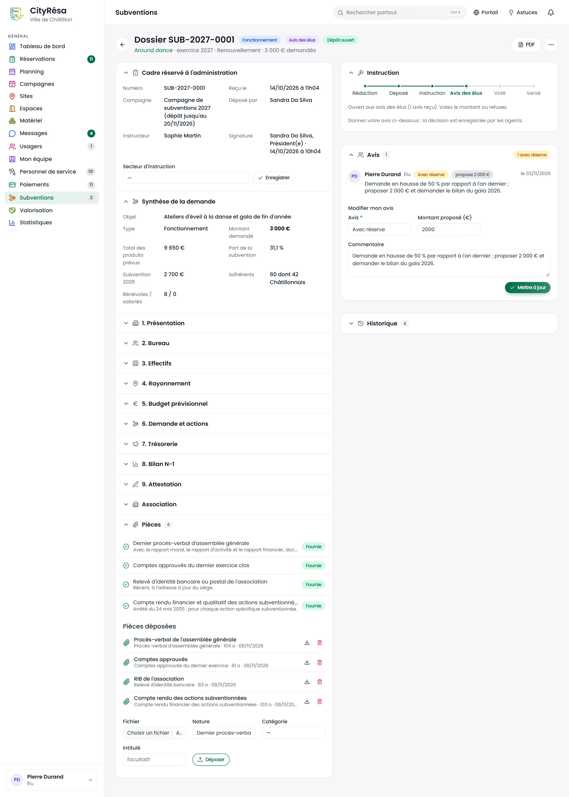
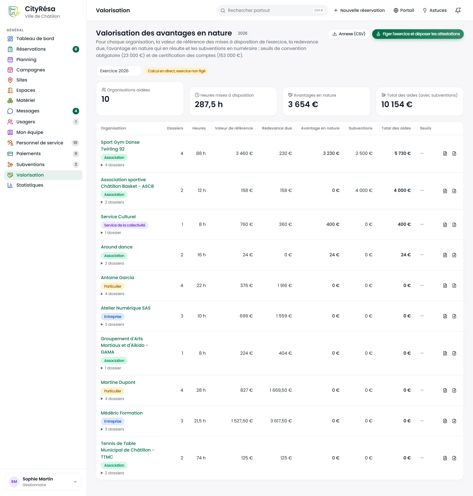

# 7. Subventions et valorisation

Ce chapitre couvre le module destiné aux associations : le circuit des demandes de subvention, de leur dépôt à leur versement en passant par l'avis des élus, puis la valorisation annuelle des mises à disposition de salles, qui alimente les attestations remises aux associations et le suivi des seuils réglementaires.

## 7.1 La liste des demandes de subvention

**À quoi ça sert** — Suivre toutes les demandes de subvention des associations, par exercice et par étape, et voir d'un coup d'œil les montants demandés, accordés et versés.

**Qui** — Tous les agents peuvent consulter (les agents en lecture seule par défaut). Les gestionnaires instruisent et décident ; les élus donnent leur avis. Le module Subventions doit être activé dans les paramètres.

*Figure — la page Subventions : quatre compteurs de l'exercice, les onglets par statut et les 4 demandes.*

**Ce que l'on voit**

- En haut à droite, **Export 2027** (export de l'exercice affiché) et **Déposer une demande**.
- Quatre cartes cliquables : **Demandé** pour l'exercice (4 800 €, 2 dossiers), **Accordé** (montant et nombre de subventions votées), **Versé** (montant et nombre de versements) et **En cours d'instruction** (dossiers à instruire, soumettre ou voter).
- Les onglets **Déposées**, **En instruction**, **Avis**, **Votées**, **Refusées**, **Versées** et **Toutes**.
- La recherche (numéro, association, objet) et les filtres **Tous les exercices**, **Tous les types**, **Toutes les associations**, puis **Filtrer**.
- Pour chaque demande : le **Numéro** (SUB-ANNÉE-NNNN) avec l'exercice et la date de dépôt, l'**Association**, l'**Objet** avec le type (Fonctionnement, Projet, Exceptionnelle, Investissement) et le nombre de bénéficiaires, les montants **Demandé** et **Accordé**, et le **Statut**.

**Comment faire — déposer une demande au nom d'une association**

L'association dépose normalement sa demande elle-même depuis « Mes subventions » sur le portail. Pour une demande reçue sur papier ou par courriel :

1. Cliquez sur **Déposer une demande**.
2. Choisissez l'**Association demandeuse** et l'**Exercice**.
3. Choisissez le **Type**, puis saisissez l'**Objet** et la **Description**.
4. Indiquez le **Montant demandé (€)**, le **Budget total du projet (€)** et le nombre de **Bénéficiaires**.
5. Cliquez sur **Déposer la demande**. Elle reçoit son numéro et le statut « Déposée ».

**Règles à connaître**

- Seules les organisations de type « association » peuvent demander une subvention.
- L'exercice proposé par défaut est l'année suivante à partir du mois d'octobre.

## 7.2 Le circuit d'une demande et son instruction

**À quoi ça sert** — Faire avancer une demande étape par étape, en gardant la trace de chaque décision.

**Qui** — Les utilisateurs qui ont le droit d'écriture sur « Subventions » (gestionnaires et élus par défaut).

*Figure — la demande SUB-2026-0003 d'Around dance, ouverte aux avis des élus, vue par la gestionnaire qui l'instruit.*

**Ce que l'on voit**

- En haut : le numéro, le type, le statut (**Avis des élus**), l'association, l'exercice et le montant demandé ; le bouton **Modifier** et le menu « … ».
- Le bloc **Demande** : numéro, exercice, type, statut, montant demandé, budget total (et la part que représente la demande : « 32 % demandés »), bénéficiaires, date de dépôt, auteur du dépôt, **Instructeur**, objet et description.
- Le bloc **Association** (replié) : coordonnées, validation de la fiche et comptes du portail.
- Le bloc **Pièces** : budget prévisionnel, bilan, RIB… avec le formulaire de dépôt (**Fichier**, **Nature**, **Catégorie**, **Intitulé**, bouton **Déposer**).
- À droite, le bloc **Instruction** avec la frise des étapes (**Déposée**, **Instruction**, **Avis des élus**, **Votée**, **Versée**), une phrase qui dit ce qu'il reste à faire, et les boutons de l'étape suivante (ici **Voter la subvention** et **Refuser**).
- Le bloc **Avis** : les avis déjà donnés et le formulaire pour donner le sien (voir 7.3).

**Comment faire — faire avancer la demande**

1. **Déposée** : cliquez sur **Prendre en instruction**. Vous devenez l'instructeur du dossier.
2. **En instruction** : vérifiez la demande et ses pièces, demandez les compléments à l'association, puis cliquez sur **Soumettre aux élus**.
3. **Avis des élus** : recueillez les avis (7.3), puis votez ou refusez (7.4).
4. **Votée** : une fois le paiement effectué, enregistrez le versement (7.4).

À chaque étape, **Refuser** reste possible jusqu'au vote.

**Règles à connaître**

- Les étapes s'enchaînent toujours dans cet ordre : Déposée → En instruction → Avis des élus → Votée → Versée. Le refus clôt la demande depuis les trois premières étapes.
- Une demande votée, refusée ou versée est close : elle ne peut plus être modifiée et ne reçoit plus d'avis.
- Seule une demande simplement déposée, sans aucun avis, peut être supprimée ; sinon, refusez-la.

## 7.3 L'avis des élus

**À quoi ça sert** — Permettre aux élus de se prononcer sur une demande et de proposer un montant avant le vote.

**Qui** — Les élus, et plus généralement tout utilisateur qui a le droit d'écriture sur « Subventions ».

*Figure — la même demande vue par l'élu Pierre Durand : son avis « Avec réserve » proposant 2 000 € est déjà enregistré et peut être modifié.*

**Ce que l'on voit**

- Le bloc **Avis** affiche le décompte des avis (« 1 avec réserve ») et chaque avis avec son auteur, son rôle, sa pastille (**Favorable**, **Avec réserve**, **Défavorable**), le montant proposé, le commentaire et sa date.
- Sous la liste, **Donner mon avis**, ou **Modifier mon avis** si vous en avez déjà donné un : **Avis**, **Montant proposé (€)** et **Commentaire**.

**Comment faire**

1. Ouvrez la demande depuis la page Subventions (onglet **Avis**).
2. Lisez la demande, ses pièces et les avis déjà donnés.
3. Choisissez votre **Avis** : Favorable, Avec réserve ou Défavorable.
4. Si vous le souhaitez, indiquez un **Montant proposé (€)** et un **Commentaire**.
5. Cliquez sur **Enregistrer mon avis** (ou **Mettre à jour** pour modifier un avis déjà donné).

**Règles à connaître**

- Chaque utilisateur ne donne qu'un avis par demande ; un nouvel enregistrement remplace le précédent.
- Les avis sont recueillis tant que la demande est déposée, en instruction ou soumise aux élus ; ils se ferment au vote ou au refus.

> **Attention** — Un élu donne un avis mais ne décide pas : il ne voit ni **Voter la subvention**, ni **Refuser**, ni **Modifier**. La carte Instruction le lui rappelle (« la décision est enregistrée par les agents »). Le vote, le refus et le versement sont saisis par les agents qui instruisent les subventions.

## 7.4 La décision et le versement

**À quoi ça sert** — Enregistrer le vote (montant accordé) ou le refus, prévenir l'association, puis constater le versement.

**Qui** — Les utilisateurs qui ont le droit d'écriture sur « Subventions ».

**Comment faire — voter la subvention**

1. Sur une demande au statut **Avis des élus**, cliquez sur **Voter la subvention**.
2. Le **Montant accordé (€)** est pré-rempli avec la moyenne des montants proposés par les élus (ou le montant demandé s'il n'y a pas de proposition) ; corrigez-le si besoin. Saisissez 0 pour un vote sans attribution.
3. Ajoutez une **Note (délibération, conditions…)**.
4. Cliquez sur **Enregistrer le vote**.

**Comment faire — refuser**

1. Cliquez sur **Refuser**.
2. Saisissez le **Motif du refus** (obligatoire) : il est transmis à l'association.
3. Cliquez sur **Refuser**.

**Comment faire — enregistrer le versement**

1. Sur une demande **Votée**, cliquez sur **Marquer versée**.
2. Indiquez la **Date du versement** (par défaut aujourd'hui, jamais dans le futur).
3. Cliquez sur **Marquer versée**. Le dossier est clos.

**Règles à connaître**

- Le vote et le refus envoient un courriel à l'association et une notification à chacun de ses membres ; l'association suit sa demande dans « Mes subventions ».
- Le versement prévient les membres de l'association par une notification ; la date du versement est ajoutée à la note de décision.
- Les subventions votées ou versées sont reprises dans la valorisation des aides (7.5).

## 7.5 La valorisation des avantages en nature

**À quoi ça sert** — Chiffrer, pour chaque organisation et chaque année civile, la valeur des salles mises à disposition gratuitement ou à prix réduit, l'ajouter aux subventions en argent, et vérifier les seuils réglementaires.

**Qui** — Les utilisateurs qui ont accès aux « Subventions » ; les actions (figer l'exercice, déposer les attestations) demandent le droit d'écriture. L'écran fait partie du module Subventions.

*Figure — la valorisation de l'exercice 2026 : 11 organisations aidées, 318,25 heures mises à disposition, 7 411,50 € d'avantages en nature et 13 911,50 € d'aides au total.*

**Ce que l'on voit**

- En haut : **Annexe (CSV)** et **Figer l'exercice et déposer les attestations**, puis le choix de l'**Exercice** et une pastille d'état (**Calcul en direct, exercice non figé**, ou la date à laquelle l'exercice a été figé).
- Quatre compteurs : **Organisations aidées**, **Heures mises à disposition**, **Avantages en nature** et **Total des aides (avec subventions)**.
- Un bandeau d'alerte si des associations dépassent le seuil de convention sans être conventionnées.
- Le tableau, une ligne par organisation : nom, type et pastille **Conventionnée** le cas échéant, le lien « N dossiers » qui déplie le détail de chaque dossier, puis **Dossiers**, **Heures**, **Valeur de référence**, **Redevance due**, **Avantage en nature**, **Subventions**, **Total des aides**, **Seuils** et deux icônes : l'attestation annuelle en PDF et le dépôt de l'attestation sur la fiche de l'organisation.

**Comment le calcul est fait**

1. Sont pris en compte les dossiers acquis (acceptés, signés, confirmés, terminés ou archivés) dont des créneaux tombent dans l'année.
2. **Heures** : les heures réellement occupées. Lorsqu'une présence a été constatée, les heures constatées remplacent les heures prévues ; un créneau manqué sans prévenir compte zéro.
3. **Valeur de référence** : les heures multipliées par la valeur horaire de valorisation de l'espace si elle est renseignée (coût de revient, valeur locative) ; sinon, le prix de la grille tarifaire « tous profils » de l'espace.
4. **Redevance due** : ce que l'organisation doit réellement payer pour ces heures (zéro pour une mise à disposition gratuite).
5. **Avantage en nature** : valeur de référence moins redevance, calculé **dossier par dossier** et jamais négatif.
6. **Total des aides** : avantages en nature plus subventions votées ou versées sur l'exercice.

**Comment faire — clôturer l'exercice et remettre les attestations**

1. Choisissez l'**Exercice** à traiter.
2. Vérifiez les montants ; dépliez « N dossiers » pour contrôler le détail d'une organisation.
3. Cliquez sur **Figer l'exercice et déposer les attestations**, puis confirmez. Les montants de toutes les organisations sont arrêtés et une attestation PDF est déposée sur la fiche de chacune ; l'organisation la retrouve dans « Mon organisation » sur le portail.
4. Pour une seule organisation, utilisez l'icône de dépôt en bout de ligne ; l'autre icône ouvre l'attestation sans la déposer.
5. Cliquez sur **Annexe (CSV)** pour obtenir l'annexe du compte administratif.

**Règles à connaître**

- **Seuils** : au-delà de 23 000 € d'aides sur l'exercice, une convention avec l'association est obligatoire (pastille **Convention obligatoire**) ; au-delà de 153 000 €, l'association doit faire certifier ses comptes (pastille **Comptes certifiés**). Ces deux montants se règlent dans Paramètres › Réservations.
- Une association qui dépasse le seuil de convention sans être cochée « conventionnée » sur sa fiche est signalée en tête de page et dans les alertes du tableau de bord. Cochez la case sur sa fiche une fois la convention signée.
- Tant que l'exercice n'est pas figé, les montants sont recalculés en direct. Une fois figé, la ligne affiche aussi le montant figé et une pastille **écart** si le calcul a changé depuis ; le bouton devient **Refiger et rééditer les attestations**.
- Le matériel n'est valorisé qu'à travers le prix de l'espace ; le temps de personnel (gardiennage) n'est pas valorisé.

> **Astuce** — Parce que l'avantage est calculé dossier par dossier, une entreprise ou un particulier peut avoir une redevance totale supérieure à la valeur de référence et un avantage malgré tout positif (un dossier gratuit à côté de dossiers payants). Une organisation qui paie plus que la valeur de référence sur tous ses dossiers apparaît avec un avantage nul.
