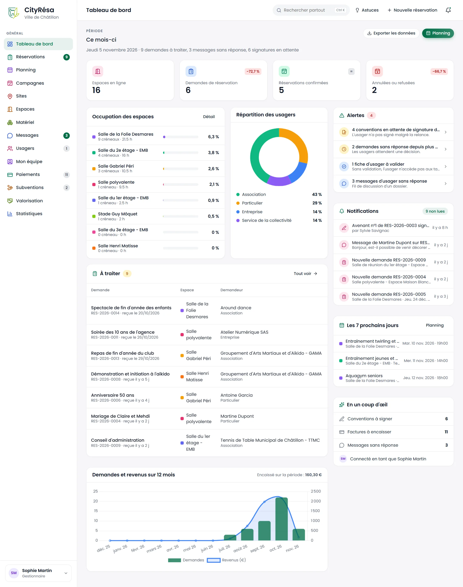
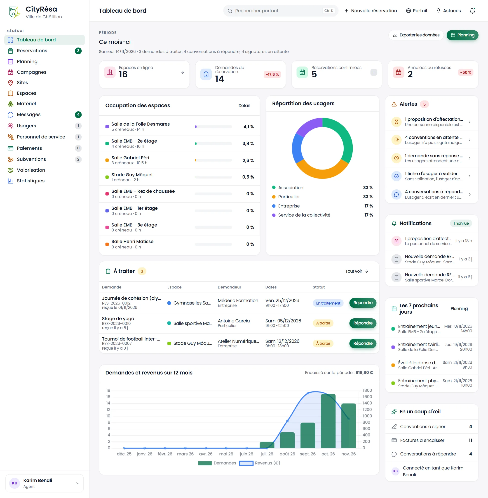
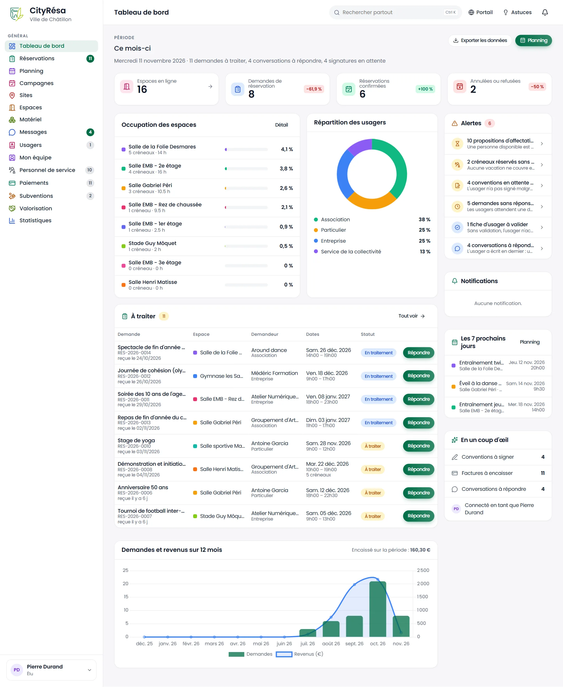
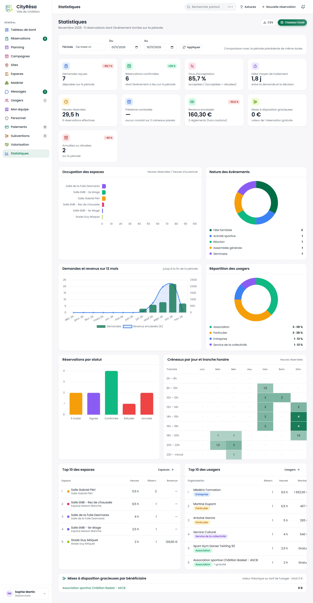
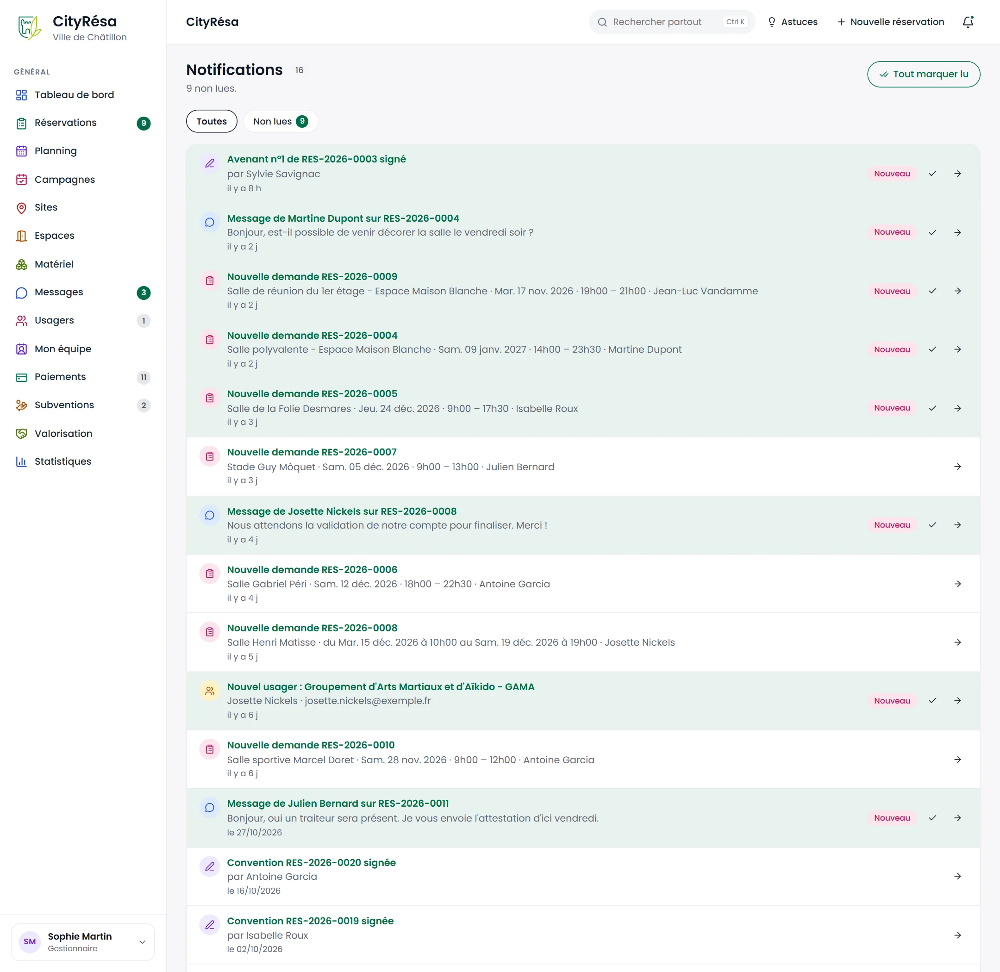
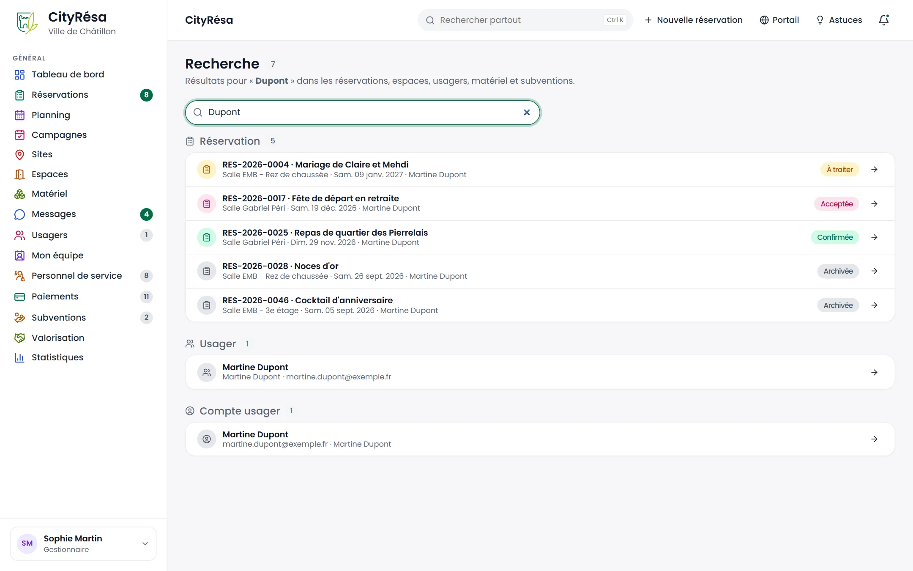
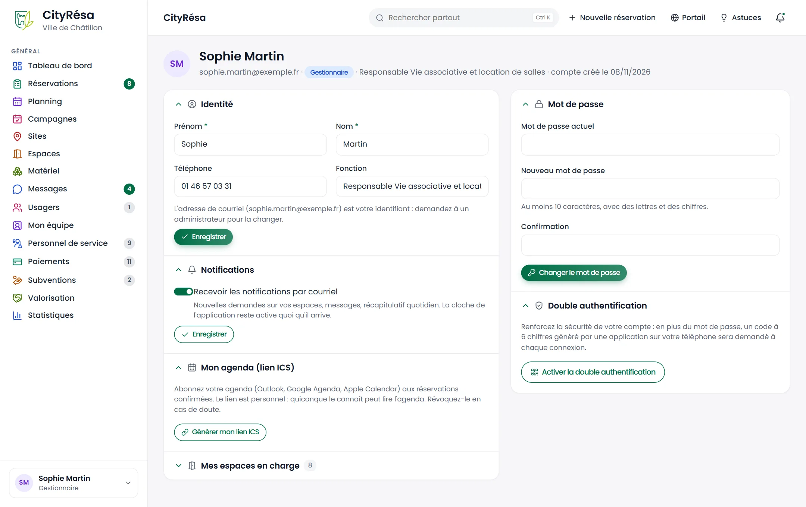
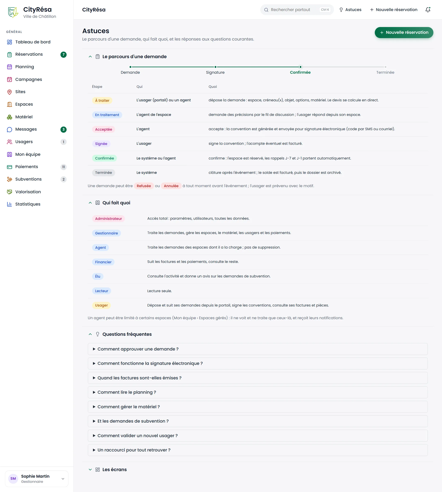

# 8. Tableau de bord, statistiques et outils du quotidien

Ce chapitre présente les écrans qui vous servent tous les jours, quel que soit votre métier : le tableau de bord, les statistiques, les notifications, la recherche, votre profil et la page Astuces.

## 8.1 Se repérer dans l'application

**À quoi ça sert** — Le cadre de l'application est le même sur toutes les pages : une barre latérale à gauche pour changer d'écran, une barre en haut pour les actions rapides.

**Qui** — Tous les agents de la collectivité. Chaque personne ne voit que les menus autorisés par son rôle.

*Les figures des sections 8.2 à 8.4 montrent ce cadre autour du tableau de bord.*

**Ce que l'on voit**

- **La barre latérale** (à gauche) :
  - en haut, le logo et le nom de la collectivité (« Ville de Châtillon ») ; un clic ramène au tableau de bord ;
  - la rubrique **GÉNÉRAL** : Tableau de bord, Réservations, Planning, Campagnes, Sites, Espaces, Matériel, Messages, Usagers, Mon équipe, Personnel de service, Paiements, Subventions, Valorisation, Statistiques. Une entrée n'apparaît que si votre rôle vous donne accès au domaine et si le module correspondant est activé ;
  - des **pastilles chiffrées** à droite de certaines entrées : demandes à traiter (Réservations), conversations à répondre (Messages), fiches d'usager à valider (Usagers), factures à payer (Paiements), demandes de subvention à traiter (Subventions). Les pastilles vertes (Réservations, Messages) signalent ce qui demande une action rapide ;
  - la rubrique **ADMINISTRATION**, visible uniquement par les administrateurs, repliable d'un clic sur son titre (voir le chapitre 9) ;
  - en bas, **votre nom et votre rôle**. Un clic ouvre un menu : **Mon profil** (identité, notifications, agenda, mot de passe et double authentification), **Thème clair / sombre**, **Déconnexion**.
- **La barre du haut** :
  - à gauche, le titre de la page en cours ;
  - le champ **Rechercher partout**, avec le rappel du raccourci **Ctrl K** (plus large sur les grands écrans) ;
  - le lien **+ Nouvelle réservation**, présent seulement si vous avez le droit de créer des réservations ;
  - le lien **Portail**, qui ouvre le portail des usagers dans un nouvel onglet (présent si le module Portail est activé) ;
  - le lien **Astuces** (voir 8.9) ;
  - la **cloche** des notifications. Un point de couleur apparaît sur la cloche quand vous avez des notifications non lues.

**Comment faire**

1. Pour changer d'écran, cliquez sur une entrée de la barre latérale. L'entrée active est surlignée en vert.
2. Pour chercher un dossier, une salle ou un usager, appuyez sur **Ctrl K** (ou cliquez dans **Rechercher partout**), tapez au moins deux caractères puis appuyez sur **Entrée** (voir 8.7).
3. Pour saisir une demande reçue au guichet ou par téléphone, cliquez sur **+ Nouvelle réservation** dans la barre du haut.
4. Pour consulter vos dernières notifications, cliquez sur la **cloche** : la liste des plus récentes s'ouvre ; **Tout voir** mène à la page complète (voir 8.6).
5. Pour passer en thème sombre, cliquez sur votre nom en bas de la barre latérale, puis sur **Thème clair / sombre**.

> **Astuce** — Sur un écran étroit (tablette, petit portable), la barre latérale se replie. Ouvrez-la avec le bouton menu (trois traits) en haut à gauche.

## 8.2 Le tableau de bord

**À quoi ça sert** — C'est la page d'accueil après la connexion. Elle résume l'activité de la période choisie et liste ce qui attend une action.

**Qui** — Tous les agents. Le contenu s'adapte au rôle et aux espaces dont vous avez la charge (voir 8.3 et 8.4).

*Figure — Le tableau de bord de Sophie Martin, gestionnaire : indicateurs du mois, occupation des espaces, répartition des usagers, alertes, notifications, demandes à traiter et graphique sur 12 mois.*

**Ce que l'on voit**

- **En-tête** : le sélecteur **PÉRIODE** (ici « Ce mois-ci »), puis une phrase de synthèse : la date du jour et le nombre de demandes à traiter, de conversations à répondre et de signatures en attente (« rien d'urgent » s'il n'y a rien). À droite, les boutons **Exporter les données** et **Planning**.
- **Quatre cartes indicateurs** :
  - **Espaces en ligne** : espaces actifs et visibles sur le portail ;
  - **Demandes de réservation** : demandes déposées pendant la période ;
  - **Réservations confirmées** : dossiers confirmés, signés ou terminés dont l'événement tombe dans la période ;
  - **Annulées ou refusées** pendant la période.
  
  Le petit badge en haut à droite d'une carte compare avec la période précédente de même durée (par exemple « −72,7 % ») ; « = » signifie aucune variation. Chaque carte est cliquable et ouvre la liste correspondante.
- **Occupation des espaces** : les huit espaces les plus occupés, avec le nombre de créneaux, les heures réservées et un taux (heures réservées rapportées aux heures d'ouverture). Le bouton **Détail** ouvre les statistiques.
- **Répartition des usagers** : un anneau qui montre la part des réservations par type d'usager (association, particulier, entreprise, service de la collectivité).
- **Alertes** : voir la section 8.3.
- **Notifications** : vos cinq dernières notifications, avec le nombre de non lues.
- **À traiter** : les demandes en attente de décision, les plus anciennes en tête, avec l'intitulé, le numéro, la date de réception, l'espace et le demandeur. **Tout voir** ouvre la liste filtrée des demandes à traiter.
- **Les 7 prochains jours** : les prochains créneaux réservés, avec l'espace, la date et l'heure. **Planning** ouvre le planning.
- **En un coup d'œil** : le nombre de conventions à signer, de factures à encaisser, de conversations à répondre, et le rappel du compte connecté.
- **Demandes et revenus sur 12 mois** : un graphique avec, en barres vertes, le nombre de demandes par mois et, en courbe bleue, les sommes encaissées (hors cautions). Le total encaissé sur la période est rappelé en haut à droite.

**Comment faire**

1. Pour changer de période, cliquez sur **Ce mois-ci** sous **PÉRIODE** et choisissez : **Ce mois-ci**, **Ce trimestre**, **Cette année**, **30 derniers jours**, **90 derniers jours** ou **12 derniers mois**. La page se recharge seule.
2. Pour traiter une demande, cliquez sur son intitulé dans le bloc **À traiter** : la fiche de la réservation s'ouvre (voir le chapitre sur les réservations).
3. Pour récupérer la liste des réservations de la période dans un tableur, cliquez sur **Exporter les données** : un fichier au format CSV est téléchargé.

**Règles à connaître**

- Si votre compte est limité à certains espaces, le chiffre **À traiter** (dans le bloc, dans la phrase d'en-tête et sur le menu **Réservations**) ne compte que les demandes de ces espaces, comme la liste. Celle-ci montre les huit plus anciennes.
- Les autres indicateurs et les graphiques portent sur toute la collectivité.

## 8.3 Le bloc d'alertes

**À quoi ça sert** — Le bloc **Alertes** rassemble ce qui réclame une action et qui n'est pas une simple demande à traiter : pièce expirée, signature en retard, facture échue, etc. Chaque alerte mène à la liste filtrée correspondante.

**Qui** — Tous les agents. Une alerte n'est montrée que si vous avez accès au domaine concerné ; certaines tiennent compte des espaces dont vous avez la charge.

*Figure — Le tableau de bord de Karim Benali, agent chargé des équipements sportifs : quatre alertes à droite, et une liste « À traiter » réduite aux demandes de ses espaces.*

**Ce que l'on voit**

- Le titre **Alertes** suivi du nombre d'alertes.
- Une ligne par alerte : une icône colorée, un titre chiffré (par exemple « 4 conventions en attente de signature depuis plus de 3 jours »), une phrase d'explication en gris (« L'usager n'a pas signé malgré la relance. ») et une flèche à droite.
- Sur cette figure, la liste **À traiter** ne contient que deux demandes (Gymnase les Sablons, Salle sportive Marcel Doret), car Karim Benali n'a que des équipements sportifs en charge. Elle affiche aussi les colonnes **Dates** et **Statut**.

**Comment faire**

1. Lisez le titre de l'alerte pour savoir combien d'éléments sont concernés.
2. Cliquez sur la ligne : la liste correspondante s'ouvre déjà filtrée (par exemple, les réservations acceptées en attente de signature).
3. Traitez les éléments un par un. L'alerte disparaît d'elle-même quand plus rien n'est en retard.

**Règles à connaître**

Les alertes possibles, des plus urgentes (en rouge) aux simples informations :

| Alerte | Quand elle apparaît | Où elle mène |
|---|---|---|
| Usagers avec une pièce expirée | Attestation d'assurance ou autre pièce datée dépassée | Usagers, filtre pièces |
| Factures échues non réglées | Date d'échéance dépassée | Paiements, filtre retard |
| Pièces qui expirent bientôt | Dans le délai réglé par l'administrateur (30 jours par défaut) ; les usagers sont prévenus par courriel | Usagers, filtre pièces |
| Associations au-delà du seuil d'aides sans convention | Avantages en nature et subventions de l'exercice au-delà du seuil (23 000 € par défaut) | Valorisation |
| Matériels à contrôler | Contrôle périodique échu | Matériel |
| Créneaux réservés sans personne de service | Module Personnel de service : dans les 7 jours, un créneau accepté, signé ou confirmé qu'aucune vacation ne couvre entièrement | Personnel de service, onglet À couvrir |
| Conventions en attente de signature | Toujours pas signée plusieurs jours après l'envoi (3 jours par défaut) | Réservations acceptées |
| Options arrivant à échéance | Une option approche de sa date limite ; sans confirmation, le créneau sera libéré d'office | Réservations à traiter |
| Cautions à restituer ou retenir | Caution encaissée, événement passé depuis plus de 30 jours (par défaut) | Réservations, filtre caution |
| Retenues sur caution à valider | Réservé aux administrateurs : retenue au-delà du seuil de double validation | Réservations, filtre caution |
| Demandes sans réponse depuis plus de 7 jours | Demande à traiter ou en traitement depuis plus d'une semaine | Réservations à traiter |
| Fiches d'usager à valider | Organisation inscrite mais pas encore validée | Usagers, filtre à valider |
| Conversations à répondre | Fil de dossier où l'usager a écrit en dernier, sans réponse d'un agent | Messages |

Les alertes liées à un module (pièces jointes, matériel, paiements, signature, subventions) disparaissent si ce module est désactivé.

## 8.4 Le tableau de bord d'un élu

**À quoi ça sert** — L'élu consulte l'activité de la collectivité sans pouvoir modifier les réservations.

**Qui** — Les comptes au rôle **Élu** (et, de la même façon, les rôles en lecture seule).

*Figure — Le tableau de bord de Pierre Durand, élu : mêmes blocs que pour un agent, sans le lien « Nouvelle réservation » dans la barre du haut.*

**Ce que l'on voit**

- Les mêmes indicateurs, graphiques, alertes et le bloc **À traiter** (ici huit demandes, toutes les salles confondues, puisque l'élu n'est pas limité à certains espaces).
- Dans la barre du haut, seuls **Rechercher partout**, **Portail**, **Astuces** et la cloche apparaissent : le lien **+ Nouvelle réservation** est absent, faute de droit d'écriture sur les réservations.
- Le bloc **Notifications** indique « Aucune notification. » quand l'élu n'a rien reçu.

**Comment faire**

1. Cliquez sur une demande ou une alerte pour consulter le dossier en lecture.
2. Pour donner un avis sur une demande de subvention, ouvrez **Subventions** dans la barre latérale (voir le chapitre consacré aux subventions).

## 8.5 Statistiques et export Excel

**À quoi ça sert** — La page **Statistiques** détaille l'activité sur une période libre : demandes, taux d'acceptation, occupation, revenus, gratuités, classements. Elle permet d'exporter les chiffres dans un tableur.

**Qui** — Tous les agents (l'entrée **Statistiques** est visible par tous les rôles du back-office).

*Figure — Les statistiques de novembre 2026 : neuf indicateurs, occupation des espaces, nature des événements, demandes et revenus, répartition des usagers, statuts, carte des créneaux par jour et tranche horaire, classements et mises à disposition gracieuses.*

**Ce que l'on voit**

- **En-tête** : le rappel de la période et du nombre de réservations dont l'événement tombe dedans. À droite, les boutons **CSV** et **Classeur Excel**.
- **Barre de période** : une liste **Période**, deux dates **Du** et **Au**, le bouton **Appliquer** et le rappel « Comparaison avec la période précédente de même durée ».
- **Neuf indicateurs** :
  - **Demandes reçues** (déposées sur la période) ;
  - **Réservations confirmées** (dont l'événement a lieu sur la période) ;
  - **Taux d'acceptation** (acceptées rapportées aux acceptées plus refusées) ;
  - **Délai moyen de traitement** (entre la demande et la décision) ;
  - **Heures réservées** ;
  - **Présence constatée** (part des heures réellement occupées, d'après les constats de présence, avec le nombre d'absences non signalées) ;
  - **Revenus encaissés** (hors cautions) ;
  - **Mises à disposition gracieuses** (valeur théorique des réservations gratuites) ;
  - **Annulées ou refusées**.
- **Graphiques** : **Occupation des espaces** (barres horizontales en pourcentage), **Nature des événements** (anneau), **Demandes et revenus sur 12 mois**, **Répartition des usagers** (nombre et pourcentage), **Réservations par statut** (barres colorées).
- **Créneaux par jour et tranche horaire** : un tableau croisé des jours de la semaine (lundi à dimanche) et des tranches de deux heures ; plus la case est foncée, plus il y a d'heures réservées. Utile pour repérer les heures creuses.
- **Top 10 des espaces** (heures et nombre de réservations) et **Top 10 des usagers** (type, réservations, heures, montant, gratuités). Les liens **Espaces** et **Usagers** ouvrent les listes complètes.
- **Mises à disposition gracieuses par bénéficiaire** : la valeur théorique, au tarif de l'usager, de ce qui a été accordé gratuitement.

**Comment faire**

1. Choisissez une période toute faite dans la liste **Période**, ou saisissez une date de début dans **Du** et une date de fin dans **Au**.
2. Cliquez sur **Appliquer**.
3. Pour obtenir un fichier Excel, cliquez sur **Classeur Excel**. Le classeur contient quatre onglets : **Réservations** (une ligne par dossier), **Espaces** (heures réservées, taux d'occupation, nombre de créneaux), **Usagers** (réservations, heures, montant, gratuités) et **Synthèse** (les indicateurs).
4. Pour une simple liste des réservations de la période, cliquez sur **CSV**.

**Règles à connaître**

- Les badges en pourcentage sur les indicateurs comparent avec la période précédente de même durée.
- Une réservation compte dans la période quand **son événement** tombe dans la période (et non sa date de dépôt), sauf pour l'indicateur **Demandes reçues**.

## 8.6 Les notifications

**À quoi ça sert** — Une notification vous prévient d'un événement qui vous concerne : nouvelle demande sur vos espaces, message d'un usager, convention ou avenant signé, nouvel usager inscrit, etc.

**Qui** — Tous les agents. Un agent limité à certains espaces reçoit les notifications de ces espaces seulement.

*Figure — La page Notifications : 16 notifications dont 9 non lues, surlignées en vert et marquées « Nouveau ».*

**Ce que l'on voit**

- Le titre **Notifications**, le nombre total et la mention du nombre de non lues (« Tout est lu. » sinon).
- Le bouton **Tout marquer lu** en haut à droite.
- Deux filtres : **Toutes** et **Non lues** (avec leur nombre).
- Une ligne par notification : une icône selon le type (demande, message, signature, usager…), un titre en vert (par exemple « Nouvelle demande RES-2026-0009 »), le détail (espace, date, horaires, demandeur ou extrait du message) et l'ancienneté (« il y a 2 j »).
- Pour une notification non lue : un fond vert pâle, l'étiquette **Nouveau** et une coche pour la marquer lue. La flèche à droite ouvre l'élément concerné.

**Comment faire**

1. Cliquez sur la **cloche** de la barre du haut pour voir les dernières notifications. À l'ouverture de ce menu, elles sont marquées comme lues.
2. Pour la liste complète, cliquez sur **Tout voir** en bas du menu.
3. Cliquez sur le titre ou sur la flèche d'une notification pour ouvrir le dossier, le message ou la fiche concernée.
4. Cliquez sur la coche d'une ligne pour la marquer lue sans l'ouvrir, ou sur **Tout marquer lu** pour toutes les marquer d'un coup.
5. Cliquez sur **Non lues** pour n'afficher que celles qui restent à voir.

**Règles à connaître**

- La cloche se met à jour seule toutes les deux minutes, sans recharger la page.
- Les notifications lues depuis plus de 90 jours sont effacées automatiquement.
- Vous pouvez aussi recevoir ces notifications par courriel : voir **Mon profil** (8.8).

## 8.7 La recherche globale

**À quoi ça sert** — Retrouver en une seule saisie une réservation, un espace, un usager, un matériel ou une demande de subvention.

**Qui** — Tous les agents. Les résultats se limitent aux domaines que votre rôle vous permet de consulter ; les administrateurs trouvent aussi les comptes du back-office.

*Figure — La recherche « Dupont » : cinq réservations, une fiche usager et un compte usager, chacun avec son statut et une flèche pour l'ouvrir.*

**Ce que l'on voit**

- Le titre **Recherche**, le nombre de résultats et le rappel du mot cherché.
- Le champ de recherche, avec une croix pour l'effacer.
- Les résultats **regroupés par type** : Réservation, Espace, Site, Usager, Compte usager, Matériel, Subvention, Membre de l'équipe. Chaque groupe indique son nombre de résultats.
- Pour une réservation : le numéro, l'intitulé, l'espace, la date, le demandeur et une étiquette de statut (À traiter, Acceptée, Confirmée, Terminée, Archivée…).

**Comment faire**

1. Appuyez sur **Ctrl K** depuis n'importe quelle page : le curseur se place dans **Rechercher partout**.
2. Tapez au moins deux caractères : un nom, un numéro de dossier (par exemple RES-2026-0004), le nom d'une salle, une adresse de courriel.
3. Appuyez sur **Entrée**.
4. Cliquez sur un résultat ou sur sa flèche pour l'ouvrir.

> **Astuce** — Les dossiers archivés sont aussi trouvés : c'est le moyen le plus rapide de retrouver une ancienne réservation.

## 8.8 Mon profil

**À quoi ça sert** — Gérer vos informations personnelles, vos notifications par courriel, votre agenda, votre mot de passe et la double authentification.

**Qui** — Chaque agent, pour son propre compte.

*Figure — Le profil de Sophie Martin : identité, notifications, lien d'agenda, espaces en charge à gauche ; mot de passe et double authentification à droite.*

**Ce que l'on voit**

- **En-tête** : vos initiales, votre nom, votre adresse de courriel, votre rôle, votre fonction et la date de création du compte.
- **Identité** : **Prénom**, **Nom**, **Téléphone**, **Fonction**, et le bouton **Enregistrer**. Votre adresse de courriel sert d'identifiant : seul un administrateur peut la changer.
- **Notifications** : l'interrupteur **Recevoir les notifications par courriel** (nouvelles demandes sur vos espaces, messages, récapitulatif quotidien). La cloche de l'application reste active dans tous les cas.
- **Mon agenda (lien ICS)** : le bouton **Générer mon lien ICS**.
- **Mes espaces en charge** : la liste des espaces qui vous sont confiés (repliée par défaut, avec leur nombre).
- **Mot de passe** : **Mot de passe actuel**, **Nouveau mot de passe** (au moins 10 caractères, avec des lettres et des chiffres), **Confirmation**, et le bouton **Changer le mot de passe**.
- **Double authentification** : une explication et le bouton **Activer la double authentification**.

**Comment faire**

*Modifier vos coordonnées*
1. Corrigez les champs de la section **Identité**.
2. Cliquez sur **Enregistrer** juste en dessous.

*Choisir de recevoir ou non les courriels*
1. Basculez l'interrupteur **Recevoir les notifications par courriel**.
2. Cliquez sur **Enregistrer** de la section **Notifications**.

*Afficher les réservations dans votre agenda (Outlook, Google Agenda, Apple Calendar)*
1. Cliquez sur **Générer mon lien ICS**.
2. Cliquez sur **Copier** à côté de l'adresse affichée.
3. Dans votre logiciel d'agenda, ajoutez un calendrier « par adresse Internet » (ou « abonnement ») et collez l'adresse. Les réservations confirmées s'y affichent et se mettent à jour.
4. En cas de doute (lien transmis par erreur), cliquez sur **Régénérer** (l'ancien lien cesse de fonctionner) ou sur **Révoquer** (plus aucun agenda ne se met à jour).

*Changer votre mot de passe*
1. Saisissez votre **Mot de passe actuel**, puis deux fois le nouveau.
2. Cliquez sur **Changer le mot de passe**.

*Activer la double authentification (second facteur)*
1. Installez sur votre téléphone une application d'authentification (Microsoft Authenticator, Google Authenticator, FreeOTP…).
2. Cliquez sur **Activer la double authentification**. Un QR code s'affiche.
3. Scannez le QR code avec l'application (ou saisissez la clé affichée à côté, que **Copier la clé** place dans le presse-papiers).
4. Saisissez le code à 6 chiffres affiché par l'application dans **Code de vérification**, puis cliquez sur **Activer**.
5. Le statut passe à **Activée** : à chaque connexion, le code à 6 chiffres de l'application vous sera demandé en plus du mot de passe.

*Désactiver la double authentification*
1. Saisissez votre mot de passe dans **Mot de passe pour confirmer**.
2. Cliquez sur **Désactiver** et confirmez.

**Règles à connaître**

- Le lien d'agenda est personnel : quiconque le connaît peut lire l'agenda. Ne le diffusez pas.
- Après trop de codes erronés, la saisie du code est bloquée pendant un moment ; l'heure de déblocage est indiquée sur la page.
- Si l'administrateur l'a rendue obligatoire, la double authentification ne peut pas être désactivée sur un compte administrateur.
- Si vous changez de téléphone ou le perdez, demandez à un administrateur de réinitialiser votre double authentification (voir le chapitre 9).

> **Astuce** — Le thème sombre se choisit dans le menu qui s'ouvre en cliquant sur votre nom, en bas de la barre latérale : **Thème clair / sombre**.

## 8.9 La page Astuces

**À quoi ça sert** — Un aide-mémoire intégré : le parcours d'une demande, le rôle de chacun et les réponses aux questions fréquentes.

**Qui** — Tous les agents, depuis le lien **Astuces** de la barre du haut.

*Figure — La page Astuces : le parcours d'une demande en six étapes, le tableau « Qui fait quoi » et la liste des questions fréquentes.*

**Ce que l'on voit**

- Le bouton **+ Nouvelle réservation** en haut à droite.
- **Le parcours d'une demande** : une frise (Demande, Signature, Confirmée, Terminée) et un tableau des étapes **À traiter**, **En traitement**, **Acceptée**, **Signée**, **Confirmée**, **Terminée**, avec pour chacune qui agit et ce qui se passe. Une phrase rappelle qu'une demande peut être **Refusée** ou **Annulée** à tout moment avant l'événement.
- **Qui fait quoi** : une ligne par rôle (Administrateur, Gestionnaire, Agent, Financier, Élu, Lecteur, Usager) et le rappel qu'un agent peut être limité à certains espaces depuis **Mon équipe**.
- **Questions fréquentes** : approuver une demande, signature électronique, émission des factures, lecture du planning, gestion du matériel, demandes de subvention, validation d'un nouvel usager, raccourci de recherche.
- **Les écrans** (replié) : des raccourcis vers les principaux écrans.

**Comment faire**

1. Cliquez sur **Astuces** dans la barre du haut.
2. Cliquez sur une question fréquente pour déplier sa réponse ; cliquez de nouveau pour la replier.
3. Cliquez sur le titre d'une section (par exemple **Les écrans**) pour l'ouvrir ou la fermer.
