# 9. Administration

Ce chapitre décrit les écrans réservés aux administrateurs : réglages généraux, comptes et droits, listes de valeurs, calendrier des saisons, courriels automatiques, journal d'audit, tâches automatiques et sauvegardes.

## 9.1 Accéder à l'administration

**À quoi ça sert** — Toutes les fonctions d'administration sont regroupées dans la rubrique **ADMINISTRATION** de la barre latérale.

**Qui** — Uniquement les comptes au rôle **Administrateur**. Les autres agents ne voient pas cette rubrique et ne peuvent pas ouvrir ces pages. Les figures de ce chapitre ont été prises avec le compte « Admin CityRésa », administrateur.

**Ce que l'on voit** — Sous la rubrique GÉNÉRAL, la rubrique **ADMINISTRATION** contient : **Paramètres**, **Utilisateurs**, **Rôles & permissions**, **Référentiels**, **Calendrier des saisons**, **Modèles de courriel**, **Journal d'audit**, **Tâches planifiées**, **Sauvegardes**.

**Comment faire**

1. Cliquez sur le titre **ADMINISTRATION** pour déplier ou replier la rubrique. L'application se souvient de votre choix ; elle reste ouverte tant que vous êtes sur une page d'administration.
2. Cliquez sur l'écran voulu.

## 9.2 Paramètres : principe et onglet Collectivité

**À quoi ça sert** — La page **Paramètres** règle le fonctionnement de CityRésa. L'onglet **Collectivité** contient l'identité de la Ville, reprise sur le portail, les conventions, les factures et les courriels.

**Qui** — Administrateurs.

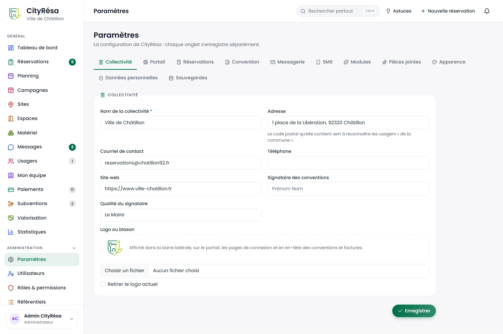
*Figure — L'onglet Collectivité des paramètres : nom, adresse, contacts, signataire des conventions et logo.*

**Ce que l'on voit**

- Les onglets : **Collectivité**, **Portail**, **Réservations**, **Convention**, **Messagerie**, **SMS**, **Modules**, **Pièces jointes**, **Apparence**, **Données personnelles**, **Sauvegardes**. Chaque onglet s'enregistre séparément.
- Dans l'onglet **Collectivité** :
  - **Nom de la collectivité** (obligatoire) ;
  - **Adresse** : le code postal qu'elle contient sert à reconnaître les usagers « de la commune » (tarifs résidents, pré-remplissage à l'inscription) ;
  - **Courriel de contact**, **Téléphone**, **Site web** ;
  - **Signataire des conventions** et **Qualité du signataire** (par exemple « Le Maire ») ;
  - **Logo ou blason** : l'aperçu actuel, le bouton **Choisir un fichier** et la case **Retirer le logo actuel**. Le logo est affiché dans la barre latérale, sur le portail, sur les pages de connexion et en en-tête des conventions et factures.
- Le bouton **Enregistrer** en bas à droite.

**Comment faire**

1. Ouvrez **Paramètres** dans la rubrique ADMINISTRATION.
2. Cliquez sur l'onglet voulu.
3. Modifiez les champs.
4. Cliquez sur **Enregistrer** en bas de l'onglet. Un message confirme l'enregistrement.

> **Attention** — Enregistrez avant de changer d'onglet : seules les modifications de l'onglet affiché sont prises en compte.

## 9.3 Onglet Portail

**À quoi ça sert** — Régler ce que voient les usagers sur le portail public : ouverture, inscription, textes et pages réglementaires.

**Qui** — Administrateurs.

**Ce que l'on voit**

- Quatre interrupteurs :
  - **Portail public actif** : le catalogue des espaces et le dépôt de demandes en ligne ;
  - **Inscription libre des usagers** : désactivée, seuls les agents créent les comptes usagers ;
  - **Validation des nouvelles organisations par un agent** : tant qu'elle n'est pas validée, une organisation n'a pas accès aux tarifs de son profil ;
  - **Afficher les tarifs sur le portail**.
- **Titre de la page d'accueil** et **Accroche** du portail.
- **Conditions d'utilisation** : le texte affiché à l'inscription (laissez vide s'il n'y a pas de conditions particulières).
- Les pages réglementaires (liens en pied de page du portail) :
  - **État de conformité RGAA** (Non évalué, Non conforme, Partiellement conforme, Totalement conforme), **Taux de conformité (%)**, **Date de l'audit** et **Déclaration : non-conformités, dérogations, plan d'amélioration** ;
  - **Mentions légales** (éditeur, directeur de publication, hébergeur ; vide, l'éditeur et le contact sont repris de l'onglet Collectivité) ;
  - **Données personnelles : compléments** (délégué à la protection des données, base légale, destinataires…), ajoutés sous les mentions générées automatiquement.

**Comment faire**

1. Ouvrez l'onglet **Portail**.
2. Activez ou désactivez les interrupteurs, complétez les textes.
3. Cliquez sur **Enregistrer**.

**Règles à connaître** — Les durées de conservation affichées sur la page « Données personnelles » du portail viennent de l'onglet **Données personnelles** (9.11).

## 9.4 Onglet Réservations

**À quoi ça sert** — Fixer les délais, pourcentages et seuils qui encadrent les réservations, les cautions, les relances et les rappels.

**Qui** — Administrateurs.

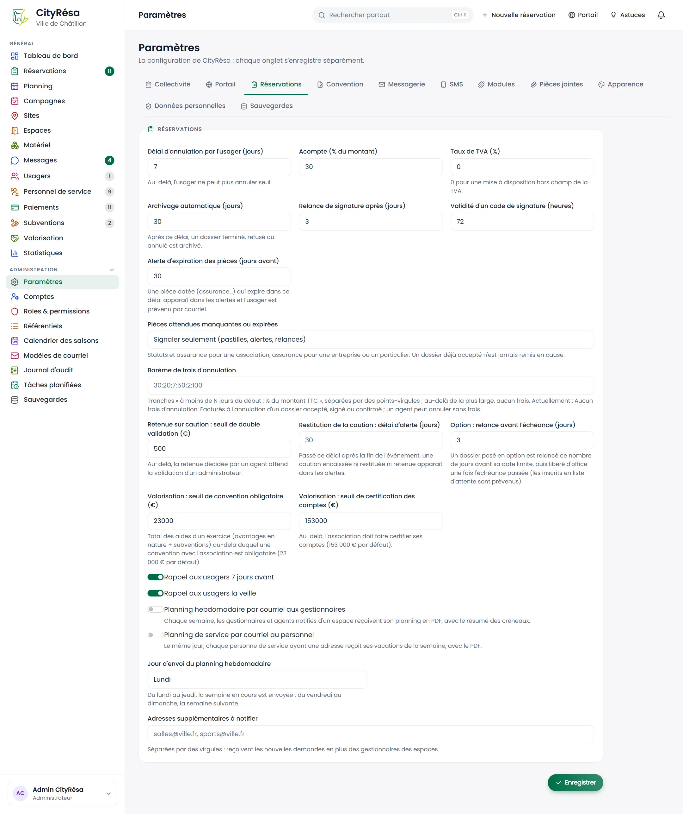
*Figure — L'onglet Réservations : délais d'annulation, acompte, TVA, archivage, relances, pièces attendues, barème d'annulation, cautions, options, seuils de valorisation, rappels et planning hebdomadaire.*

**Ce que l'on voit** (valeurs de la figure entre parenthèses)

- **Délai d'annulation par l'usager (jours)** (7) : au-delà, l'usager ne peut plus annuler seul.
- **Acompte (% du montant)** (30).
- **Taux de TVA (%)** (0) : 0 pour une mise à disposition hors champ de la TVA.
- **Archivage automatique (jours)** (30) : après ce délai, un dossier terminé, refusé ou annulé est archivé.
- **Relance de signature après (jours)** (3) et **Validité d'un code de signature (heures)** (72).
- **Alerte d'expiration des pièces (jours avant)** (30) : une pièce datée qui expire dans ce délai apparaît dans les alertes et l'usager est prévenu par courriel.
- **Pièces attendues manquantes ou expirées** : trois choix — **Signaler seulement (pastilles, alertes, relances)**, **Bloquer le dépôt d'une demande sur le portail**, **Bloquer le dépôt et l'acceptation par un agent**. Les pièces attendues sont les statuts et l'assurance pour une association, l'assurance pour une entreprise ou un particulier.
- **Barème de frais d'annulation** : des tranches « à moins de N jours du début : pourcentage du montant TTC », séparées par des points-virgules. L'exemple grisé « 30:20;7:50;2:100 » signifie 20 % à moins de 30 jours, 50 % à moins de 7 jours, 100 % à moins de 2 jours. La phrase en dessous rappelle le barème actuel (sur la figure : aucun frais).
- **Retenue sur caution : seuil de double validation (€)** (500) : au-delà, une retenue décidée par un agent attend la validation d'un administrateur.
- **Restitution de la caution : délai d'alerte (jours)** (30).
- **Option : relance avant l'échéance (jours)** (3) : un dossier posé en option est relancé ce nombre de jours avant sa date limite, puis libéré d'office (les inscrits en liste d'attente sont prévenus).
- **Valorisation : seuil de convention obligatoire (€)** (23000) et **Valorisation : seuil de certification des comptes (€)** (153000).
- Les interrupteurs **Rappel aux usagers 7 jours avant**, **Rappel aux usagers la veille** et **Planning hebdomadaire par courriel aux gestionnaires** ; si le module Personnel de service est actif, **Planning de service par courriel au personnel** (chaque personne ayant une adresse reçoit ses vacations de la semaine, le même jour).
- **Jour d'envoi du planning hebdomadaire** (Lundi) : du lundi au jeudi, la semaine en cours est envoyée ; du vendredi au dimanche, la semaine suivante.
- **Adresses supplémentaires à notifier** : des adresses séparées par des virgules, qui reçoivent les nouvelles demandes en plus des gestionnaires des espaces.

**Comment faire**

1. Ouvrez l'onglet **Réservations**.
2. Modifiez les valeurs voulues.
3. Pour le barème d'annulation, saisissez par exemple `30:20;7:50;2:100`, ou laissez le champ vide pour ne facturer aucuns frais.
4. Cliquez sur **Enregistrer**.

**Règles à connaître**

- Les frais d'annulation ne s'appliquent qu'à l'annulation d'un dossier accepté, signé ou confirmé. Un agent peut toujours annuler sans frais.
- Un dossier déjà accepté n'est jamais remis en cause par la règle des pièces attendues.

## 9.5 Onglet Convention

**À quoi ça sert** — Rédiger le texte de la convention de mise à disposition signée par les usagers.

**Qui** — Administrateurs.

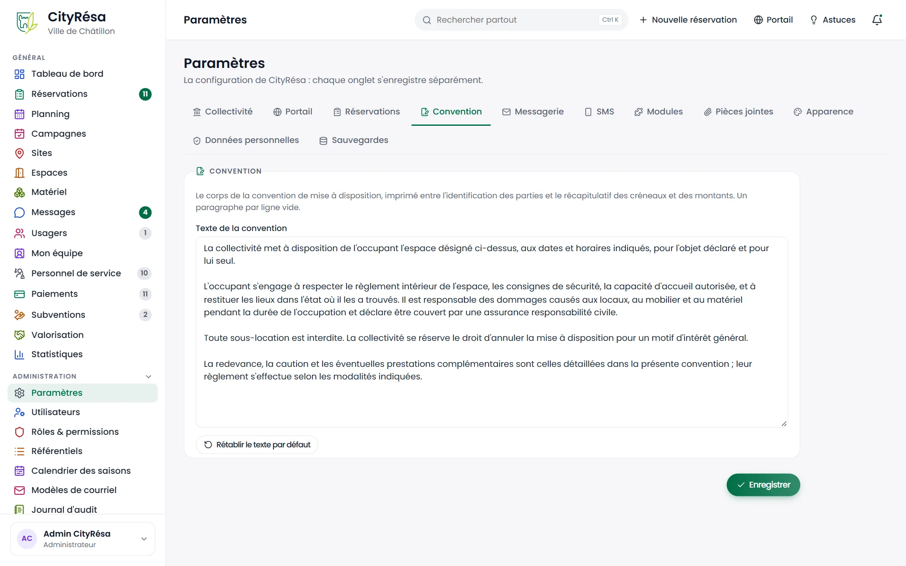
*Figure — L'onglet Convention : le texte de la convention en quatre paragraphes et le bouton pour revenir au texte par défaut.*

**Ce que l'on voit**

- Une explication : ce texte est imprimé entre l'identification des parties et le récapitulatif des créneaux et des montants.
- La zone **Texte de la convention**.
- Le bouton **Rétablir le texte par défaut**.

**Comment faire**

1. Ouvrez l'onglet **Convention**.
2. Modifiez le texte. Laissez une ligne vide entre deux paragraphes.
3. Cliquez sur **Enregistrer**.
4. Pour annuler toutes vos modifications et revenir au texte d'origine, cliquez sur **Rétablir le texte par défaut**.

**Règles à connaître** — Le nouveau texte s'applique aux conventions éditées ensuite ; les conventions déjà produites ne changent pas.

## 9.6 Onglet Messagerie

**À quoi ça sert** — Brancher CityRésa sur le serveur de courriel de la collectivité pour que les courriels partent réellement.

**Qui** — Administrateurs, avec les informations fournies par le service informatique.

**Ce que l'on voit**

- Un encadré d'avertissement tant que l'envoi n'est pas configuré : les courriels sont alors **simulés** (enregistrés mais pas envoyés).
- L'interrupteur **Envoi des courriels activé** et l'interrupteur **Connexion chiffrée (STARTTLS)** (le port 465 utilise toujours une connexion chiffrée).
- **Serveur SMTP**, **Port**, **Expéditeur**, **Identifiant**, **Mot de passe**.
- **Envoyer un courriel de test à** et le bouton **Enregistrer et envoyer un test**.

**Comment faire**

1. Saisissez les informations du serveur de courriel transmises par le service informatique.
2. Activez **Envoi des courriels activé**.
3. Indiquez votre adresse dans **Envoyer un courriel de test à**, puis cliquez sur **Enregistrer et envoyer un test**.
4. Vérifiez la réception du courriel de test.

**Règles à connaître** — Le mot de passe enregistré n'est jamais réaffiché. Laissez le champ vide pour le conserver ; ne le remplissez que pour le changer.

## 9.7 Onglet SMS

**À quoi ça sert** — Envoyer par SMS les codes de signature électronique des conventions.

**Qui** — Administrateurs, avec les informations du prestataire SMS.

**Ce que l'on voit**

- L'interrupteur **Envoi de SMS activé**. Désactivé, le code de signature part par courriel.
- **Fournisseur** : **Console (simulation, affiché dans les journaux)** ou **Passerelle HTTP (API)**.
- **Expéditeur affiché** (11 caractères maximum), **URL de l'API**, **Clé d'API**.

**Comment faire**

1. Choisissez **Passerelle HTTP (API)** et renseignez l'adresse et la clé fournies par le prestataire.
2. Saisissez le nom d'expéditeur (par exemple « CHATILLON »).
3. Activez **Envoi de SMS activé** et cliquez sur **Enregistrer**.

**Règles à connaître** — Comme pour la messagerie, laissez **Clé d'API** vide pour conserver la clé déjà enregistrée.

## 9.8 Onglet Modules

**À quoi ça sert** — Activer ou désactiver des pans entiers de l'application selon les besoins de la collectivité.

**Qui** — Administrateurs.

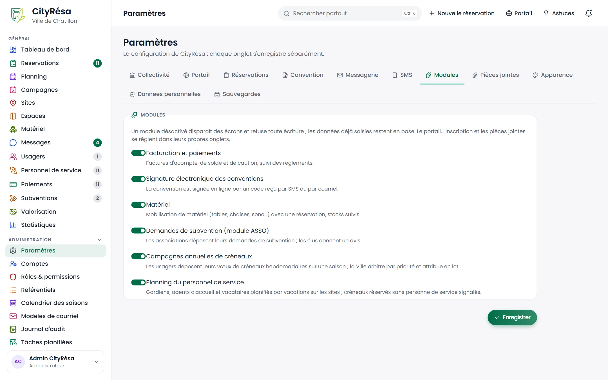
*Figure — L'onglet Modules : les interrupteurs des modules, tous activés (le module Personnel de service, ajouté depuis, s'y trouve aussi).*

**Ce que l'on voit**

- **Facturation et paiements** : factures d'acompte, de solde et de caution, suivi des règlements.
- **Signature électronique des conventions** : signature en ligne par un code reçu par SMS ou par courriel.
- **Matériel** : mobilisation de matériel (tables, chaises, sono…) avec une réservation, stocks suivis.
- **Demandes de subvention (module ASSO)** : les associations déposent leurs demandes ; les élus donnent un avis.
- **Campagnes annuelles de créneaux** : les usagers déposent leurs vœux de créneaux hebdomadaires sur une saison ; la Ville arbitre et attribue en lot.
- **Planning du personnel de service** : gardiens, agents d'accueil et vacataires planifiés par vacations sur les sites ; créneaux réservés sans personne de service signalés (chapitre 11). Coupé, le menu **Personnel** disparaît et la colonne **Service** des fiches de réservation avec lui ; les personnes et vacations déjà saisies restent en base.

**Comment faire**

1. Basculez l'interrupteur du module.
2. Cliquez sur **Enregistrer**.

**Règles à connaître**

- Un module désactivé disparaît des écrans (menus, alertes) et refuse toute modification ; les données déjà saisies sont conservées et réapparaissent si vous le réactivez.
- Le portail, l'inscription et les pièces jointes se règlent dans leurs propres onglets (Portail, Pièces jointes).
- Désactiver Paiements, Matériel ou Subventions retire le domaine correspondant à tous les agents, quel que soit leur rôle.

## 9.9 Onglet Pièces jointes

**À quoi ça sert** — Autoriser le dépôt de documents sur les dossiers et en limiter la taille.

**Qui** — Administrateurs.

**Ce que l'on voit**

- L'interrupteur **Pièces jointes** : dépôt de pièces (attestation d'assurance, statuts, programme) sur les dossiers.
- **Taille maximale d'une pièce (Mo)** (entre 1 et 200).

**Comment faire** — Réglez l'interrupteur et la taille, puis cliquez sur **Enregistrer**.

**Règles à connaître** — Sans pièces jointes, les alertes et relances d'expiration des pièces sont aussi arrêtées.

## 9.10 Onglet Apparence

**À quoi ça sert** — Choisir la couleur principale de l'interface, du portail et des courriels.

**Qui** — Administrateurs.

**Ce que l'on voit**

- Le sélecteur **Couleur principale** et la valeur choisie (« par défaut » pour le thème Vert).
- Le bouton **Réinitialiser**.
- Un aperçu en direct : pastilles, bouton principal, bouton secondaire, avatar.

**Comment faire**

1. Cliquez sur le carré de couleur et choisissez une teinte. L'aperçu se met à jour.
2. Cliquez sur **Enregistrer**.
3. Pour revenir au vert d'origine, cliquez sur **Réinitialiser**.

> **Astuce** — Choisissez une couleur assez foncée : un texte blanc doit rester lisible dessus.

## 9.11 Onglet Données personnelles

**À quoi ça sert** — Fixer les durées de conservation des données des usagers, conformément au RGPD.

**Qui** — Administrateurs, en lien avec le délégué à la protection des données.

**Ce que l'on voit**

- Une explication : chaque nuit à 3 h 30, une tâche prévient par courriel les usagers inactifs, anonymise leur compte à la fin du préavis (coordonnées effacées, dossiers conservés sans identité) et purge les messages, pièces et notes des dossiers dont la durée de conservation est échue.
- **Anonymisation après inactivité (mois)** : mois sans connexion ; 0 = jamais automatiquement.
- **Préavis avant anonymisation (jours)** : une connexion pendant le préavis annule l'anonymisation.
- **Conservation des dossiers terminés (années)** : au-delà, les données personnelles du dossier sont purgées ; 0 = jamais.

**Comment faire** — Saisissez les durées et cliquez sur **Enregistrer**.

**Règles à connaître** — Les usagers peuvent aussi télécharger leurs données et demander la suppression de leur compte depuis « Mon compte » sur le portail.

## 9.12 Les utilisateurs

**À quoi ça sert** — Voir et gérer tous les comptes : agents de la collectivité et usagers du portail.

**Qui** — Administrateurs.

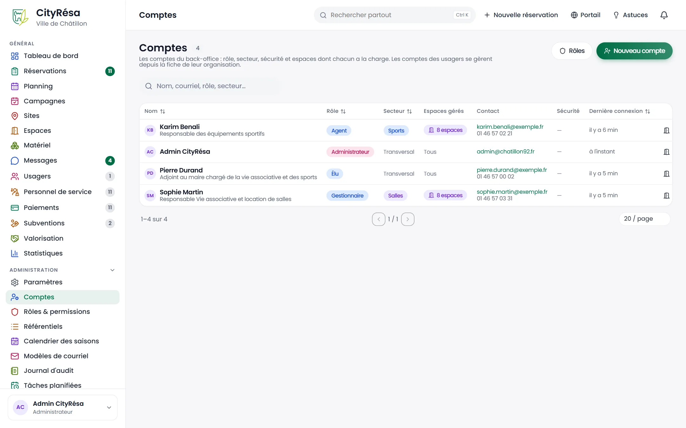
*Figure — L'onglet Agents de la liste des utilisateurs : cinq comptes avec leur rôle, leur dernière connexion et leur date de création.*

**Ce que l'on voit**

- Les boutons **Rôles** (vers 9.14) et **Nouvel agent**.
- Trois filtres : **Agents**, **Usagers**, **Inactifs**, avec leur nombre.
- Un champ de recherche (nom, courriel, organisation, rôle).
- Le tableau : **Compte** (nom, courriel, fonction), **Rôle** (étiquette colorée), **Organisation** (pour un usager), **Sécurité** (double authentification), **Dernière connexion**, **Créé le**. Les colonnes portant deux flèches se trient d'un clic.
- En bas : la pagination et le nombre de lignes par page.

**Comment faire**

*Créer un compte agent*
1. Cliquez sur **Nouvel agent**.
2. Renseignez **Courriel (identifiant)**, **Prénom**, **Nom**, et si besoin **Fonction** et **Téléphone**.
3. Choisissez le **Rôle** (« Agent » est proposé par défaut ; la description de chaque rôle est rappelée à côté).
4. Cliquez sur **Créer le compte**.
5. Un mot de passe provisoire s'affiche **une seule fois** dans le message de confirmation : transmettez-le à la personne par un moyen sûr. Elle pourra le changer depuis son profil.

*Retrouver un compte*
1. Choisissez le filtre **Agents**, **Usagers** ou **Inactifs**.
2. Tapez un nom ou une adresse dans le champ de recherche.
3. Cliquez sur la ligne pour ouvrir la fiche.

**Règles à connaître** — Les comptes usagers sont normalement créés par les usagers eux-mêmes sur le portail, ou par un agent depuis l'écran Usagers.

## 9.13 La fiche d'un utilisateur

**À quoi ça sert** — Consulter un compte, le modifier, réinitialiser son accès ou le désactiver.

**Qui** — Administrateurs.

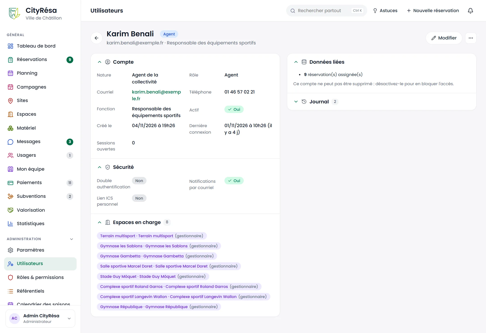
*Figure — La fiche de Karim Benali, agent : compte, sécurité, huit espaces en charge, données liées et journal.*

**Ce que l'on voit**

- **En-tête** : le nom, l'étiquette du rôle, le courriel et la fonction ; les boutons **Modifier** et **…** (autres actions).
- **Compte** : nature (agent de la collectivité ou usager), rôle, courriel, téléphone, fonction, compte actif ou non, date de création, dernière connexion, sessions ouvertes.
- **Sécurité** : double authentification, notifications par courriel, lien d'agenda personnel (Oui / Non).
- **Espaces en charge** : les espaces confiés à l'agent et son rôle sur chacun (ici « gestionnaire »). Si la liste est vide, l'agent intervient sur tous les espaces selon son rôle.
- **Données liées** : par exemple « 9 réservation(s) assignée(s) », et l'indication que le compte ne peut pas être supprimé.
- **Journal** (replié) : les actions enregistrées pour ce compte.

**Comment faire**

*Modifier le compte*
1. Cliquez sur **Modifier**.
2. Corrigez l'identité (y compris le courriel) et, pour un agent, le **Rôle**.
3. Enregistrez.

*Autres actions (menu **…**)*
- **Envoyer un lien de réinitialisation** : la personne reçoit par courriel un lien pour choisir un nouveau mot de passe.
- **Réinitialiser la double authentification** : à utiliser si la personne a perdu son téléphone ; elle devra la réactiver depuis son profil.
- **Désactiver le compte** : la personne ne peut plus se connecter et ses sessions sont fermées. **Réactiver le compte** rétablit l'accès.
- **Supprimer définitivement** : proposé uniquement pour un compte sans aucune donnée liée.

**Règles à connaître**

- Vous ne pouvez ni changer votre propre rôle, ni désactiver votre propre compte.
- Un compte lié à des réservations ou à d'autres données ne se supprime pas : désactivez-le.
- Les espaces confiés à un agent se règlent depuis **Mon équipe**, pas depuis cette fiche.

## 9.14 Rôles et permissions

**À quoi ça sert** — Définir, pour chaque rôle, le niveau d'accès à chaque domaine de l'application.

**Qui** — Administrateurs.

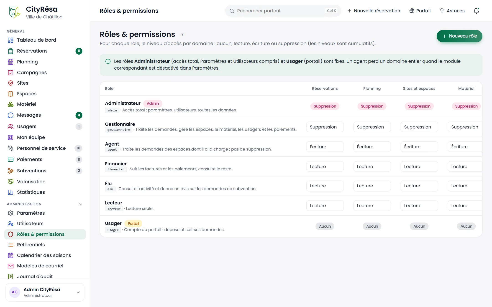
*Figure — Le tableau des rôles : Administrateur et Usager figés, les autres rôles réglables domaine par domaine.*

**Ce que l'on voit**

- Le bouton **Nouveau rôle**.
- Un encadré : les rôles **Administrateur** (accès total, Paramètres et Utilisateurs compris) et **Usager** (portail) sont fixes ; un agent perd un domaine entier quand le module correspondant est désactivé.
- Une ligne par rôle (nom, nom technique, description) et une colonne par domaine : **Réservations**, **Planning**, **Sites et espaces**, **Matériel**, **Usagers**, **Messages**, **Paiements**, **Subventions**, **Mon équipe** (faites défiler le tableau vers la droite pour voir les derniers domaines), puis le nombre de **Comptes** ayant ce rôle.
- Pour les rôles figés, le niveau est une étiquette ; pour les autres, une liste déroulante.

**Les quatre niveaux** (cumulatifs : chaque niveau comprend les précédents)

| Niveau | Ce qu'il permet |
|---|---|
| **Aucun** | Le domaine est invisible. |
| **Lecture** | Consulter sans rien modifier. |
| **Écriture** | Créer et modifier. |
| **Suppression** | Créer, modifier et supprimer. |

**Les rôles fournis**

| Rôle | Réglage de départ |
|---|---|
| Administrateur | Accès total, y compris l'administration. |
| Gestionnaire | Suppression partout. |
| Agent | Écriture partout, sauf Subventions et Mon équipe en lecture. |
| Financier | Suppression sur Paiements, lecture ailleurs. |
| Élu | Écriture sur Subventions (pour donner un avis), lecture ailleurs. |
| Lecteur | Lecture partout. |
| Usager | Aucun accès au back-office (portail seulement). |

**Comment faire**

*Changer les droits d'un rôle*
1. Sur la ligne du rôle, choisissez le niveau voulu dans chaque liste déroulante.
2. Cliquez sur **Enregistrer** au bout de la ligne.

*Créer un rôle*
1. Cliquez sur **Nouveau rôle**.
2. Saisissez un **Nom technique** (minuscules, chiffres, tirets, sans espace, par exemple « accueil »), un **Libellé** (par exemple « Agent d'accueil ») et une **Description**.
3. Cliquez sur **Créer le rôle**, puis réglez ses niveaux dans le tableau.

*Supprimer un rôle* — L'icône corbeille n'apparaît que pour un rôle attribué à aucun compte.

**Règles à connaître** — Le rôle fixe les droits par domaine ; en plus, un agent peut être limité à certains espaces depuis **Mon équipe**.

## 9.15 Les référentiels

**À quoi ça sert** — Gérer les listes de valeurs proposées dans les formulaires : natures d'espace, natures d'événement, équipements, profils tarifaires, catégories de matériel et de pièces.

**Qui** — Administrateurs.

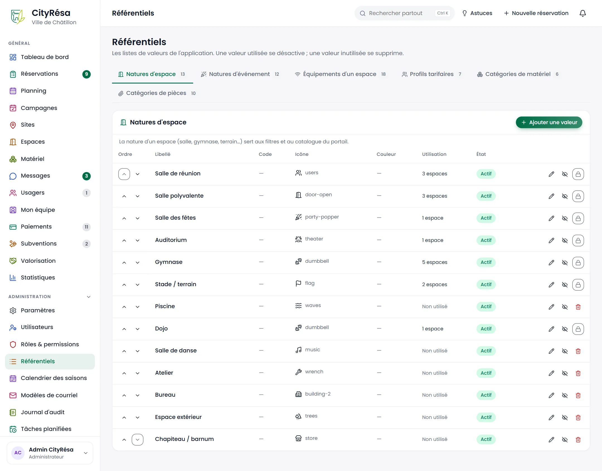
*Figure — L'onglet Natures d'espace : treize valeurs avec leur icône, leur utilisation et leur état.*

**Ce que l'on voit**

- Six onglets avec leur nombre de valeurs : **Natures d'espace**, **Natures d'événement**, **Équipements d'un espace**, **Profils tarifaires**, **Catégories de matériel**, **Catégories de pièces**.
- Pour l'onglet ouvert : une phrase d'explication (par exemple, la nature d'un espace sert aux filtres et au catalogue du portail) et le bouton **Ajouter une valeur**.
- Le tableau : **Ordre** (flèches monter / descendre), **Libellé**, **Code**, **Icône**, **Couleur**, **Utilisation** (par exemple « 3 espaces » ou « Non utilisé »), **État** (Actif / Inactif).
- À droite de chaque ligne : le crayon (modifier), l'œil barré (désactiver) et soit une corbeille rouge (supprimer), soit un cadenas quand la valeur est utilisée.

**Comment faire**

*Ajouter une valeur*
1. Ouvrez l'onglet voulu et cliquez sur **Ajouter une valeur**.
2. Saisissez le **Libellé** ; si besoin un **Code**, une **Icône** et une **Couleur**.
3. Laissez **Valeur active** cochée et validez.

*Changer l'ordre d'affichage* — Cliquez sur les flèches de la colonne **Ordre**.

*Retirer une valeur*
- Si elle est marquée « Non utilisé » : cliquez sur la corbeille.
- Si elle est utilisée (cadenas) : cliquez sur l'œil barré pour la **désactiver**.

**Règles à connaître** — Une valeur utilisée se désactive, une valeur inutilisée se supprime. Une valeur inactive n'est plus proposée dans les formulaires mais reste affichée sur les fiches qui l'utilisent déjà.

## 9.16 Le calendrier des saisons

**À quoi ça sert** — Déclarer les saisons (années scolaires), les vacances scolaires et les jours fériés. Les réservations récurrentes « hors vacances » ou « hors jours fériés » sautent ces jours ; la fin de la saison active pré-remplit la date de fin des récurrences.

**Qui** — Administrateurs.

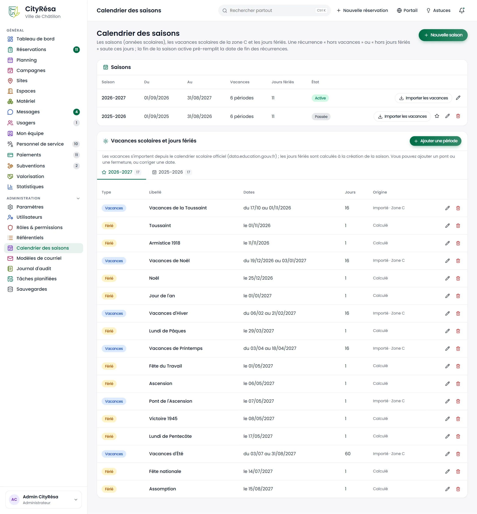
*Figure — Deux saisons (2026-2027 active, 2025-2026 passée) et les 17 périodes de la saison active : vacances importées pour la zone C et jours fériés calculés.*

**Ce que l'on voit**

- Le bouton **Nouvelle saison**.
- Le bloc **Saisons** : nom, dates **Du** et **Au**, nombre de périodes de vacances et de jours fériés, **État** (Active, Passée…). Sur chaque ligne : **Importer les vacances**, une étoile (**Rendre active**, absente sur la saison déjà active), le crayon et la corbeille.
- Le bloc **Vacances scolaires et jours fériés** : un onglet par saison et le bouton **Ajouter une période**. Pour chaque période : **Type** (Vacances ou Férié), **Libellé**, **Dates**, nombre de **Jours**, **Origine** (« Importé · Zone C », « Calculé » ou saisi à la main), le crayon et la corbeille.

**Comment faire**

*Créer une saison*
1. Cliquez sur **Nouvelle saison**.
2. Saisissez le **Nom** (deux années qui se suivent, par exemple 2027-2028), les dates **Du** et **Au**, et cochez **Saison active** si elle doit devenir la saison de référence.
3. Cliquez sur **Créer la saison**. Les jours fériés légaux de la période sont inscrits automatiquement.

*Importer les vacances scolaires*
1. Sur la ligne de la saison, cliquez sur **Importer les vacances**.
2. Vérifiez la **Zone** : Châtillon (académie de Versailles) est en **zone C**.
3. Cliquez sur **Importer**. CityRésa interroge le calendrier scolaire officiel du ministère de l'Éducation nationale.
4. Si le serveur n'a pas accès à Internet, téléchargez au préalable le fichier du calendrier scolaire officiel et joignez-le dans **Export JSON (facultatif)** avant de cliquer sur **Importer**.

*Ajouter un pont ou une fermeture*
1. Cliquez sur **Ajouter une période**.
2. Choisissez le **Type** (Vacances scolaires ou Jour férié), saisissez le **Libellé**, la date **Du** et, pour plusieurs jours, la date **Au (inclus)**.
3. Cliquez sur **Ajouter**.

*Changer de saison active* — Cliquez sur l'étoile de la saison voulue.

**Règles à connaître**

- Une seule saison est active à la fois.
- Un nouvel import remplace les vacances déjà importées pour cette saison ; les périodes saisies à la main sont conservées.

## 9.17 Les modèles de courriel

**À quoi ça sert** — Consulter la liste de tous les courriels envoyés automatiquement par CityRésa, aux usagers comme aux agents.

**Qui** — Administrateurs.

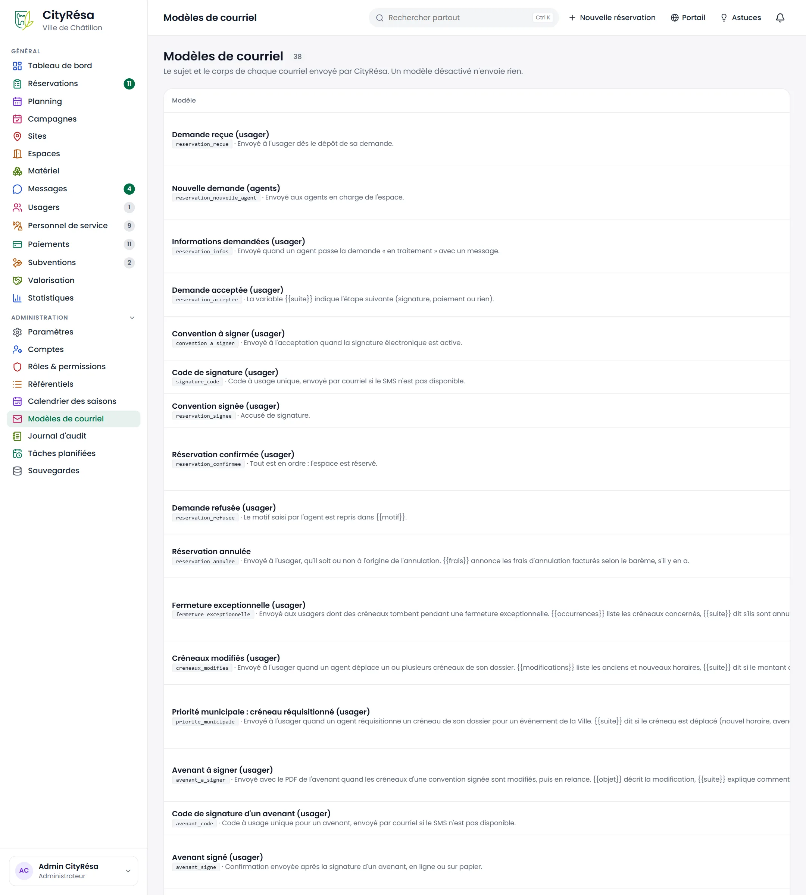
*Figure — La liste des 35 modèles de courriel, chacun avec son nom, son identifiant et la circonstance de son envoi.*

**Ce que l'on voit**

- Le titre et le nombre de modèles, avec le rappel : un modèle désactivé n'envoie rien.
- Une ligne par modèle : le nom (entre parenthèses, le destinataire : usager ou agents), un identifiant gris et une phrase qui dit quand il part. Par exemple : **Demande reçue (usager)**, envoyé dès le dépôt de la demande ; **Nouvelle demande (agents)**, envoyé aux agents en charge de l'espace ; **Demande acceptée (usager)** ; **Convention à signer (usager)** ; **Code de signature (usager)** ; **Réservation confirmée (usager)** ; **Demande refusée (usager)** ; **Réservation annulée** ; **Fermeture exceptionnelle (usager)** ; **Créneaux modifiés (usager)** ; **Priorité municipale : créneau réquisitionné (usager)** ; **Avenant à signer (usager)**, etc.

**Comment faire**

1. Parcourez la liste pour trouver le courriel à revoir.
2. Cliquez sur sa ligne pour l'ouvrir (voir 9.18).

## 9.18 Modifier un modèle de courriel

**À quoi ça sert** — Adapter le sujet et le texte d'un courriel automatique, le tester, ou le désactiver.

**Qui** — Administrateurs.

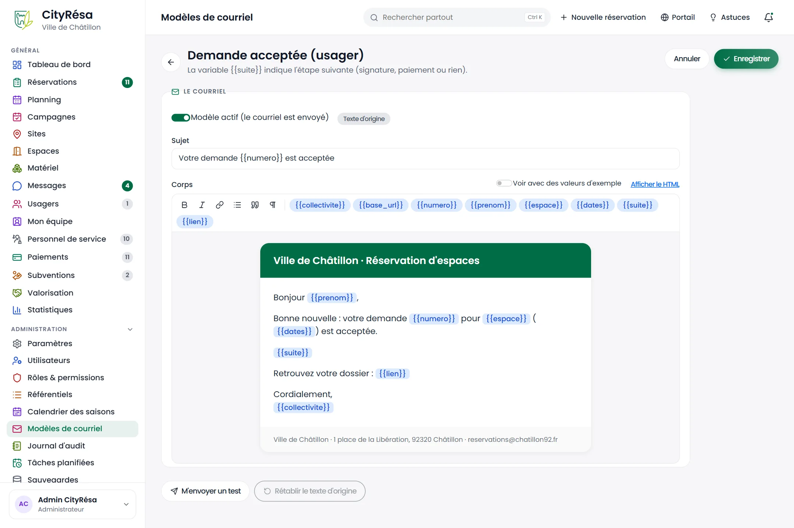
*Figure — Le modèle « Demande acceptée (usager) » : le contenu à gauche, les variables disponibles, l'aperçu et les actions à droite.*

**Ce que l'on voit**

- **CONTENU** :
  - l'interrupteur **Modèle actif (le courriel est envoyé)** ;
  - le **Sujet** ;
  - le **Corps (HTML simple)**, avec la liste des balises de mise en forme admises (paragraphe, gras, lien, liste, citation, retour à la ligne).
- **Variables disponibles** : les mots entre doubles accolades propres à ce modèle, par exemple `{{prenom}}`, `{{numero}}`, `{{espace}}`, `{{dates}}`, `{{suite}}`, `{{lien}}`, `{{collectivite}}`. Ils sont remplacés à l'envoi par les vraies valeurs.
- **Aperçu avec des valeurs d'exemple** : le sujet et le corps tels que l'usager les recevra (ici « Bonjour Camille, … votre demande RES-2026-0042 pour Salle des fêtes … est acceptée »).
- **Actions** : **M'envoyer un test** (à votre adresse), **Rétablir le texte d'origine** et une étiquette **Texte d'origine** ou **Personnalisé**.
- Les boutons **Annuler** et **Enregistrer**, en haut et en bas.

**Comment faire**

1. Modifiez le **Sujet** et le **Corps**. Pour insérer une information du dossier, recopiez une variable de la liste, accolades comprises, par exemple `{{prenom}}`.
2. Cliquez sur **Enregistrer**.
3. Cliquez sur **M'envoyer un test** pour recevoir le courriel avec des valeurs d'exemple et vérifier sa mise en forme.
4. Pour revenir au texte livré avec l'application, cliquez sur **Rétablir le texte d'origine** et confirmez (bouton actif seulement si le modèle a été personnalisé).
5. Pour ne plus envoyer ce courriel, désactivez **Modèle actif** puis enregistrez.

**Règles à connaître**

- Une variable absente de la liste est remplacée par un texte vide à l'envoi : vérifiez l'orthographe des variables.
- Certaines variables changent selon la situation : par exemple `{{suite}}` indique l'étape suivante (signature, paiement ou rien) et `{{motif}}` reprend le motif de refus saisi par l'agent.

> **Attention** — Désactiver un modèle supprime l'envoi pour tous les dossiers. Ne désactivez pas les codes de signature si la signature électronique est utilisée.

## 9.19 Le journal d'audit

**À quoi ça sert** — Savoir qui a fait quoi, et quand. Les actions restent dans le journal même après la suppression de l'élément concerné.

**Qui** — Administrateurs.

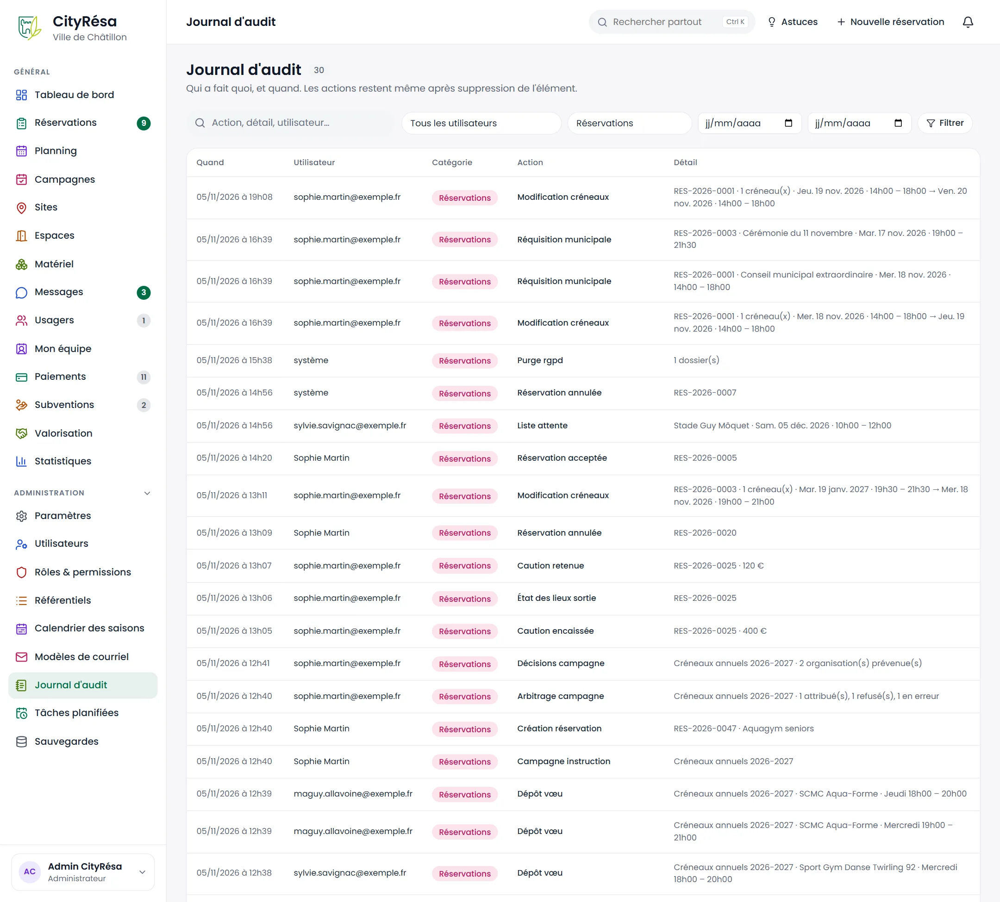
*Figure — Le journal d'audit filtré sur la catégorie Réservations : modifications de créneaux, réquisitions, cautions, états des lieux, campagne et vœux.*

**Ce que l'on voit**

- Les filtres : une recherche libre (action, détail, utilisateur), **Tous les utilisateurs**, **Toutes les catégories**, deux dates (du… au…), et le bouton **Filtrer**.
- Le tableau : **Quand** (date et heure), **Utilisateur** (adresse de courriel), **Catégorie** (étiquette colorée : Sécurité, Réservations, Matériel, Planning…), **Action** (Connexion, Modification créneaux, Réquisition municipale, Caution encaissée, Dépôt vœu…) et **Détail** (numéro de dossier, créneau, quantité…).

**Comment faire**

1. Pour retrouver une action, tapez un numéro de dossier ou un mot dans la recherche.
2. Choisissez au besoin un utilisateur, une catégorie et une période.
3. Cliquez sur **Filtrer**.

> **Astuce** — La catégorie **Sécurité** regroupe les connexions et déconnexions : utile pour vérifier qu'un compte n'a pas été utilisé à votre insu.

## 9.20 Les tâches planifiées

**À quoi ça sert** — Suivre les traitements que CityRésa exécute seul chaque jour (rappels, relances, archivage, sauvegarde…) et, au besoin, en lancer un à la main.

**Qui** — Administrateurs.

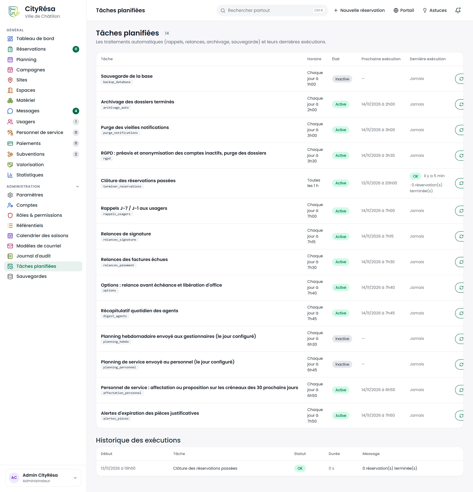
*Figure — Les douze tâches planifiées avec leur horaire, leur état et leur prochaine exécution, puis l'historique des exécutions.*

**Ce que l'on voit**

- Le tableau des tâches : **Tâche** (nom et identifiant), **Horaire**, **État** (Active / Inactive), **Prochaine exécution**, **Dernière exécution** (OK ou erreur, ancienneté et compte rendu) et le bouton **Exécuter**.
- **Historique des exécutions** : **Début**, **Tâche**, **Statut**, **Durée**, **Message** (par exemple « 0 réservation(s) terminée(s) »).

**Les tâches et leur rôle**

| Tâche | Horaire | Ce qu'elle fait | Active si… |
|---|---|---|---|
| Sauvegarde de la base | 1 h 00 | Copie de sécurité complète des données | un dossier de sauvegarde est configuré (voir 9.21) |
| Archivage des dossiers terminés | 2 h 00 | Archive les dossiers terminés, refusés ou annulés depuis le délai d'archivage (30 jours par défaut) | toujours |
| Purge des vieilles notifications | 3 h 00 | Efface les notifications lues depuis plus de 90 jours et les traces de courriels de plus d'un an | toujours |
| RGPD : préavis et anonymisation… | 3 h 30 | Prévient les usagers inactifs, anonymise les comptes en fin de préavis, purge les dossiers échus | une durée est réglée dans l'onglet Données personnelles |
| Clôture des réservations passées | toutes les heures | Passe en « Terminée » les réservations confirmées dont l'événement est fini | toujours |
| Rappels J-7 / J-1 aux usagers | 7 h 00 | Rappelle leur réservation aux usagers 7 jours avant et la veille | un des rappels est activé (onglet Réservations) |
| Relances de signature | 7 h 15 | Relance les usagers qui n'ont pas signé leur convention | module Signature électronique activé |
| Relances des factures échues | 7 h 30 | Prévient l'usager d'une facture non réglée après l'échéance (au plus une fois par semaine) | module Facturation et paiements activé |
| Options : relance avant échéance et libération d'office | 7 h 40 | Relance les options proches de leur date limite, libère sans frais celles qui sont échues | toujours |
| Récapitulatif quotidien des agents | 7 h 45 | Courriel aux administrateurs, gestionnaires et agents : demandes à traiter, messages, signatures, factures, créneaux du jour | toujours (seuls les agents qui acceptent les courriels le reçoivent) |
| Planning hebdomadaire envoyé aux gestionnaires | 6 h 30, le jour choisi | Envoie aux gestionnaires et agents notifiés de chaque espace son planning de la semaine en PDF | planning hebdomadaire activé (onglet Réservations) |
| Planning de service envoyé au personnel | 6 h 45, le jour choisi | Envoie à chaque personne de service ayant une adresse ses vacations de la semaine en PDF | module Personnel de service et planning de service par courriel activés |
| Alertes d'expiration des pièces justificatives | 7 h 50 | Prévient les usagers dont une pièce expire bientôt ou aujourd'hui | module Pièces jointes activé |

**Comment faire**

1. Repérez la tâche et son état.
2. Pour la lancer immédiatement (par exemple après une correction), cliquez sur **Exécuter** et confirmez.
3. Consultez le résultat dans **Dernière exécution** et dans l'**Historique des exécutions**.

**Règles à connaître** — Une tâche **Inactive** ne s'exécute pas automatiquement ; elle s'active d'elle-même dès que le réglage ou le module correspondant est activé dans les Paramètres.

## 9.21 Les sauvegardes

**À quoi ça sert** — Disposer de copies de sécurité de toutes les données de CityRésa, pour pouvoir les restaurer en cas d'incident.

**Qui** — Administrateurs, en lien avec le service informatique pour la restauration.

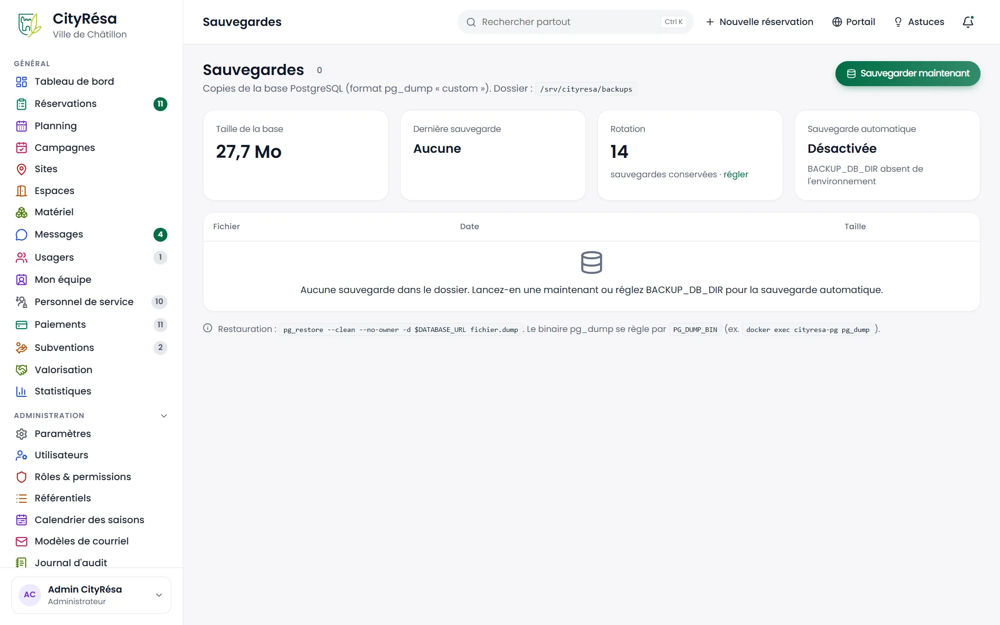
*Figure — La page Sauvegardes avant toute sauvegarde : taille de la base, aucune sauvegarde, 14 sauvegardes conservées, sauvegarde automatique désactivée.*

**Ce que l'on voit**

- Le bouton **Sauvegarder maintenant** et l'emplacement du dossier des sauvegardes.
- Quatre cartes : **Taille de la base**, **Dernière sauvegarde**, **Rotation** (nombre de sauvegardes conservées, avec le lien **régler**), **Sauvegarde automatique** (Activée ou Désactivée).
- La liste des fichiers : **Fichier**, **Date**, **Taille**, avec pour chacun une icône **Télécharger** et une icône **Supprimer**. Sur la figure, la liste est vide.
- En bas, une note technique destinée au service informatique pour la restauration.

**Comment faire**

*Faire une sauvegarde immédiate*
1. Cliquez sur **Sauvegarder maintenant**.
2. La nouvelle sauvegarde apparaît dans la liste.

*Récupérer une sauvegarde* — Cliquez sur l'icône **Télécharger** de la ligne et conservez le fichier en lieu sûr.

*Choisir le nombre de sauvegardes conservées*
1. Cliquez sur **régler** dans la carte **Rotation** (ou ouvrez **Paramètres**, onglet **Sauvegardes**).
2. Saisissez le nombre de **Sauvegardes conservées** (entre 1 et 365) et cliquez sur **Enregistrer**. Au-delà, les plus anciennes sont supprimées.

**Règles à connaître**

- La sauvegarde automatique a lieu chaque nuit à 1 h 00, à condition que le service informatique ait configuré le dossier des sauvegardes sur le serveur. Sinon, la carte affiche **Désactivée** et seule la sauvegarde manuelle est possible.
- La restauration d'une sauvegarde remplace toutes les données actuelles : elle est réalisée par le service informatique.

> **Attention** — Une sauvegarde contient toutes les données personnelles des usagers. Ne la stockez pas sur un poste ou une clé non protégés.
