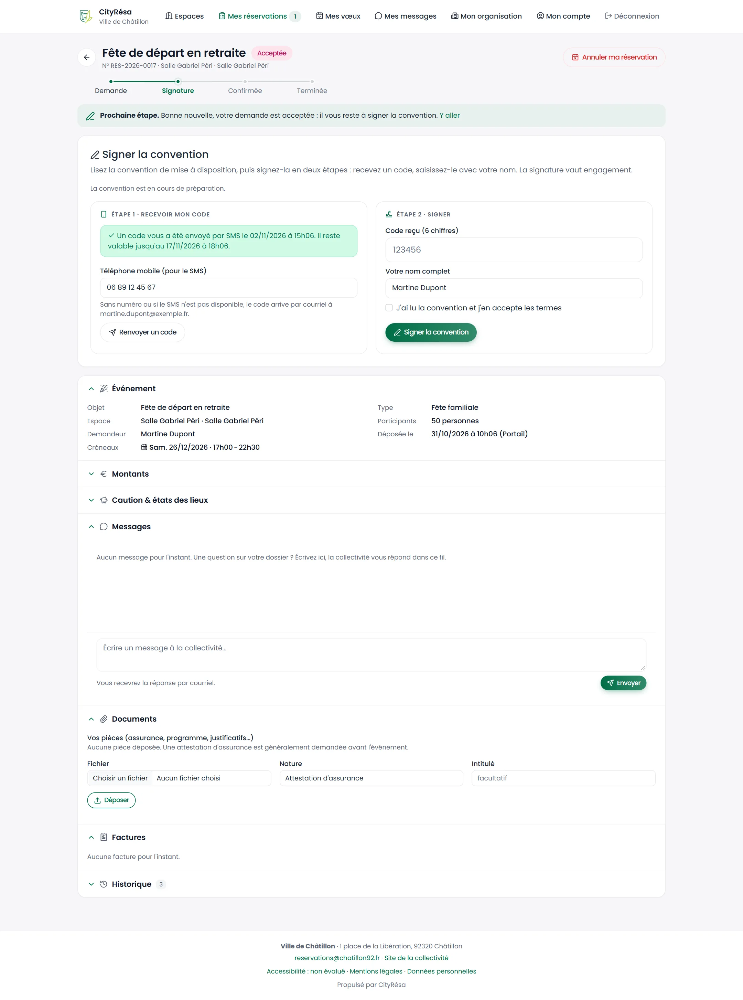
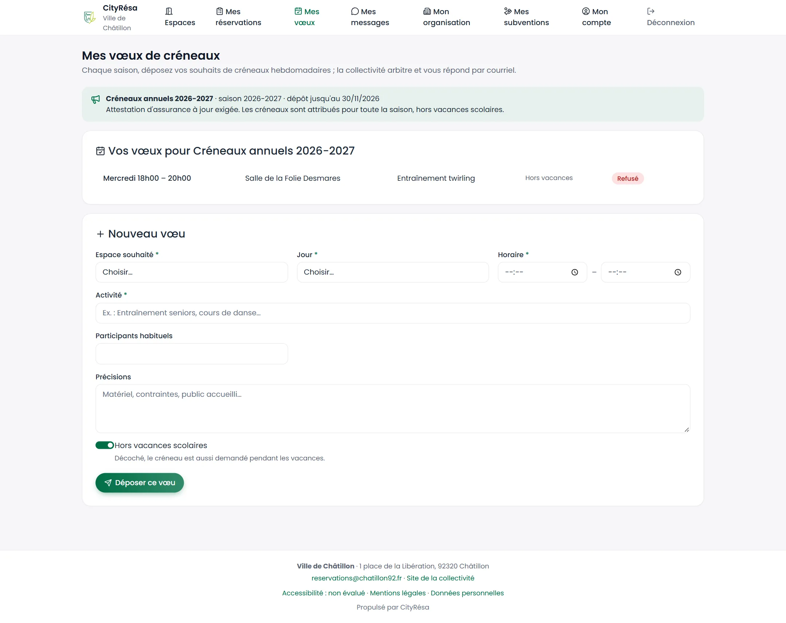
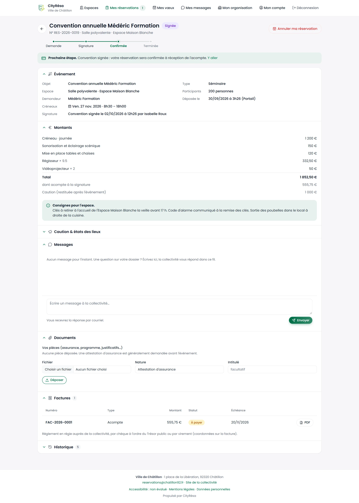
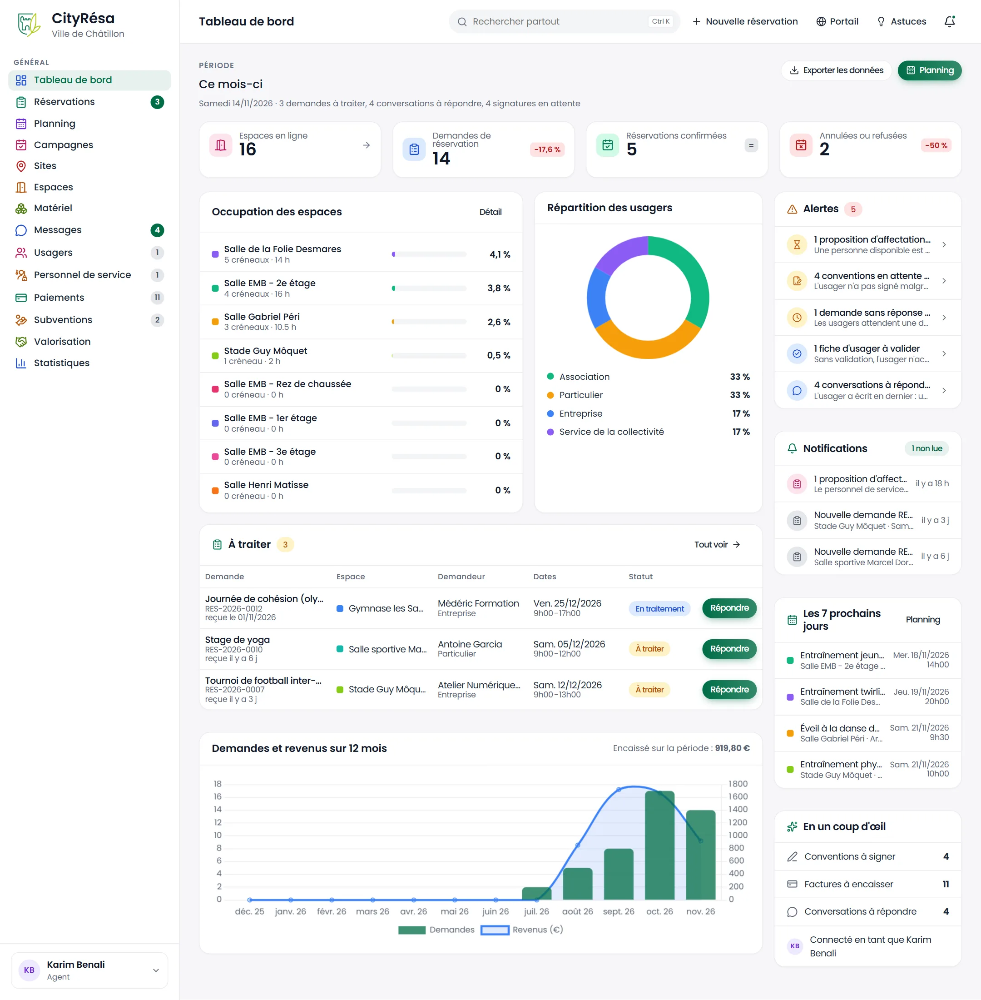
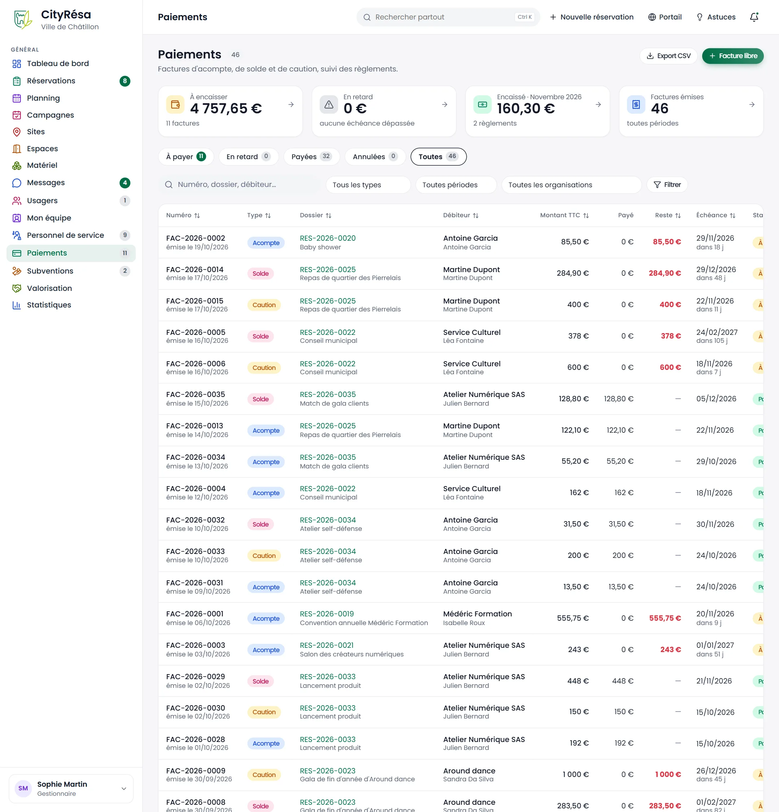
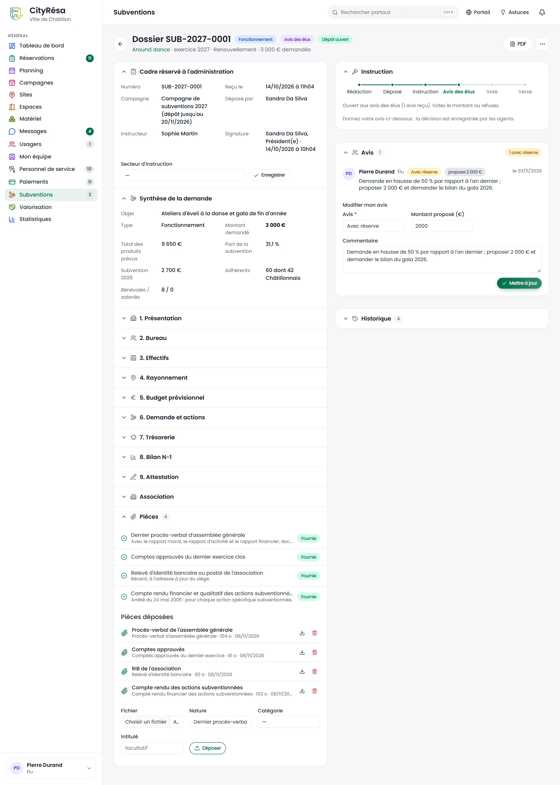
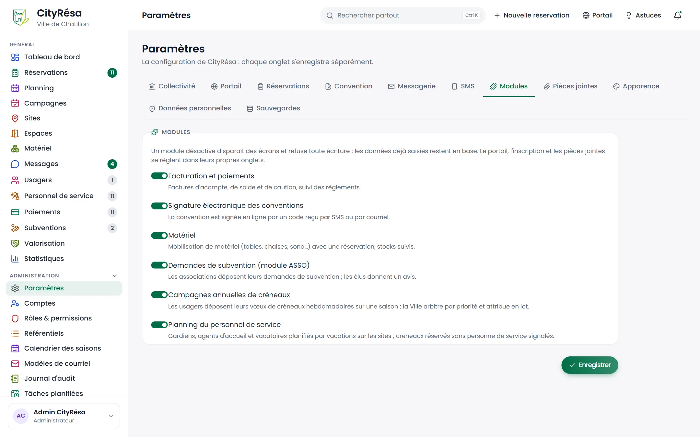

# 10. Parcours métier par profil

Les chapitres 1 à 9 décrivent les écrans un par un. Ce chapitre les remet dans l'ordre où chaque
intervenant les utilise réellement : pour chaque profil, une situation type, les étapes, l'écran
utilisé à chaque étape et le renvoi vers le chapitre qui le détaille. Les exemples reprennent les
personnes et les dossiers du jeu de démonstration.

## 10.1 Vue d'ensemble : qui intervient, et quand

| Profil | Population | Accès | Droits (aucun / lecture / écriture / suppression) |
| --- | --- | --- | --- |
| Particulier | Usager | Portail | Ses dossiers et ceux de son foyer |
| Association | Usager | Portail | Ses dossiers, ses vœux de campagne, ses subventions, la fiche de l'association |
| Entreprise | Usager | Portail | Ses dossiers et ses factures |
| Service interne | Usager (ou agent) | Portail | Ses dossiers, sans facturation |
| Agent | Agent | Back-office | Écriture sur le quotidien, lecture sur les subventions et l'équipe, pas de suppression ; limité à ses espaces s'il y est rattaché |
| Gestionnaire | Agent | Back-office | Suppression (niveau le plus élevé) sur tous les domaines |
| Financier | Agent | Back-office | Suppression sur les paiements, lecture sur le reste |
| Élu | Agent | Back-office | Écriture sur les subventions (avis), lecture sur le reste |
| Lecteur | Agent | Back-office | Lecture seule |
| Administrateur | Agent | Back-office + Administration | Tout, y compris paramètres, utilisateurs, rôles, sauvegardes |

Les niveaux de chaque rôle se règlent dans **Administration › Rôles & permissions** (chapitre 9).

### Le cycle d'une réservation, tous acteurs confondus

| # | Étape | Usager (portail) | Agent / gestionnaire (back-office) | Système (automatique) | Statut du dossier |
| --- | --- | --- | --- | --- | --- |
| 1 | Découverte | Consulte le catalogue, la fiche de l'espace, simule le tarif | — | — | — |
| 2 | Compte | Crée son espace, complète sa fiche et ses pièces | Valide la fiche (si exigé) | Déduit le profil tarifaire | — |
| 3 | Demande | Dépose la demande (devis en direct) | Ou saisit la demande à sa place | Accusé de réception, notification des agents de l'espace | À traiter |
| 4 | Instruction | Répond aux questions dans le fil | Pose des questions, ajuste, pose une option | Relance et libération d'une option échue | En traitement |
| 5 | Décision | — | **Approuver** ou **Décliner** (avec motif) | Revérifie la disponibilité, génère la convention | Acceptée / Refusée |
| 6 | Signature | Signe avec le code reçu par SMS ou courriel | — | Relance de signature ; acompte facturé | Signée |
| 7 | Paiement | Règle (régie, chèque, virement, mandat) | Enregistre le règlement | Confirme le dossier à réception de l'acompte | Confirmée |
| 8 | Avant l'événement | Reçoit les consignes d'accès | Sort le matériel, état des lieux d'entrée | Rappels J-7 et J-1 | Confirmée |
| 9 | Après l'événement | — | Présences, retour du matériel, état des lieux de sortie, caution | Clôture, facture de solde, archivage | Terminée › Archivée |

Un espace « sans validation » passe directement de l'étape 3 à « Confirmée » ; sans module de
signature, l'étape 6 disparaît ; un service de la ville ou une mise à disposition gracieuse ne
reçoit aucune facture (étape 7 sans objet).

---

## 10.2 Particulier : réserver une salle pour une fête familiale

*Exemple : Martine Dupont, habitante de Châtillon, organise une fête de départ en retraite salle
Gabriel Péri (dossier RES-2026-0017).*

| # | Ce que fait l'usager | Écran | Voir |
| --- | --- | --- | --- |
| 1 | Parcourt le catalogue, filtre par nombre de personnes et date | Portail › Espaces | 1 |
| 2 | Ouvre la fiche de la salle : photos, équipements, horaires, tarifs, calendrier de disponibilité ; simule le prix de sa soirée | Fiche espace | 1 |
| 3 | Crée son espace (identité, adresse) ; le profil « particulier de la commune » est déduit du code postal | Inscription | 1 |
| 4 | Dépose sa demande : date et horaires, objet, nombre de participants, options (ménage…), matériel ; le devis s'affiche en direct. Elle peut enregistrer un brouillon et revenir plus tard | Demande | 1 |
| 5 | Reçoit l'accusé de réception ; pose une question dans le fil du dossier | Mes réservations › dossier | 1 |
| 6 | Reçoit le courriel « demande acceptée » ; lit la convention, demande un code (SMS ou courriel), le saisit avec son nom et signe | Dossier › Signer la convention | 1 |
| 7 | Reçoit la facture d'acompte, la règle en régie ou par virement ; le dossier passe « Confirmée » | Dossier › Factures | 1, 6 |
| 8 | Reçoit les rappels J-7 et J-1 avec les consignes d'accès ; état des lieux d'entrée et de sortie avec l'agent | Dossier › Caution & états des lieux | 1, 2 |
| 9 | Après la fête : solde facturé, caution restituée (ou retenue motivée) | Dossier | 2, 6 |

*Figure — Côté usager, la frise indique l'étape en cours et le bloc « Signer la convention »
guide la signature en deux étapes.*

> **Attention** — Le particulier peut annuler lui-même tant que le délai d'annulation est
> respecté. Passé un dossier accepté, le barème de frais d'annulation de la Ville peut
> s'appliquer (facture « Frais d'annulation »).

---

## 10.3 Association : la saison, les créneaux réguliers et la subvention

*Exemple : Around dance, association châtillonnaise de danse (compte de Sandra Da Silva).*

Le parcours d'une association suit le rythme de la saison sportive et culturelle (du
1er septembre au 31 août) :

| Moment | Ce que fait l'association | Écran | Côté Ville | Voir |
| --- | --- | --- | --- | --- |
| Inscription | Crée son espace, renseigne l'association : nom, siège, président, date de l'AG de nomination, SIRET / RNA | Inscription, Mon organisation | Valide la fiche (Usagers › À valider) | 1, 5 |
| Pièces | Dépose ses statuts et son attestation d'assurance (avec date de fin de validité) | Mon organisation | Vérifie les pièces ; alertes avant expiration | 1, 5 |
| Campagne annuelle | Dépose ses vœux de créneaux hebdomadaires pour la saison suivante (espace, jour, heures, activité) | Mes vœux | Instruit, arbitre les conflits, attribue en lot | 1, 3 |
| Attribution | Reçoit un courriel unique avec ses attributions et refus ; ses créneaux deviennent un dossier récurrent (chaque semaine, hors vacances scolaires et jours fériés) | Mes réservations | Dossiers créés par la campagne | 1, 2 |
| Convention | Signe la convention de la saison | Dossier | — | 1 |
| Au fil de l'année | Demande des créneaux ponctuels (gala, spectacle), souvent à titre gracieux ; échange avec la Ville dans le fil du dossier | Demande, Mes messages | Instruit, présences constatées après chaque séance | 1, 2, 3 |
| Imprévus | Est prévenue en cas de fermeture exceptionnelle ou de réquisition d'un créneau pour un événement de la Ville, avec une proposition de report | Courriel, dossier | Fermeture, réquisition | 2, 3 |
| Subvention | Remplit pendant la campagne le dossier de demande de subvention (fiches, budget par postes, pièces, attestation signée par code), le dépose et en suit l'avancement | Mes subventions | Instruction, avis des élus, vote, versement | 1, 7 |
| Fin d'exercice | Reçoit l'attestation de valorisation des avantages en nature (mises à disposition gratuites) | Mes subventions | Valorisation | 7 |

*Figure — « Mes vœux » pendant le dépôt d'une campagne : les vœux déjà déposés avec leur sort,
puis le formulaire d'un nouveau vœu.*

> **Astuce** — Tant que la fiche de l'association est incomplète (président, date d'AG,
> adresse du siège…), le portail bloque le dépôt et renvoie vers « Mon organisation ».

---

## 10.4 Entreprise : séminaire ou formation payante

*Exemple : Médéric Formation (Boulogne), convention annuelle à l'Espace Maison Blanche
(dossier RES-2026-0019, statut « Signée »).*

1. **Inscription** avec raison sociale, SIRET et dirigeant ; le profil « entreprise » applique
   la grille tarifaire entreprise (chapitre 1).
2. **Demande** avec devis : la tarification retient automatiquement l'unité la moins chère
   (heure, demi-journée, journée, soirée, week-end ou forfait) ; TVA, acompte et caution sont
   affichés (chapitres 1 et 4).
3. **Signature** de la convention ; une **facture d'acompte** est émise, le dossier reste
   « Signée » jusqu'à son règlement (chapitre 6).
4. **Règlement** par virement ou mandat, enregistré par la Ville : le dossier passe
   « Confirmée ».
5. Après l'événement, **facture de solde** ; la caution suit son propre cycle (attendue,
   encaissée, restituée ou retenue).

*Figure — Dossier d'une entreprise après signature : la frise attend la confirmation, la
signature est tracée (date, signataire) et la facture d'acompte est téléchargeable en PDF.*

---

## 10.5 Service interne de la Ville

*Exemple : le Service Culturel (compte de Léa Fontaine) réserve la salle de la Folie Desmares
pour le conseil municipal et le gymnase les Sablons pour le forum des associations.*

- Le service réserve depuis le portail comme un usager, ou un agent saisit la réservation à sa
  place (**Nouvelle réservation**, chapitre 2).
- Profil « service de la collectivité » : **gratuité**, aucune facture ; les montants restent
  calculés pour mémoire (valorisation).
- Pour un événement municipal prioritaire sur un créneau déjà attribué, un gestionnaire utilise
  **Réquisitionner pour la Ville** sur le créneau concerné : l'usager touché est prévenu avec
  le motif et, quand c'est possible, un créneau de remplacement (chapitre 2).

---

## 10.6 Agent : la journée type

*Exemple : Karim Benali, chargé des équipements sportifs ; il ne voit et ne traite que les
espaces auxquels il est rattaché.*

*Figure — Le tableau de bord de l'agent, limité à son périmètre : demandes à traiter, alertes,
sept prochains jours.*

| Moment | Action | Écran | Voir |
| --- | --- | --- | --- |
| Arrivée | Lit le tableau de bord : demandes à traiter, alertes, conversations à répondre, sept prochains jours ; la cloche signale les nouveautés | Tableau de bord | 8 |
| Matin | Traite les demandes « À traiter » : vérifie le créneau (conflits signalés), le demandeur, le devis ; **Approuver**, **Décliner** avec motif, ou **J'ai besoin d'informations** | Réservations › fiche | 2 |
| Matin | Répond aux messages des usagers ; note interne pour les collègues | Messages, fil du dossier | 5 |
| Au téléphone | Saisit une demande pour un usager (**Nouvelle réservation**) ; en cas de conflit, choisit une des alternatives proposées | Nouvelle réservation | 2 |
| Planification | Vérifie l'occupation de la semaine, déplace un créneau, imprime la feuille de salle | Planning | 3 |
| Sur place | Sortie du matériel, état des lieux d'entrée ; après l'événement, retour du matériel et état des lieux de sortie | Fiche dossier | 2 |
| Fin de semaine | Constate les présences (présent, absent, heures réalisées) | Planning › Présences | 3 |

> **Attention** — L'agent ne peut rien supprimer et consulte les subventions sans les modifier.

---

## 10.7 Gestionnaire : organiser et piloter

*Exemple : Sophie Martin, vie associative et location de salles.*

En plus du travail de l'agent, le gestionnaire :

1. **Tient le patrimoine** : sites, espaces (horaires, règles, tarifs datés, options, caution,
   gestionnaires rattachés), matériel et stock (chapitre 4).
2. **Valide les usagers** et vérifie leurs pièces (onglets « À valider » et « Pièces à
   vérifier ») (chapitre 5).
3. **Pose les fermetures** (travaux, usage municipal) : l'aperçu montre les dossiers touchés,
   les créneaux sont annulés et les usagers prévenus (chapitre 3).
4. **Mène la campagne annuelle** : ouverture, instruction des vœux, arbitrage, attribution en
   lot (chapitre 3).
5. **Suit les paiements**, émet les avoirs, gère la caution (chapitre 6).
6. **Instruit les subventions** et prépare la décision ; produit la **valorisation** annuelle
   (chapitre 7).
7. **Organise son équipe** : rattachement des agents aux espaces (chapitre 5).
8. **Pilote** avec les statistiques et l'export Excel (chapitre 8).

---

## 10.8 Financier : encaisser et relancer

1. Ouvre **Paiements** : factures à payer, échues, payées (chapitre 6).
2. Enregistre chaque **règlement** (mode et référence) ; un acompte réglé confirme le dossier
   signé.
3. Suit les **relances** automatiques des factures échues ; émet un **avoir** si une facture
   doit être annulée.
4. Exporte le journal pour la comptabilité.

Le financier consulte le reste de l'application en lecture seule.

*Figure — Le module Paiements : factures d'acompte, de solde et de caution avec leur statut.*

---

## 10.9 Élu : suivre l'activité et donner un avis

*Exemple : Pierre Durand, adjoint au maire.*

1. Consulte le **tableau de bord** et les **statistiques** : taux d'occupation, recettes,
   valeur des mises à disposition gratuites (chapitre 8).
2. Ouvre les demandes de subvention au statut « Avis des élus » et donne un **avis**
   (favorable, avec réserve, défavorable), un montant proposé et un commentaire (chapitre 7).
3. Après le vote, la décision et le montant accordé sont enregistrés par les agents ;
   l'association est prévenue.

*Figure — Une demande de subvention au stade « Avis des élus », vue par Pierre Durand : son avis
(avec réserve, 2 000 € proposés) peut être modifié tant que la décision n'est pas prise.*

---

## 10.10 Administrateur : mettre en service et faire vivre l'outil

**Mise en service (une fois)**

1. **Paramètres** : identité de la collectivité (nom, adresse, signataire, blason), textes du
   portail, courriel (SMTP), SMS, TVA, acompte, délais et relances, barème d'annulation,
   texte de la convention, modules actifs (chapitre 9).
2. **Calendrier des saisons** : saison active, import des vacances scolaires de la zone C,
   jours fériés.
3. **Référentiels** : natures d'espace et d'événement, équipements, profils tarifaires,
   catégories de matériel et de pièces.
4. **Comptes et rôles** : création des comptes du back-office (Administration › Comptes), rôle et secteur de chacun, second facteur.
5. **Modèles de courriel** : relecture des textes envoyés aux usagers.

**Au quotidien**

- Surveille les **tâches planifiées** (rappels, relances, clôtures, sauvegardes) et lance l'une
  d'elles à la main si besoin.
- Consulte le **journal d'audit** (qui a fait quoi).
- Vérifie les **sauvegardes** quotidiennes et en télécharge une si nécessaire.

*Figure — Les modules s'activent ou se désactivent sans intervention technique.*
