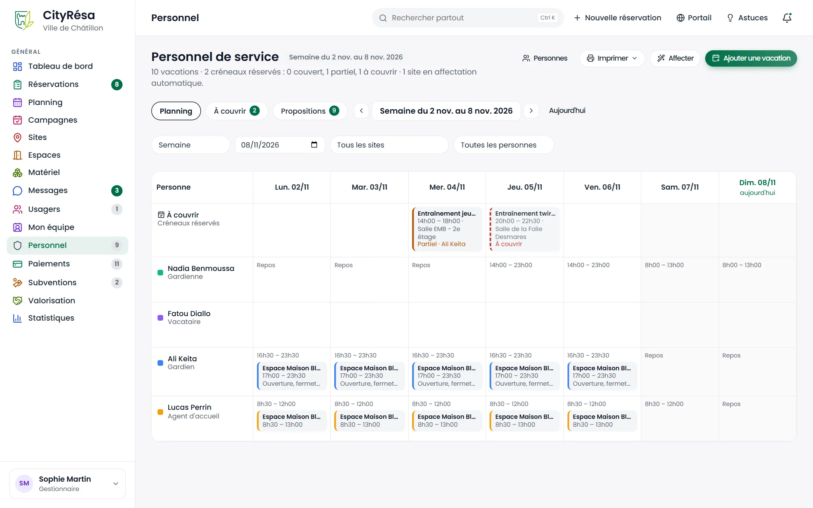
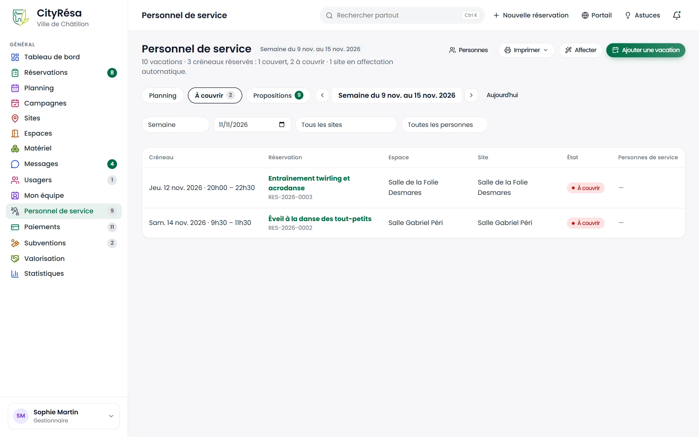
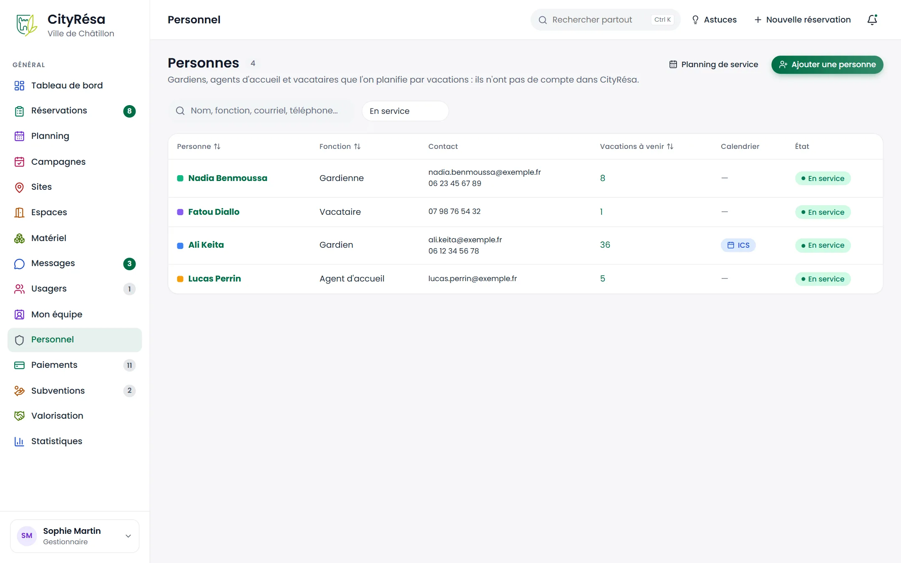
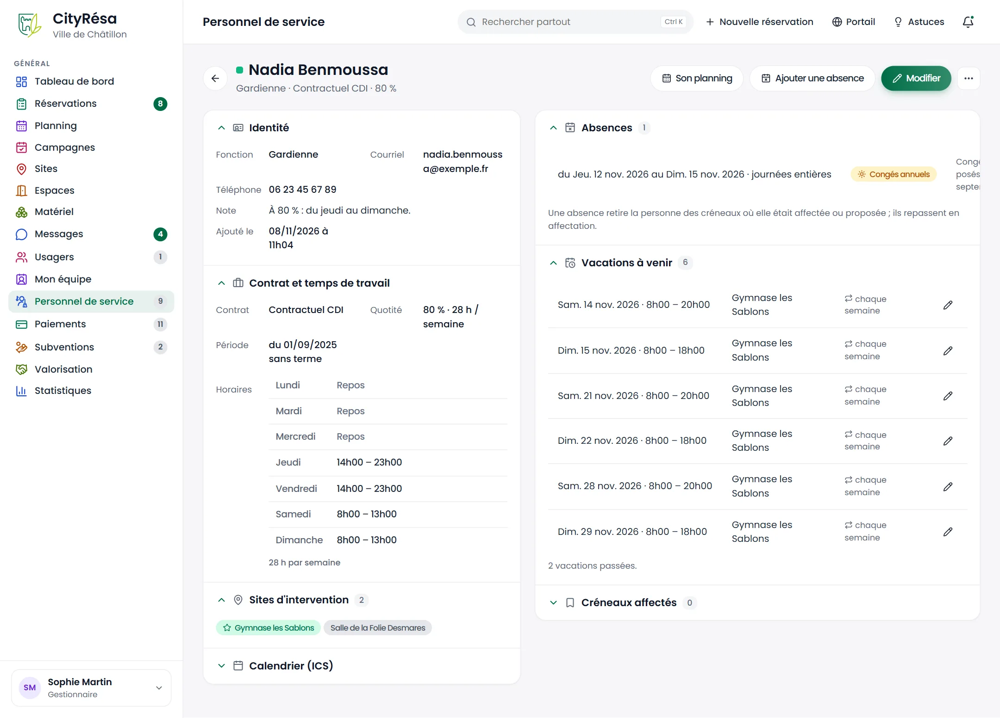
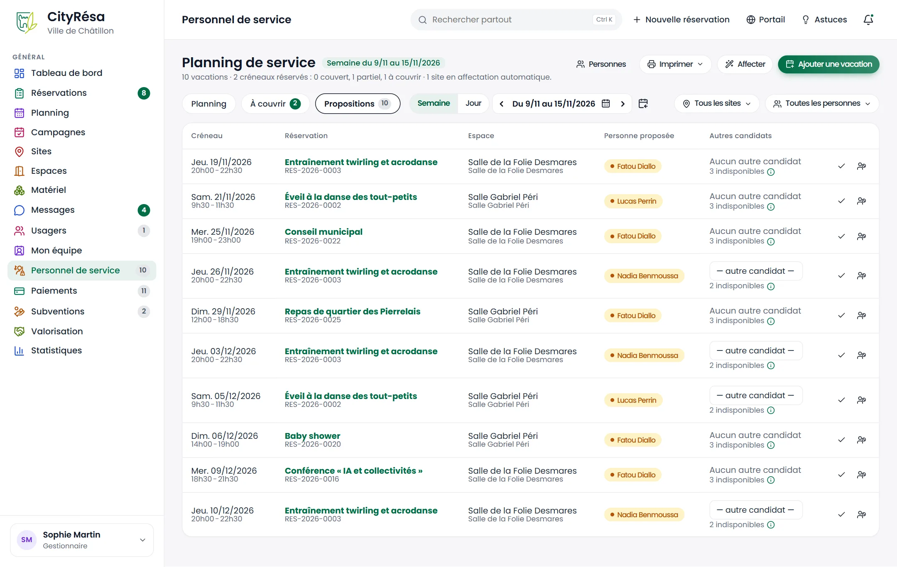

# 11. Personnel de service

Ce chapitre présente le module **Personnel de service** : les gardiens, agents d'accueil et vacataires que la Ville place sur ses sites, leurs vacations, et la façon dont l'application rapproche ces vacations des créneaux réservés pour signaler ceux que personne ne couvre. Ces personnes n'ont pas de compte dans CityRésa : ce sont les agents qui les planifient. Le module s'active dans Administration › Paramètres › Modules (chapitre 9).

## 11.1 Le planning de service

**À quoi ça sert** — Voir, semaine par semaine ou jour par jour, qui est de service sur quel site, et repérer d'un coup d'œil les créneaux réservés qu'aucune vacation ne couvre.

**Qui** — Tous les agents en lecture ; ajout et modification des vacations avec le droit d'écriture sur « Personnel de service » (gestionnaires et agents par défaut). Comme ailleurs, un agent rattaché à certains espaces ne voit que les sites de son périmètre.

*Figure — la semaine de service de Sophie Martin : la ligne « À couvrir » avec les créneaux réservés de ses sites, puis une ligne par personne avec ses vacations.*

**Ce que l'on voit**

- Le titre avec la semaine affichée, puis le résumé : nombre de vacations, nombre de créneaux réservés et leur état (couverts, partiels, à couvrir).
- Les boutons **Personnes**, **Imprimer** (semaine en PDF A4 ou A3, une page par site, créneaux à couvrir hachurés) et **Ajouter une vacation**.
- Les onglets **Planning** et **À couvrir** (avec le nombre de créneaux pas entièrement couverts), la navigation par période et les filtres : **Semaine / Jour**, la date, le **site** et la **personne**.
- La première ligne, **À couvrir**, liste par jour les créneaux réservés (dossiers acceptés, signés ou confirmés) de vos sites, avec l'espace, les heures et une mention colorée :
  - **Couvert** (vert) : une ou plusieurs vacations du site, mises bout à bout, couvrent tout le créneau, ou une personne y est épinglée ;
  - **Partiel** (orange) : une vacation le touche sans le couvrir entièrement ;
  - **À couvrir** (rouge) : personne n'est de service sur ce site à ce moment-là.
  La mention est suivie du nom des personnes concernées ; cliquer ouvre la fiche de la réservation.
- Ensuite, une ligne par personne avec sa couleur, sa fonction, et dans chaque jour ses vacations : le site, les heures et la note. Une vacation à cheval sur minuit s'affiche sur les deux jours.

**Comment faire — ajouter une vacation**

1. Cliquez sur **Ajouter une vacation**.
2. Choisissez la **Personne** et le **Site** : la personne est de service sur tous les espaces du site.
3. Saisissez la **Date**, le **Début** et la **Fin** (une fin avant le début = le lendemain, pour une soirée qui finit après minuit) et, au besoin, une **Note** (remise des clés, état des lieux…).
4. Pour une vacation régulière, cochez **Répéter chaque semaine, le même jour**, indiquez **Jusqu'au (inclus)** et choisissez de **sauter les jours fériés** ou **les vacances scolaires** du calendrier des saisons.
5. Cliquez sur **Ajouter**.

**Comment faire — modifier ou supprimer une vacation**

1. Cliquez sur la vacation dans le planning (ou sur le crayon dans la fiche de la personne).
2. Modifiez la personne, le site, la date, les heures ou la note, puis **Enregistrer**.
3. Pour la supprimer : **Supprimer cette vacation**, ou, si elle vient d'une répétition, **Supprimer celle-ci et les suivantes** pour arrêter la série à partir de cette date.

**Règles à connaître**

- Une même personne ne peut pas être de service deux fois sur des horaires qui se recouvrent : l'application refuse la vacation et dit laquelle gêne. Deux personnes peuvent en revanche être de service en même temps sur le même site.
- Une vacation est **refusée** si la personne est absente sur la période, hors de sa période de contrat, ou déjà affectée à un créneau réservé sur un autre site. Dans une répétition, les dates qui tombent pendant une absence sont simplement sautées, et le message dit combien.
- Hors des sites de rattachement de la personne ou de ses horaires de travail, la vacation est enregistrée avec un **avertissement** (bandeau orange) : c'est à vous de juger (remplacement, heures supplémentaires).
- Une répétition crée une vacation par semaine, chacune modifiable séparément ; au plus 200 occurrences.
- Seuls les créneaux des dossiers **acceptés, signés ou confirmés** sont à couvrir : une demande encore à l'étude n'apparaît pas.
- Les créneaux à couvrir des 7 prochains jours remontent aussi dans les **alertes** du tableau de bord (chapitre 8).

## 11.2 L'onglet À couvrir

**À quoi ça sert** — Travailler la liste des créneaux de la période qui n'ont pas (ou pas entièrement) de personne de service, sans la grille.

*Figure — les créneaux de la semaine à couvrir ou partiellement couverts, avec l'état et les personnes déjà en place.*

**Ce que l'on voit** — Une ligne par créneau : date et heures, la réservation (titre et numéro, lien vers sa fiche), l'espace, le site, l'**État** et les **Personnes de service** déjà présentes sur une partie du créneau. Quand tout est couvert, la liste le dit.

**Comment faire** — Pour chaque ligne, soit ajoutez une vacation qui couvre le créneau (bouton **Ajouter une vacation**, le site est à choisir), soit ouvrez la réservation et épinglez une personne sur ce créneau précis (section 11.4).

## 11.3 Les personnes

**À quoi ça sert** — Tenir la liste du personnel de service et la fiche de chacun : coordonnées, couleur dans le planning, lien d'agenda, envoi de son planning.

**Qui** — Lecture pour tous les agents ; création et modification en écriture ; suppression avec le droit de suppression (gestionnaires par défaut).

*Figure — les quatre personnes du jeu de démonstration : fonction, contact, vacations à venir, lien d'agenda et état.*

**Ce que l'on voit** — Une recherche (nom, fonction, courriel, téléphone), le filtre **En service / Plus en service / Tous**, et pour chaque personne : sa couleur et son nom, sa **Fonction**, son **Contact**, ses **Vacations à venir** (lien vers son planning), une pastille **ICS** si un lien d'agenda existe, et son **État**.

**Comment faire — ajouter une personne**

1. Cliquez sur **Ajouter une personne**.
2. Saisissez le **Prénom** et le **Nom** (obligatoires), la **Fonction** (gardien, agent d'accueil, vacataire…), la **Couleur dans le planning** (une couleur libre est proposée), le **Courriel** (pour lui envoyer son planning), le **Téléphone** et une **Note**.
3. Cliquez sur **Ajouter** : sa fiche s'ouvre.

*Figure — la fiche d'Ali Keita, gardien : identité, lien d'agenda ICS, vacations à venir et créneaux épinglés.*

**La fiche**

- **Identité** : fonction, courriel, téléphone, note, date d'ajout ; le bouton **Modifier** ouvre le formulaire.
- **Calendrier (ICS)** : **Générer le lien ICS** crée une adresse personnelle à coller dans l'agenda de la personne (Outlook, Google Agenda, téléphone) ; ses vacations et les créneaux où elle est épinglée s'y mettent à jour seuls. **Révoquer le lien** l'invalide.
- **Vacations à venir** : les 30 prochaines, avec le site, la note et la mention « chaque semaine » pour celles d'une série ; le crayon ouvre la vacation. Le nombre de vacations passées est rappelé dessous.
- **Créneaux épinglés** : les créneaux de réservation sur lesquels la personne a été placée nommément (section 11.4).
- Le menu **⋯** : **Envoyer son planning de la semaine** (courriel immédiat avec le PDF de la semaine en cours, si la personne a une adresse), **Plus en service** / **Remettre en service**, **Supprimer**.

**Règles à connaître**

- Une personne **plus en service** ne peut plus recevoir de vacation, mais ses vacations passées restent consultables ; elle disparaît du planning.
- **Supprimer** une personne supprime ses vacations ; les créneaux où elle était épinglée reviennent à l'état déduit des vacations.
- Le lien ICS est un secret : ne le transmettez qu'à la personne, et révoquez-le si elle quitte le service.

## 11.4 Épingler une personne sur un créneau

**À quoi ça sert** — Désigner nommément qui s'occupe d'un créneau précis (état des lieux, événement sensible), même sans vacation sur le site ce jour-là.

**Qui** — Agents et gestionnaires qui décident sur le dossier (périmètre) et qui ont le droit d'écriture sur « Personnel de service ».

**Comment faire**

1. Ouvrez la fiche de la réservation ; dans la liste des **Créneaux** de la section **Événement**, une colonne montre pour chaque séance à venir qui est de service.
2. Cliquez sur la silhouette suivie d'un « + » (**Personne de service**) de la séance voulue.
3. Choisissez la personne, ou **Aucune (vacations du site)** pour retirer l'épinglage, puis **Enregistrer**.

**Règles à connaître**

- Un créneau épinglé est toujours **Couvert**, et la personne apparaît en tête, marquée d'un signet.
- L'épinglage ne crée pas de vacation. Pour une présence régulière, préférez une vacation.
- L'épinglage est **refusé** si la personne n'est plus en service, est hors de sa période de contrat, est absente, ou est déjà de service au même moment sur un autre site (créneau affecté ou vacation) : le message donne la raison. Hors de ses sites de rattachement ou de ses horaires de travail, il est enregistré avec un **avertissement**. La même règle s'applique quand vous validez une proposition en choisissant un autre candidat.
- Les séances passées ne s'épinglent plus ; elles gardent le nom déjà enregistré.

## 11.5 Courriel hebdomadaire et PDF

**À quoi ça sert** — Donner à chaque personne son planning de la semaine sans ressaisie : par courriel chaque semaine, ou imprimé par site.

**Comment faire — activer l'envoi hebdomadaire**

1. Dans Administration › Paramètres, onglet **Réservations**, activez **Planning de service par courriel au personnel** ; le **Jour d'envoi du planning hebdomadaire** est commun avec celui des gestionnaires (du lundi au jeudi, la semaine en cours ; du vendredi au dimanche, la suivante).
2. Vérifiez que le modèle de courriel **Planning de service (personnel)** est actif (Administration › Modèles de courriel) ; ses variables : `{{prenom}}`, `{{semaine}}`, `{{sites}}`, `{{resume}}`, `{{lien_ics}}`.
3. La tâche planifiée **Planning de service envoyé au personnel** part à 6 h 45 le jour choisi ; elle s'envoie une seule fois par personne et par jour (journal des courriels).

**Imprimer** — Dans le planning de service, **Imprimer › Semaine en PDF** : une page par site, les vacations en couleur et les créneaux à couvrir hachurés, à afficher à la loge ou à l'accueil.

## 11.6 Le contrat et les horaires de travail

**À quoi ça sert** — Décrire le temps de travail de chaque personne pour que l'application sache quand elle est en poste : type de contrat, quotité, durée hebdomadaire, dates, et le cycle hebdomadaire d'horaires.

**Qui** — Agents et gestionnaires en écriture sur « Personnel de service ».

*Figure — la fiche de Nadia Benmoussa, gardienne contractuelle à 80 % : contrat, cycle du jeudi au dimanche, sites d'intervention, absence de congés et créneaux affectés.*

**Ce que l'on voit** — Dans la section **Contrat et temps de travail** : le **Contrat** (type), la **Quotité** et la durée hebdomadaire, la **Période** du contrat, et le tableau des **Horaires** jour par jour (« Repos » ou les plages, par exemple « 8h00 – 12h00 · 13h30 – 17h00 »), suivi du total d'heures du cycle. Quand ce total s'écarte des heures attendues (35 h × quotité, ou la durée saisie pour un temps non complet), une pastille orange le signale : c'est une information, pas un blocage. La section **Sites d'intervention** liste les sites où la personne peut être affectée, le principal marqué d'une étoile.

**Comment faire**

1. Sur la fiche, cliquez sur **Modifier** : la fenêtre comporte l'identité, puis **Contrat et temps de travail** et **Sites d'intervention**.
2. Choisissez le **Type de contrat** (fonctionnaire titulaire ou stagiaire, contractuel CDD ou CDI, vacataire, apprenti, mis à disposition ; liste dans Administration › Référentiels), la **Quotité (%)** (100 pour un temps complet, 80 pour un quatre-cinquièmes…) et, pour un temps non complet, la **Durée hebdomadaire (h)** du contrat (28 h par exemple).
3. Renseignez le **Début** et la **Fin du contrat** si elle est connue : hors de ces dates, la personne n'est jamais proposée.
4. Cochez **Horaires de travail fixes** pour saisir le cycle : pour chaque jour, cochez **Repos** ou indiquez le **Début** et la **Fin**, et au besoin une seconde plage (coupure méridienne). Décoché, la personne est affectable à toute heure de tous les jours, hors absences (vacataire appelé selon les besoins).
5. Cochez les **Sites où la personne peut être affectée** et choisissez son **Site principal**.
6. Cliquez sur **Enregistrer**. Les affectations à venir qui ne tiennent plus (site retiré, horaire modifié) sont retirées et les créneaux repassent en affectation ; le message le dit.

**Règles à connaître**

- Un créneau ne convient que s'il tient **entièrement** dans une plage du cycle : une personne en poste de 14 h à 21 h n'est pas proposée pour un créneau de 20 h à 22 h 30.
- Quotité et durée hebdomadaire sont descriptives : l'application ne limite pas les heures affectées, mais elle classe les candidats pour répartir la charge (section 11.8).
- Une personne sans site d'intervention n'est jamais proposée ; la liste des personnes le signale par un tiret dans la colonne **Sites**.

## 11.7 Les absences

**À quoi ça sert** — Tenir les congés, RTT, maladies, formations et récupérations, pour que la personne ne soit ni proposée ni affectée pendant ses absences.

**Qui** — Agents et gestionnaires en écriture sur « Personnel de service ».

**Ce que l'on voit** — Sur la fiche, la section **Absences** liste les absences récentes et à venir : période (« Sam. 28 nov. 2026 · journée entière », ou la plage horaire), **motif** (pastille) et note, avec la croix pour supprimer. Dans le planning de service, une absence apparaît hachurée en orange dans la case du jour, et les plages travaillées du jour en sont réduites.

**Comment faire**

1. Sur la fiche, cliquez sur **Ajouter une absence**.
2. Choisissez le **Motif** (congés annuels, RTT, maladie, formation, récupération, autre ; liste dans Administration › Référentiels), le premier jour (**Du**) et le dernier (**Au**, inclus).
3. Laissez **Journée(s) entière(s)** coché, ou décochez-le pour une demi-journée ou un rendez-vous et indiquez l'**Heure de début** et l'**Heure de fin**.
4. Cliquez sur **Ajouter**. Si la personne était affectée ou proposée sur un créneau de la période, l'affectation est retirée et le créneau repasse en affectation : le message indique combien. Si elle avait des vacations sur la période, le message le signale aussi.

**Règles à connaître**

- Une personne absente **ne couvre rien** : ses vacations restent affichées au planning (à vous de les supprimer ou de les confier à quelqu'un d'autre), mais elles ne comptent plus dans la couverture pendant l'absence. Les créneaux réservés qu'elles couvraient repassent **À couvrir** ou **Partiel** et sont remis en affectation.
- La suppression d'une absence ne réaffecte rien d'elle-même ; la tâche quotidienne ou le bouton **Affecter** s'en chargent.
- L'historique du dossier de réservation garde la trace d'une personne retirée (« Personne de service retirée … plus disponible »).

## 11.8 L'affectation automatique et les propositions

**À quoi ça sert** — Placer une personne disponible sur chaque créneau réservé sans que le gestionnaire ait à chercher qui est libre : d'office sur les sites qui le souhaitent, sur proposition ailleurs.

**Qui** — Le calcul est automatique ; la validation des propositions demande le droit d'écriture sur « Personnel de service » et la charge de l'espace.

*Figure — l'onglet Propositions : pour chaque créneau, la personne proposée, les autres candidats et les boutons Valider et Écarter.*

**Ce que l'on voit**

- Dans le planning de service, les créneaux **affectés** apparaissent dans la case de la personne (signet vert, titre de la réservation, espace), les **propositions** en pointillé orange avec la mention « Proposé · à valider ». Le sous-titre de la page rappelle combien de sites sont en affectation automatique.
- L'onglet **Propositions** (compteur dans le menu **Personnel** et dans les alertes du tableau de bord) : une ligne par créneau avec la **Personne proposée**, la liste des **Autres candidats** (site principal, heures déjà affectées cette semaine) et le nombre d'indisponibles (survolez pour lire le motif de chacun : hors horaires, absente, hors site…).
- Sur la fiche d'une réservation, la colonne **Service** affiche « Proposé : … » avec une coche pour valider et une croix pour écarter.

**Comment faire**

- **Choisir le mode d'un site** : fiche du site › **Modifier** › **Affectation automatique du personnel de service**. Coché, la première personne disponible est affectée d'office et les gestionnaires du site sont notifiés ; décoché (par défaut), elle est proposée.
- **Valider une proposition** : cliquez sur **Valider**, ou choisissez une autre personne dans la liste puis **Affecter**.
- **Écarter une proposition** : cliquez sur **Écarter** ; la personne écartée ne sera plus proposée sur ce créneau, un autre candidat le sera au prochain passage.
- **Lancer le calcul à la demande** : dans le planning, bouton **Affecter** (période et site affichés), après confirmation. Le message résume : affectés, proposés, propositions conservées, créneaux sans personne disponible.

**Règles à connaître**

- Le calcul se fait dès qu'un dossier devient accepté, signé ou confirmé, puis chaque matin à 6 h 50 sur les 30 prochains jours (tâche **Personnel de service : affectation ou proposition**). Une proposition encore valable est conservée d'un passage à l'autre.
- Une personne est **disponible** si elle est en service, rattachée au site, dans sa période de contrat, en poste d'après son cycle, pas absente, et pas déjà affectée au même moment sur un autre site. Plusieurs créneaux d'un même site au même moment restent compatibles (un gardien couvre tout le site).
- Les candidats sont classés : site principal d'abord, puis la plus faible charge déjà affectée sur la semaine (du lundi au dimanche du créneau, créneaux affectés et proposés compris), puis le nom.
- Les créneaux déjà **couverts par des vacations** ne sont pas traités : les vacations restent le moyen de planifier une présence régulière sur un site, l'affectation complète le reste.
