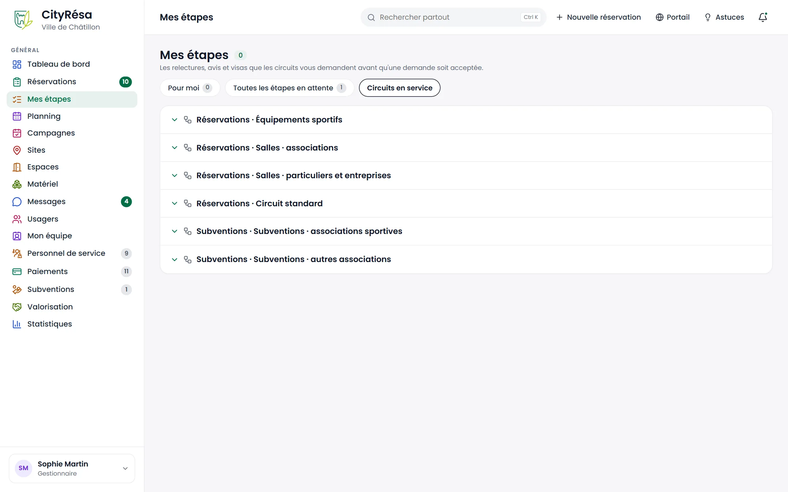
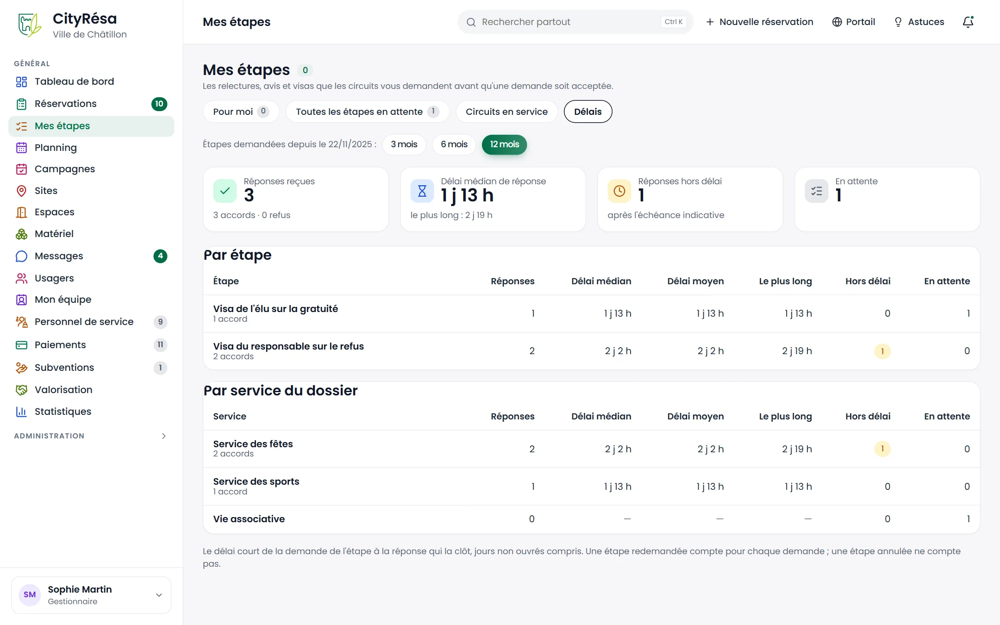
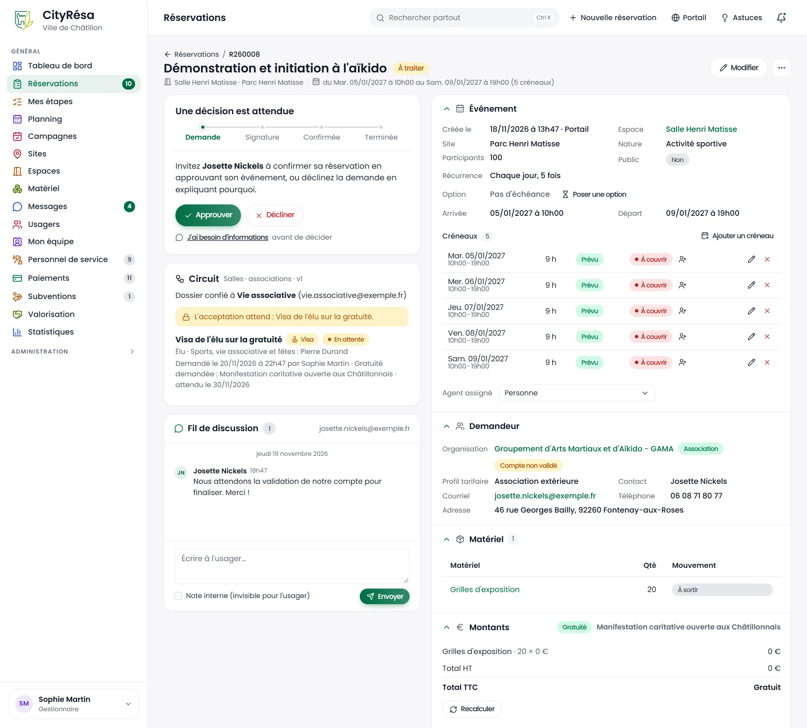
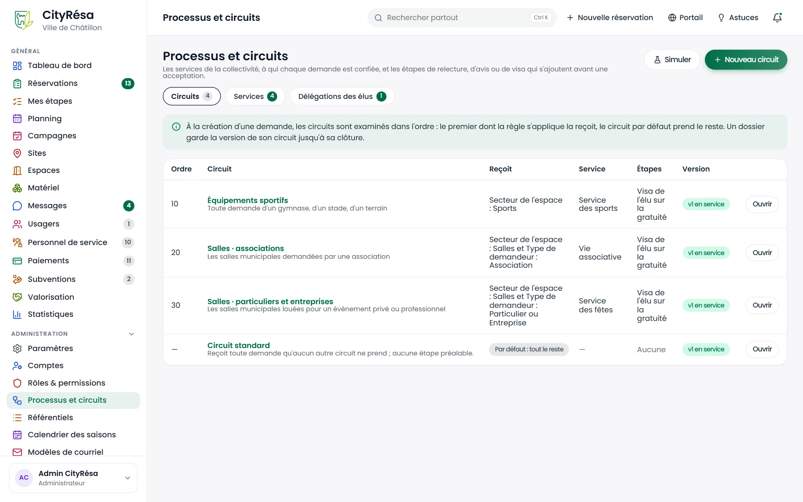
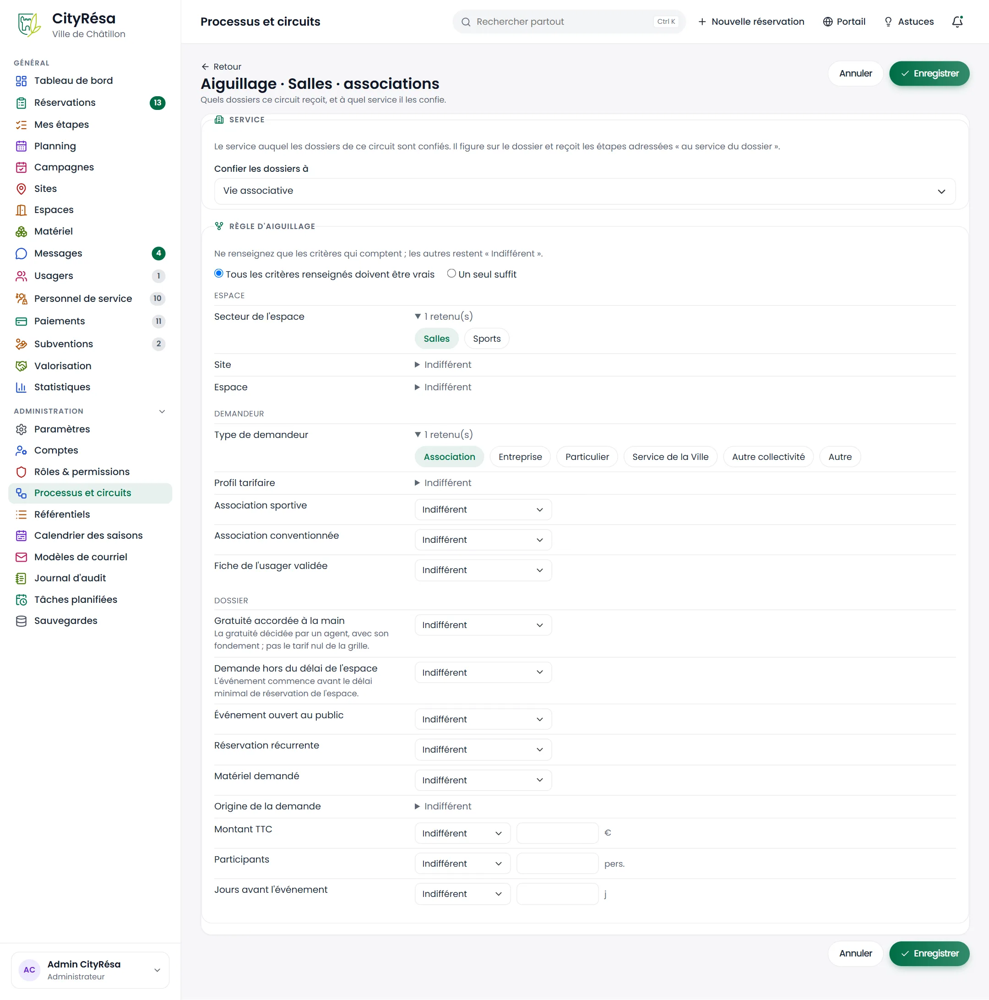
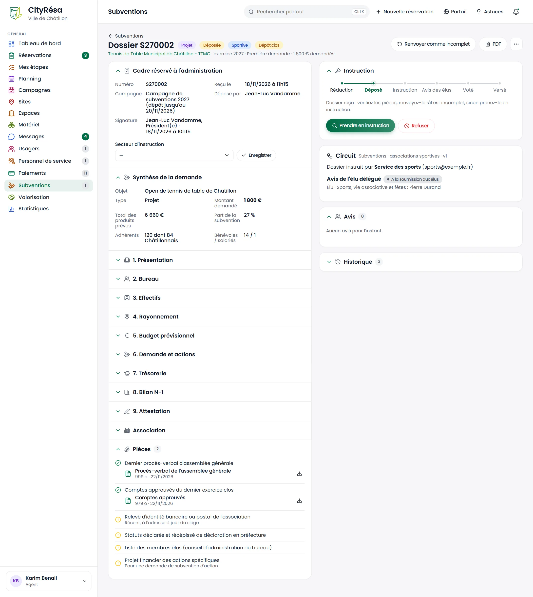
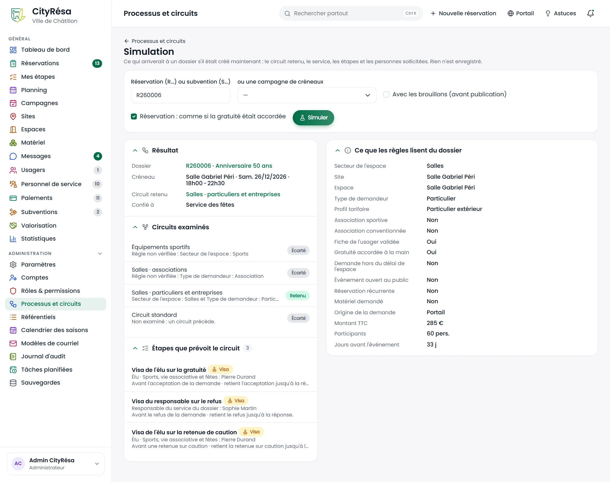

# 12. Processus et circuits

Ce chapitre présente le module **Processus et circuits** : les services de la collectivité, la règle qui confie chaque demande de réservation à l'un d'eux, et les étapes de relecture, d'avis ou de visa que la Ville ajoute avant une acceptation. La Ville décrit elle-même cette organisation et la modifie quand elle change, sans intervention technique. Le module s'active dans Administration › Paramètres › Modules (chapitre 9).

Le cycle d'un dossier ne change pas : le module y **insère** des étapes, il ne le remplace pas. Il porte sur les demandes de **réservation** (sections 12.2 à 12.4) et sur les demandes de **subvention** (section 12.7).

## 12.1 Les notions

| Notion | Ce que c'est |
| --- | --- |
| **Service** | Un service de la Ville (Service des sports, Vie associative, Service des fêtes, Communication…), avec ses membres, son responsable et, au besoin, un service qui le supplée pendant une période. |
| **Délégation** | Le domaine d'un élu. Une étape s'adresse à une délégation, pas à une personne : l'élu peut changer sans toucher aux circuits. |
| **Circuit** | Pour un type de demandes : le service auquel elles sont confiées et les étapes qui précèdent leur acceptation. |
| **Règle d'aiguillage** | La condition qui fait qu'un circuit reçoit une demande (« une salle demandée par une association »). |
| **Étape** | Une relecture, un avis ou un visa, demandé à un service, à un élu ou à un rôle, sous condition ou toujours, à un **moment** du dossier. |
| **Version** | Un circuit se modifie en brouillon, puis se publie. Un dossier garde la version avec laquelle il a commencé, sauf si l'agent le fait passer sur la version en service. |

Les trois natures d'étape :

| Nature | Effet |
| --- | --- |
| **Relecture** | Un second regard avant que la décision parte à l'usager. Retient l'acceptation. |
| **Visa** | Un accord préalable. Retient l'acceptation. |
| **Avis** | Un avis consultatif. Ne retient rien. |

Une étape précède l'un de six gestes sur une réservation :

| Moment | Le geste retenu |
| --- | --- |
| **Avant l'acceptation de la demande** | Approuver (ou créer directement le dossier accepté) |
| **Avant le refus de la demande** | Décliner |
| **Avant une annulation par la collectivité** | Annuler la réservation (l'annulation par l'usager n'est pas concernée) |
| **Avant une réquisition pour la Ville** | Réquisitionner un créneau |
| **Avant l'émission d'une facture** | Émettre une facture d'acompte, de solde ou de caution depuis le dossier (les factures émises d'office, comme les frais d'annulation, ne sont pas concernées) |
| **Avant une retenue sur caution** | Retenir tout ou partie de la caution, après l'état des lieux de sortie (la restitution n'est pas concernée) |

## 12.2 Mes étapes

**À quoi ça sert** — Retrouver les relectures, avis et visas que l'on attend de vous, et y répondre.

**Qui** — Tous les agents, élus compris. Répondre à une étape ne demande aucun droit sur les réservations : il suffit d'être la personne attendue (membre du service, élu de la délégation, compte du rôle).

*Figure — « Mes étapes » de l'élu Pierre Durand : la gestionnaire veut accorder la gratuité à une association, le circuit demande son visa.*

**Ce que l'on voit**

- L'entrée **Mes étapes** du menu, avec le nombre d'étapes qui vous attendent.
- Trois onglets : **Pour moi**, **Toutes les étapes en attente** (pour suivre, sans pouvoir répondre à la place d'un autre) et **Circuits en service** (le logigramme de chaque circuit).
- Pour chaque étape : son libellé et sa nature, le dossier (numéro, objet, demandeur, espace, dates), **ce qui est soumis** (ce que l'agent a écrit en la demandant), qui l'a demandée et quand, et l'échéance s'il y en a une (en rouge quand elle est dépassée).

**Comment faire**

1. Cliquez sur le dossier pour le lire : vous y accédez même s'il ne relève pas de vos espaces.
2. Cliquez sur le bouton d'accord (**Visa accordé**, **Relu, bon pour envoi**, **Avis favorable**) ; un commentaire est possible.
3. Ou cliquez sur le bouton de refus (**Visa refusé**, **À revoir**, **Avis défavorable**) et indiquez le **Motif** : il est obligatoire et le service le lira sur le dossier.

**Règles à connaître**

- Quand une étape s'adresse à plusieurs personnes (un service, un rôle), sa **règle de réunion** dit combien doivent répondre : **Une réponse suffit** (la première clôt l'étape, réglage par défaut), **Tous doivent répondre** (chacun accorde, un seul refus refuse) ou **La majorité** (plus de la moitié des personnes désignées ; à égalité, l'étape est refusée). Tant qu'il manque des réponses, l'étape reste en attente et la carte Circuit liste celles reçues. Chacun ne répond qu'une fois ; l'étape quitte alors ses **Mes étapes**.
- Un **courriel** double la cloche : il part à chaque personne attendue quand une étape lui est demandée (avec ce que l'agent soumet, l'échéance et un lien vers le dossier), puis une fois si l'échéance est dépassée, à ceux qui n'ont pas encore répondu. Les élus consultés sur une subvention le reçoivent aussi. Un administrateur règle le texte, ou coupe l'envoi, dans **Modèles de courriel** (chapitre 9.17) : « Étape de circuit demandée » et « Étape de circuit en retard ».
- Vous êtes prévenu par la cloche quand une étape vous est demandée ; l'agent qui l'a demandée l'est quand vous répondez.
- Une étape ne s'attend plus sur un dossier refusé ou annulé.
- **En copie** : une étape peut nommer des personnes mises en copie (un service qui suit, un responsable). Elles reçoivent par la cloche « Pour information » quand l'étape est demandée, puis la réponse, sans avoir à répondre et sans que l'étape figure dans leurs **Mes étapes**. La carte Circuit du dossier les nomme. La mise en copie n'ouvre aucun droit : la personne ouvre le dossier si son rôle le lui permet déjà.
- **Accord d'office** : une étape peut être réglée pour être **tenue pour accordée à l'échéance**. Si personne n'a répondu dans le délai, elle est validée d'office le lendemain matin (« le silence vaut accord ») : la carte Circuit l'indique, l'historique porte « accordé d'office », l'agent qui l'a demandée et les personnes attendues sont prévenus. Le geste retenu peut alors se refaire.
- **En retard** : quand le délai indicatif d'une étape est dépassé, vous êtes relancé une fois par la cloche, le responsable du service du dossier et l'agent assigné sont prévenus, et le tableau de bord vous signale « N étapes de circuit en retard ». L'échéance reste indicative : rien n'est décidé à votre place. La relance part chaque matin (tâche **Processus : relance des étapes de circuit en retard**, chapitre 9.20).

*Figure — l'onglet « Circuits en service » : chaque circuit en logigramme, consultable par tous les agents.*

**L'onglet Délais** — Il mesure le temps que mettent les relectures, avis et visas à recevoir leur réponse, sur les étapes demandées depuis 3, 6 ou 12 mois.

*Figure — l'onglet « Délais » : les réponses reçues et leur délai, par étape et par service.*

- Quatre cartes résument la période : réponses reçues (accords et refus), délai médian, réponses arrivées **hors délai** (après l'échéance indicative de l'étape), étapes encore en attente et, parmi elles, celles en retard.
- Deux tableaux détaillent les mêmes chiffres **par étape** et **par service du dossier** : délai médian, délai moyen, délai le plus long.
- Le délai court de la demande de l'étape à la réponse qui la clôt, jours non ouvrés compris. Une étape redemandée compte pour chaque demande ; une étape annulée ne compte pas. L'avis des élus sur une subvention, donné sur le dossier, n'y figure pas.
- L'onglet est ouvert à tous les agents, comme « Toutes les étapes en attente ».

## 12.3 Le circuit sur la fiche d'un dossier

**À quoi ça sert** — Savoir à quel service le dossier est confié, quelles étapes son circuit lui impose et où elles en sont.

**Qui** — Tous les agents qui voient le dossier ; l'agent qui l'instruit demande les étapes.

*Figure — un dossier « À traiter » dont l'acceptation attend le visa de l'élu.*

**Ce que l'on voit** — Sous la carte de décision, la carte **Circuit** : le nom du circuit et sa version, le service auquel le dossier est confié, un bandeau jaune quand une étape retient l'acceptation, puis chaque étape applicable avec sa nature, son état (**À demander**, **En attente**, accordé, refusé), les personnes attendues, et le suivi (qui a demandé, quand, la réponse et son commentaire).

**Comment faire**

1. Instruisez le dossier comme d'habitude, puis cliquez sur **Approuver**.
2. Si le circuit prévoit une relecture ou un visa, le dossier **n'est pas accepté** : l'étape est demandée d'office, les personnes attendues sont prévenues et un message jaune vous le dit. Vous pouvez aussi demander une étape à l'avance avec son bouton **Demander**, en précisant ce que vous soumettez.
3. Quand la réponse arrive (cloche), rouvrez le dossier et cliquez de nouveau sur **Approuver**.
4. Si l'étape est refusée : corrigez le dossier puis **Redemander**, ou déclinez la demande.

**Règles à connaître**

- Une étape ne s'applique que si sa condition est vraie. Exemple du jeu de démonstration : le visa de l'élu n'est demandé que si l'agent accorde la gratuité ; approuver sans gratuité ne déclenche rien.
- Un avis part avec la première approbation mais ne la retient pas.
- Il en va de même des autres gestes : **Décliner**, **Annuler** ou **Réquisitionner** est retenu si le circuit prévoit une relecture ou un visa à ce moment-là. L'étape est demandée d'office, avec le motif que vous avez saisi, et le geste se refait une fois l'accord donné. Le jeu de démonstration en a deux exemples : le visa du responsable avant le refus d'une location, et le visa de l'élu avant la réquisition du créneau d'une association.
- La carte n'affiche que les étapes du moment présent : un visa de refus ne s'attend plus sur un dossier accepté, un visa de réquisition n'apparaît que sur un dossier acquis.
- Une réservation saisie directement « Acceptée » ou « Confirmée » par un agent, sur un espace sans validation ou par une campagne, naît « À traiter » si son circuit lui impose une relecture ou un visa.
- L'usager ne voit une étape que si elle porte un libellé qui lui est destiné (« Votre demande est en cours de validation »).
- Chaque demande et chaque réponse sont inscrites à l'historique du dossier.

## 12.4 Ce que le service change pour un agent

**À quoi ça sert** — Séparer le travail de services qui partagent les mêmes espaces (la Vie associative et le Service des fêtes sur les salles), sans cacher à l'un l'occupation décidée par l'autre.

**Qui** — Les agents qui appartiennent à un service. Un agent agit pour un service s'il en est **membre** ou **responsable**, ou s'il est du service qui le **supplée** pendant la période de suppléance.

**Ce qui est réservé au service d'un dossier**

- **Décider** : approuver, décliner, demander des informations, modifier, annuler, toucher aux créneaux, à la convention, à la caution. Sur le dossier d'un autre service, la carte de décision indique « Ce dossier est confié à … : la décision lui revient ».
- **Facturer et encaisser** les factures du dossier.
- **Les gestes de terrain** sur ses créneaux : constater la présence (chapitre 3.10), valider ou écarter une proposition de personnel de service et affecter quelqu'un (chapitre 11.8). L'écran **Présences**, l'onglet **Propositions** et l'affectation automatique se limitent à la file de travail. Comme pour les factures, un agent sans service (accueil, régie) les accomplit pour tous.
- **Annuler des créneaux par une fermeture** : une fermeture exceptionnelle reste l'affaire de l'espace, tout agent qui en a la charge la pose ; mais elle n'annule que les créneaux des dossiers de son service. Ceux d'un autre service sont signalés dans l'aperçu (« … · décide de l'annulation »), laissés en place, et ce service est prévenu par la cloche pour annuler ou reporter.
- **Être prévenu** : une nouvelle demande, un message de l'usager ou une annulation préviennent les personnes du service, plus les gestionnaires de l'espace.

**Ce que l'usager voit du service** — Le service auquel son dossier est confié signe les courriels qu'il reçoit (« Service des fêtes, Ville de Châtillon », avec son courriel et son téléphone), figure sur la convention (« Dossier suivi par… ») et sur son dossier du portail (« Votre interlocuteur »). Les modèles de courriel disposent pour cela des variables `{{service}}`, `{{service_contact}}` et `{{{signature}}}`.

**Ce qui reste ouvert à tous les agents du périmètre**

- **Consulter** le dossier et le planning : deux services qui partagent une salle voient l'occupation l'un de l'autre.
- **Écrire dans le fil** du dossier (message à l'usager, note interne).

**La file de travail** — Pour un agent qui appartient à au moins un service, le compteur **Réservations** du menu, le bloc « À traiter » du tableau de bord et la liste des réservations se limitent par défaut aux dossiers de **ses services** et à ceux qui n'ont pas de service. Dans la liste, le filtre des services affiche alors **Mes services** ; **Tous les services** montre le reste, en consultation.

**Règles à connaître**

- Le droit par service **s'ajoute** aux droits existants : il faut toujours le droit d'écriture sur les réservations et avoir l'espace dans son périmètre.
- Un dossier **sans service** (circuit standard) se décide comme avant, par les agents chargés de l'espace.
- Un agent qui n'appartient à **aucun service** garde la vue d'ensemble mais ne décide pas sur un dossier confié à un service. Il encaisse en revanche toutes les factures : c'est le cas de la régie ou des finances.
- Un **administrateur** agit sur tous les dossiers.
- Un agent ne crée pas directement « Acceptée » ou « Confirmée » une demande qui revient à un autre service : il l'enregistre « À traiter ».
- Les blocages sans réservation, les vacations du personnel et les plannings types restent réglés par espace ou par site : ils ne touchent aucun dossier.

## 12.5 Les services et les délégations

**À quoi ça sert** — Déclarer les services de la Ville et les délégations des élus, sur lesquels les circuits s'appuient.

**Qui** — Les comptes qui ont un droit sur le domaine **Processus et circuits** (Administration › **Processus et circuits**) : la **lecture** pour consulter les services, les délégations, les circuits et la simulation, et pour exporter un circuit ; l'**écriture** pour les créer, les modifier, publier et importer ; la **suppression** pour supprimer un circuit. L'administrateur a tout ; le rôle Gestionnaire fourni a la lecture ; les autres rôles n'y ont pas accès, ce qui ne change rien à **Mes étapes**, ouvert à tous les agents.

*Figure — les quatre services du jeu de démonstration, avec leur responsable, leurs membres et le nombre de dossiers qui leur sont confiés.*

**Comment faire — un service**

1. Onglet **Services**, bouton **Nouveau service** (ou le crayon d'une ligne).
2. Saisissez le **Nom**, le **Courriel**, le **Téléphone**, choisissez le **Responsable** et cochez les **Membres** parmi les comptes du back-office. Un agent peut appartenir à plusieurs services.
3. Pour une **suppléance**, choisissez le service dans **Suppléé par** et indiquez les dates **Du** et **Au** : pendant la période, les membres du service suppléant reçoivent aussi ses étapes.
4. Cliquez sur **Enregistrer**.

*Figure — la délégation « Sports, vie associative et fêtes », confiée à Pierre Durand.*

**Les usagers d'un service** — Dans la fiche d'un service, **Usagers dont ce service est le référent** coche les types d'organisation qu'il suit (associations, entreprises, particuliers…), et **Parmi les associations** précise au besoin « sportives seulement » ou « non sportives seulement ». Le service de référence d'un usager est le premier service, dans l'ordre de la liste, qui suit son type. Il en découle trois choses :

- il est **prévenu** de l'inscription de l'usager ;
- il est seul (avec les administrateurs) à **valider sa fiche** ;
- les onglets **À valider** et **Pièces à vérifier** de la liste des usagers, le compteur du menu et l'alerte du tableau de bord ne montrent à un agent que les usagers de ses services, et ceux qui n'ont pas de référent.

Consulter et modifier une fiche reste ouvert à tous les agents qui ont l'écriture sur les usagers : une même association peut réserver un gymnase et une salle.

**Les campagnes de créneaux d'un service** — Une campagne de créneaux est conduite par un service (chapitre 3.12) : ses membres l'ouvrent, la modifient, l'arbitrent et préviennent les demandeurs. Deux services peuvent mener leur campagne en même temps, sur des espaces distincts.

**Comment faire — une délégation** — Onglet **Délégations des élus**, bouton **Nouvelle délégation** : l'**Intitulé**, l'**Élu** et, si besoin, son **Suppléant**, qui est sollicité avec lui.

**Règles à connaître**

- Un service sans membre ou une délégation sans élu ne peut pas recevoir d'étape : la publication d'un circuit qui s'adresse à lui est refusée.
- Appartenir à un service détermine les étapes qu'un agent reçoit et les dossiers sur lesquels il décide (12.4) ; son rôle, son secteur et ses espaces continuent de s'appliquer.

## 12.6 Les circuits

**À quoi ça sert** — Décrire, pour chaque famille de demandes, le service qui les reçoit et les étapes qui précèdent l'acceptation.

**Qui** — Les comptes qui ont l'écriture sur **Processus et circuits** (chapitre 12.5) ; la lecture suffit pour consulter.

*Figure — les circuits du jeu de démonstration, dans leur ordre d'examen, et le circuit par défaut.*

**Ce que l'on voit** — Pour chaque circuit : son **Ordre**, son nom, ce qu'il **Reçoit** (sa règle d'aiguillage en clair), le **Service**, ses **Étapes** et sa **Version** (en service, brouillon en cours).

*Figure — la fiche d'un circuit : aiguillage, étapes, versions, et le logigramme à droite.*

**Comment faire — créer ou modifier un circuit**

1. Cliquez sur **Nouveau circuit**, ou ouvrez un circuit existant. Toute modification s'écrit dans un **brouillon** ; rien ne change pour les dossiers tant qu'il n'est pas publié.
2. Section **Aiguillage** › **Modifier** : choisissez le **service** et réglez la **règle**. Chaque critère est « Indifférent » par défaut ; ne renseignez que ceux qui comptent, et choisissez s'ils doivent tous être vrais ou si un seul suffit.
3. Section **Étapes du circuit** › **Ajouter** : le **Libellé**, la **Nature**, **Qui répond**, les **Réponses attendues** (une suffit, tous, la majorité), le **Moment** (avant l'acceptation, le refus, une annulation ou une réquisition), un **Délai indicatif**, qui est mis **En copie** (facultatif), ce qui se passe **À l'échéance, sans réponse** (relancer, ou tenir l'étape pour accordée), ce que lit l'usager, et les critères de **Quand l'étape s'applique**.
4. Ordonnez les étapes avec les flèches ; la corbeille en retire une.
5. Vérifiez le **logigramme**, puis cliquez sur **Publier** et saisissez une note de version.

*Figure — la règle d'aiguillage : un réglage par critère, regroupés par espace, demandeur et dossier.*

*Figure — l'étape « Visa de l'élu sur la gratuité » : un visa demandé à la délégation, seulement si la gratuité est accordée à la main.*

**Les critères disponibles**

| Groupe | Critères |
| --- | --- |
| Espace | Secteur, site, espace |
| Demandeur | Type de demandeur, profil tarifaire, association sportive, association conventionnée, fiche validée |
| Dossier | Gratuité accordée à la main, demande hors du délai de l'espace, événement ouvert au public, réservation récurrente, matériel demandé, origine (portail ou back-office), montant, participants, jours avant l'événement |

**Qui peut répondre à une étape** — un service ; le service du dossier ; le responsable du service du dossier ; l'élu d'une délégation ; les comptes d'un rôle.

**Règles à connaître**

- À la création d'une demande, les circuits sont examinés dans l'**ordre** : le premier dont la règle est vraie la reçoit ; le **circuit par défaut** prend le reste. Il y en a un seul, sans règle.
- La publication est refusée tant qu'il reste une incohérence (étape sans libellé, service sans membre, délégation sans élu, circuit sans règle) : la fiche les liste.
- Les dossiers en cours **gardent la version** de leur circuit ; la nouvelle version s'applique aux demandes créées ensuite.
- Un dossier en cours peut **rejoindre la version en service** : quand il en suit une autre, sa carte Circuit l'indique et l'agent qui l'instruit dispose du bouton **Passer à la version N** (réservation, subvention ou campagne). Les étapes déjà demandées qui existent encore dans la nouvelle version sont conservées avec leur réponse ; celles en attente qui n'existent plus sont annulées ; le dossier prend le service que désigne la nouvelle version (une campagne garde le sien). Le passage est inscrit à l'historique et ne se défait pas.
- **Abandonner le brouillon** revient à la version en service ; une version archivée se **reprend en brouillon**.
- **Exporter (fichier)**, dans le menu « ... » d'un circuit, télécharge sa définition en JSON : le brouillon s'il y en a un, sinon la version en service. **Importer un fichier…** la recharge dans le brouillon d'un circuit du même type (réservations, subventions ou campagnes) : aiguillage et étapes sont remplacés, rien ne s'applique avant la publication. Services et délégations sont retrouvés par leur **nom** ; s'il en manque un, ou un rôle, l'import est refusé en le nommant. Les critères qui citent un espace, un site ou un profil gardent leurs identifiants : relisez-les après un import venu d'une autre base. L'export sert de sauvegarde avant une refonte, de modèle pour un circuit voisin, ou à passer d'une base d'essai à la base réelle.
- Un circuit qu'un dossier a suivi ne se supprime pas : désactivez-le.
- À l'installation, un seul circuit existe, le **Circuit standard**, sans service ni étape : les demandes se traitent comme avant le module.

## 12.7 Les circuits des subventions

**À quoi ça sert** — Dire quel service instruit une demande de subvention et à quels élus son avis est demandé. Le cycle du dossier (déposé, instruction, avis des élus, voté, versé) reste celui du chapitre 7.

**Qui** — Administrateurs pour décrire les circuits ; le service instructeur et les élus consultés pour s'en servir.

*Figure — la demande d'une association sportive vue par Karim Benali, agent instructeur du Service des sports : il l'instruit, et l'avis sera demandé à l'élu de la délégation.*

**Ce que décrit un circuit de subvention**

- son **aiguillage**, sur des critères propres aux subventions : association sportive, association conventionnée, type de subvention, première demande ou renouvellement, secteur d'instruction, montant demandé ;
- le **service instructeur** ;
- les **avis demandés aux élus** : une ou plusieurs étapes d'avis, chacune adressée à une délégation (ou à un service, à un rôle), sous condition ou toujours ;
- des **étapes avant le versement** : un visa ou une relecture qui retient l'enregistrement du versement d'une subvention votée ;
- des **étapes avant le vote** : une relecture ou un visa qui retient le vote, ou un avis qui ne le retient pas, comme pour une réservation.

**Ce qui change sur un dossier**

- **Au dépôt**, le dossier rejoint son circuit et son service instructeur, qui est prévenu. Si l'agent renseigne ensuite le **secteur d'instruction**, le dossier est aiguillé de nouveau tant qu'il n'est pas soumis aux élus.
- **Instruire** le dossier (le prendre en instruction, le renvoyer comme incomplet, le compléter, le soumettre aux élus, voter, refuser, marquer versée) revient aux personnes du service instructeur et aux administrateurs. Il faut les deux clés : le **rôle** donne le droit (écriture sur « Subventions »), le **service** désigne les dossiers. Les agents d'un autre service lisent « Ce dossier est instruit par … » ; un membre du service dont le rôle n'a que la lecture lit « votre rôle n'a pas l'écriture sur les subventions ».
- **À la soumission aux élus**, les élus que le circuit consulte sont prévenus par la cloche et retrouvent le dossier dans **Mes étapes**, jusqu'à ce qu'ils aient donné leur avis.
- **Donner un avis** est alors réservé aux personnes consultées (et aux administrateurs), qui doivent avoir l'écriture sur « Subventions », comme le rôle Élu. La carte **Circuit** du dossier indique pour chaque avis demandé s'il est attendu ou donné.

**Comment faire**

1. **Processus et circuits** › **Nouveau circuit**, type de dossier **Subventions**.
2. Réglez l'aiguillage et le service instructeur, puis ajoutez les étapes : au moment **À l'avis des élus**, un avis ; au moment **Avant le vote de la subvention**, une relecture, un visa ou un avis.
3. Simulez sur un dossier (numéro en S…), puis publiez.

**Règles à connaître**

- Sans circuit de subvention publié, rien ne change : l'instruction demande l'écriture sur les subventions et tout compte qui l'a peut donner un avis.
- Un circuit sans avis nommé confie l'instruction à un service, mais laisse l'avis ouvert comme avant.
- Un dossier garde le circuit de son dépôt ; il n'en change plus une fois soumis aux élus.
- L'avis d'un élu a une **échéance** quand son étape porte un délai : elle se compte à partir de la soumission aux élus et s'affiche dans **Mes étapes** (« Attendu le », puis « En retard »). Passé ce délai, l'élu est relancé une fois par la cloche et par courriel, le responsable du service instructeur est prévenu, et l'historique du dossier porte « Avis en retard relancé ». Un dossier soumis de nouveau aux élus repart d'une échéance neuve.
- Les avis des élus ne retiennent pas le vote : le service instructeur vote quand il l'estime utile, la carte Circuit lui montre les avis encore attendus.
- Une étape **avant le versement** retient **Marquer versée** de la même façon, sur une subvention votée : l'étape est demandée d'office avec le montant accordé, et le versement s'enregistre une fois l'accord donné. Dans le jeu de démonstration, la régie (rôle Financier) vise le versement des « autres associations ».
- Une étape **avant le vote** se comporte comme sur une réservation : si une relecture ou un visa s'applique, **Voter la subvention** est retenu, l'étape est demandée d'office avec le montant envisagé, et le vote se refait une fois l'accord donné. Elle se demande aussi à l'avance depuis la carte Circuit, se retrouve dans **Mes étapes** de la personne attendue et se relance en cas de retard. Un refus de la demande clôt les étapes encore ouvertes. Dans le jeu de démonstration, la Communication relit avant le vote toute demande d'au moins 2 500 €.
- L'association connaît son interlocuteur : les courriels du dossier (accusé de réception, dossier à compléter, décision) sont signés du service instructeur, avec son courriel et son téléphone ; le bandeau du dossier sur le portail indique « Votre interlocuteur » ; le PDF du dossier et la notice sur les données personnelles nomment ce service. Une coordonnée que le service n'a pas reprend celle des réglages des subventions. Un dossier encore en rédaction n'a pas de service : le contact général s'affiche.
- Un élu donne un avis, il n'instruit jamais, même membre d'un service.
- Appartenir au service instructeur ne donne aucun droit que le rôle n'a pas. Le rôle Agent fourni n'a que la lecture sur les subventions : pour qu'un agent instruise, donnez-lui un rôle qui a l'écriture. Le jeu de démonstration le fait avec un rôle **Agent instructeur** (celui de l'agent, plus l'écriture sur les subventions), attribué à Karim Benali.
- La liste des subventions se filtre par **service instructeur** (chapitre 7), le planning par **service du dossier** (chapitre 3.5), les paiements par **service du dossier** (chapitre 6.1) ; le PDF d'une facture nomme ce service.
- Le compteur **Subventions** du menu suit la file de travail de l'agent : les dossiers de ses services et ceux sans service.

## 12.8 Les circuits des campagnes de créneaux

**À quoi ça sert** — Soumettre l'attribution des créneaux d'une campagne (chapitre 3.13) à un élu, ou à une relecture, avant que les demandeurs soient prévenus.

**Qui** — Administrateurs pour décrire le circuit ; le service qui conduit la campagne et la personne sollicitée pour s'en servir.

**Marche à suivre**

1. Dans **Processus et circuits**, créez un circuit de type **Campagnes de créneaux**.
2. Ajoutez une étape : son seul moment est **Avant de prévenir les demandeurs**. Un visa ou une relecture retient l'envoi ; un avis ne le retient pas.
3. Si vous tenez plusieurs circuits, réglez l'aiguillage sur le **secteur** des espaces de la campagne. Le service n'est pas à désigner : c'est celui qui conduit la campagne.
4. Publiez.

**Ce que voit le service**

- Dès que le dépôt est clos, la fiche de la campagne porte une carte **Circuit** : le circuit suivi, les étapes et leur état, le bouton **Demander**.
- **Prévenir les demandeurs** est retenu tant qu'un visa ou une relecture manque : l'étape est demandée d'office, avec le bilan de l'arbitrage (vœux attribués, refusés, en attente). L'envoi se refait une fois l'accord donné.
- La personne sollicitée retrouve la campagne dans **Mes étapes**, l'ouvre en lecture et répond ; un retard est relancé comme pour un dossier.

**Règles à connaître**

- Une campagne rejoint son circuit à la clôture du dépôt et garde la version alors publiée.
- Le visa retient l'**annonce** des décisions, pas l'arbitrage : un vœu attribué crée son dossier aussitôt, mais l'association n'en est prévenue qu'après l'accord. En cas de refus du visa, revoyez l'arbitrage (un vœu décidé se remet en attente) puis redemandez l'étape.
- Un visa accordé vaut pour la suite de la campagne : les décisions prises ensuite s'envoient sans nouvelle demande. Redemandez l'étape vous-même si l'arbitrage a beaucoup changé.
- Les réponses sont tracées dans le journal d'audit, la campagne n'ayant pas d'historique propre.
- La simulation (12.9) accepte aussi une campagne.
- Dans le jeu de démonstration, le circuit « Campagnes de créneaux » demande le visa de l'élu délégué sur toute campagne.

## 12.9 La simulation

**À quoi ça sert** — Vérifier, avant de publier, ce qui arriverait à un dossier.

**Qui** — Les comptes qui ont la lecture sur **Processus et circuits**.

*Figure — la simulation sur un dossier, comme si la gratuité était accordée : le circuit retenu, les circuits écartés et pourquoi, l'étape qui s'ouvrirait et la personne sollicitée.*

**Comment faire**

1. Cliquez sur **Simuler** et saisissez le numéro d'un dossier existant : une réservation (R…) ou une demande de subvention (S…). Pour une campagne de créneaux, laissez le numéro vide et choisissez-la dans la liste **ou une campagne de créneaux**.
2. Cochez **Avec les brouillons** pour tester ce que vous n'avez pas encore publié, et **Comme si la gratuité était accordée** pour éprouver une étape qui en dépend.
3. Lisez le résultat : le circuit retenu et le service, chaque circuit examiné avec la raison de son sort, les étapes qui s'ouvriraient et les personnes sollicitées, et à droite tout ce que les règles lisent du dossier.

**Règles à connaître** — La simulation n'enregistre rien et n'envoie rien. Pour une subvention, elle distingue l'avis des élus des étapes avant le vote et avant le versement. Pour une campagne, le service affiché est celui qui la conduit, et le seul fait lu est le secteur de ses espaces.
