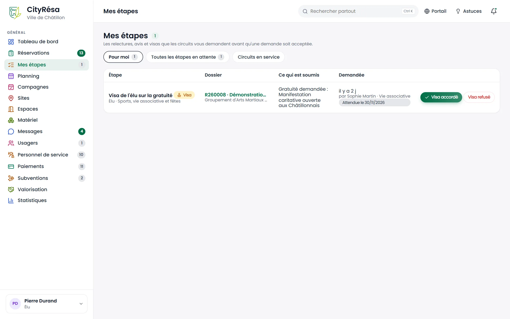
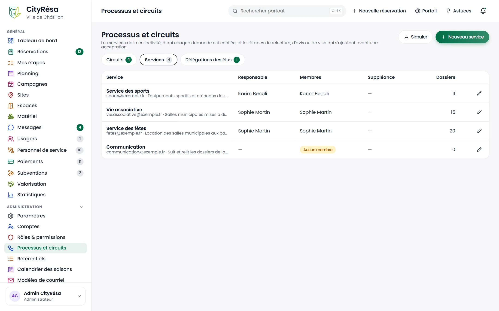
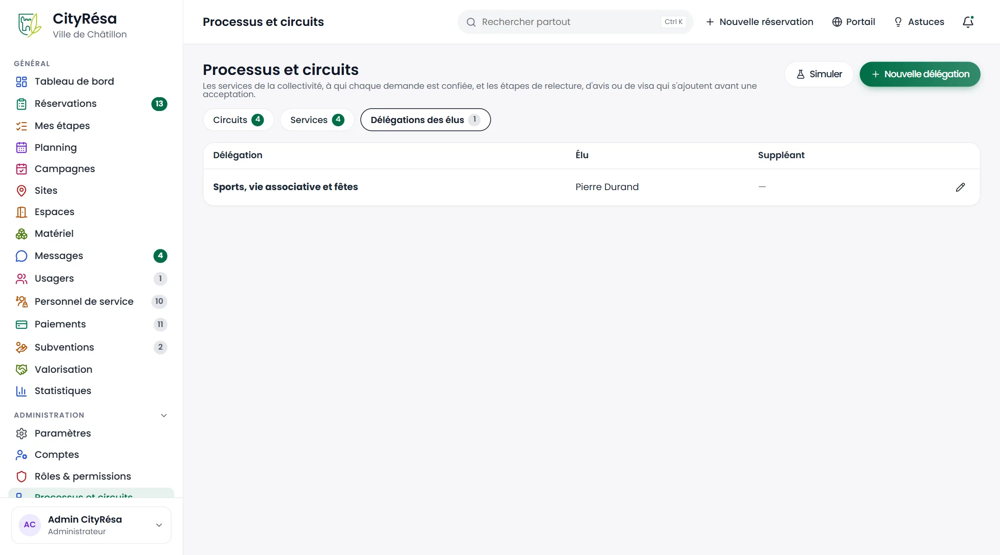
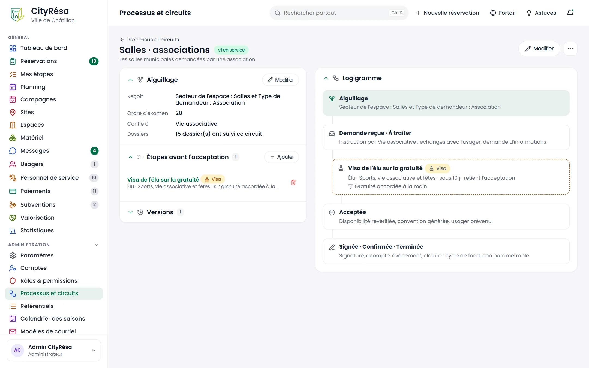
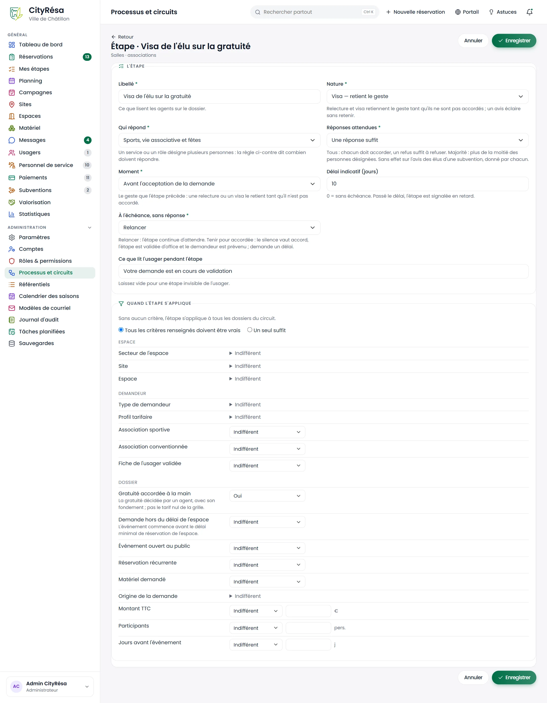

# 12. Processus et circuits

Ce chapitre présente le module **Processus et circuits** : les services de la collectivité, la règle qui confie chaque demande de réservation à l'un d'eux, et les étapes de relecture, d'avis ou de visa que la Ville ajoute avant une acceptation. La Ville décrit elle-même cette organisation et la modifie quand elle change, sans intervention technique. Le module s'active dans Administration › Paramètres › Modules (chapitre 9).

Le cycle d'un dossier (à traiter, acceptée, signée, confirmée, terminée) ne change pas : le module y **insère** des étapes, il ne le remplace pas. Il porte aujourd'hui sur les demandes de réservation.

## 12.1 Les notions

| Notion | Ce que c'est |
| --- | --- |
| **Service** | Un service de la Ville (Service des sports, Vie associative, Service des fêtes, Communication…), avec ses membres, son responsable et, au besoin, un service qui le supplée pendant une période. |
| **Délégation** | Le domaine d'un élu. Une étape s'adresse à une délégation, pas à une personne : l'élu peut changer sans toucher aux circuits. |
| **Circuit** | Pour un type de demandes : le service auquel elles sont confiées et les étapes qui précèdent leur acceptation. |
| **Règle d'aiguillage** | La condition qui fait qu'un circuit reçoit une demande (« une salle demandée par une association »). |
| **Étape** | Une relecture, un avis ou un visa, demandé à un service, à un élu ou à un rôle, sous condition ou toujours. |
| **Version** | Un circuit se modifie en brouillon, puis se publie. Un dossier garde la version avec laquelle il a commencé. |

Les trois natures d'étape :

| Nature | Effet |
| --- | --- |
| **Relecture** | Un second regard avant que la décision parte à l'usager. Retient l'acceptation. |
| **Visa** | Un accord préalable. Retient l'acceptation. |
| **Avis** | Un avis consultatif. Ne retient rien. |

## 12.2 Mes étapes

**À quoi ça sert** — Retrouver les relectures, avis et visas que l'on attend de vous, et y répondre.

**Qui** — Tous les agents, élus compris. Répondre à une étape ne demande aucun droit sur les réservations : il suffit d'être la personne attendue (membre du service, élu de la délégation, compte du rôle).

*Figure — « Mes étapes » de l'élu Pierre Durand : la gestionnaire veut accorder la gratuité à une association, le circuit demande son visa.*

**Ce que l'on voit**

- L'entrée **Mes étapes** du menu, avec le nombre d'étapes qui vous attendent.
- Trois onglets : **Pour moi**, **Toutes les étapes en attente** (pour suivre, sans pouvoir répondre à la place d'un autre) et **Circuits en service** (le logigramme de chaque circuit).
- Pour chaque étape : son libellé et sa nature, le dossier (numéro, objet, demandeur, espace, dates), **ce qui est soumis** (ce que l'agent a écrit en la demandant), qui l'a demandée et quand, et l'échéance s'il y en a une (en rouge quand elle est dépassée).

**Comment faire**

1. Cliquez sur le dossier pour le lire : vous y accédez même s'il ne relève pas de vos espaces.
2. Cliquez sur le bouton d'accord (**Visa accordé**, **Relu, bon pour envoi**, **Avis favorable**) ; un commentaire est possible.
3. Ou cliquez sur le bouton de refus (**Visa refusé**, **À revoir**, **Avis défavorable**) et indiquez le **Motif** : il est obligatoire et le service le lira sur le dossier.

**Règles à connaître**

- Une seule réponse suffit : la première personne attendue qui répond clôt l'étape.
- Vous êtes prévenu par la cloche quand une étape vous est demandée ; l'agent qui l'a demandée l'est quand vous répondez.
- Une étape ne s'attend plus sur un dossier refusé ou annulé.

*Figure — l'onglet « Circuits en service » : chaque circuit en logigramme, consultable par tous les agents.*

## 12.3 Le circuit sur la fiche d'un dossier

**À quoi ça sert** — Savoir à quel service le dossier est confié, quelles étapes son circuit lui impose et où elles en sont.

**Qui** — Tous les agents qui voient le dossier ; l'agent qui l'instruit demande les étapes.

*Figure — un dossier « À traiter » dont l'acceptation attend le visa de l'élu.*

**Ce que l'on voit** — Sous la carte de décision, la carte **Circuit** : le nom du circuit et sa version, le service auquel le dossier est confié, un bandeau jaune quand une étape retient l'acceptation, puis chaque étape applicable avec sa nature, son état (**À demander**, **En attente**, accordé, refusé), les personnes attendues, et le suivi (qui a demandé, quand, la réponse et son commentaire).

**Comment faire**

1. Instruisez le dossier comme d'habitude, puis cliquez sur **Approuver**.
2. Si le circuit prévoit une relecture ou un visa, le dossier **n'est pas accepté** : l'étape est demandée d'office, les personnes attendues sont prévenues et un message jaune vous le dit. Vous pouvez aussi demander une étape à l'avance avec son bouton **Demander**, en précisant ce que vous soumettez.
3. Quand la réponse arrive (cloche), rouvrez le dossier et cliquez de nouveau sur **Approuver**.
4. Si l'étape est refusée : corrigez le dossier puis **Redemander**, ou déclinez la demande.

**Règles à connaître**

- Une étape ne s'applique que si sa condition est vraie. Exemple du jeu de démonstration : le visa de l'élu n'est demandé que si l'agent accorde la gratuité ; approuver sans gratuité ne déclenche rien.
- Un avis part avec la première approbation mais ne la retient pas.
- Une réservation saisie directement « Acceptée » ou « Confirmée » par un agent, sur un espace sans validation ou par une campagne, naît « À traiter » si son circuit lui impose une relecture ou un visa.
- L'usager ne voit une étape que si elle porte un libellé qui lui est destiné (« Votre demande est en cours de validation »).
- Chaque demande et chaque réponse sont inscrites à l'historique du dossier.

## 12.4 Les services et les délégations

**À quoi ça sert** — Déclarer les services de la Ville et les délégations des élus, sur lesquels les circuits s'appuient.

**Qui** — Administrateurs (Administration › **Processus et circuits**).

*Figure — les quatre services du jeu de démonstration, avec leur responsable, leurs membres et le nombre de dossiers qui leur sont confiés.*

**Comment faire — un service**

1. Onglet **Services**, bouton **Nouveau service** (ou le crayon d'une ligne).
2. Saisissez le **Nom**, le **Courriel**, le **Téléphone**, choisissez le **Responsable** et cochez les **Membres** parmi les comptes du back-office. Un agent peut appartenir à plusieurs services.
3. Pour une **suppléance**, choisissez le service dans **Suppléé par** et indiquez les dates **Du** et **Au** : pendant la période, les membres du service suppléant reçoivent aussi ses étapes.
4. Cliquez sur **Enregistrer**.

*Figure — la délégation « Sports, vie associative et fêtes », confiée à Pierre Durand.*

**Comment faire — une délégation** — Onglet **Délégations des élus**, bouton **Nouvelle délégation** : l'**Intitulé**, l'**Élu** et, si besoin, son **Suppléant**, qui est sollicité avec lui.

**Règles à connaître**

- Un service sans membre ou une délégation sans élu ne peut pas recevoir d'étape : la publication d'un circuit qui s'adresse à lui est refusée.
- Appartenir à un service ne change pas les droits d'un agent (rôle, secteur, espaces) : cela détermine les étapes qu'il reçoit.

## 12.5 Les circuits

**À quoi ça sert** — Décrire, pour chaque famille de demandes, le service qui les reçoit et les étapes qui précèdent l'acceptation.

**Qui** — Administrateurs.

*Figure — les circuits du jeu de démonstration, dans leur ordre d'examen, et le circuit par défaut.*

**Ce que l'on voit** — Pour chaque circuit : son **Ordre**, son nom, ce qu'il **Reçoit** (sa règle d'aiguillage en clair), le **Service**, ses **Étapes** et sa **Version** (en service, brouillon en cours).

*Figure — la fiche d'un circuit : aiguillage, étapes, versions, et le logigramme à droite.*

**Comment faire — créer ou modifier un circuit**

1. Cliquez sur **Nouveau circuit**, ou ouvrez un circuit existant. Toute modification s'écrit dans un **brouillon** ; rien ne change pour les dossiers tant qu'il n'est pas publié.
2. Section **Aiguillage** › **Modifier** : choisissez le **service** et réglez la **règle**. Chaque critère est « Indifférent » par défaut ; ne renseignez que ceux qui comptent, et choisissez s'ils doivent tous être vrais ou si un seul suffit.
3. Section **Étapes avant l'acceptation** › **Ajouter** : le **Libellé**, la **Nature**, **Qui répond**, un **Délai indicatif**, ce que lit l'usager, et les critères de **Quand l'étape s'applique**.
4. Ordonnez les étapes avec les flèches ; la corbeille en retire une.
5. Vérifiez le **logigramme**, puis cliquez sur **Publier** et saisissez une note de version.

*Figure — la règle d'aiguillage : un réglage par critère, regroupés par espace, demandeur et dossier.*

*Figure — l'étape « Visa de l'élu sur la gratuité » : un visa demandé à la délégation, seulement si la gratuité est accordée à la main.*

**Les critères disponibles**

| Groupe | Critères |
| --- | --- |
| Espace | Secteur, site, espace |
| Demandeur | Type de demandeur, profil tarifaire, association sportive, association conventionnée, fiche validée |
| Dossier | Gratuité accordée à la main, demande hors du délai de l'espace, événement ouvert au public, réservation récurrente, matériel demandé, origine (portail ou back-office), montant, participants, jours avant l'événement |

**Qui peut répondre à une étape** — un service ; le service du dossier ; le responsable du service du dossier ; l'élu d'une délégation ; les comptes d'un rôle.

**Règles à connaître**

- À la création d'une demande, les circuits sont examinés dans l'**ordre** : le premier dont la règle est vraie la reçoit ; le **circuit par défaut** prend le reste. Il y en a un seul, sans règle.
- La publication est refusée tant qu'il reste une incohérence (étape sans libellé, service sans membre, délégation sans élu, circuit sans règle) : la fiche les liste.
- Les dossiers en cours **gardent la version** de leur circuit ; la nouvelle version s'applique aux demandes créées ensuite.
- **Abandonner le brouillon** revient à la version en service ; une version archivée se **reprend en brouillon**.
- Un circuit qu'un dossier a suivi ne se supprime pas : désactivez-le.
- À l'installation, un seul circuit existe, le **Circuit standard**, sans service ni étape : les demandes se traitent comme avant le module.

## 12.6 La simulation

**À quoi ça sert** — Vérifier, avant de publier, ce qui arriverait à un dossier.

**Qui** — Administrateurs.

*Figure — la simulation sur un dossier, comme si la gratuité était accordée : le circuit retenu, les circuits écartés et pourquoi, l'étape qui s'ouvrirait et la personne sollicitée.*

**Comment faire**

1. Cliquez sur **Simuler** et saisissez le numéro d'un dossier existant.
2. Cochez **Avec les brouillons** pour tester ce que vous n'avez pas encore publié, et **Comme si la gratuité était accordée** pour éprouver une étape qui en dépend.
3. Lisez le résultat : le circuit retenu et le service, chaque circuit examiné avec la raison de son sort, les étapes qui s'ouvriraient et les personnes sollicitées, et à droite tout ce que les règles lisent du dossier.

**Règles à connaître** — La simulation n'enregistre rien et n'envoie rien.
